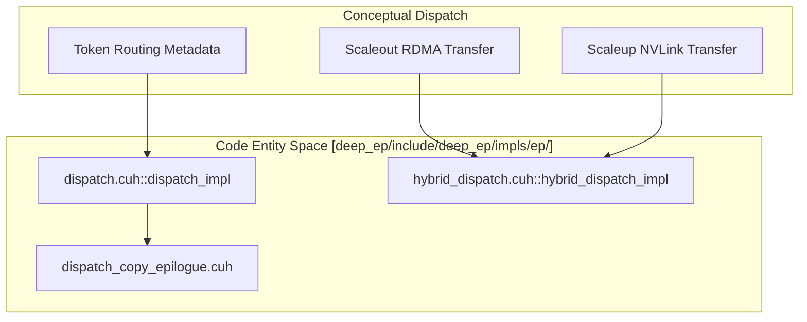
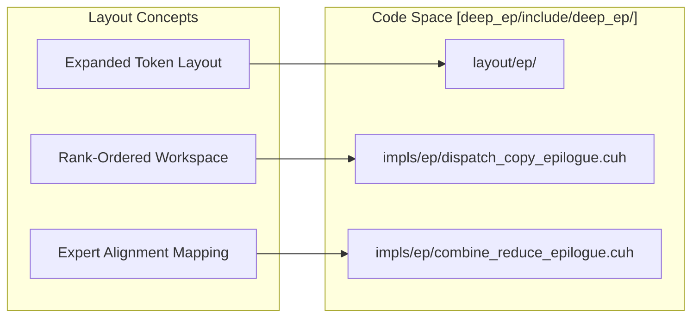

<!-- source: DeepWiki mcp.deepwiki.com · repo deepseek-ai/DeepEP · page 5.1 Expert-Parallel Kernels · fetched 2026-11-11 -->

# Expert-Parallel Kernels

Relevant source files

The following files were used as context for generating this wiki page:

- [csrc/indexing/main.cu](csrc/indexing/main.cu)

## Purpose and Scope

This page documents the Expert-Parallel (EP) kernel implementations located in `deep_ep/include/deep_ep/impls/ep/` and their corresponding memory layouts in `deep_ep/include/deep_ep/layout/ep/`. These header-only, JIT-compiled CUDA kernels implement high-performance token dispatch, token combination, weight prefetching, and gradient reduction for Mixture-of-Experts (MoE) workloads using the NCCL Gin backend and TMA/NVLink primitives.

Sources: [csrc/indexing/main.cu:15-24]()

---

## JIT Template Instantiation Pattern

DeepEP uses a Just-In-Time (JIT) compilation template pattern where EP kernels are instantiated from parameterized templates at runtime. This allows specialization for specific hidden dimensions, expert counts, and hardware resource allocations without pre-compiled binary bloat.

Key template parameters include:
- `kNumSMs`: Streaming Multiprocessors allocated to the kernel execution. [csrc/indexing/main.cu:15-24]()
- `kNumQPs`: Number of InfiniBand Queue Pairs for RDMA scaleout transfers. [csrc/indexing/main.cu:15-24]()
- `kNumExperts`: Total number of active/redundant experts in the layer. [csrc/indexing/main.cu:15-24]()
- `kNumTopk`: Number of routing choices selected per token. [csrc/indexing/main.cu:15-24]()
- `kHidden`: Token hidden dimension size. [csrc/indexing/main.cu:15-24]()

Sources: [csrc/indexing/main.cu:15-24]()

---

## Dispatch Kernels (`dispatch.cuh` & `hybrid_dispatch.cuh`)

The dispatch subsystem routes input tokens from local ranks to their assigned remote or local experts based on routing indices (`topk_idx`). 

### Warp Roles
Within `dispatch_impl` [csrc/indexing/main.cu:16-16]() and `hybrid_dispatch_impl` [csrc/indexing/main.cu:20-20](), warps are assigned specialized hardware roles:
- **Notify Warp**: Manages synchronization flags and metadata exchanges (such as token counts per expert) using atomic primitives across ranks.
- **Dispatch / Scaleout Warp**: Handles cross-node data movement over RDMA transports via the `ncclGin` interface.
- **Forward Warp**: Manages intra-node scale-up transfers over NVLink domains, often utilizing Tensor Memory Accelerator (TMA) instructions.

### Natural Language to Code Entity Mapping: Dispatch
The following diagram bridges conceptual dispatch tasks to their concrete implementations in `deep_ep/include/deep_ep/impls/ep/`.

Sources: [csrc/indexing/main.cu:16-20]()

---

## Combine Kernels (`combine.cuh` & `hybrid_combine.cuh`)

The combine phase reverses the dispatch routing, gathering processed tokens from experts back to their originating ranks.

- **Combine Implementation**: `combine_impl` [csrc/indexing/main.cu:17-17]() and `hybrid_combine_impl` [csrc/indexing/main.cu:21-21]() manage multi-cast and point-to-point data retrieval from experts.
- **Vectorization and Alignment**: Kernels utilize vector types (e.g., `int4` or specialized traits) to maximize memory throughput based on `kHidden` alignment.
- **Reduction Epilogue**: `combine_reduce_epilogue.cuh` [csrc/indexing/main.cu:19-19]() and `combine_utils.cuh` [csrc/indexing/main.cu:17-17]() handle token summation and bias addition across multiple expert outputs.

Sources: [csrc/indexing/main.cu:17-23]()

---

## Epilogues and Utilities (`dispatch_copy_epilogue`, `combine_reduce_epilogue`, `combine_utils`)

Specialized epilogue modules handle post-communication data layout transformations and reductions:
- **`dispatch_copy_epilogue.cuh`**: Moves received tokens from communication buffers into destination activation tensors, supporting expanded and non-expanded layouts [csrc/indexing/main.cu:18-18]().
- **`combine_reduce_epilogue.cuh`**: Performs reduction operations on incoming combined tokens before writing them back to model tensors [csrc/indexing/main.cu:19-19]().
- **`combine_utils.cuh`**: Provides shared math, vectorized data types, and summation helpers for combine kernels [csrc/indexing/main.cu:17-17]().

Sources: [csrc/indexing/main.cu:18-23]()

---

## Advanced EP Kernels: Weight Prefetching and Gradient Reduction (`prefetch_weights.cuh` & `reduce_grads.cuh`)

To support dynamic expert load balancing and redundant expert allocation:
- **`prefetch_weights.cuh`**: Implements weight prefetching over NVLink, allowing ranks to fetch replicated or load-balanced expert weights ahead of execution [csrc/indexing/main.cu:22-22]().
- **`reduce_grads.cuh`**: Handles backward pass gradient accumulation across redundant experts, performing FP32/FP16 reduction sweeps [csrc/indexing/main.cu:23-23]().

Sources: [csrc/indexing/main.cu:22-23]()

---

## Layout Architecture (`layout/ep`)

Expert-parallel layouts define how token tensors, expert buffers, and routing metadata are laid out in memory across ranks.

### Natural Language to Code Entity Mapping: Layouts
The following diagram connects layout abstractions to the codebase structure.

Sources: [csrc/indexing/main.cu:15-24]()

---

