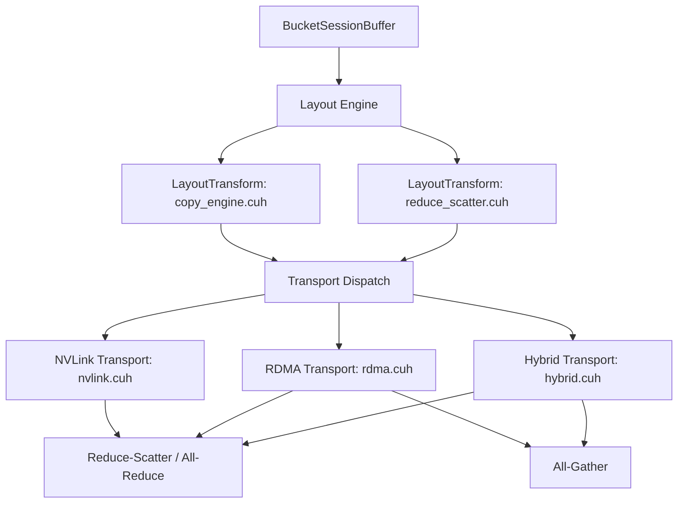

<!-- source: DeepWiki mcp.deepwiki.com · repo deepseek-ai/DeepEP · page 5.2 Bucket Collective Kernels · fetched 2026-11-11 -->

# Bucket Collective Kernels

Relevant source files

The following files were used as context for generating this wiki page:

- [csrc/indexing/main.cu](csrc/indexing/main.cu)

This page documents the bucket collective kernel layer in DeepEP (`impls/bucket/` and `layout/bucket/`), which provides optimized communication primitives—specifically `reduce_scatter`, `all_gather`, and `all_reduce`—operating across NVLink, RDMA, and hybrid transport topologies for tensor and context parallelism (CP/DP).

Sources: `csrc/indexing/main.cu:4-14`

---

## 1. Bucket Layout Architecture

The layout subsystem for bucket collectives defines how tensors are mapped, aligned, and moved through buffers during collective operations. 

- `reduce_scatter.cuh`: Manages chunking, sizing, and memory layout configurations for distributed reduce-scatter reductions across ranks.
- `copy_engine.cuh`: Implements high-throughput copy operations optimized for staging tensor chunks into bucket memory regions prior to network transmission or local reduction.

Sources: `csrc/indexing/main.cu:5-6`

---

## 2. Reduce-Scatter Transport Implementations

The reduce-scatter primitives combine local input tensors across participating ranks and scatter the reduced results such that each rank receives a distinct chunk. DeepEP provides three transport specializations:

- **NVLink (`nvlink.cuh`)**: Leverages high-bandwidth, low-latency NVLink interconnects within scale-up domains, utilizing direct load/store and atomic operations on symmetric memory windows.
- **RDMA (`rdma.cuh`)**: Coordinates multi-node scale-out transfers using InfiniBand/RoCE verbs, InfiniBand atomics, and Queue Pair (QP) management.
- **Hybrid (`hybrid.cuh`)**: Combines intra-node NVLink staging with inter-node RDMA transfers to optimize multi-node cluster performance without bottlenecking on inter-node links.

Sources: `csrc/indexing/main.cu:7-9`

---

## 3. All-Gather Transport Implementations

All-gather operations collect chunks from all ranks and distribute the concatenated result to every participant. DeepEP implements all-gather for scale-out and hybrid topologies:

- **RDMA (`rdma.cuh`)**: Orchestrates peer-to-peer RDMA read/write operations to pull or push data chunks across remote nodes.
- **Hybrid (`hybrid.cuh`)**: Uses NVLink for fast local intra-node broadcasting combined with RDMA transfers across nodes to minimize network traversal overhead.

Sources: `csrc/indexing/main.cu:10-11`

---

## 4. All-Reduce Transport Implementations

All-reduce aggregates tensor data across all ranks so that every rank receives the fully reduced output.

- **NVLink (`nvlink.cuh`)**: Executes hierarchical or ring-based all-reduces entirely within the scale-up domain using symmetric memory and CUDA atomics.
- **RDMA (`rdma.cuh`)**: Implements multi-node all-reduce using network-level reduction capabilities or explicit scatter-reduce-gather phases over InfiniBand transports.

Sources: `csrc/indexing/main.cu:12-13`

---

## 5. Architectural Data Flow

The following diagram illustrates how bucket collective operations map from high-level layout transformations to transport-specific kernel implementations.

Sources: `csrc/indexing/main.cu:4-14`, `deep_ep/layout/bucket/copy_engine.cuh`, `deep_ep/layout/bucket/reduce_scatter.cuh`

---

