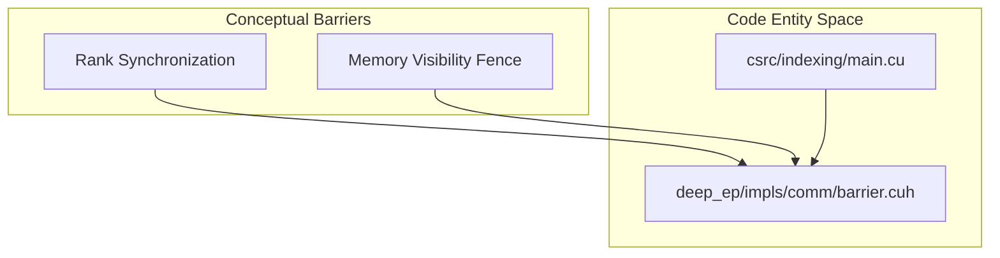
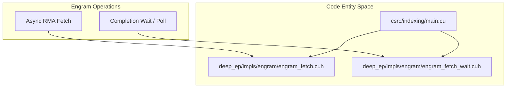
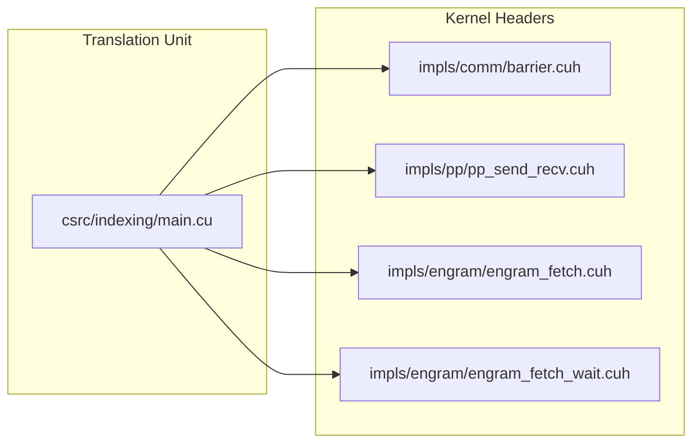

<!-- source: DeepWiki mcp.deepwiki.com · repo deepseek-ai/DeepEP · page 5.3 Engram, PP and Barrier Kernels · fetched 2026-11-11 -->

# Engram, PP and Barrier Kernels

Relevant source files

The following files were used as context for generating this wiki page:

- [csrc/indexing/main.cu](csrc/indexing/main.cu)

## Purpose and Scope

This section covers the specialized CUDA header-only synchronization and communication kernels implemented in DeepEP: the Engram remote memory access (RMA) fetch and wait kernels (`impls/engram/engram_fetch.cuh` and `impls/engram/engram_fetch_wait.cuh`), the Pipeline Parallelism (PP) send and receive communication primitives (`impls/pp/pp_send_recv.cuh`), and the low-level barrier synchronization primitives (`impls/comm/barrier.cuh`). These kernels provide the underlying synchronization and data movement foundations for non-standard parallelism modes, multi-layer caching, and inter-rank coordination beyond standard expert-parallel dispatch and combine.

Sources: `csrc/indexing/main.cu:1-34`

---

## Barrier Synchronization Primitives

The barrier communication primitives reside in `impls/comm/barrier.cuh` and are indexed via `csrc/indexing/main.cu` [csrc/indexing/main.cu:2-2](). They handle inter-rank and inter-block synchronization across different execution phases.

### Core Mechanics
* **Inter-Block and Inter-Rank Sync:** Coordinates execution flags and memory visibility across distributed GPU nodes using hardware-accelerated fences and atomic updates.
* **Integration with NCCL Gin Context:** Works alongside symmetric memory windows and queue pairs to guarantee that dependent asynchronous memory operations complete before downstream consumers proceed.

*Figure 1: Mapping barrier concepts to code entities.*

Sources: `csrc/indexing/main.cu:2-3`

---

## Engram Fetch and Wait Kernels

The Engram buffer architecture relies on `impls/engram/engram_fetch.cuh` and `impls/engram/engram_fetch_wait.cuh` [csrc/indexing/main.cu:29-30]() to manage multi-layer GPU/CPU RMA storage operations, enabling asynchronous writes and fetches with per-layer hooks.

### Implementation Details
* **`engram_fetch.cuh`:** Initiates asynchronous data retrieval from remote or cached RMA memory regions across multi-layer storage hierarchies. It leverages low-level GPU communication engines to pull weights or activation states without blocking the main compute stream.
* **`engram_fetch_wait.cuh`:** Provides the synchronization counterparts that block or poll until the initiated Engram fetches complete. It ensures memory consistency before downstream layers consume the fetched weights or data.

*Figure 2: Engram fetch and wait kernel architecture.*

Sources: `csrc/indexing/main.cu:28-31`

---

## Pipeline Parallelism Send/Recv Kernels

Pipeline parallelism (PP) communication primitives are implemented in `impls/pp/pp_send_recv.cuh` [csrc/indexing/main.cu:26-26]() and back the `PPBuffer` class family for RDMA-only ring groups.

### Characteristics
* **Ring-Group Data Transfer:** Facilitates peer-to-peer tensor transfers between adjacent or remote pipeline stages over high-speed RDMA transports.
* **Streamlined Latency:** Minimizes CPU overhead by driving point-to-point communication directly from optimized CUDA kernel routines, bypassing heavy runtime scheduling layers where possible.

Sources: `csrc/indexing/main.cu:25-27`

---

## Compilation and Translation Unit Integration

All synchronization and specialized communication kernels are included in the primary IDE and JIT indexing translation unit, `csrc/indexing/main.cu`, ensuring proper template instantiation, syntax checking, and symbol visibility during DeepJIT compilation.

*Figure 3: Inclusion graph for synchronization and specialized kernels.*

Sources: `csrc/indexing/main.cu:1-34`

---

