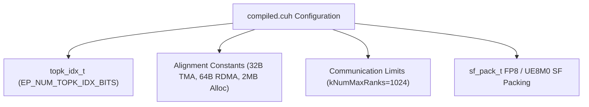
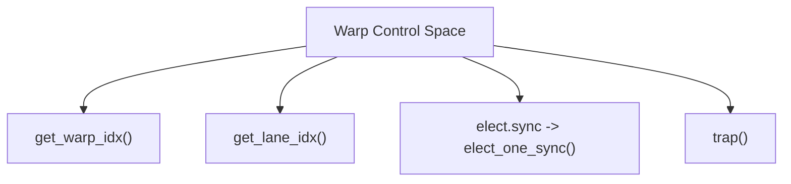
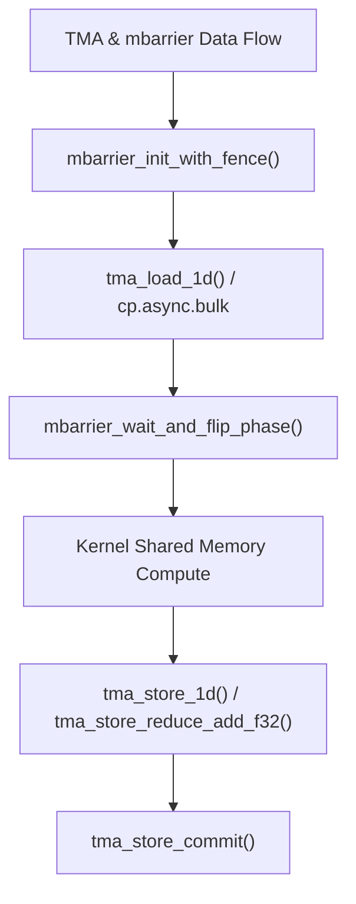
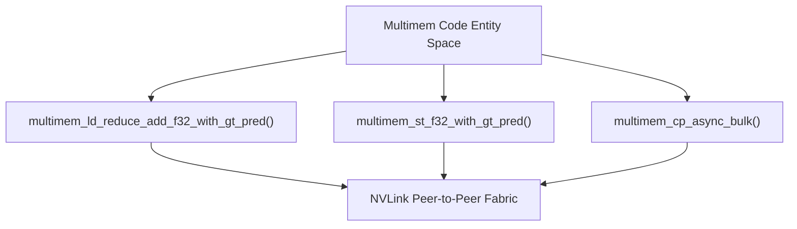

<!-- source: DeepWiki mcp.deepwiki.com · repo deepseek-ai/DeepEP · page 5.4 PTX Primitives and Common Headers · fetched 2026-11-11 -->

# PTX Primitives and Common Headers

Relevant source files

The following files were used as context for generating this wiki page:

- [deep_ep/include/deep_ep/common/compiled.cuh](deep_ep/include/deep_ep/common/compiled.cuh)
- [deep_ep/include/deep_ep/common/ptx.cuh](deep_ep/include/deep_ep/common/ptx.cuh)

This section details the low-level hardware abstraction layer provided by `deep_ep/include/deep_ep/common/ptx.cuh` and `deep_ep/include/deep_ep/common/compiled.cuh`. These headers expose optimized PTX inline assembly, CUDA asynchronous execution mechanisms (such as Tensor Memory Accelerator and `mbarrier`), NVLink `multimem` collectives, thread election routines, and compile-time constants required across DeepEP's kernel implementations.

---

## 1. Compilation Setup and Global Constants (`compiled.cuh`)

The `compiled.cuh` header manages host/device cross-compilation configurations, IDE indexing compatibility (e.g., CLion definitions), PyTorch type restrictions, and fundamental alignment/communication limits used across DeepEP.

Key configuration aspects defined in `compiled.cuh`:
- **Top-K Index Bitwidth**: Configures `topk_idx_t` based on `EP_NUM_TOPK_IDX_BITS` (defaulting to 64-bit integer routing indices) [deep_ep/include/deep_ep/common/compiled.cuh:45-58].
- **Scale-Factor Packs**: Defines `sf_pack_t` unions for FP8/quantization tile packing [deep_ep/include/deep_ep/common/compiled.cuh:59-64].
- **Alignment Rules**: Enforces strict memory boundaries for TMA (`kNumTMAAlignmentBytes` = 32), RDMA (`kNumRDMAAlignmentBytes` = 64), and symmetric buffer allocations (`kNumAllocationAlignmentBytes` = 2 MB) [deep_ep/include/deep_ep/common/compiled.cuh:66-72].
- **Communication Limits**: Establishes upper bounds on ranks (`kNumMaxRanks` = 1024), contexts, QPs, and signal sizes [deep_ep/include/deep_ep/common/compiled.cuh:73-83].

Sources: `deep_ep/include/deep_ep/common/compiled.cuh:1-85`

---

## 2. Warp and Execution Control Primitives (`ptx.cuh`)

`deep_ep/include/deep_ep/common/ptx.cuh` implements warp-level intrinsics and thread control wrappers.

- **`trap()`**: Triggers an unconditional execution trap via assembly [deep_ep/include/deep_ep/common/ptx.cuh:17-20].
- **`get_warp_idx()` and `get_lane_idx()`**: Determines local thread coordinates within a block and warp using shuffle and register move instructions [deep_ep/include/deep_ep/common/ptx.cuh:22-31].
- **`elect_one_sync()`**: Executes the PTX `elect.sync` instruction to select a single leader thread within a predicated warp mask [deep_ep/include/deep_ep/common/ptx.cuh:33-46].

Sources: `deep_ep/include/deep_ep/common/ptx.cuh:17-46`

---

## 3. Asynchronous Barriers and TMA Operations

DeepEP heavily leverages Hopper's Tensor Memory Accelerator (TMA) and hardware `mbarrier` primitives for asynchronous global-to-shared memory data movement.

### Mbarrier Functions
- **`mbarrier_init_with_fence()`**: Initializes shared memory barriers with an arrival count and issues a cluster-scoped release fence [deep_ep/include/deep_ep/common/ptx.cuh:49-53].
- **`mbarrier_arrive()` / `mbarrier_arrive_and_set_tx()`**: Signals completion or expected incoming byte counts on an `mbarrier` object [deep_ep/include/deep_ep/common/ptx.cuh:60-68].
- **`mbarrier_wait_and_flip_phase()`**: Spins on `mbarrier.try_wait.parity` until the expected phase completes, then flips the local phase bit [deep_ep/include/deep_ep/common/ptx.cuh:70-83].

### TMA and Bulk Data Movement
- **`st_bulk`**: Performs weak bulk stores into shared memory or falls back to parallel lane stores on pre-Hopper architectures [deep_ep/include/deep_ep/common/ptx.cuh:85-101].
- **`tma_load_1d()` / `tma_store_1d()`**: Wraps `cp.async.bulk` operations utilizing `L2CacheHint` (`kEvictFirst`, `kEvictNormal`) to control cache persistence during streaming data movement [deep_ep/include/deep_ep/common/ptx.cuh:117-146].
- **`tma_store_reduce_add_f32()`**: Issues asynchronous reduction-store operations (`cp.reduce.async.bulk.global`) for accumulating FP32 gradients or features directly to global memory [deep_ep/include/deep_ep/common/ptx.cuh:148-156].

Sources: `deep_ep/include/deep_ep/common/ptx.cuh:49-160`

---

## 4. Multimem and NVLink Collectives

For high-bandwidth peer-to-peer operations across the NVLink scaleup domain, `ptx.cuh` provides bindings to `multimem` instructions. These allow single instructions to atomically load, reduce, or multicast across multiple peer memory addresses simultaneously.

- **`multimem_ld_reduce_add_f32_with_gt_pred()`**: Executes `multimem.ld_reduce.relaxed.gpu.global.add.v4.f32` guarded by a predicate check (`setp.gt.s32`) [deep_ep/include/deep_ep/common/ptx.cuh:162-174].
- **`multimem_st_f32_with_gt_pred()`**: Performs a multicast store across NVLink peers using `multimem.st.relaxed.gpu.global.v4.f32` [deep_ep/include/deep_ep/common/ptx.cuh:176-186].
- **`multimem_cp_async_bulk()`**: Initiates asynchronous bulk copies via multimem endpoints [deep_ep/include/deep_ep/common/ptx.cuh:188-189].

Sources: `deep_ep/include/deep_ep/common/ptx.cuh:162-189`

---

## 5. Exception Handling and Common Utilities

Complementing `ptx.cuh` and `compiled.cuh`, `exception.cuh` provides assertions, error-checking macros, and runtime exception propagation wrappers that integrate CUDA driver error codes with Python bindings.

Sources: `deep_ep/include/deep_ep/common/compiled.cuh:1-85`, `deep_ep/include/deep_ep/common/ptx.cuh:1-189`

---

