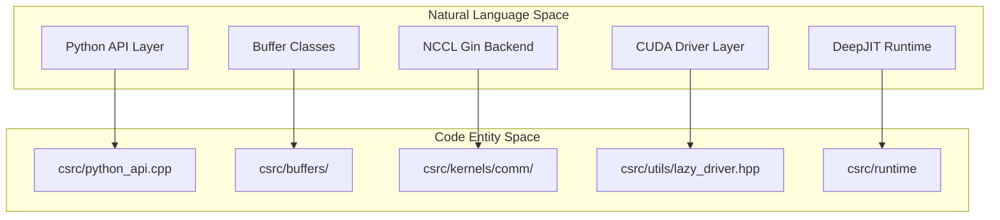
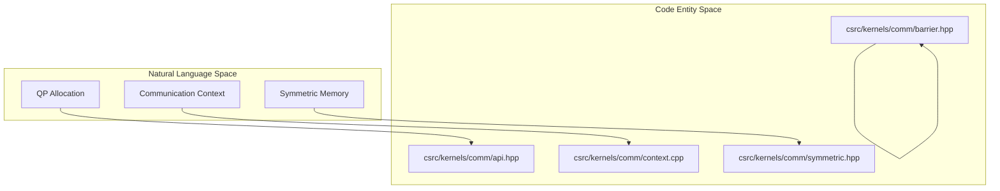

<!-- source: DeepWiki mcp.deepwiki.com · repo deepseek-ai/DeepEP · page 6 C++ Runtime and Backend · fetched 2026-11-11 -->

# C++ Runtime and Backend

Relevant source files

The following files were used as context for generating this wiki page:

- [csrc/CMakeLists.txt](csrc/CMakeLists.txt)
- [csrc/kernels/CMakeLists.txt](csrc/kernels/CMakeLists.txt)

The C++ runtime and backend layer bridges Python APIs and native CUDA execution in DeepEP. Located primarily under `csrc/`, this layer manages buffer life cycles, Pybind11 bindings, NCCL Gin communication contexts, lazy CUDA driver loading, and JIT compilation infrastructure [csrc/CMakeLists.txt:1](), [csrc/kernels/CMakeLists.txt:1-14]().

**C++ Runtime Architecture**

Sources: [csrc/CMakeLists.txt:1](), [csrc/kernels/CMakeLists.txt:1-14]()

## 6.1 Buffer C++ Classes and python_api

The buffer management classes define the underlying C++ structures for expert parallelism, buckets, engrams, and pipeline parallelism. These classes interface with Python via Pybind11 registration to map high-level tensor operations directly to JIT-compiled kernel launches.

For details, see [Buffer C++ Classes and python_api](#6.1).

Sources: [csrc/CMakeLists.txt:1]()

## 6.2 NCCL Gin Backend and Symmetric Memory

The NCCL Gin communication backend manages distributed communication contexts, communicator creation and reuse, symmetric memory window allocation, InfiniBand Queue Pair (QP) management, and RDMA service levels. 

**Communication and Backend Architecture**

Sources: [csrc/kernels/CMakeLists.txt:1-14]()

For details, see [NCCL Gin Backend and Symmetric Memory](#6.2).

## 6.3 CUDA Driver Layer

The CUDA driver subsystem provides lazy `dlopen`/`dlsym` binding of `libcuda.so.1` using specialized macros and driver wrapper functions. This allows DeepEP to interact with low-level CUDA virtual memory and IPC primitives without requiring hard linkage against the driver stub at build time.

For details, see [CUDA Driver Layer](#6.3).

Sources: [csrc/kernels/CMakeLists.txt:11-14]()

## 6.4 JIT Compilation with DeepJIT

DeepEP integrates the DeepJIT submodule (`third-party/deep_jit`) with the `csrc/runtime` module to compile and instantiate CUDA kernel templates dynamically. This layer handles cache directories (`EP_JIT_CACHE_DIR`), debug environment variables, and translation units like `csrc/indexing/main.cu` that serve IDE indexing and runtime compilation needs.

For details, see [JIT Compilation with DeepJIT](#6.4).

Sources: [csrc/CMakeLists.txt:1]()

---

