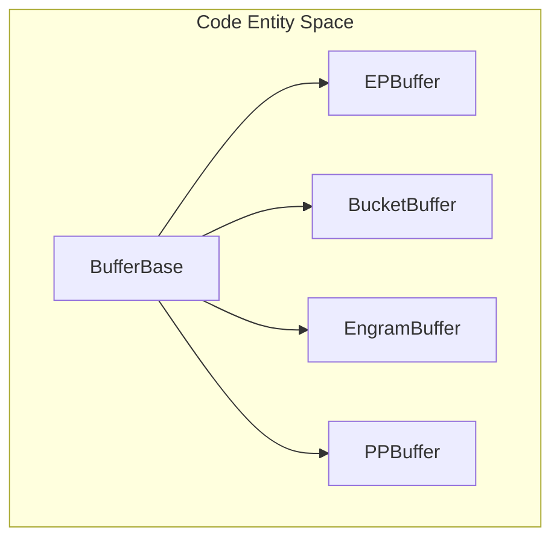
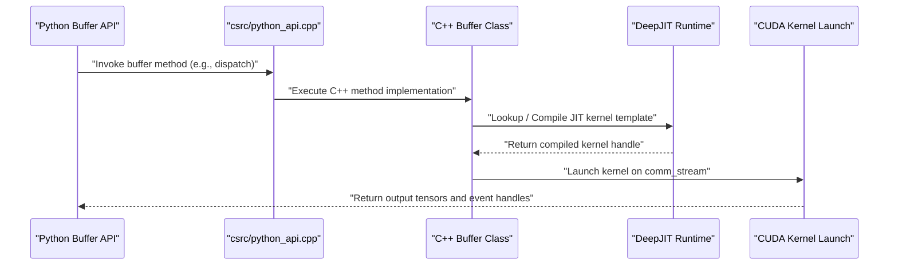

<!-- source: DeepWiki mcp.deepwiki.com · repo deepseek-ai/DeepEP · page 6.1 Buffer C++ Classes and python_api · fetched 2026-11-11 -->

# Buffer C++ Classes and python_api

Relevant source files

The following files were used as context for generating this wiki page:

- [csrc/indexing/main.cu](csrc/indexing/main.cu)
- [deep_ep/__init__.py](deep_ep/__init__.py)

## Purpose and Scope

This page documents the C++ buffer class hierarchy (`csrc/buffers/base.hpp`, `csrc/buffers/ep.hpp`, `csrc/buffers/bucket.hpp`, `csrc/buffers/engram.hpp`, and `csrc/buffers/pp.hpp`) and their registration in `csrc/python_api.cpp` using pybind11. These classes form the low-level execution engine of DeepEP, mapping high-level Python buffer methods (`EPBuffer`, `BucketBuffer`, `EngramBuffer`, `PPBuffer`) to Just-In-Time (JIT) compiled CUDA kernels, symmetric memory spaces, and NCCL Gin communication primitives.

---

## C++ Buffer Class Hierarchy

DeepEP organizes its communication and tensor staging memory around a base class abstraction (`BufferBase`) and specialized subclass implementations tailored to specific distributed parallelism primitives.

*Sources: [deep_ep/buffers/base.py](), [deep_ep/buffers/ep.py](), [deep_ep/buffers/bucket.py](), [deep_ep/buffers/engram.py](), [deep_ep/buffers/pp.py]()*

### Class Responsibilities
* **`BufferBase` (`csrc/buffers/base.hpp`)**: Manages lifetime, device contexts, symmetric memory allocations via the NCCL Gin backend, and communication streams.
* **`EPBuffer` (`csrc/buffers/ep.hpp`)**: Coordinates Expert Parallelism (EP) token routing, dispatch, combine, expert weight prefetching, and gradient reduction [deep_ep/__init__.py:64]().
* **`BucketBuffer` (`csrc/buffers/bucket.hpp`)**: Implements collective communication primitives for Context Parallelism (CP) and Data Parallelism (DP), including `all_gather`, `reduce_scatter`, and `all_reduce` [deep_ep/__init__.py:66]().
* **`EngramBuffer` (`csrc/buffers/engram.hpp`)**: Manages multi-layer GPU/CPU Remote Memory Access (RMA) storage for KV caching [deep_ep/__init__.py:65]().
* **`PPBuffer` (`csrc/buffers/pp.hpp`)**: Manages point-to-point pipeline parallel send and receive operations in RDMA-only ring topologies [deep_ep/__init__.py:67]().

---

## Python API Registration (`csrc/python_api.cpp`)

The pybind11 bindings in `csrc/python_api.cpp` expose the C++ buffer classes and runtime initialization functions to Python. The initialization routine `init_jit` compiles and loads kernels dynamically using `deep_ep._C` [deep_ep/__init__.py:44-51]().

*Sources: [deep_ep/__init__.py:44-51](), [csrc/indexing/main.cu:1-35]*

### Pybind11 Binding Structure
The extension module exposes:
1. JIT runtime initialization (`init_jit`) [deep_ep/__init__.py:51]().
2. Alignment query helpers (`get_num_allocation_alignment`, `get_num_rdma_alignment`, `get_num_tma_alignment`) [deep_ep/__init__.py:72-76]().
3. Buffer constructors and member functions for `EPBuffer`, `BucketBuffer`, `EngramBuffer`, and `PPBuffer`.

---

## Data Flow: Python to JIT Kernel Execution

*Sources: [deep_ep/__init__.py:44-51](), [csrc/indexing/main.cu:1-35]*

---

## Sources

* `deep_ep/__init__.py` [deep_ep/__init__.py:1-79]()
* `csrc/indexing/main.cu` [csrc/indexing/main.cu:1-34]()
* `deep_ep/buffers/base.py`
* `deep_ep/buffers/ep.py`
* `deep_ep/buffers/bucket.py`
* `deep_ep/buffers/engram.py`
* `deep_ep/buffers/pp.py`

---

