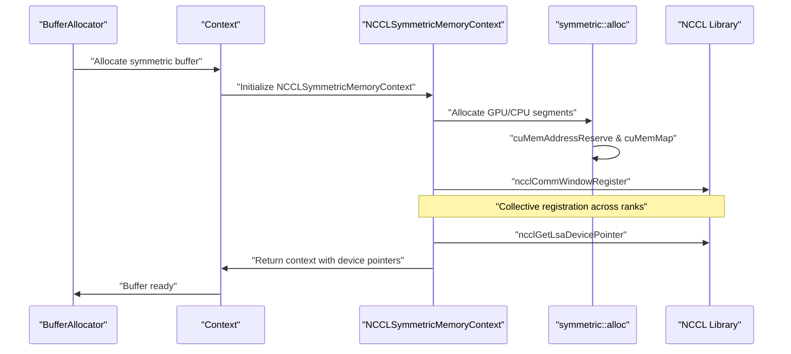
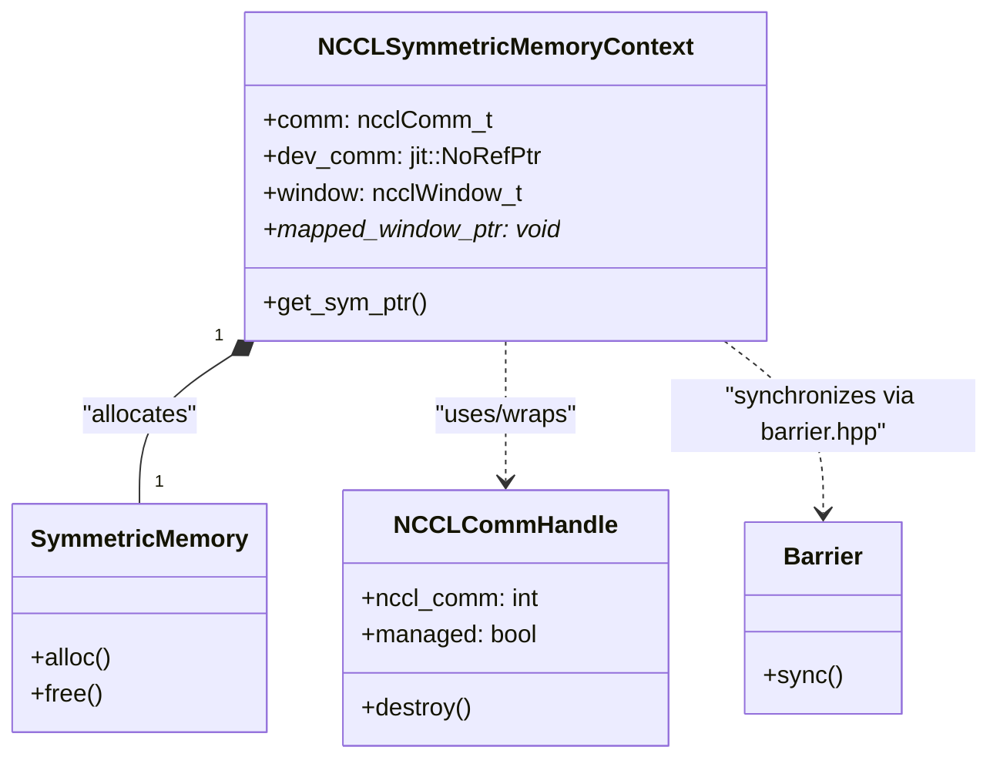

<!-- source: DeepWiki mcp.deepwiki.com · repo deepseek-ai/DeepEP · page 6.2 NCCL Gin Backend and Symmetric Memory · fetched 2026-11-11 -->

# NCCL Gin Backend and Symmetric Memory

Relevant source files

The following files were used as context for generating this wiki page:

- [csrc/kernels/CMakeLists.txt](csrc/kernels/CMakeLists.txt)
- [deep_ep/__init__.py](deep_ep/__init__.py)

## Purpose and Scope

This page documents the NCCL Gin backend and symmetric memory subsystem in DeepEP, located in `csrc/kernels/comm/` (`api.hpp`, `barrier.hpp`, `context.cpp`, `symmetric.hpp`) and `csrc/comm/`. It covers NCCL communicator creation and reuse, symmetric window allocation, Queue Pair (QP) allocation, RDMA service levels, and domain size queries.

Sources: [deep_ep/__init__.py:1-79](), [csrc/kernels/CMakeLists.txt:1-14]()

---

## NCCL Symmetric Memory Management and Context

The core of the communication backend is the symmetric memory abstraction and the NCCL communication context (`context.cpp`), which manages cross-node memory visibility, device communicators, and window registration.

### NCCLSymmetricMemoryContext

Managed via C++ and exposed through bindings, this structure coordinates NCCL communicators, memory windows, and transport configuration.

| Function / Component | Role |
|---|---|
| `NCCLSymmetricMemoryContext` | Initializes device communicators, registers symmetric memory windows, and sets up QPs. |
| `get_sym_ptr` | Calculates the device pointer for a specific rank's symmetric memory window by offset. |
| Communicator creation/reuse | Integrates with NCCL and PyTorch to create or reuse communicators. |

Sources: [deep_ep/__init__.py:60-67]()

### Memory Allocation and Symmetric Windows

DeepEP uses NCCL's symmetric memory features and CUDA virtual memory management (VMM) to allocate contiguous, registerable memory windows across GPUs and CPU RAM.

**Diagram: NCCL Window Allocation Flow**

Sources: [deep_ep/__init__.py:60-67]()

---

## Domain Size and Topology

DeepEP distinguishes between **Physical** and **Logical** domains to support hierarchical topologies (NVLink + RDMA). 

| Function | Description |
|---|---|
| `get_physical_domain_size` | Returns physical topology dimensions (`num_rdma_nodes`, `num_nvl_ranks_per_node`). |
| `get_logical_domain_size` | Returns logical domain sizes (`num_scaleout_ranks`, `num_scaleup_ranks`) based on hybrid mode configuration. |

Sources: [deep_ep/__init__.py:61-61]()

---

## QP Allocation and RDMA Service Levels

The NCCL Gin backend configures Queue Pairs (QPs) and InfiniBand Service Levels (`sl_idx`) via NCCL properties:
- `ginContextCount`: Allocated based on `num_allocated_qps`.
- `ginQueueDepth`: Configured to `kGinQPDepth`.
- `ginTrafficClass`: Mapped to the InfiniBand Service Level (`sl_idx`).
- `ginSignalCount`: Configured for customized RDMA barriers (`barrier.hpp`).

Sources: [deep_ep/__init__.py:72-77]()

---

## Bridge Diagram: Natural Language Space to Code Entity Space

To connect conceptual entities to code implementations in `csrc/kernels/comm/`:

Sources: [deep_ep/__init__.py:60-67]()

---

