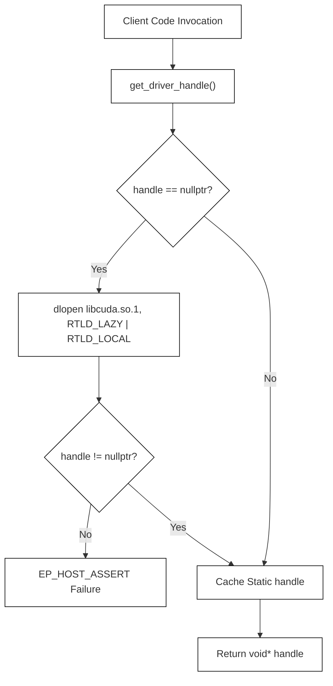
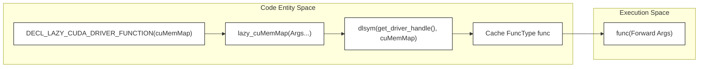

<!-- source: DeepWiki mcp.deepwiki.com · repo deepseek-ai/DeepEP · page 6.3 CUDA Driver Layer · fetched 2026-11-11 -->

# CUDA Layer

Relevant source files

The following files were used as context for generating this wiki page:

- [csrc/utils/lazy_driver.hpp](csrc/utils/lazy_driver.hpp)

## Purpose and Scope

The CUDA Driver Layer, implemented in `csrc/utils/lazy_driver.hpp`, provides a zero-link-time dependency mechanism for binding the CUDA Driver API (`libcuda.so.1`) at runtime. By utilizing dynamic loading via `dlopen` and `dlsym`, DeepEP avoids direct link dependencies on the CUDA driver library, ensuring robust binary portability across varied execution environments and CUDA driver versions. This layer defines static helper functions and macros that wrap CUDA Virtual Memory Management (VMM), module loading, context management, and stream operations.

Sources: [csrc/utils/lazy_driver.hpp:1-60]()

---

## 1. Lazy Loading Infrastructure

To prevent hard-linked dependencies on `libcuda.so.1`, the codebase initializes the driver library handle on demand through the `get_driver_handle()` function [csrc/utils/lazy_driver.hpp:11-18](). 

The `get_driver_handle()` routine uses a local static variable to ensure `dlopen` is executed exactly once per process. It attempts to load `libcuda.so.1` with `RTLD_LAZY | RTLD_LOCAL` flags and triggers a host-side assertion (`EP_HOST_ASSERT`) if the handle resolution fails [csrc/utils/lazy_driver.hpp:13-16]().

*Diagram 1: Runtime Resolution Flow of `get_driver_handle()` [csrc/utils/lazy_driver.hpp:11-18]().*

Sources: [csrc/utils/lazy_driver.hpp:11-18]()

---

## 2. The `DECL_LAZY_CUDA_DRIVER_FUNCTION` Macro

Symbol resolution is automated using the `DECL_LAZY_CUDA_DRIVER_FUNCTION` macro [csrc/utils/lazy_driver.hpp:24-34](). This macro constructs a template wrapper function prefixed with `lazy_` that matches the signature of the target CUDA driver entry point.

On its initial invocation, the wrapper checks if the resolved function pointer is `nullptr`. If uninitialized, it queries `dlsym` using `get_driver_handle()` and stringifies the API name via `EP_CUDA_STRINGIFY` [csrc/utils/lazy_driver.hpp:28-32](). Subsequent calls bypass the `dlsym` lookup overhead by executing the cached function pointer directly.

*Diagram 2: Macro Expansion and Caching Architecture in `DECL_LAZY_CUDA_DRIVER_FUNCTION` [csrc/utils/lazy_driver.hpp:24-34]().*

Sources: [csrc/utils/lazy_driver.hpp:20-34]()

---

## 3. Bound CUDA Driver API Surface

The header explicitly binds a targeted subset of the CUDA driver API required for advanced virtual memory management, IPC sharing, module execution, and stream batching operations. 

The complete list of bound driver functions includes:
* **Error Handling & Contexts**: `cuGetErrorName`, `cuGetErrorString`, `cuCtxGetDevice`, `cuDeviceGet`, `cuDeviceGetAttribute` [csrc/utils/lazy_driver.hpp:36-57]().
* **Module & Kernel Management**: `cuFuncSetAttribute`, `cuModuleLoad`, `cuModuleUnload`, `cuModuleGetFunction`, `cuLaunchKernelEx` [csrc/utils/lazy_driver.hpp:38-42]().
* **Virtual Memory Management (VMM)**: `cuMemSetAccess`, `cuMemRetainAllocationHandle`, `cuMemGetAddressRange_v2`, `cuMemAddressReserve`, `cuMemAddressFree`, `cuMemMap`, `cuMemUnmap`, `cuMemCreate`, `cuMemRelease`, `cuMemImportFromShareableHandle`, `cuMemExportToShareableHandle`, `cuMemGetAllocationGranularity` [csrc/utils/lazy_driver.hpp:43-55]().
* **Stream Operations**: `cuStreamBatchMemOp` [csrc/utils/lazy_driver.hpp:58]().

Sources: [csrc/utils/lazy_driver.hpp:36-59]()

---

