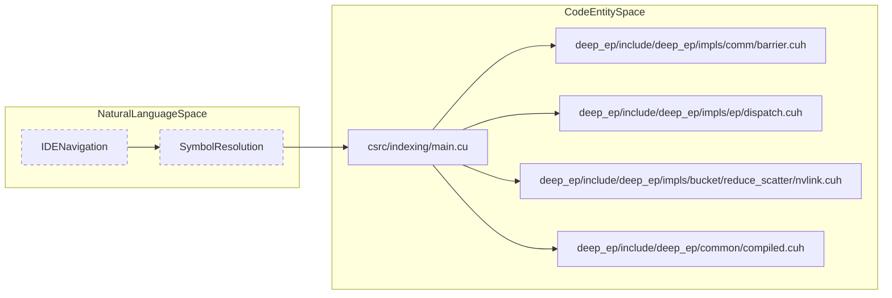

<!-- source: DeepWiki mcp.deepwiki.com · repo deepseek-ai/DeepEP · page 6.4 JIT Compilation with DeepJIT · fetched 2026-11-11 -->

# JIT Compilation with DeepJIT

Relevant source files

The following files were used as context for generating this wiki page:

- [.gitmodules](.gitmodules)
- [csrc/indexing/main.cu](csrc/indexing/main.cu)
- [deep_ep/include/deep_ep/common/compiled.cuh](deep_ep/include/deep_ep/common/compiled.cuh)

The JIT (Just-In-Time) compilation subsystem in DeepEP uses the DeepJIT submodule (`third-party/deep_jit`) to enable high-performance CUDA kernel specialization at runtime. Instead of relying on pre-compiled binaries for every permutation of expert counts, SM configurations, block sizes, and data types, DeepEP compiles header-only implementations on-demand via NVRTC. This leaf page describes the DeepJIT submodule integration, runtime initialization via `init_jit`, caching mechanisms governed by `EP_JIT_CACHE_DIR`, debugging environment variables, and `csrc/indexing/main.cu` as the IDE-indexing translation unit.

---

### 1. DeepJIT Submodule and Architecture Overview

The DeepJIT framework is integrated as a Git submodule under `third-party/deep_jit` [.-gitmodules:1-4](). It provides the underlying compiler infrastructure, caching logic, and template instantiation utilities that translate Python-level tensor parameters and configurations into specialized `.cubin` artifacts.

```mermaid
graph TD
    subgraph "NaturalLanguageSpace"
        A["PythonJITRequest"] --> B["DeepJITSubmoduleEngine"]
        B --> C["NVRTCCompilation"]
        C --> D["DeviceKernelExecution"]
    end

    subgraph "CodeEntitySpace"
        E["deep_ep/__init__.py"] -- "Invokes" --> F["init_jit"]
        F --> G["third-party/deep_jit"]
        G --> H["deep_ep/include/deep_ep/impls/*.cuh"]
        H --> I["csrc/indexing/main.cu"]
    end

    style A stroke-dasharray: 5 5
    style B stroke-dasharray: 5 5
    style C stroke-dasharray: 5 5
    style D stroke-dasharray: 5 5
```

Sources: `.gitmodules:1-4](), `csrc/indexing/main.cu:1-35`()

---

### 2. Environment Variables and Caching

The JIT compiler behavior, caching directories, and diagnostic flags are controlled via specific environment variables:

| Environment Variable | Description |
| :--- | :--- |
| `EP_JIT_CACHE_DIR` | Directory path used for storing compiled `.cubin` cache files on disk. |
| `EP_JIT_DEBUG` | When enabled, compiles kernels with debug symbols and relaxed optimization levels. |
| `EP_JIT_WITH_LINEINFO` | Embeds device line information into binaries for profiling with Nsight Systems. |
| `EP_JIT_DUMP_SASS` | Dumps generated SASS (Streaming Assembler) code for inspection. |
| `EP_JIT_PTXAS_CHECK` | Invokes `ptxas` to validate generated PTX prior to binary emission. |

Sources: `.gitmodules:1-4]()`

---

### 3. IDE Indexing Translation Unit (`csrc/indexing/main.cu`)

Because DeepEP relies heavily on header-only CUDA templates located in `deep_ep/include/deep_ep/impls/`, standard IDEs (such as CLion or VS Code) cannot resolve symbols or provide accurate code completion without a dedicated translation unit. DeepEP provides `csrc/indexing/main.cu` exclusively for IDE indexing [csrc/indexing/main.cu:1-34](). It includes communication barriers, bucket reduction/all-gather/all-reduce implementations, expert-parallel dispatch/combine routines, pipeline-parallel send/recv primitives, and Engram fetch utilities without participating in the production binary runtime [csrc/indexing/main.cu:1-34]().

Sources: `csrc/indexing/main.cu:1-35]()`, `deep_ep/include/deep_ep/common/compiled.cuh:1-8`()

---

### 4. Common Compiled Environment (`compiled.cuh`)

The header `deep_ep/include/deep_ep/common/compiled.cuh` establishes core definitions required across all JIT compilation units. It includes IDE compatibility macros (`__CLION_IDE__`) [deep_ep/include/deep_ep/common/compiled.cuh:1-8](), lifts Torch half/bfloat16 conversion restrictions [deep_ep/include/deep_ep/common/compiled.cuh:10-25](), defines 256-bit load/store data structures (`longlong4_t`) [deep_ep/include/deep_ep/common/compiled.cuh:33-43](), maps top-k index bit widths to `topk_idx_t` [deep_ep/include/deep_ep/common/compiled.cuh:45-57](), and specifies global alignment and communication rank limits [deep_ep/include/deep_ep/common/compiled.cuh:66-84]().

Sources: `deep_ep/include/deep_ep/common/compiled.cuh:1-85`()

---

