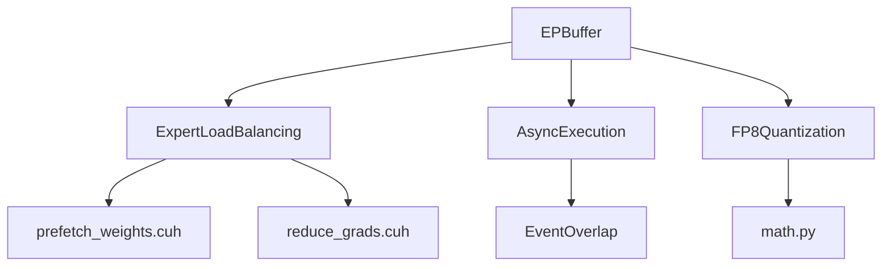

<!-- source: DeepWiki mcp.deepwiki.com · repo deepseek-ai/DeepEP · page 7 Advanced Features · fetched 2026-11-11 -->

# Advanced Features

Relevant source files

The following files were used as context for generating this wiki page:

- [README.md](README.md)

Purpose and scope: This page covers specialized capabilities of DeepEP beyond basic expert-parallel dispatch and combine operations [README.md:3-3](). These features include expert load balancing for redundant experts, asynchronous execution with deferred epilogues for compute-communication overlapping, and FP8 quantization with advanced numerics [README.md:15-16](). As a parent page, this section provides a high-level overview; detailed technical mechanics are covered in the respective child pages.

- [Expert Load Balancing](#7.1)
- [Asynchronous Execution and Overlapping](#7.2)
- [FP8 Quantization and Numerics](#7.3)

Sources: [README.md:3-3](), [README.md:15-16]()

---

## 7.1 Expert Load Balancing

DeepEP provides native support for dynamic redundant experts to mitigate load imbalance in large-scale Mixture-of-Experts (MoE) models [README.md:15-15](). Using APIs such as `redundancy_mapping`, `lb_allocation_plan_or_num_bytes`, `lb_prefetch_weights`, and `lb_reduce_grads`, ranks can replicate heavily used experts, prefetch expert weights and quantization scales over NVLink prior to expert computation, and accumulate redundant experts' FP32 gradients into the original experts during backward passes [README.md:15-15]().

The underlying communication and reduction kernels, such as `prefetch_weights.cuh` and `reduce_grads.cuh`, execute over the NVLink fabric to minimize latency [README.md:15-15](). These primitives support advanced expert-replication frameworks [README.md:15-15]().

For details, see [Expert Load Balancing](#7.1).

Sources: [README.md:15-15]()

---

## 7.2 Asynchronous Execution and Overlapping

To hide communication latency behind model training and inference computations, DeepEP supports asynchronous execution models and compute-communication overlapping [README.md:3-3](). Using parameters such as `async_with_compute_stream`, `defer_epilogue`, and synchronization primitives like `EventOverlap.wait` and `previous_event`, communication kernels operate concurrently on dedicated communication streams [README.md:16-16]().

These mechanisms integrate with CUDA graph capture workflows to ensure zero-overhead orchestration during high-performance execution [README.md:16-16]().

For details, see [Asynchronous Execution and Overlapping](#7.2).

Sources: [README.md:3-3](), [README.md:16-16]()

---

## 7.3 FP8 Quantization and Numerics

To reduce effective communication bandwidth requirements, DeepEP supports FP8 dispatch with scale-factor packing [README.md:3-3](). Per-token casting helpers in `deep_ep/utils/math.py` facilitate manual and integrated quantization tasks, while stochastic rounding operations are supported via `third-party/tilelang_ops` [README.md:15-15]().

Additionally, reduction precision controls ensure numerical stability during multi-rank tensor aggregations and scaling operations [README.md:15-15]().

For details, see [FP8 Quantization and Numerics](#7.3).

Sources: [README.md:3-3](), [README.md:15-15]()

---

