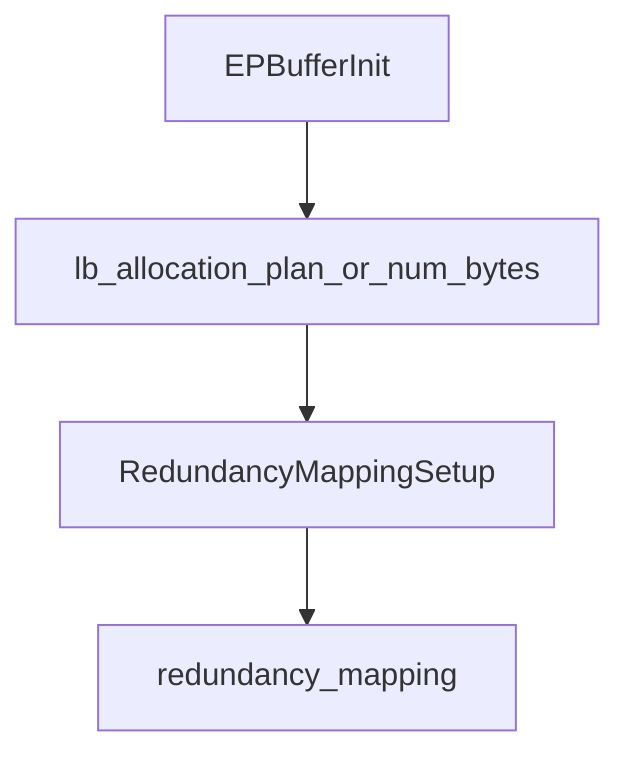
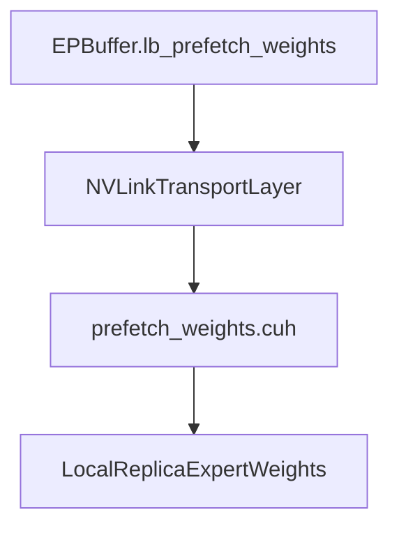
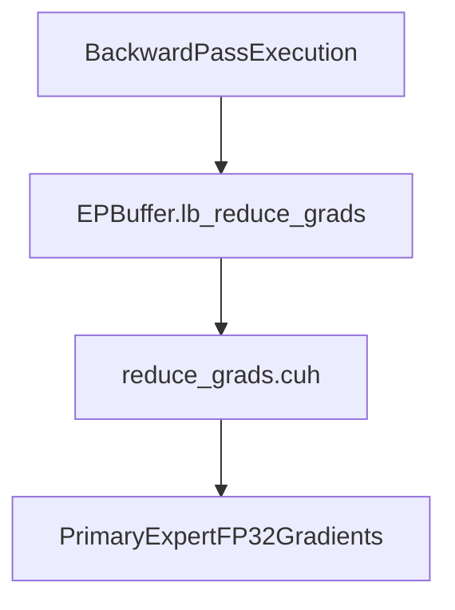

<!-- source: DeepWiki mcp.deepwiki.com · repo deepseek-ai/DeepEP · page 7.1 Expert Load Balancing · fetched 2026-11-11 -->

# Expert Load Balancing

Relevant source files

The following files were used as context for generating this wiki page:

- [README.md](README.md)
- [csrc/indexing/main.cu](csrc/indexing/main.cu)

## Purpose and Scope

This page details the expert load balancing architecture in DeepEP V2.5. It covers dynamic redundant experts designed to handle load imbalances in Mixture-of-Experts (MoE) models. The implementation relies on redundancy mappings, buffer allocation planning (`lb_allocation_plan_or_num_bytes`), NVLink-based weight prefetching (`lb_prefetch_weights`), and FP32 gradient accumulation (`lb_reduce_grads`), backed by the header-only CUDA kernel implementations `prefetch_weights.cuh` and `reduce_grads.cuh`.

Sources: `README.md:11-19`, `csrc/indexing/main.cu:22-24`

---

## 1. Dynamic Redundant Experts and Allocation Planning

To mitigate hot-spot experts where certain ranks receive a disproportionate number of tokens, DeepEP supports dynamic redundant experts (similar to strategies explored in MoonEP and UltraEP). This functionality relies on explicit redundancy mapping and pre-allocated buffer plans.

- **Redundancy Mapping (`redundancy_mapping`)**: Maps primary expert indices to redundant replica indices across the NVLink scale-up domain.
- **Allocation Planning (`lb_allocation_plan_or_num_bytes`)**: Determines the memory footprint and structural layout required to hold replicated expert weights and their associated scaling factors before buffer instantiation.

Sources: `README.md:11-19`

---

## 2. Weight Prefetching over NVLink

Before executing expert computations (such as grouped GEMMs), replica ranks must fetch updated expert weights and quantization scales from the source ranks hosting the primary expert parameters. 

- **Python Interface (`lb_prefetch_weights`)**: Exposed on `EPBuffer`, this method initiates a high-throughput NVLink transfer of expert weights to the local buffer space designated for redundant experts.
- **CUDA Kernel Implementation (`prefetch_weights.cuh`)**: Executes the low-level data movement across the NVLink topology, leveraging optimized warp roles and memory streaming primitives.

Sources: `README.md:15-15`, `csrc/indexing/main.cu:22-22`

---

## 3. FP32 Gradient Accumulation

During the backward pass, redundant experts compute gradients independently based on the tokens routed to them. Because these experts are replicas of primary parameters, their gradients must be accumulated back into the original expert parameters residing on source ranks.

- **Python Interface (`lb_reduce_grads`)**: Coordinates the gradient reduction phase across the NVLink domain during backward execution.
- **CUDA Kernel Implementation (`reduce_grads.cuh`)**: Performs high-precision FP32 gradient accumulation, ensuring that updates from redundant replicas correctly sum into the primary expert gradient tensors without precision loss.

Sources: `README.md:15-15`, `csrc/indexing/main.cu:23-23`

---

## 4. Verification and Testing

Validation of the expert load balancing primitives is supported by dedicated test suites included in the repository structure:

- Weight prefetch testing: `tests/ep/test_prefetch_weights.py`
- Gradient reduction testing: `tests/ep/test_reduce_grads.py`

Sources: `README.md:95-96`

---

