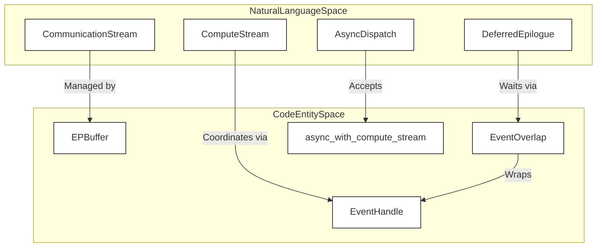
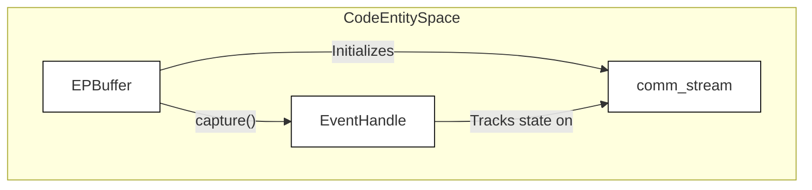
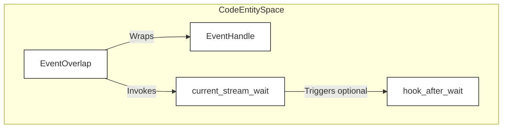
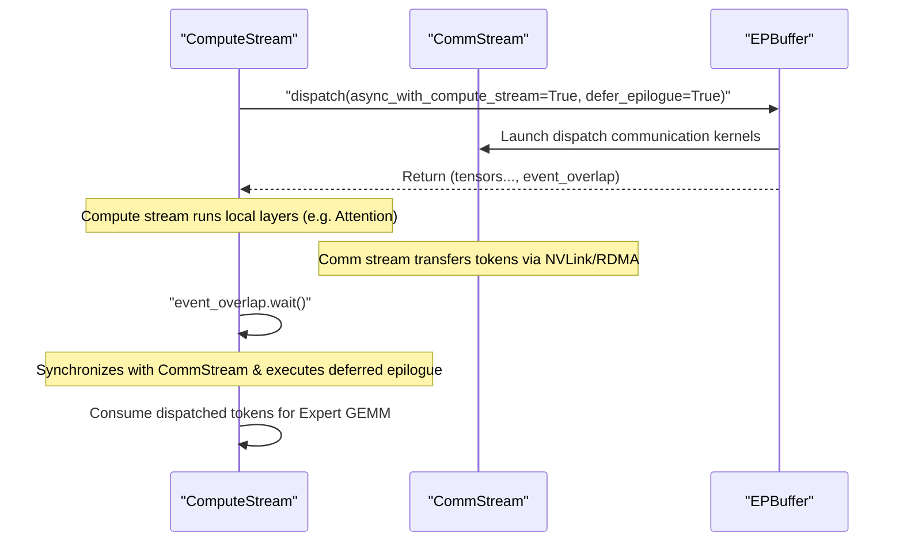

<!-- source: DeepWiki mcp.deepwiki.com · repo deepseek-ai/DeepEP · page 7.2 Asynchronous Execution and Overlapping · fetched 2026-11-11 -->

# Asynchronous Execution and Overlapping

<details>
<summary>Relevant source files</summary>

The following files were used as context for generating this wiki page:

- [README.md](README.md)
- [deep_ep/utils/event.py](deep_ep/utils/event.py)

</details>


This page details DeepEP's asynchronous execution architecture, designed to overlap communication with compute in MoE and distributed training workloads. By decoupling kernel execution across dedicated communication and compute streams, DeepEP hides latency via mechanisms such as `async_with_compute_stream`, deferred epilogues (`defer_epilogue`), event synchronization (`EventOverlap` and `EventHandle`), previous-event dependency chaining (`previous_event`), and CUDA graph capture compatibility.

---

## 1. Overview and Core Mechanisms

DeepEP enables overlapping communication with computation across the `EPBuffer` and broader buffer family through a multi-stream, event-driven model [README.md:12-16](). Key components include:
- **Dual-Stream Architecture**: Segregating communication kernels onto a dedicated, high-priority communication stream (`comm_stream`) while user computation runs on the default compute stream.
- **Hook-Based Execution**: Functions like dispatch and combine accept `async_with_compute_stream=True` to return execution control immediately while communication runs asynchronously [deep_ep/utils/event.py:8-64]().
- **Deferred Epilogues**: Using `defer_epilogue` alongside `EventOverlap.wait` to postpone unpacking, scaling, or permutation operations until just before compute consumption.
- **Event Synchronization**: Leveraging C++ `EventHandle` and Python `EventOverlap` wrappers to manage cross-stream barriers and tensor lifecycles [deep_ep/utils/event.py:8-31]().



Sources: [README.md:12-16](), [deep_ep/utils/event.py:8-64]()

---

## 2. Communication Stream Architecture

DeepEP allocates and manages a dedicated communication stream during buffer initialization. This stream operates independently of user-managed PyTorch compute streams.

### Stream Management and Capture

In the underlying C++ and Python buffer wrappers, the communication stream is maintained to execute all internode (RDMA) and intranode (NVLink) communication kernels [README.md:54-55](). Users can query or interact with streams and capture synchronization states using event handles [deep_ep/utils/event.py:8-31]().



Sources: [deep_ep/utils/event.py:8-31]()

---

## 3. Event-Based Synchronization (`EventHandle` and `EventOverlap`)

Cross-stream synchronization is handled via the C++ `EventHandle` class (exposed via pybind11) and wrapped in Python by `EventOverlap` [deep_ep/utils/event.py:5-15]().

### `EventOverlap` Lifecycle and Methods

`EventOverlap` manages CUDA events and tensor lifecycles to ensure memory remains valid while asynchronous kernels are in-flight [deep_ep/utils/event.py:8-31]():
- `current_stream_wait(release_handle: bool)`: Forces `torch.cuda.current_stream()` to wait for the recorded event to complete [deep_ep/utils/event.py:39-61]().
- `wait()`: Alias for `current_stream_wait()` [deep_ep/utils/event.py:62-64]().
- Context manager (`__enter__` / `__exit__`): Automatically waits on the event when exiting the scope [deep_ep/utils/event.py:84-106]().



Sources: [deep_ep/utils/event.py:8-72]()

---

## 4. Hook-Based Asynchronous Execution (`async_with_compute_stream` and `defer_epilogue`)

When executing dispatch or combine operations, setting `async_with_compute_stream=True` offloads execution to the communication stream and returns control back to the compute stream immediately [README.md:12-16](). 

### Execution Sequence with `defer_epilogue`

When `defer_epilogue=True` is combined with async execution, data movement finishes while compute proceeds. The user then invokes `EventOverlap.wait()` to trigger any deferred epilogue transformations (such as unpacking or unpermuting tokens) right before consumption.



Sources: [README.md:12-16](), [deep_ep/utils/event.py:39-64]()

---

## 5. Dependency Chaining with `previous_event`

To prevent race conditions where communication kernels start before previous dependent compute tasks finish on the GPU, DeepEP supports the `previous_event` parameter [README.md:12-16]().

```python
# Capture current compute stream state
prev_event = buffer.capture()

# Dispatch with dependency on the previous compute work
recv_x, ..., event_overlap = buffer.dispatch(
    x, topk_idx,
    async_with_compute_stream=True,
    previous_event=prev_event
)
```

Sources: [README.md:12-16]()

---

## 6. CUDA Graph Compatibility

DeepEP's asynchronous design is fully compatible with PyTorch CUDA graph capture:
- **`extra_tensors`**: Maintains tensor references inside `EventOverlap` to prevent premature garbage collection without breaking graph capture [deep_ep/utils/event.py:12-30]().
- **Graph-Safe Synchronization**: `EventHandle.current_stream_wait()` records a wait operation directly into the graph node structure [deep_ep/utils/event.py:39-48]().
- **Deterministic Hook Support**: `EventOverlap` supports registering `hook_after_wait` for operations like deterministic sorting that must execute immediately following stream synchronization [deep_ep/utils/event.py:35-54]().

Sources: [deep_ep/utils/event.py:12-54]()

---

