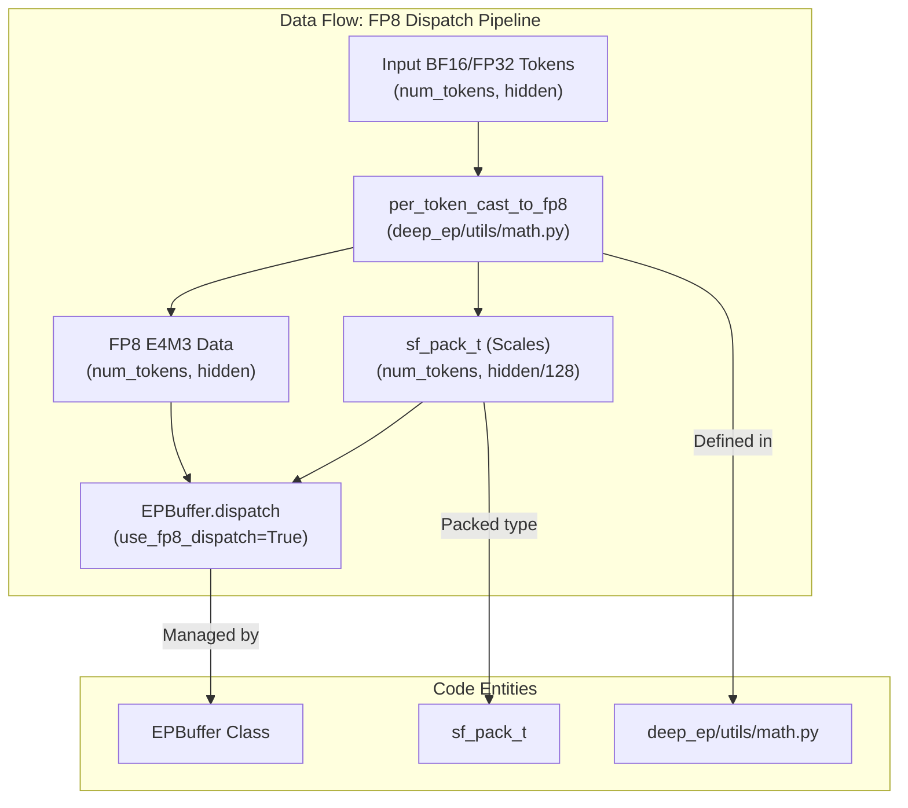
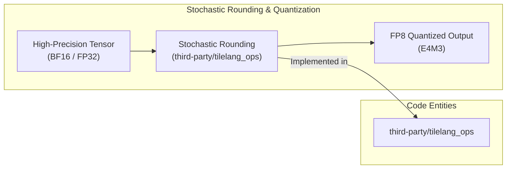

<!-- source: DeepWiki mcp.deepwiki.com · repo deepseek-ai/DeepEP · page 7.3 FP8 Quantization and Numerics · fetched 2026-11-11 -->

# FP8 Quantization and Numerics

Relevant source files

The following files were used as context for generating this wiki page:

- [README.md](README.md)
- [deep_ep/include/deep_ep/common/ptx.cuh](deep_ep/include/deep_ep/common/ptx.cuh)

This page details the FP8 quantization, scale-factor packing, per-token cast helpers in `deep_ep/utils/math.py`, stochastic rounding mechanisms in `third-party/tilelang_ops`, and reduction precision controls implemented in DeepEP V2.

## Overview

DeepEP provides high-throughput, low-precision communication primitives to reduce network bandwidth requirements in Mixture-of-Experts (MoE) dispatch and combine operations. By utilizing Hopper (SM90) architecture features and specialized software utilities, DeepEP achieves efficient FP8 data movement without sacrificing numerical stability.

| Feature | Description | Key Code Entities |
| :--- | :--- | :--- |
| **FP8 Dispatch** | BF16/FP32 to E4M3 conversion with per-token scaling during MoE dispatch. | `EPBuffer`, `use_fp8_dispatch`, `sf_pack_t` [README.md:15-15](), [deep_ep/include/deep_ep/impls/dispatch_copy_epilogue.cuh:22-33]() |
| **Per-Token Cast** | Python helpers for casting tensors between high precision and FP8 with scale extraction. | `per_token_cast_to_fp8`, `per_token_cast_back` [README.md:15-15]() |
| **Stochastic Rounding** | Tilelang-based stochastic rounding operations for precision preservation in quantization. | `third-party/tilelang_ops` [README.md:3-3]() |
| **Reduction Precision Controls** | Flags controlling intermediate reduction behaviors to prevent precision loss. | `allow_multiple_reduction` [README.md:15-15]() |

Sources: [README.md:3-15](), [deep_ep/include/deep_ep/impls/dispatch_copy_epilogue.cuh:22-33]()

---

## FP8 Dispatch and Scale-Factor Packing

In DeepEP V2, FP8 support is integrated directly into the `EPBuffer` workflow [README.md:15-15](). When `use_fp8_dispatch` is enabled, dispatch kernels expect quantized FP8 tensors alongside packed scale factor structures (`sf_pack_t`) [README.md:15-15]().

**Diagram: FP8 Dispatch Data Flow and Code Entities**

Sources: [README.md:15-15](), [deep_ep/include/deep_ep/impls/dispatch_copy_epilogue.cuh:22-33]()

### Scale Factor Management (`sf_pack_t`)
To prevent underflow/overflow during low-bitwidth communication, DeepEP computes per-token (or per-block) scale factors. These are packed into `sf_pack_t` structures, allowing efficient memory transfers alongside the primary FP8 token payloads. Kernels utilize template parameters such as `kNumSFPacks` to process scale factor packs per iteration, maximizing memory bandwidth utilization [deep_ep/include/deep_ep/impls/dispatch_copy_epilogue.cuh:11-21]().

Sources: [README.md:15-15](), [deep_ep/include/deep_ep/impls/dispatch_copy_epilogue.cuh:11-33]()

---

## Per-Token Cast Helpers

DeepEP supplies high-performance quantization utilities in `deep_ep/utils/math.py` to prepare tensors prior to communication [README.md:15-15]().

*   **`per_token_cast_to_fp8`**: Converts high-precision tensors (BF16 or FP32) into FP8 (E4M3 format) on a per-token basis, returning both the quantized tensor and the corresponding scale factor packs [README.md:15-15]().
*   **`per_token_cast_back`**: Reverses the quantization process, converting FP8 data back to BF16/FP32 using the associated scale factor packs [README.md:15-15]().

Sources: [README.md:15-15]()

---

## Stochastic Rounding in `third-party/tilelang_ops`

To mitigate quantization bias and preserve numerical representation accuracy when converting high-precision weights or activations to low-precision formats, DeepEP integrates stochastic rounding primitives via `third-party/tilelang_ops` [README.md:3-3]().

**Diagram: Stochastic Rounding Integration**

Sources: [README.md:3-3]()

---

## Reduction Precision Controls

Numerical precision during communication and reduction phases is governed by configuration flags in `EPBuffer` [README.md:15-15]().

*   **`allow_multiple_reduction`**: Controls whether intermediate reduction stages are permitted during communication operations [README.md:15-15](). When disabled, the runtime avoids intermediate rounding steps that could accumulate error in FP8/BF16 pipelines, prioritizing maximum numerical accuracy over raw communication throughput.
*   **Gradient Accumulation Precision**: For operations like `lb_reduce_grads`, redundant experts accumulate gradients in high-precision (FP32) before updating weights, mitigating rounding errors across distributed ranks [README.md:15-15]().

Sources: [README.md:15-15]()

---

