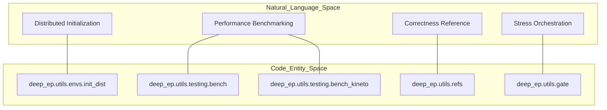
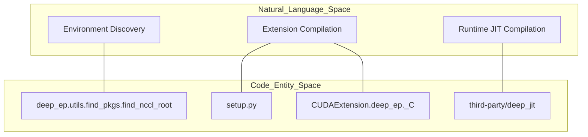

<!-- source: DeepWiki mcp.deepwiki.com · repo deepseek-ai/DeepEP · page 8 Testing and Development · fetched 2026-11-11 -->

# Testing and Development

Relevant source files

The following files were used as context for generating this wiki page:

- [README.md](README.md)
- [setup.py](setup.py)

## Purpose and Scope

This page provides a high-level overview of the testing infrastructure, test suite layout, and build/CI tooling for DeepEP. With the V2.5 refactoring, tests are organized under dedicated directories covering expert parallelism (`tests/ep`), bucket collectives (`tests/bucket`), memory-access features (`tests/engram`), pipeline parallelism (`tests/pp`), buffer allocation (`tests/buffer`), communication helpers (`tests/comm`), and utilities (`tests/utils`) [README.md:83-100](). 

This is a parent page. For detailed breakdowns of specific test cases and helpers, see [Test Suite (#8.1)](). For details on `setup.py`, compilation flags, and build tooling, see [Build System and Tooling (#8.2)]().

Sources: [README.md:83-100](), [setup.py:1-140]()

---

## Test Suite Layout and Organization

The DeepEP test suite validates correctness and performance across all communication primitives and buffer families. Distributed tests rely on multi-process spawning or cluster orchestration (`MASTER_ADDR`, `MASTER_PORT`, `WORLD_SIZE`, `RANK`) configured via environment helpers [README.md:101]().

The test directory layout includes:
- `tests/ep/`: Validates expert parallelism operations (`test_ep.py`, `test_prefetch_weights.py`, `test_reduce_grads.py`) [README.md:90-96]().
- `tests/bucket/`: Tests bucket collectives (`test_all_gather.py`, `test_reduce_scatter.py`, `test_all_reduce.py`, mixed, perf, session) [README.md:91-93]().
- `tests/engram/` & `tests/pp/`: Validates experimental Engram storage and pipeline-parallel communication [README.md:97-98]().
- `tests/buffer/`: Tests symmetric buffer allocation strategies (`test_allocation.py`) [README.md:94]().
- `tests/comm/` & `tests/utils/`: Validates low-level communication primitives, math wrappers, and reference validation functions.

For detailed test harnesses, assertions, and test parameters, see [Test Suite (#8.1)]().

Diagram: "Test Infrastructure Mapping"

Sources: [README.md:83-100](), [setup.py:1-140]()

---

## Build System and Tooling

DeepEP uses `setup.py` alongside `install.sh` and PyTorch's `CppExtension` framework to build the host-side C++ extension (`deep_ep._C`) [setup.py:11-139](). Runtime kernel compilation is managed via DeepJIT [README.md:3].

Key components of the build and tooling layer:
- **`setup.py`**: Configures C++20 compilation flags, persistent environment capture (`persistent_env_names`), NCCL root discovery via `find_pkgs`, and version stamping from git revision metadata [setup.py:1-140]().
- **Environment Integration**: Preserves essential configuration variables (`EP_JIT_CACHE_DIR`, `EP_NCCL_ROOT_DIR`, `EP_NUM_TOPK_IDX_BITS`, etc.) into generated module files (`deep_ep/envs.py`) during building [setup.py:14-75]().
- **CI and Formatting**: Automated scripts ensure compliance with standard code formatting and validation rules across updates.

For a full breakdown of build configurations, CMake debug paths, and packaging rules, see [Build System and Tooling (#8.2)]().

Diagram: "Build and Execution Flow"

Sources: [README.md:57-79](), [setup.py:1-140]()

---

## Child Pages

- [Test Suite (#8.1)]() — Detailed breakdown of test directories (`tests/ep`, `tests/bucket`, `tests/engram`, `tests/pp`, `tests/buffer`, `tests/comm`, `tests/utils`) and shared helper modules (`deep_ep/utils/testing.py`, `envs.py`, `refs.py`, `gate.py`).
- [Build System and Tooling (#8.2)]() — Detailed analysis of `setup.py`, CMake integration, version stamping, environment variables, and CI tooling.

Sources: [README.md:83-101](), [setup.py:1-140]()

---

