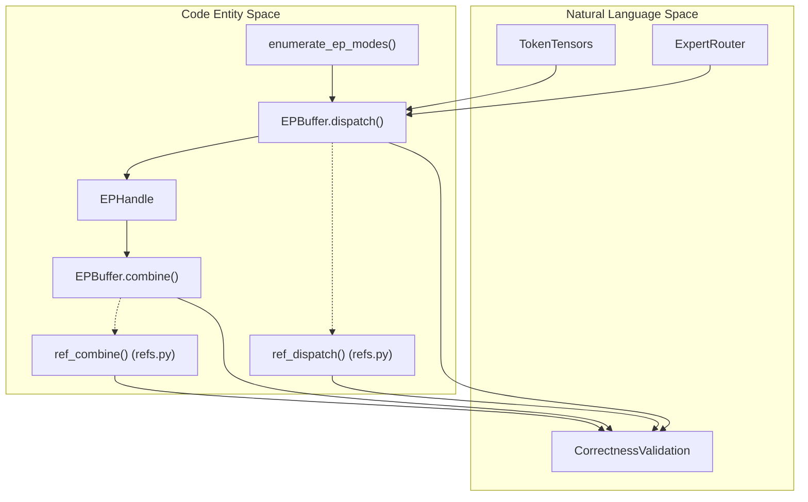
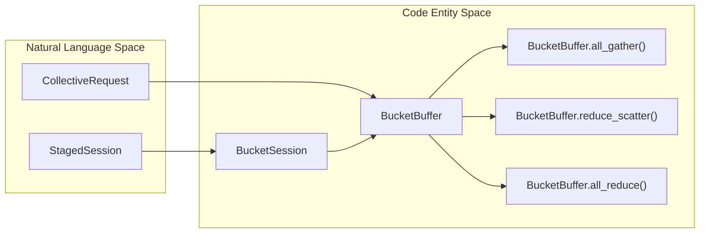

<!-- source: DeepWiki mcp.deepwiki.com · repo deepseek-ai/DeepEP · page 8.1 Test Suite · fetched 2026-11-11 -->

# Test Suite

Relevant source files

The following files were used as context for generating this wiki page:

- [README.md](README.md)
- [deep_ep/__init__.py](deep_ep/__init__.py)

## Purpose and Scope

The DeepEP test suite provides comprehensive distributed test harnesses across multiple modules (`tests/ep`, `tests/bucket`, `tests/engram`, `tests/pp`, `tests/buffer`, `tests/comm`, `tests/utils`) [README.md:83-100](). These tests validate the correctness, performance, and functionality of DeepEP V2.5 primitives including `EPBuffer`, `BucketBuffer`, `EngramBuffer`, `PPBuffer`, Buffer allocation planning, weight prefetching, gradient reduction, and shared utility modules (`deep_ep/utils/testing.py`, `envs.py`, `refs.py`, `gate.py`) [README.md:12-18]().

Sources: [README.md:83-100]()

---

## Shared Test Utilities (`deep_ep/utils/`)

The test suite relies on common helper modules for environment setup, rank distribution, reference implementations, and communication handle caching:
- Environment & Distribution (`envs.py`): Initializes distributed process groups (`init_dist`), synchronized printing (`dist_print`), and deterministic random seeds (`init_seed`) [deep_ep/utils/envs.py:1-84]().
- Testing & Benchmarking (`testing.py`): Measures execution times (`bench`), captures PyTorch Kineto traces (`bench_kineto`), and evicts L2 cache (`flush_l2_cache`) [deep_ep/utils/testing.py:1-52]().
- Reference Implementations & Gating (`refs.py`, `gate.py`): Provides CPU-based reference dispatch/combine functions (`ref_dispatch`, `ref_combine`) and synthetic expert routing scores (`get_unbalanced_scores`) [deep_ep/utils/refs.py:1-85](), [deep_ep/utils/gate.py:1-36]().

Sources: [deep_ep/utils/envs.py:1-84](), [deep_ep/utils/testing.py:1-52](), [deep_ep/utils/refs.py:1-85](), [deep_ep/utils/gate.py:1-36]()

---

## Expert Parallelism Tests (`tests/ep/`)

The `tests/ep` directory validates core expert parallelism features:
- `test_ep.py`: Core `EPBuffer.dispatch` and `EPBuffer.combine` correctness, FP8 round-trips, handle caching, and EP modes [README.md:90]().
- `test_prefetch_weights.py`: Validates `EPBuffer.lb_prefetch_weights` for dynamic redundant experts over NVLink [README.md:15](), [README.md:95]().
- `test_reduce_grads.py`: Validates `EPBuffer.lb_reduce_grads` for accumulating FP32 gradients of redundant experts during backward [README.md:15](), [README.md:96]().

### Data Flow and Code Entity Mapping

*Figure 1: Expert Parallelism Test Flow and Code Mapping*

Sources: [README.md:15](), [README.md:90-96](), [deep_ep/utils/refs.py:1-85]()

---

## Bucket Collectives Tests (`tests/bucket/`)

The `tests/bucket` test suite exercises experimental collective communication primitives and sessions (`BucketBuffer` / `BucketSession`) [README.md:14](), [README.md:35]():
- `all_gather.py`: Validates batched and multi-tensor all-gather operations [README.md:91]().
- `reduce_scatter.py`: Validates reduce-scatter collectives across CP/DP domains [README.md:92]().
- `all_reduce.py`: Validates all-reduce primitives [README.md:93]().
- `mixed.py`: Tests mixed collective sequences.
- `perf.py`: Benchmarks collective throughput and latency.
- `session.py`: Exercises `BucketSession` staging and ordinary PyTorch tensor integration [README.md:14]().

### Bucket Test Architecture

*Figure 2: Bucket Collectives Architecture and Code Mapping*

Sources: [README.md:14](), [README.md:35](), [README.md:91-93]()

---

## Engram, Pipeline Parallelism, Buffer, Comm and Utils Tests

- `tests/engram/`: Validates multi-layer GPU/CPU RMA storage (`EngramBuffer.engram_write`, `EngramBuffer.engram_fetch`, with per-layer wait hooks) [README.md:17](), [README.md:97]().
- `tests/pp/`: Tests pipeline-parallel send/recv operations in RDMA-only ring groups (`PPBuffer`) [README.md:98]().
- `tests/buffer/`: Exercises `BufferAllocator` symmetric memory planning and buffer size hints (`test_allocation.py`) [README.md:13](), [README.md:94]().
- `tests/comm/`: Tests distributed communicators, barriers, and NCCL Gin handles.
- `tests/utils/`: Validates utility functions such as environment configuration and mathematical helpers.

Sources: [README.md:13](), [README.md:17](), [README.md:94-98]()

---

