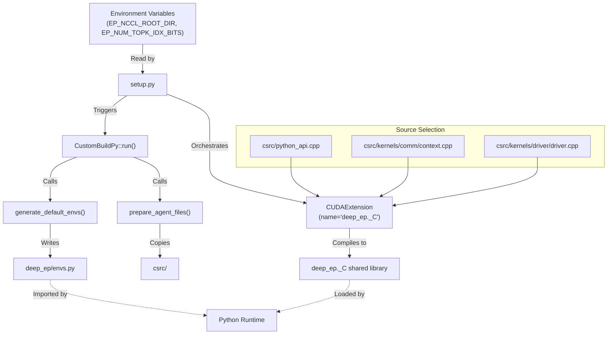
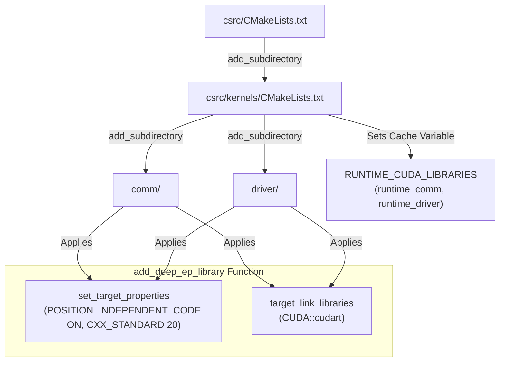

<!-- source: DeepWiki mcp.deepwiki.com · repo deepseek-ai/DeepEP · page 8.2 Build System and Tooling · fetched 2026-11-11 -->

# Build System and Tooling

Relevant source files

The following files were used as context for generating this wiki page:

- [.gitignore](.gitignore)
- [LICENSE](LICENSE)
- [csrc/CMakeLists.txt](csrc/CMakeLists.txt)
- [csrc/kernels/CMakeLists.txt](csrc/kernels/CMakeLists.txt)
- [install.sh](install.sh)
- [setup.py](setup.py)

This page documents the DeepEP build system, centered around `setup.py`, and the compilation options, CMake integration, and tooling available to developers. DeepEP uses a hybrid build approach: a primary Python-based build for the extension module (`deep_ep._C`) and a Just-In-Time (JIT) compilation system for performance-critical kernels.

---

## 1. setup.py and Extension Build Architecture

DeepEP employs `setuptools` and PyTorch's `CUDAExtension` to compile the C++ and CUDA backend [setup.py:5-11](). The build process orchestrates dependency discovery via helper modules, source file selection, git-clean version stamping, and persistent environment generation.

### Source Files and Extension Compilation
The main build script compiles `deep_ep._C` using a targeted set of C++ and CUDA source files [setup.py:81-83, 132]():
* `csrc/python_api.cpp`: Implements the pybind11 module bindings mapping Python invocations to runtime functions.
* `csrc/kernels/comm/context.cpp`: Manages NCCL Gin communication contexts and window setup.
* `csrc/kernels/driver/driver.cpp`: Handles CUDA driver interactions.

Include directories point to `deep_ep/include`, `third-party/deep_jit/include`, CCCL headers (`/usr/local/cuda/include/cccl`), and discovered NCCL directories [setup.py:84-93]().

### Custom Build Pipeline and Persistent Environments
`CustomBuildPy` inherits from `setuptools.command.build_py.build_py` to customize the packaging phase [setup.py:10, 43](). It executes two primary actions before standard python file copying:
1. `generate_default_envs()`: Captures pre-defined environment variables from `persistent_env_names` (`EP_JIT_CACHE_DIR`, `EP_JIT_PRINT_COMPILER_COMMAND`, `EP_JIT_CPP_STANDARD`, `EP_NUM_TOPK_IDX_BITS`, `EP_NCCL_ROOT_DIR`, `EP_DEFAULT_RDMA_SL`, `EP_OVERRIDE_RDMA_SL`) and writes them out to `deep_ep/envs.py` [setup.py:14-15, 46, 63-74]().
2. `prepare_agent_files()`: Copies the entire `csrc` directory into the build wheel (excluding local `cmake-build-*` directories) to allow agent-side error lookups [setup.py:49, 54-62]().

### Version Stamping and Git Clean Validation
Version resolution is managed by `get_package_version()`, which reads the semantic version from `deep_ep/__init__.py` [setup.py:23-26](). It enforces that the git working directory is clean by running `git status --porcelain`; if uncommitted changes exist, the build fails or records a warning/assertion [setup.py:29-34](). It then appends the short git commit hash obtained via `git rev-parse --short HEAD` (or `+local` on failure) [setup.py:36-39]().

**Title: DeepEP Build Logic and Entity Mapping**

Sources: [setup.py:13-90](), [setup.py:131-138]()

---

## Sources: [setup.py:1-140]()

---

## 2. Environment Variables and Persistent Build Options

DeepEP's compilation and runtime behavior rely heavily on environment variables listed in `persistent_env_names` [setup.py:14-15]():
* `EP_JIT_CACHE_DIR`: Specifies the filesystem path for caching JIT-compiled PTX/cubin artifacts.
* `EP_JIT_PRINT_COMPILER_COMMAND`: Controls whether JIT compiler diagnostic commands are printed.
* `EP_JIT_CPP_STANDARD`: Sets the target C++ standard for JIT compilation.
* `EP_NUM_TOPK_IDX_BITS`: Configures the integer bit-width for `topk_idx` routing representations, adding `-DEP_NUM_TOPK_IDX_BITS=...` to compilation flags [setup.py:14, 96-98]().
* `EP_NCCL_ROOT_DIR`: Points to the NCCL installation path, discovered via `find_pkgs.find_nccl_root()` [setup.py:14, 78]().
* `EP_DEFAULT_RDMA_SL` / `EP_OVERRIDE_RDMA_SL`: Configures service level parameters for RDMA communications [setup.py:14-15]().

Sources: [setup.py:14-115]()

---

## 3. CMake Integration and Target Structure

While `setup.py` builds the primary Python extension, `CMakeLists.txt` provides structured C++ library definitions under `csrc/` [csrc/CMakeLists.txt:1]() and `csrc/kernels/CMakeLists.txt` [csrc/kernels/CMakeLists.txt:1-14]().

### Library Targets and `add_deep_ep_library`
The helper function `add_deep_ep_library` defined in `csrc/kernels/CMakeLists.txt` standardizes static library target creation [csrc/kernels/CMakeLists.txt:1-9]():
* Sets properties for position-independent code (`POSITION_INDEPENDENT_CODE ON`) and enforces C++20 (`CXX_STANDARD 20`, `CXX_STANDARD_REQUIRED ON`) [csrc/kernels/CMakeLists.txt:3-7]().
* Links target libraries against `CUDA::cudart` [csrc/kernels/CMakeLists.txt:8]().

Subdirectories such as `comm` and `driver` are included via `add_subdirectory`, populating internal runtime libraries [csrc/kernels/CMakeLists.txt:11-12](). The aggregate runtime CUDA libraries are exposed through the internal CMake cache variable `RUNTIME_CUDA_LIBRARIES`, aggregating `runtime_comm` and `runtime_driver` [csrc/kernels/CMakeLists.txt:14]().

**Title: CMake Hierarchy and Target Entity Mapping**

Sources: [csrc/CMakeLists.txt:1](), [csrc/kernels/CMakeLists.txt:1-14]()

---

## Sources: [csrc/CMakeLists.txt:1](), [csrc/kernels/CMakeLists.txt:1-14]()

---

## 4. Helper Scripts, Ignore Rules, and Licensing

### Installation Script (`install.sh`)
The `install.sh` shell script streamlines local development and wheel installation [install.sh:1-12]():
1. Changes current working directory to the script's root path [install.sh:1-4]().
2. Cleans up any existing `dist/` artifacts [install.sh:7]().
3. Invokes `python setup.py bdist_wheel` to build the wheel [install.sh:8]().
4. Installs the resulting wheel using `pip install dist/*.whl` [install.sh:9]().

### Ignore Patterns and Licensing
* **`.gitignore`**: Excludes IDE files (`.vscode/`, `.idea/`, `.clangd`, `compile_commands.json`), build artifacts (`build/`, `dist/`, `*.so`, `deep_ep.egg-info/`, `*/cmake-build-*/`), Python cache files (`*.pyc`), and agent logs [.gitignore:1-28]().
* **Licensing**: DeepEP is licensed under the MIT License (Copyright (c) 2025 DeepSeek), permitting free use, modification, and distribution under standard MIT terms [LICENSE:1-21]().

Sources: [install.sh:1-12](), [.gitignore:1-28](), [LICENSE:1-21]()

---

