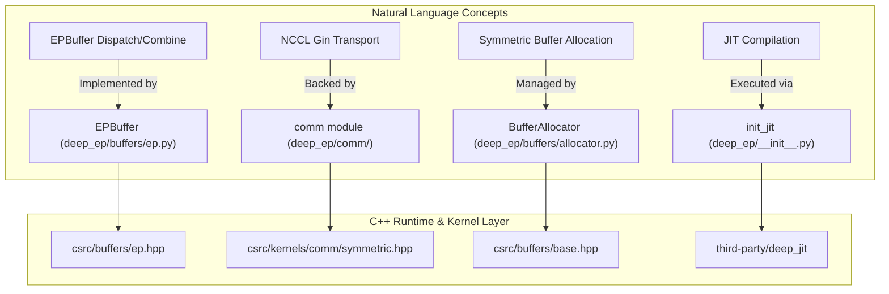
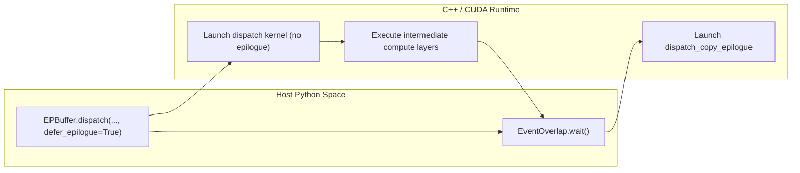

<!-- source: DeepWiki mcp.deepwiki.com · repo deepseek-ai/DeepEP · page 9 Glossary · fetched 2026-11-11 -->

# Glossary

Relevant source files

The following files were used as context for generating this wiki page:

- [README.md](README.md)
- [deep_ep/__init__.py](deep_ep/__init__.py)
- [figures/normal.png](figures/normal.png)

This page provides definitions for codebase-specific terms, jargon, and domain concepts used in DeepEP. It covers the V2.5 architecture, buffer family (`EPBuffer`, `BucketBuffer`, `EngramBuffer`, `PPBuffer`), communication backends (`NCCL Gin`), runtime compilation (`DeepJIT`), hardware concepts (`SM`, `TMA`, `mbarrier`, `multimem`, `QP`), and specialized algorithms.

## Definitions and Code Pointers

### MoE (Mixture of Experts)
A neural network architecture where input tokens are dynamically routed to a subset of specialized expert networks using a gating function (`topk_idx`).
*   **Sources**: [README.md:1-3]()

### EP / CP / DP / PP
Distributed parallelism modes supported or targeted by DeepEP:
*   **EP (Expert Parallelism)**: Distributing Mixture-of-Experts expert layers across GPUs using `EPBuffer` dispatch and combine operations.
*   **CP (Context Parallelism)**: Distributing long-context sequence lengths across ranks, utilizing `BucketBuffer` collectives (all-gather, reduce-scatter).
*   **DP (Data Parallelism)**: Distributing batches across workers with synchronized gradients or parameters via `BucketBuffer`.
*   **PP (Pipeline Parallelism)**: Distributing model layers sequentially across pipeline stages using `PPBuffer` send/recv primitives.
*   **Sources**: [README.md:1-3](), [README.md:11-15]()

### Dispatch / Combine
*   **Dispatch**: The forward routing phase of MoE where tokens are moved from source ranks to the ranks hosting their assigned experts. Handled by `EPBuffer.dispatch` [README.md:29]().
*   **Combine**: The backward routing phase of MoE where processed token activations are returned from expert GPUs back to their original source ranks. Handled by `EPBuffer.combine`.
*   **Sources**: [README.md:2-3](), [README.md:29]()

### Epilogue
The final post-processing phase of a communication kernel (e.g., `dispatch_copy_epilogue` or `combine_reduce_epilogue`) that stores or reduces data into its destination tensor memory layout. Supports `defer_epilogue` for overlapping communication with previous compute layers.
*   **Sources**: [README.md:16]()

### Engram
An experimental feature for remote memory access (RMA) used to fetch KV cache or model states between GPU or CPU memory tiers with near-zero SM overhead via RDMA using `EngramBuffer`.
*   **Sources**: [README.md:17](), [README.md:33]()

### Bucket
A collection abstraction (`BucketBuffer`, `BucketSession`) that manages batched collective communication (all-gather, reduce-scatter, all-reduce) for CP and DP workflows on ordinary PyTorch tensors.
*   **Sources**: [README.md:14](), [README.md:35]()

### NCCL Gin Backend
The lightweight device-side communication transport backend introduced in V2 that replaces NVSHMEM, using header-only CUDA APIs (`ncclDevComm_t`, `ncclWindow_t`) to orchestrate NVLink and RDMA operations while reusing existing NCCL communicators.
*   **Sources**: [README.md:20](), [README.md:25-27]()

### DeepJIT
The runtime just-in-time kernel compilation module (sub-project `third-party/deep_jit`) that compiles highly-specialized CUDA communication kernels against active hardware configurations and dimensions.
*   **Sources**: [README.md:3](), [README.md:24]()

### QP (Queue Pair)
An InfiniBand / RDMA work queue pair used for message posting and completion tracking, budgeted analytically via DeepEP resource models.
*   **Sources**: [README.md:31]()

### SM (Streaming Multiprocessor)
NVIDIA GPU processing core unit. DeepEP communication kernels explicitly allocate a budgeted number of SMs (`_num_comm_sms`) to execute warp-specialized communication routines.
*   **Sources**: [README.md:39]()

### TMA (Tensor Memory Accelerator)
Hopper hardware feature (`SM90`) used for asynchronous, multi-dimensional tensor bulk data movement between global memory and shared memory (`shared_storage`).
*   **Sources**: [deep_ep/__init__.py:75]()

### mbarrier
Hopper hardware synchronization primitive (`mbarrier`) used in CUDA kernels to coordinate asynchronous TMA data transfers and thread-block execution milestones.
*   **Sources**: [README.md:49]()

### Multimem
NVIDIA hardware instructions (`multimem.ld` / `multimem.st`) allowing single-instruction broadcast or reduction operations across peer NVLink memory windows.
*   **Sources**: [README.md:54]()

### Scaleup vs. Scaleout
*   **Scaleup**: Intranode communication domain leveraging NVLink high-bandwidth switch fabrics and multimem.
*   **Scaleout**: Internode communication domain leveraging RDMA / InfiniBand network interfaces.
*   **Hybrid Transport**: A hierarchical communication strategy combining scaleup (NVLink) and scaleout (RDMA) phases.
*   **Sources**: [README.md:20](), [README.md:32]()

### EPHandle
An opaque metadata structure returned by `EPBuffer.dispatch` that stores routing alignment maps, receive token counts, and expanded layout descriptors needed by the matching `combine` operation or cached for inference decoding.
*   **Sources**: [README.md:29]()

### BufferAllocator
A utility class (`BufferAllocator`) used to plan symmetric tensor allocations across ranks before initializing buffer instances.
*   **Sources**: [README.md:13](), [deep_ep/__init__.py:62]()

### Redundancy Mapping
A configuration mechanism (`redundancy_mapping`) supporting dynamic redundant experts, coupled with `lb_prefetch_weights` and `lb_reduce_grads` for prefetching expert weights over NVLink and accumulating FP32 gradients across replicas.
*   **Sources**: [README.md:15]()

### Deferred Epilogue
An execution mode (`defer_epilogue=True`) where communication is initiated without executing the final write epilogue immediately, allowing host or device code to overlap computation before invoking an event wait handle (`EventOverlap.wait`).
*   **Sources**: [README.md:16]()

### Symmetric Memory
Memory allocated across all ranks with identical virtual memory layouts, enabling peer-to-peer RMA writes and reads via NCCL window registrations.
*   **Sources**: [README.md:13]()

### topk_idx_t
The data type representation for token routing indices (`topk_idx`), exposed via PyTorch bindings to configure token-to-expert mapping precision (controlled by `EP_NUM_TOPK_IDX_BITS`).
*   **Sources**: [deep_ep/__init__.py:76]()

### RDMA SL (Service Level)
InfiniBand Service Level configuration index (`NCCL_IB_SL` or `EP_OVERRIDE_RDMA_SL`) controlling virtual lanes and traffic priority for internode RDMA messages.
*   **Sources**: [README.md:101]()

### Key Environment Variables
Configuration variables recognized by DeepEP:
*   `EP_JIT_CACHE_DIR`: Directory path for caching DeepJIT compiled binaries.
*   `EP_NCCL_ROOT_DIR`: Root directory containing NCCL header files (`include/`) and libraries (`lib/`).
*   `EP_NUM_TOPK_IDX_BITS`: Bit-width configuration for `topk_idx_t`.
*   `EP_SUPPRESS_NCCL_CHECK`: Disables binary-identity runtime checks for `libnccl.so`.
*   `EP_OVERRIDE_RDMA_SL`: Overrides InfiniBand Service Level.
*   **Sources**: [README.md:69](), [deep_ep/__init__.py:24]()

---

## Architecture Mapping Diagrams

### Terminology to Code Entity Mapping
The following diagram bridges conceptual names used throughout documentation to their concrete Python and C++ source code symbols.

**Sources**: [deep_ep/__init__.py:44-52](), [deep_ep/__init__.py:61-67](), [README.md:11-18]()

### Execution Flow: Deferred Epilogue & Event Overlap
This diagram illustrates the operational path when using deferred epilogues and event overlapping for compute-communication concurrency.

**Sources**: [README.md:16](), [deep_ep/__init__.py:69]()

---
Sources: [README.md:1-110](), [deep_ep/__init__.py:1-79]()