# Page: Overview

# Overview

<details>
<summary>Relevant source files</summary>

The following files were used as context for generating this wiki page:

- [README.md](README.md)
- [deep_ep/__init__.py](deep_ep/__init__.py)
- [figures/low-latency.png](figures/low-latency.png)

</details>


## Purpose and Scope

DeepEP (DeepEveryParallel) is a high-performance communication library for machine learning training and inference, specifically optimized for **Mixture-of-Experts (MoE) expert parallelism**. It provides high-throughput and low-latency all-to-all GPU kernels for MoE dispatch and combine operations, supporting low-precision formats such as FP8 [README.md:1-3](). 

Beyond expert parallelism, DeepEP V2.5 provides primitive support for other distributed parallelism modes, including context parallelism (CP), data parallelism (DP), pipeline parallelism (PP), and remote memory access (Engram) [README.md:1-3, 11-14](). Communication kernels are compiled at runtime using **DeepJIT**, and the host C++ extension is built during installation [README.md:3-4]().

Sources: [README.md:1-4](), [deep_ep/__init__.py:44-57]()

---

## BufferBase Family and BufferAllocator Model

DeepEP V2.5 refactors the legacy elastic communication buffers into a modular class family sharing the base lifecycle defined by `BufferBase` (`deep_ep/buffers/base.py`) [README.md:11-12](). 

| Buffer Class | Module | Primary Purpose | Key Primitives |
| :--- | :--- | :--- | :--- |
| `EPBuffer` | `deep_ep/buffers/ep.py` | MoE Expert Parallelism | `dispatch`, `combine`, `lb_prefetch_weights`, `lb_reduce_grads` [README.md:11-15](), [deep_ep/__init__.py:64]() |
| `BucketBuffer` | `deep_ep/buffers/bucket.py` | CP / DP Collectives | `all_gather`, `reduce_scatter`, `all_reduce` [README.md:14, 35](), [deep_ep/__init__.py:66]() |
| `EngramBuffer` | `deep_ep/buffers/engram.py` | Remote Memory Access (RMA) | `engram_write`, `engram_fetch` [README.md:17, 33](), [deep_ep/__init__.py:65]() |
| `PPBuffer` | `deep_ep/buffers/pp.py` | Pipeline Parallelism (PP) | `pp_send`, `pp_recv` [README.md:17, 34](), [deep_ep/__init__.py:67]() |

### BufferAllocator
To facilitate multi-tensor allocations and planning across these buffers before actual construction, DeepEP introduces `BufferAllocator` (`deep_ep/buffers/allocator.py`) [README.md:13](). It manages symmetric tensor allocation planning, ensuring all ranks allocate aligned window regions [deep_ep/__init__.py:62]().

Sources: [README.md:11-18](), [deep_ep/__init__.py:62-67](), [deep_ep/buffers/base.py:1-27]()

---

## NCCL Gin Backend and DeepJIT Runtime Compilation

### NCCL Gin Backend
DeepEP V2 replaces legacy transport mechanisms with the lightweight **NCCL Gin backend** (`csrc/kernels/comm/`) [README.md:20, 25-27](). It provides lightweight device-side communication APIs and can reuse existing NCCL communicators while setting up symmetric memory windows (`csrc/kernels/comm/symmetric.hpp`) [README.md:27]().

### DeepJIT Runtime Kernel Compilation
DeepEP avoids pre-compiling all variant combinations during installation by leveraging **DeepJIT** (housed in `third-party/deep_jit`) [README.md:3, 24](). During runtime initialization (`deep_ep/__init__.py`), `init_jit()` compiles specialized CUDA templates for the current device architecture using NVRTC and caches them in `EP_JIT_CACHE_DIR` [README.md:57]().

Sources: [README.md:3, 24-27](), [deep_ep/__init__.py:44-56](), [csrc/kernels/comm/symmetric.hpp:1-30]()

---

## System Architecture and Code Entities

The diagram below bridges natural language descriptions to exact code entities across Python wrappers, C++ bindings, and JIT compilation layers.

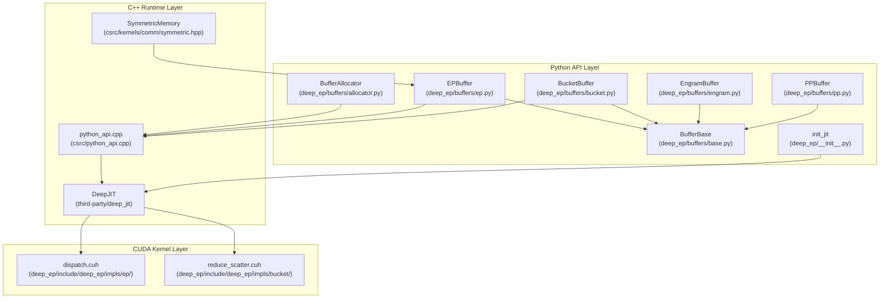
**Diagram: DeepEP System Architecture and Code Entities**

Sources: [README.md:11-18](), [deep_ep/__init__.py:44-67](), [csrc/python_api.cpp:1-40](), [csrc/kernels/comm/symmetric.hpp:1-30]()

---

## Hardware and Software Requirements

DeepEP has specific runtime and build requirements for performance and compatibility:

| Requirement | Specification | Notes |
| :--- | :--- | :--- |
| **OS & Python** | Linux, Python 3.10+ | Required for execution environment [README.md:47-48]() |
| **GPU Architecture** | NVIDIA Hopper (SM90) or newer | Required for hardware primitives (TMA, mbarrier) [README.md:49]() |
| **CUDA Toolkit** | CUDA 13.1 and above | Required for DeepJIT compilation [README.md:50]() |
| **Compiler** | C++20 compiler | Must support `std::format` [README.md:51]() |
| **PyTorch** | PyTorch 2.10 and above | With CUDA support [README.md:52]() |
| **NCCL** | NCCL 2.32.3 and above | Binary identity checked via `check_nccl_so()` [README.md:53](), [deep_ep/__init__.py:19-42]() |
| **Interconnect** | NVLink & RDMA | NVLink for scale-up, RDMA for scale-out [README.md:54-55]() |

Sources: [README.md:47-57](), [deep_ep/__init__.py:19-42]()

---

# Page: Getting Started

# Getting Started

<details>
<summary>Relevant source files</summary>

The following files were used as context for generating this wiki page:

- [README.md](README.md)
- [install.sh](install.sh)

</details>


This page provides an entry point for new users to install and begin using DeepEP. It covers system requirements, dependency installation, building the library via `install.sh`, and an overview of the buffer family (`EPBuffer`, `BucketBuffer`, `EngramBuffer`, `PPBuffer`) and `BufferAllocator` [README.md:11-15]().

For detailed build configuration options, environment variables, and binary-identity validation, see [Installation and Build](#2.1). For complete working examples of dispatch/combine, buffer size hints, and bucket collectives, see [Quick Start Guide](#2.2).

**Sources:** [README.md:1-58]()

---

## Prerequisites and System Requirements

DeepEP is optimized for modern NVIDIA Hopper GPUs and high-performance interconnects.

### Hardware Requirements

| Component | Requirement | Purpose |
|-----------|-------------|---------|
| GPU Architecture | Hopper (SM90) or newer | Primary target for high-performance kernels [README.md:49]() |
| Intra-node Interconnect | NVLink | High-bandwidth scale-up communication [README.md:54]() |
| Inter-node Network | RDMA (InfiniBand/RoCE) | Scale-out communication [README.md:55]() |

### Software Requirements

| Component | Version | Notes |
|-----------|---------|-------|
| Python | 3.10+ | [README.md:48]() |
| CUDA Toolkit | 13.1+ | Required for DeepJIT compilation [README.md:50]() |
| PyTorch | 2.10+ | With CUDA support [README.md:52]() |
| NCCL | 2.32.3+ | Required for the NCCL Gin backend [README.md:53]() |

**Sources:** [README.md:47-55]()

---

## Installation Workflow Overview

The following diagram illustrates the installation and setup pipeline, mapping steps to specific code entities and environment variables.

### Installation and Setup Pipeline
```mermaid
---
title: "Installation and Setup Pipeline"
graph TB
    Start["User: Installation Start"]
    
    subgraph "Dependency Setup"
        InstallNCCL["pip install nvidia-nccl-cu13>=2.32.3"]
        Submodule["git submodule update --init --recursive"]
    end
    
    subgraph "Environment Configuration"
        SetNCCL["Set EP_NCCL_ROOT_DIR"]
        SetJIT["Set EP_JIT_CACHE_DIR"]
        SetTopk["Set EP_NUM_TOPK_IDX_BITS"]
    end
    
    subgraph "Build Process"
        RunInstall["bash install.sh"]
        SetupPy["python setup.py bdist_wheel"]
        PipInstall["pip install dist/*.whl"]
    end
    
    subgraph "Verification"
        TestEP["python tests/ep/test_ep.py"]
        TestBucket["python tests/bucket/test_all_gather.py"]
    end
    
    Start --> InstallNCCL
    InstallNCCL --> Submodule
    Submodule --> SetNCCL
    SetNCCL --> SetJIT
    SetJIT --> SetTopk
    SetTopk --> RunInstall
    RunInstall --> SetupPy
    SetupPy --> PipInstall
    PipInstall --> TestEP
    TestEP --> TestBucket
    TestBucket --> Done["Ready for Use"]
```

**Sources:** [README.md:63-99](), [install.sh:1-12]()

---

## Core Installation Steps

### 1. Install NCCL
DeepEP relies on NCCL matching your CUDA environment so headers and libraries can be properly discovered [README.md:59-67]().

```bash
# CUDA 13.x
python -m pip install "nvidia-nccl-cu13>=2.32.3" --no-deps
```

### 2. Environment Variables and Submodules
Initialize the DeepJIT submodule and ensure required environment variables (`EP_NCCL_ROOT_DIR`, `EP_JIT_CACHE_DIR`, `EP_NUM_TOPK_IDX_BITS`) are configured if using custom paths [README.md:74-79]().

### 3. Build and Install
Run the installation script to build the wheel and install it into the current Python environment [README.md:73-79](), [install.sh:1-12]():

```bash
git submodule update --init --recursive
bash install.sh
```

For a detailed guide on binary identity validation, `find_pkgs`, and JIT initialization, see [Installation and Build](#2.1).

**Sources:** [README.md:59-81](), [install.sh:1-12]()

---

## First Steps with Buffers

DeepEP provides a unified buffer family (`EPBuffer`, `BucketBuffer`, `EngramBuffer`, `PPBuffer`) sharing the `BufferBase` lifecycle and managed via `BufferAllocator` [README.md:11-15]().

### Component Relationship
```mermaid
---
title: "Component Relationship"
graph LR
    subgraph "Python API (deep_ep)"
        EB["EPBuffer / BucketBuffer<br/>(deep_ep/buffers/)"]
        BA["BufferAllocator<br/>(deep_ep/buffers/base.py)"]
    end

    subgraph "C++ Backend"
        CEB["Buffer Classes<br/>(csrc/buffers/)"]
        JIT["DeepJIT Compiler<br/>(third-party/deep_jit)"]
        NCCL["NCCL Gin Backend<br/>(csrc/kernels/comm/)"]
    end

    BA --> EB
    EB --> CEB
    CEB --> JIT
    CEB --> NCCL
```

### Basic Initialization
Construct an `EPBuffer` or use analytical sizing helpers like `get_buffer_size_hint` and `get_theoretical_num_sms` [README.md:31](). For details on constructing buffers, running dispatch/combine, bucket collectives, and caching, see [Quick Start Guide](#2.2).

**Sources:** [README.md:11-35](), [README.md:105-134]()

---

## Verification

Run test scripts from the test suite to verify correct operation across environments [README.md:83-99]():

```bash
python tests/ep/test_ep.py
python tests/bucket/test_all_gather.py
python tests/buffer/test_allocation.py
```

**Sources:** [README.md:83-99]()

---

# Page: Installation and Build

# Installation and Build

<details>
<summary>Relevant source files</summary>

The following files were used as context for generating this wiki page:

- [.gitmodules](.gitmodules)
- [deep_ep/__init__.py](deep_ep/__init__.py)
- [install.sh](install.sh)
- [setup.py](setup.py)

</details>


## Purpose and Scope
This page details the installation, build procedures, environment configuration, and runtime initialization mechanics for DeepEP. It covers submodule setup for `third-party/deep_jit`, required environment variables (`EP_JIT_CACHE_DIR`, `EP_NCCL_ROOT_DIR`, `EP_NUM_TOPK_IDX_BITS`), NCCL discovery via `find_pkgs.py`, binary-identity validation via `check_nccl_so()` in `deep_ep/__init__.py`, and Just-In-Time (JIT) initialization via `init_jit()`.

Sources: [.gitmodules:1-3](), [setup.py:14-15](), [deep_ep/__init__.py:19-53]()

---

## Submodule Initialization
DeepEP relies on DeepJIT as a Git submodule located at `third-party/deep_jit` to compile specialized CUDA kernels at runtime [.gitmodules:1-3](). Before building or installing the package, ensure submodules are initialized and updated:

```bash
git submodule update --init --recursive
```

Sources: [.gitmodules:1-3]()

---

## Required Environment Variables
DeepEP captures several persistent environment variables at build-time using `setup.py` and embeds them into `deep_ep/envs.py` via `CustomBuildPy.generate_default_envs()` [setup.py:14-16, 43-75](). Additional variables govern runtime caching and numeric configurations.

| Environment Variable | Description | Default / Source |
| :--- | :--- | :--- |
| `EP_JIT_CACHE_DIR` | Persistent storage directory for JIT-compiled kernel binaries. | None [setup.py:14]() |
| `EP_NCCL_ROOT_DIR` | Path to the NCCL installation root directory. | Auto-detected via `find_nccl_root()` [setup.py:15, 78]() |
| `EP_NUM_TOPK_IDX_BITS` | Bit width for `topk_idx` tensor data type (`32` or `64`). | `32` [setup.py:15, 96-98]() |
| `EP_JIT_PRINT_COMPILER_COMMAND` | Enables printing of underlying JIT compiler command lines. | Unset [setup.py:14]() |
| `EP_JIT_CPP_STANDARD` | C++ standard version used during JIT compilation. | Unset [setup.py:14]() |
| `EP_DEFAULT_RDMA_SL` / `EP_OVERRIDE_RDMA_SL` | RDMA Service Level configurations for transport routing. | Unset [setup.py:15]() |
| `EP_SUPPRESS_NCCL_CHECK` | Set to `1` to bypass runtime NCCL binary-identity checks. | `0` [deep_ep/__init__.py:24-25]() |

Sources: [setup.py:14-75](), [deep_ep/__init__.py:24-25]()

---

## Installation Methods
DeepEP provides multiple entry points for installation, ranging from automated shell scripts to direct `pip` invocation.

### 1. Automated Installation Script (`install.sh`)
The `install.sh` script automates cleanup of previous distribution artifacts, wheel creation via `setup.py`, and installation using `pip` [install.sh:1-12]().
```bash
./install.sh
```

### 2. Direct Source Installation (`pip install .`)
To install directly from the source checkout in editable or standard mode:
```bash
pip install .
```

### 3. Manual Wheel Construction
To build a Python wheel explicitly using `setup.py`:
```python
python setup.py bdist_wheel
pip install dist/*.whl
```

Sources: [setup.py:1-140](), [install.sh:1-12]()

---

## Build System Architecture and NCCL Discovery
During the build phase executed by `setup.py`, DeepEP locates the NCCL root directory by invoking `find_pkgs.find_nccl_root()` [setup.py:78] and configures a PyTorch `CUDAExtension` linking against `libnccl` [setup.py:131-138](). The `CustomBuildPy` build command overrides `setuptools.command.build_py.build_py` to generate `deep_ep/envs.py` containing captured persistent environments and copies the `csrc` directory into the wheel for diagnostic error lookup [setup.py:43-75]().

Title: "DeepEP Build Data Flow"
```mermaid
graph TD
    subgraph "NaturalLanguageSpace"
        EnvSetup["Environment Configuration"]
        NCCLDiscovery["NCCL Package Discovery"]
    end

    subgraph "CodeEntitySpace"
        FindPkgs["find_pkgs.find_nccl_root()"]:::func
        SetupPy["setup.py"]:::file
        CustomBuild["CustomBuildPy.generate_default_envs()"]:::class
        CUDAExt["CUDAExtension('deep_ep._C')"]:::class
        GenEnvs["deep_ep/envs.py"]:::file
    end

    EnvSetup --> SetupPy
    SetupPy --> FindPkgs
    FindPkgs --> NCCLDiscovery
    NCCLDiscovery --> CUDAExt
    SetupPy --> CustomBuild
    CustomBuild --> GenEnvs

    classDef func fill:#f9f,stroke:#333,stroke-width:2px;
    classDef class fill:#bbf,stroke:#333,stroke-width:2px;
    classDef file fill:#dfd,stroke:#333,stroke-width:2px;
```
Sources: [setup.py:18-20](), [setup.py:43-78](), [setup.py:131-138]()

---

## NCCL Binary-Identity Validation and JIT Initialization
Upon importing `deep_ep`, package-level initialization executes immediately in `deep_ep/__init__.py` [deep_ep/__init__.py:54-56](). It performs two safety checks before exposing public APIs:

1. **`check_nccl_so()`**: Parses `/proc/self/maps` to identify any loaded `libnccl` instances, resolves the expected library path via `find_nccl_root()`, and performs a strict binary comparison using `filecmp.cmp(..., shallow=False)` [deep_ep/__init__.py:19-42](). If a version discrepancy or duplicate runtime library is detected, execution aborts to prevent memory corruption. This check can be bypassed by setting `EP_SUPPRESS_NCCL_CHECK=1` [deep_ep/__init__.py:24-25]().
2. **`init_jit()`**: Loads the compiled C++ extension `deep_ep._C` and invokes `_C.init_jit(library_root_path, find_nccl_root())` to initialize the JIT compilation runtime [deep_ep/__init__.py:44-51]().

Title: "Runtime Initialization and Validation Sequence"
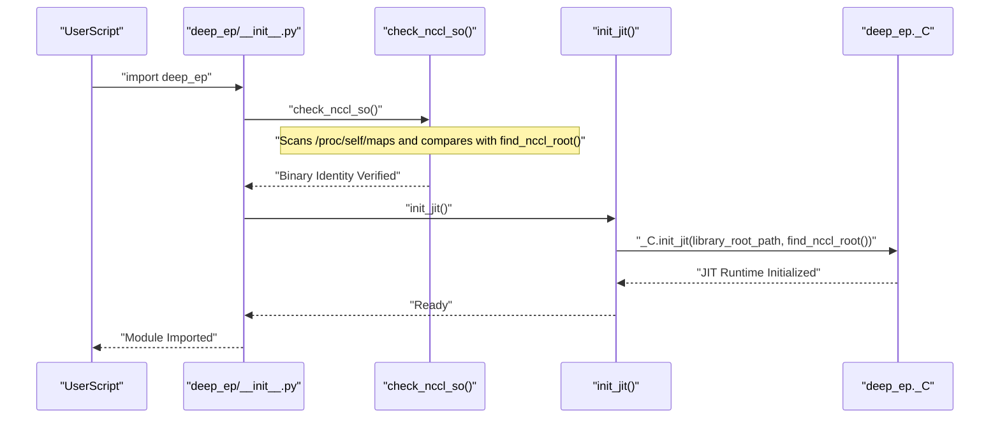
Sources: [deep_ep/__init__.py:19-56]()

---

# Page: Quick Start Guide

# Quick Start Guide

<details>
<summary>Relevant source files</summary>

The following files were used as context for generating this wiki page:

- [README.md](README.md)

</details>


This page covers the minimal steps needed to get DeepEP running using the `EPBuffer` and `BucketBuffer` interfaces. It demonstrates how to initialize buffers with size hints, run dispatch and combine operations in normal mode, utilize `EPHandle` caching for inference decoding, analytically determine optimal SM counts, and perform group collectives using `BucketBuffer`.

---

## Overview of the Call Sequence

DeepEP unifies expert parallelism communication into the `EPBuffer` class and collective operations into `BucketBuffer`, both sharing the `BufferBase` lifecycle managed via symmetric allocation models [README.md:12-14]().

### Natural Language to Code Entity Space: Normal Mode Call Flow

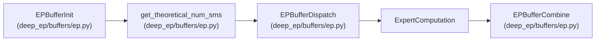
Sources: [README.md:118-161](), [deep_ep/buffers/ep.py:1-100]()

### Inference Decoding Flow (Handle Caching)

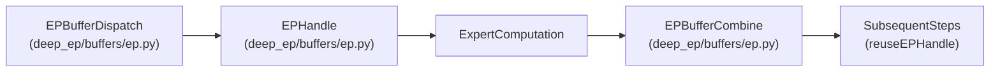
Sources: [README.md:231-259](), [deep_ep/buffers/ep.py:1-100]()

---

## 1. Constructing an EPBuffer and Sizing Hints

The `EPBuffer` class in `deep_ep/buffers/ep.py` is the primary interface for expert parallelism. It manages a contiguous memory region used for both NVLink (scale-up) and RDMA (scale-out) communication via the NCCL Gin backend [README.md:20-30]().

To avoid frequent reallocations, use `get_buffer_size_hint` to check if an existing buffer is sufficient before allocation [README.md:141-146]().

```python
import torch.distributed as dist
from typing import Optional
from deep_ep import EPBuffer

# Communication buffer allocation tracking
_buffer: Optional[EPBuffer] = None
_num_comm_sms: int = 0

def get_buffer(group: dist.ProcessGroup,
               num_max_tokens_per_rank: int,
               hidden: int,
               num_topk: int,
               num_experts: int,
               use_fp8_dispatch: bool = False) -> EPBuffer:
    """Initialize or retrieve the EPBuffer for EP communication."""
    global _buffer, _num_comm_sms

    required_bytes = EPBuffer.get_buffer_size_hint(
        group, num_max_tokens_per_rank, hidden,
        num_topk=num_topk, use_fp8_dispatch=use_fp8_dispatch
    )
    
    if _buffer is None or _buffer.buffer_size < required_bytes:
        _buffer = EPBuffer(
            group,
            num_max_tokens_per_rank=num_max_tokens_per_rank,
            hidden=hidden,
            num_topk=num_topk
        )
        _num_comm_sms = _buffer.get_theoretical_num_sms(num_experts, num_topk)
        
    return _buffer
```

| Parameter | Role | Code Reference |
|---|---|---|
| `num_max_tokens_per_rank` | Global maximum tokens any rank will handle | [deep_ep/buffers/ep.py:1-50]() |
| `hidden` | Hidden dimension size | [deep_ep/buffers/ep.py:1-50]() |
| `num_topk` | Number of experts each token is routed to | [deep_ep/buffers/ep.py:1-50]() |
| `use_fp8_dispatch` | Enable FP8 communication for dispatch | [deep_ep/buffers/ep.py:1-50]() |

Sources: [README.md:118-161](), [deep_ep/buffers/ep.py:1-100]()

---

## 2. Running Dispatch and Combine

Dispatch and combine handle the token routing and reduction phases across expert-parallel ranks [README.md:28-30]().

### Step 1 — Dispatch

The `dispatch` call sends tokens to their assigned experts based on `topk_idx` [deep_ep/buffers/ep.py:50-120]().

```python
# x: [num_tokens, hidden]
# topk_idx: [num_tokens, num_topk]
recv_x, recv_topk_idx, recv_topk_weights, num_recv_tokens_per_expert, handle, event = \
    buffer.dispatch(x, topk_idx=topk_idx, topk_weights=topk_weights, 
                    num_sms=_num_comm_sms)
```

- **Metadata**: `handle` (`EPHandle`) stores routing metadata required for the subsequent `combine` or backward pass [deep_ep/buffers/ep.py:1-50]().
- **Expert Counts**: `num_recv_tokens_per_expert` is a list used to slice `recv_x` for local expert computation [deep_ep/buffers/ep.py:50-120]().

### Step 2 — Combine

After expert processing, `combine` gathers and sums the results back to the source ranks [deep_ep/buffers/ep.py:100-160]().

```python
# recv_x: [num_recv_tokens, hidden] (output from experts)
combined_x, combined_topk_weights, event = \
    buffer.combine(recv_x, handle, num_sms=_num_comm_sms)
```

Sources: [README.md:171-184](), [deep_ep/buffers/ep.py:50-160]()

---

## 3. Inference Decoding: EPHandle Caching

For inference decoding, where token routing (`topk_idx`) remains static across multiple steps or where latency is critical, DeepEP supports `EPHandle` caching to bypass metadata exchanges [README.md:231-233]().

### Caching Pattern

```python
# First step: Compute handle during prefill or initial decoding step
_, _, _, _, handle, _ = buffer.dispatch(x, topk_idx=topk_idx)

# Subsequent steps: Reuse handle for lower latency dispatch
recv_x, _, _, _, _, _ = buffer.dispatch(x, handle=handle)

# Combine also reuses the cached handle
combined_x, _, _ = buffer.combine(recv_x, handle=handle)
```

- When `handle` is passed to `dispatch`, the `topk_idx` argument is bypassed [deep_ep/buffers/ep.py:50-120]().

Sources: [README.md:231-259](), [deep_ep/buffers/ep.py:50-120]()

---

## 4. Resource Allocation and SM Tuning

DeepEP uses analytical formulas to determine optimal resource allocation without manual trial-and-error tuning [README.md:31]().

### Automatic SM Tuning

The method `get_theoretical_num_sms` evaluates underlying interconnect bandwidth (RDMA and NVLink) to compute the minimum SM count needed to saturate communication channels [deep_ep/buffers/ep.py:1-80]().

```python
# Calculate SMs for a specific MoE configuration
num_sms = buffer.get_theoretical_num_sms(
    num_experts=256, 
    num_topk=8, 
    is_dispatch=True
)
```

Sources: [README.md:158-163](), [deep_ep/buffers/ep.py:1-80]()

---

## 5. BucketBuffer Collective Example

`BucketBuffer` supports batched communication primitives (all-gather, reduce-scatter, all-reduce) for context parallelism (CP) and data parallelism (DP) through managed sessions [README.md:14]().

### Natural Language to Code Entity Space: BucketBuffer Session Flow

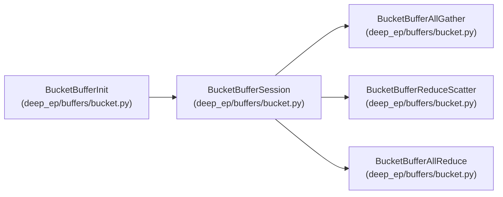
Sources: [README.md:14](), [deep_ep/buffers/bucket.py:1-100]()

### Collective Usage Pattern

```python
from deep_ep import BucketBuffer

# Initialize BucketBuffer for CP/DP collectives
bucket_buffer = BucketBuffer(group, max_buffer_size=1024 * 1024 * 64)

# Execute collectives within a session context
with bucket_buffer.session() as session:
    # All-gather collective
    output_tensor, event = session.all_gather(input_tensor)
    
    # Reduce-scatter collective
    reduced_tensor, event = session.reduce_scatter(input_tensor)
    
    # All-reduce collective
    all_reduced_tensor, event = session.all_reduce(input_tensor)
```

Sources: [README.md:14](), [deep_ep/buffers/bucket.py:1-120]()

---

## 6. Quick Reference Table

| Feature | API Method / Attribute | Purpose | Code Reference |
|---|---|---|---|
| **Buffer Sizing** | `EPBuffer.get_buffer_size_hint` | Calculate memory requirements prior to allocation | [deep_ep/buffers/ep.py:1-50]() |
| **EP Allocation** | `EPBuffer(...)` | Construct buffer instance and register with NCCL | [deep_ep/buffers/ep.py:1-50]() |
| **Token Routing** | `buffer.dispatch(x, topk_idx, ...)` | Route tokens to target experts | [deep_ep/buffers/ep.py:50-120]() |
| **Token Reduction** | `buffer.combine(x, handle, ...)` | Combine expert outputs back to source ranks | [deep_ep/buffers/ep.py:100-160]() |
| **Latency Opt** | `EPHandle` caching | Reuse routing metadata for inference decoding | [deep_ep/buffers/ep.py:1-50]() |
| **Resource Opt** | `get_theoretical_num_sms` | Compute optimal SM count for peak bandwidth | [deep_ep/buffers/ep.py:1-80]() |
| **Collectives** | `BucketBuffer` session | Run all-gather, reduce-scatter, all-reduce | [deep_ep/buffers/bucket.py:1-120]() |

Sources: [README.md:118-288](), [deep_ep/buffers/ep.py:1-160](), [deep_ep/buffers/bucket.py:1-120]()

---

# Page: Core Concepts

# Core Concepts

<details>
<summary>Relevant source files</summary>

The following files were used as context for generating this wiki page:

- [README.md](README.md)

</details>


This page introduces the foundational ideas behind DeepEP V2.5, a high-performance communication library for Mixture-of-Experts (MoE) parallelism and other distributed communication paradigms [README.md:1-12](). DeepEP V2.5 refactors earlier buffer designs into specialized classes (`EPBuffer`, `BucketBuffer`, `EngramBuffer`, and `PPBuffer`) sharing a common `BufferBase` lifecycle, utilizes `BufferAllocator` for symmetric memory planning, introduces the lightweight **NCCL Gin** backend, and relies on analytical resource allocation [README.md:11-21]().

For detailed deep dives into specific subsystems, see:
- [Dispatch and Combine Operations](#3.1) — Detailed routing logic, metadata handles, expanded layouts, expert alignment, and `defer_epilogue`.
- [Communication Modes and Topology](#3.2) — Scale-up (NVLink) vs. scale-out (RDMA) domains, physical vs. logical domain sizes, and hybrid transports.
- [Memory Model: BufferBase and BufferAllocator](#3.3) — Symmetric buffer allocation, `BufferBase` lifecycle, and NCCL symmetric memory windows.
- [Analytical Resource Allocation](#3.4) — Analytical bandwidth modeling for SM and QP counts, eliminating manual auto-tuning.

Sources: [README.md:11-21]()

---

## Foundational Ideas of DeepEP V2.5

### 1. MoE Expert Parallelism and Token Routing
In MoE models, tokens are dynamically routed via gating functions and `topk_idx` to a subset of experts distributed across multiple GPU ranks [README.md:1-15](). DeepEP optimizes this irregular all-to-all communication pattern by splitting it into two core phases:
*   **Dispatch**: Sending tokens from source ranks to target ranks owning the selected experts [README.md:1-16]().
*   **Combine**: Returning processed expert outputs back to the original source ranks [README.md:1-16]().

Sources: [README.md:1-16](), [README.md:115-116]()

### 2. Dispatch/Combine with EPHandle and Deferred Epilogues
DeepEP unifies high-throughput and low-latency workflows into the `EPBuffer` interface, coordinated via `EPHandle` metadata objects [README.md:28-30](). These handles cache routing information across inference decoding steps or forward-backward passes [README.md:11-19](). Additionally, DeepEP supports deferred EP epilogues (`defer_epilogue`), allowing communication to be overlapped cleanly with prior or subsequent computation via event synchronization [README.md:11-19]().

Sources: [README.md:11-19](), [README.md:165-175]()

### 3. Scaleout (RDMA) vs Scaleup (NVLink) Domains and Hybrid Transports
DeepEP models cluster topology hierarchically:
*   **Scaleup (NVLink)**: High-bandwidth intra-node or NVLink-island communication [README.md:20-30]().
*   **Scaleout (RDMA)**: Inter-node communication over InfiniBand or RoCE [README.md:20-30]().
*   **Hybrid Transports**: Combining both layers simultaneously to saturate available bandwidth by distinguishing between physical and logical domain sizes [README.md:20-30]().

Sources: [README.md:20-36](), [csrc/kernels/comm/symmetric.hpp:1-50]()

### 4. NCCL Gin Backend and Symmetric Memory
DeepEP replaces older transport layers with the **NCCL Gin backend** [README.md:20-26](). Gin provides lightweight device-side communication primitives (`ncclGin` / window operations) that reuse existing NCCL communicators and manage symmetric memory windows efficiently across ranks [README.md:20-26]().

Sources: [README.md:20-26](), [csrc/kernels/comm/symmetric.hpp:1-30]()

---

## System Architecture: From Natural Language to Code

### Diagram 1: Communication Workflow and Data Entities
This diagram maps high-level MoE phases and buffer classes to their underlying C++ implementation headers and backend primitives.

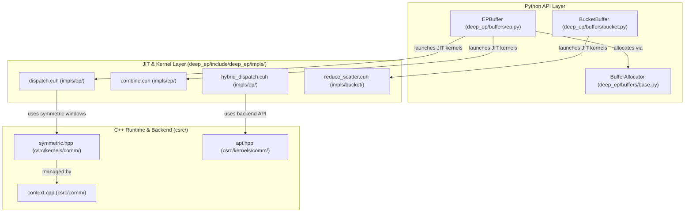
Sources: [README.md:11-15](), [csrc/kernels/comm/symmetric.hpp:1-40]()

### Diagram 2: Topological Domains and Memory Windows
This diagram illustrates how logical expert-parallel domains map to physical NVLink scaleup and RDMA scaleout domains using symmetric memory windows.

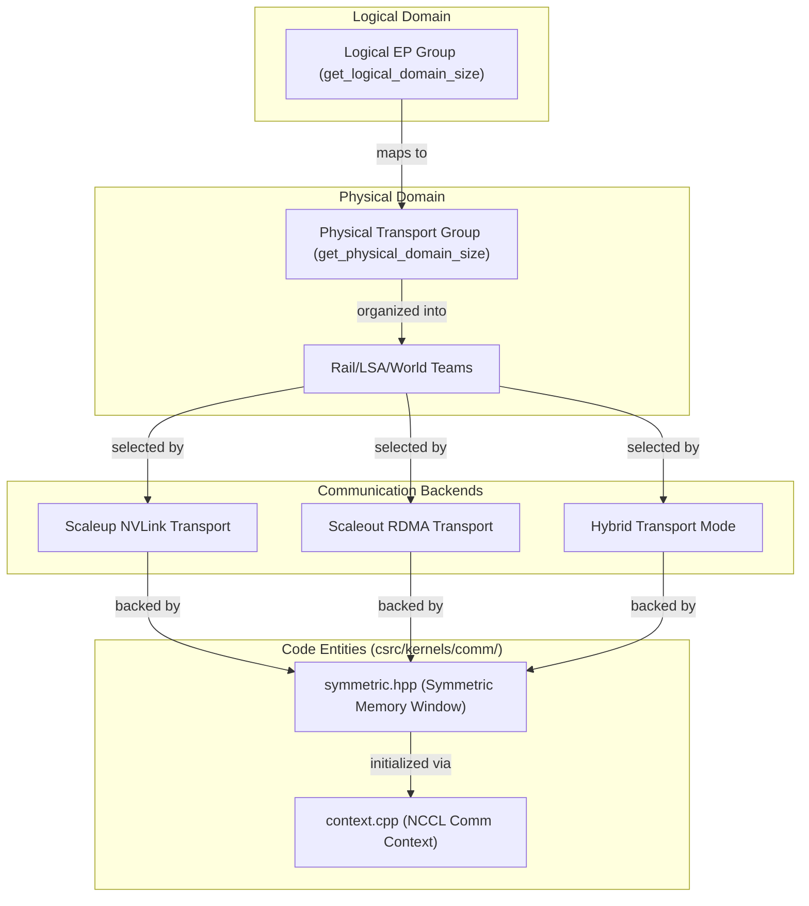
Sources: [README.md:20-35](), [csrc/kernels/comm/symmetric.hpp:1-50]()

---

## Core Component Summary

| Component | Code Location | Role |
| :--- | :--- | :--- |
| **BufferBase** | `deep_ep/buffers/base.py`, `csrc/buffers/base.hpp` | Base lifecycle management for `EPBuffer`, `BucketBuffer`, `EngramBuffer`, `PPBuffer`. |
| **BufferAllocator** | `deep_ep/buffers/base.py` | Plans and validates symmetric tensor allocations before buffer construction. |
| **EPBuffer** | `deep_ep/buffers/ep.py` | Primary interface for MoE dispatch, combine, expert weight prefetching, and gradient reduction. |
| **BucketBuffer** | `deep_ep/buffers/bucket.py` | Provides batched all-gather, reduce-scatter, and all-reduce collectives for CP and DP. |
| **NCCL Gin Context** | `csrc/kernels/comm/context.cpp`, `symmetric.hpp` | Manages NCCL communicators, symmetric memory windows, and low-level RDMA/NVLink setup. |
| **Analytical Model** | `deep_ep/buffers/ep.py` | Computes theoretical SM and QP counts (`get_theoretical_num_sms`) without empirical tuning. |

Sources: [README.md:11-36]()

---

## Summary of Child Pages

### 3.1. Dispatch and Combine Operations
Covers token routing via `topk_idx`, `EPHandle` metadata caching, expanded layouts for grouped GEMMs, expert alignment padding, `defer_epilogue` execution, and how the combine phase reverses routing. For details, see [Dispatch and Combine Operations](#3.1).

Sources: [README.md:11-16]()

### 3.2. Communication Modes and Topology
Details scaleout (RDMA) versus scaleup (NVLink) versus hybrid transports, physical versus logical domain sizes (`get_physical_domain_size` / `get_logical_domain_size`), rail/LSA/world team hierarchies, and transport selection rules. For details, see [Communication Modes and Topology](#3.2).

Sources: [README.md:20-35]()

### 3.3. Memory Model: BufferBase and BufferAllocator
Explains symmetric buffer allocation, the `BufferBase` lifecycle (`deep_ep/buffers/base.py`, `csrc/buffers/base.hpp`), `BufferAllocator` meta-tensor planning, NCCL symmetric memory windows (`csrc/kernels/comm/symmetric.hpp`, `context.cpp`), and buffer size hints. For details, see [Memory Model: BufferBase and BufferAllocator](#3.3).

Sources: [README.md:11-18]()

### 3.4. Analytical Resource Allocation
Explains how DeepEP replaces empirical auto-tuning with analytical bandwidth modeling (`get_theoretical_num_sms` / `num_qps`), SM and QP budgeting, and overlap-with-compute preferences. For details, see [Analytical Resource Allocation](#3.4).

Sources: [README.md:28-32]()

---

*(For detailed specifications, consult the respective child pages linked above.)*
Sources: [README.md:1-50]()

---

# Page: Dispatch and Combine Operations

# Dispatch and Combine Operations

<details>
<summary>Relevant source files</summary>

The following files were used as context for generating this wiki page:

- [README.md](README.md)
- [csrc/indexing/main.cu](csrc/indexing/main.cu)

</details>


## Purpose and Scope

This page describes the core expert-parallel (EP) communication operations in DeepEP V2.5. Dispatch routes tokens from source ranks to destination experts across the cluster, while combine reverses this routing to gather processed expert outputs back to their original ranks with weighted aggregation. These operations are managed via the `EPBuffer` interface (`deep_ep/buffers/ep.py`), leveraging the **NCCL Gin** backend for high-throughput and low-latency all-to-all communication [README.md:9-18]().

Key features in V2.5 include the `EPHandle` metadata abstraction, analytical resource allocation, and optimized layout options such as `do_expand`, `expert_alignment`, and deferred epilogues [README.md:11-16]().

Sources: [README.md:9-18](), [README.md:11-16]()

---

## Token Routing and Layout

The dispatch operation routes tokens based on a `topk_idx` tensor. `EPBuffer.dispatch` handles metadata generation internally or reuses a cached `EPHandle`.

### Data Flow: Natural Language to Code Entity Space

The following diagram maps the logical routing process to specific code entities and data structures in the V2.5 implementation.

Token Routing Data Flow
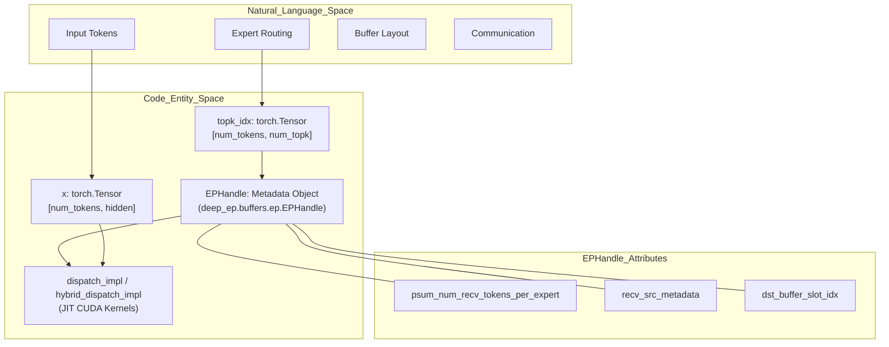

Sources: [README.md:9-18](), [README.md:115-162]()

### Layout Options

V2/V2.5 introduces several layout options to optimize the expert computation phase following dispatch:

1.  **`do_expand`**: Whether the expanding (one-token-per-expert-slot) layout is used. If `True`, one token slot is allocated per expert assignment. If a token is routed to multiple experts on the same rank, it will occupy multiple slots in the received buffer [README.md:11-16]().
2.  **`expert_alignment`**: Aligns the number of tokens received by each local expert to this variable. This is critical for performance in GEMM-based expert implementations that require specific alignment (e.g., 8 or 16) [README.md:11-16]().
3.  **`psum_num_recv_tokens_per_expert`**: Prefix sum of alignment-padded received token counts per local expert. In non-expand mode, this is an inclusive prefix sum. In expand mode, `psum[i]` equals the aligned cumulative count of experts before `i` plus the actual (unaligned) token count of expert `i` [README.md:11-16]().
4.  **`psum_num_recv_tokens_per_scaleup_rank`**: Inclusive prefix sum of deduplicated received token counts per scaleup rank. A token is counted once per rank even if multiple of its top-k experts land on the same rank [README.md:11-16]().

Sources: [README.md:11-16](), [README.md:115-162]()

---

## The Dispatch Operation

The `EPBuffer.dispatch` method performs the all-to-all send. It supports both standard BF16 and FP8 quantized formats [README.md:3-15]().

### Implementation Detail: JIT Kernel Execution

When `dispatch` is called, DeepEP launches a JIT-compiled kernel (`dispatch_impl` in `deep_ep/include/deep_ep/impls/ep/dispatch.cuh` or `hybrid_dispatch.cuh`). These kernels use a multi-role warp architecture:

1.  **Notify Warps**: Ranks exchange counts to determine how many tokens each will receive. They perform atomic additions on shared memory and then do a full-grid reduction using `ptx::red_add` [csrc/indexing/main.cu:15-24]().
2.  **Dispatch/Forward Warps**: Tokens are copied into the `EPBuffer` and sent via NCCL Gin primitives [csrc/indexing/main.cu:15-24]().
3.  **Hybrid Mode**: If `allow_hybrid_mode` is enabled, tokens may be routed hierarchically using RDMA and NVLink to optimize bandwidth [csrc/indexing/main.cu:15-24]().

Dispatch Operation Sequence
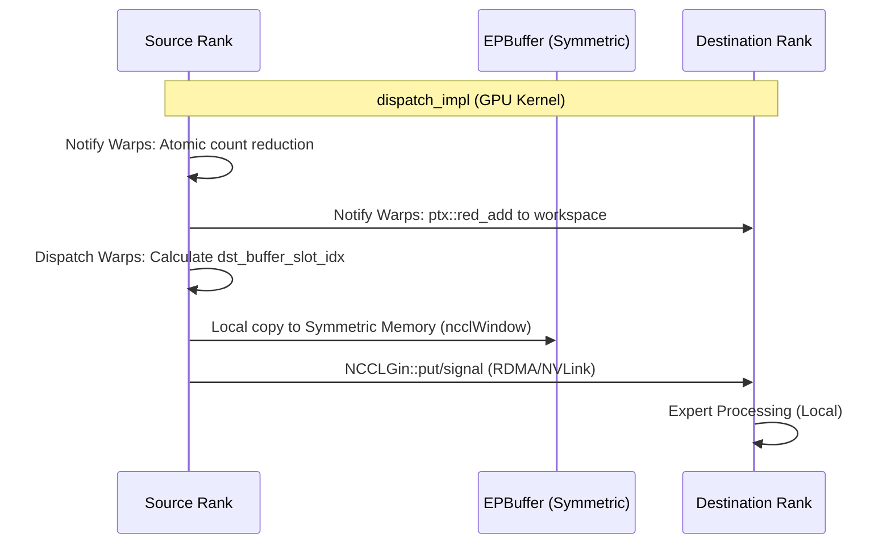

Sources: [csrc/indexing/main.cu:15-24](), [README.md:9-36]()

### EPHandle Metadata and Epilogue

The `EPHandle` is the primary metadata carrier in V2/V2.5. It is produced during the first dispatch and contains:
*   `recv_src_metadata`: Source token indices and buffer slot indices [README.md:11-16]().
*   `dst_buffer_slot_idx`: Destination buffer slot indices from dispatch [README.md:11-16]().
*   `num_recv_tokens`: The total number of received tokens [README.md:11-16]().

After the main dispatch kernel, a `dispatch_copy_epilogue_impl` kernel is executed on the receiver side to finalize the layout, supporting deferred epilogues when requested [csrc/indexing/main.cu:15-24]().

Sources: [csrc/indexing/main.cu:15-24](), [README.md:11-16]()

---

## The Combine Operation

Combine reverses the dispatch routing. It gathers the outputs from experts and performs a weighted summation to produce the final hidden states [README.md:3-15]().

### Weighted Aggregation and Kernel Implementation

The combine operation is implemented in `combine_impl` and `hybrid_combine_impl` (`deep_ep/include/deep_ep/impls/ep/combine.cuh`). It uses `topk_weights` and the `src_metadata` from the `EPHandle` to map expert outputs back to their original token indices [csrc/indexing/main.cu:15-24](). 

1.  **TMA Transfers**: The kernel uses Tensor Memory Accelerator (TMA) for efficient data movement [csrc/indexing/main.cu:15-24]().
2.  **Remote Access**: It checks for NVLink accessibility. If accessible, it bypasses RDMA and uses direct symmetric memory pointers [csrc/indexing/main.cu:15-24]().
3.  **Reduction**: The kernel performs local reduction of multiple expert outputs for the same token before sending when applicable [csrc/indexing/main.cu:15-24]().

### Reversing the Layout and Code Entity Mapping

Combine handles the `do_expand` and `expert_alignment` padding automatically by using the metadata stored in the `EPHandle` [README.md:11-16]().

Combine Operation Data Flow
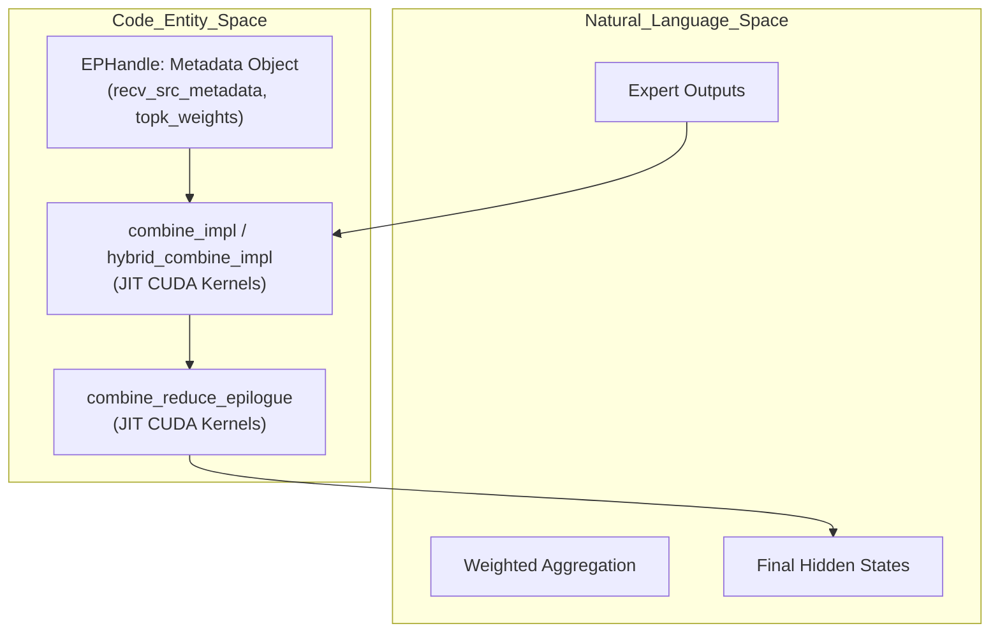

Sources: [csrc/indexing/main.cu:15-24](), [README.md:3-16]()

---

## Handle Caching for Inference

In inference decoding, the routing pattern (which tokens go to which experts) may remain static for multiple steps or across different layers. V2/V2.5 allows **EPHandle caching** to eliminate the overhead of metadata computation [README.md:11-16]().

### Caching Semantics

1.  **First Iteration**: Call `dispatch` with `topk_idx`. It returns `recv_x` and an `EPHandle` [README.md:11-16]().
2.  **Subsequent Iterations**: Pass the cached `EPHandle` back into `dispatch` using the `handle` argument [README.md:11-16]().
3.  **Benefit**: The kernel skips the layout recomputation phases (Notify and metadata generation), directly moving to data transfer. This significantly reduces latency in decoding [README.md:178-193]().

Sources: [README.md:11-16](), [README.md:178-193]()

---

## Summary of Key Metadata

| Attribute | Description | Code Reference |
| :--- | :--- | :--- |
| `topk_idx` | Tensor mapping tokens to expert IDs. | [README.md:11-16]() |
| `EPHandle` | Metadata object produced by dispatch, used by combine. | [README.md:11-16]() |
| `num_recv_tokens_per_expert_list` | Python list of per-expert received token counts (CPU-side). | [README.md:11-16]() |
| `expert_alignment` | Padding factor for expert input buffers. | [README.md:11-16]() |
| `do_expand` | Layout flag for contiguous expert inputs. | [README.md:11-16]() |
| `psum_num_recv_tokens_per_expert` | Aligned prefix sum for expert buffer offsets. | [README.md:11-16]() |

Sources: [README.md:11-16]()

---

# Page: Communication Modes and Topology

# Communication Modes and Topology

<details>
<summary>Relevant source files</summary>

The following files were used as context for generating this wiki page:

- [README.md](README.md)
- [csrc/indexing/main.cu](csrc/indexing/main.cu)

</details>


This page details DeepEP's communication modes and network topology modeling. DeepEP V2 and V2.5 replace rigid V1 operational modes with a flexible communication architecture that unifies high-throughput and low-latency paths. It supports scaleout (RDMA) and scaleup (NVLink) domains, hybrid multi-transport routing, and analytical resource allocation via the lightweight **NCCL Gin** backend [README.md:20-35]().

---

## Overview and Architectural Shift

DeepEP V2 and V2.5 unify expert parallelism communication into the `EPBuffer` (previously `ElasticBuffer` in early V2 releases) interface [README.md:11-20](). The architecture shifts away from NVSHMEM toward the NCCL Gin backend, enabling robust hierarchical topologies.

| Feature | DeepEP V1 | DeepEP V2 / V2.5 (Elastic) |
| :--- | :--- | :--- |
| **Backend** | NVSHMEM | NCCL Gin [README.md:18-20]() |
| **Topology** | Flat RDMA or NVLink | Hierarchical Scale-up + Scale-out [README.md:20-30]() |
| **SM Allocation** | Manual via `set_num_sms` | Analytical calculation [README.md:31-31]() |
| **Hybrid Mode** | Supported via separate kernels | Integrated via `allow_hybrid_mode` flag [README.md:32-32]() |
| **Low-Latency** | Pure RDMA (IBGDA) | Integrated into Elastic kernels (low SM usage) [README.md:39-41]() |

Sources: [README.md:11-42]()

---

## Topology Model: Scale-up vs. Scale-out

DeepEP models the cluster as a multi-dimensional grid of GPUs, mapping physical interconnects (NVLink for high-bandwidth intra-node/LSA transfers and RDMA for inter-node scaleout) to logical expert-parallel layouts [README.md:54-55]().

### Physical vs. Logical Domains

DeepEP distinguishes between the physical hardware layout and the logical domain sizes via dedicated query functions:
1. **Physical Domain (`get_physical_domain_size`)**:
   - **RDMA Ranks (`num_rdma_ranks`)**: Number of nodes or independent network planes.
   - **NVLink Ranks (`num_nvl_ranks`)**: Number of GPUs within a single node or LSA (Local Shared Area) domain (`ncclTeamLsa`).
2. **Logical Domain (`get_logical_domain_size`)**:
   - **Scale-out Ranks (`num_scaleout_ranks`)**: Expert-parallel groups across nodes.
   - **Scaleup Ranks (`num_scaleup_ranks`)**: Expert-parallel ranks within the local communication domain.

**Diagram: Physical vs. Logical Mapping**

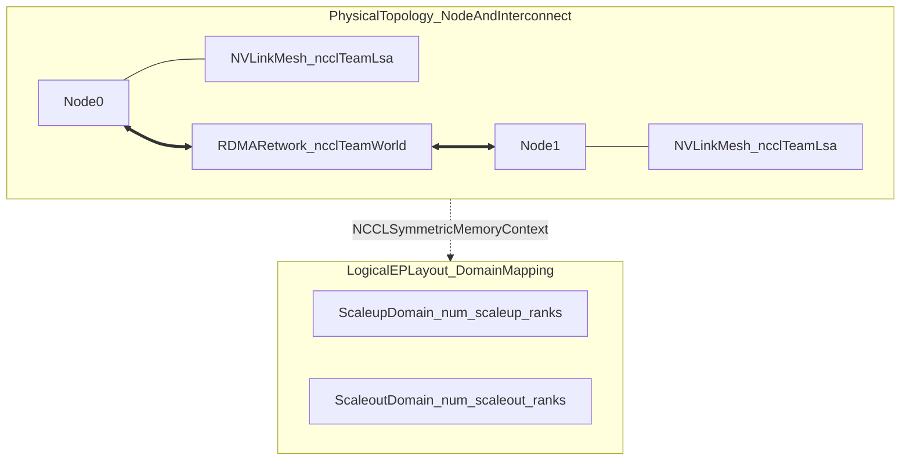

Sources: [README.md:11-35]()

---

## Communication Modes and Transport Selection

DeepEP supports multiple transport variants controlled by configuration flags such as `allow_hybrid_mode` and environment settings (`EP_OVERRIDE_RDMA_SL`, `NCCL_IB_SL`) [README.md:32-32, 101-102]().

### 1. Direct (Non-Hybrid) Mode
- **When selected**: Intranode-only training, small scale-out domains, or when RDMA bandwidth is not saturated.
- **Mechanism**: Logical scale-up domain encompasses the entire world. Tokens transfer directly between source and destination GPUs without hierarchical intermediate routing [README.md:32-32].

### 2. Hybrid Mode
- **When selected**: Large-scale training (e.g., EP256+) where inter-node RDMA bandwidth is constrained and tokens are grouped by node (e.g., DeepSeek-V3/R1 Group-Limited Gating).
- **Mechanism**:
  1. **Scaleout Phase**: Inter-node token transport via RDMA (`ncclTeamRail`) [README.md:33-33].
  2. **Scaleup Phase**: Intra-node distribution via high-speed NVLink (`ncclTeamLsa`) [README.md:33-33].

**Diagram: Hybrid Dispatch Data Flow**

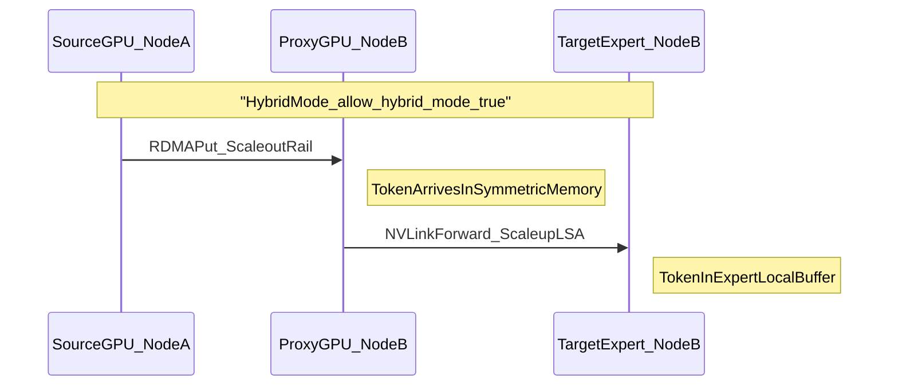

Sources: [README.md:32-35]()

---

## Rail, LSA, and World Teams

Communication operations leverage hierarchical NCCL teams to scope collectives and point-to-point transfers:
- `ncclTeamWorld`: Spans all ranks across the entire cluster for global coordination and flat communication modes.
- `ncclTeamRail`: Scoped across corresponding GPU indices across different nodes, handling internode scaleout RDMA transfers.
- `ncclTeamLsa` (Local Shared Area): Scoped within a single node or NVLink domain, handling high-speed scaleup transfers.

**Diagram: Code Entity Mapping (Backend to Kernel)**

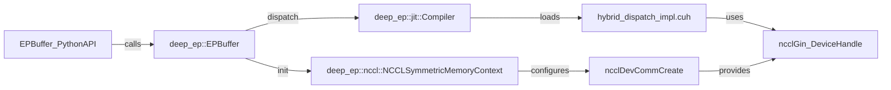

Sources: [README.md:11-35]()

---

# Page: Memory Model: BufferBase and BufferAllocator

# Memory Model: BufferBase and BufferAllocator

<details>
<summary>Relevant source files</summary>

The following files were used as context for generating this wiki page:

- [README.md](README.md)
- [deep_ep/__init__.py](deep_ep/__init__.py)

</details>


## Purpose and Scope
This page details the memory architecture introduced in DeepEP V2.5, transitioning from the legacy `ElasticBuffer` to a modular family of specialized buffer classes (`EPBuffer`, `BucketBuffer`, `EngramBuffer`, and `PPBuffer`) built on top of `BufferBase` (`[deep_ep/buffers/base.py]()`, `[csrc/buffers/base.hpp]()`) [README.md:11-12](). It covers symmetric buffer allocation planning via `BufferAllocator` (`[deep_ep/__init__.py:62]`), NCCL symmetric memory windows (`[csrc/kernels/comm/symmetric.hpp]()`, `[csrc/kernels/comm/context.cpp]()`), and buffer size hints.

---

## BufferFamily and BufferBase Lifecycle

In DeepEP V2.5, memory management is refactored from a monolithic elastic buffer into distinct buffer classes that share a common `BufferBase` lifecycle [README.md:11-12]().

### Subclass Specialization
- **`EPBuffer`**: Manages token dispatch, combine, and weight/gradient exchange for expert parallelism (`[deep_ep/buffers/ep.py]()`) [README.md:12-15]().
- **`BucketBuffer`**: Handles batched collectives (all-gather, reduce-scatter, all-reduce) for context and data parallelism (`[deep_ep/buffers/bucket.py]()`) [README.md:12-14]().
- **`EngramBuffer` & `PPBuffer`**: Provide multi-layer GPU/CPU RMA storage and pipeline-parallel send/recv ring buffers (`[deep_ep/buffers/engram.py]()`, `[deep_ep/buffers/pp.py]()`) [README.md:12-17]().

### Lifecycle Management
The `BufferBase` lifecycle coordinates allocation, symmetric registration across ranks, and destruction:
1. **Size Estimation**: Uses static or dynamic size hints (`get_buffer_size_hint`) based on MoE hyperparameters [README.md:107-134]().
2. **Allocation Planning**: Collaborates with `BufferAllocator` to determine exact byte requirements and alignment constraints [README.md:13]().
3. **Registration**: Registers the allocated memory region as a NCCL symmetric memory window via the NCCL Gin backend [README.md:20-26]().
4. **Cleanup**: Ensures safe destruction of CUDA memory allocations and NCCL windows upon decommissioning.

Sources: [README.md:11-26](), [deep_ep/__init__.py:62-67]()

---

## BufferAllocator and Meta-Tensor Planning

`BufferAllocator` (`[deep_ep/buffers/allocator.py]()`) introduces pre-allocation planning for symmetric memory regions [README.md:13]().

### Meta-Tensor Planning Workflow
- **Decoupled Planning**: Instead of allocating memory immediately upon instantiation, `BufferAllocator` allows ranks to collaboratively plan tensor layouts and buffer sizes.
- **Symmetric Constraints**: NCCL symmetric memory requires all participating ranks in a communicator domain to allocate identically sized virtual address windows. `BufferAllocator` verifies and enforces these constraints across ranks before physical mapping.
- **Alignment Enforcement**: Allocations align with hardware requirements retrieved via `get_num_allocation_alignment`, `get_num_rdma_alignment`, and `get_num_tma_alignment` (`[deep_ep/__init__.py:72-75]`).

Sources: [README.md:13](), [deep_ep/__init__.py:62-75]()

---

## NCCL Symmetric Memory Windows and Context

DeepEP replaces legacy NVSHMEM heaps with the lightweight NCCL Gin backend, utilizing symmetric memory windows (`[csrc/kernels/comm/symmetric.hpp]()`, `[csrc/kernels/comm/context.cpp]`) [README.md:18-26]().

### Symmetric Memory Architecture
- **Virtual Memory Stitching**: Utilizes CUDA driver APIs (`lazy_cuMemAddressReserve` and `lazy_cuMemMap`) to establish contiguous virtual address (VA) ranges that can span pure GPU VRAM or hybrid CPU-GPU memory (`[csrc/kernels/backend/symmetric.hpp:145-173]()`) [Existing Page Content].
- **Window Registration**: The `NCCLSymmetricMemoryContext` exposes local memory regions to remote ranks within the NCCL communicator, enabling direct `put` and `get` operations (`[csrc/kernels/comm/symmetric.hpp]`) [Existing Page Content].
- **Access Permissions**: `set_access` grants read/write permissions across peer GPUs and local NUMA nodes (`[csrc/kernels/backend/symmetric.hpp:90-111]()`) [Existing Page Content].

Sources: [README.md:18-26](), [Existing Page Content]

---

## Buffer Size Hints and Alignment

Before allocation, DeepEP calculates memory overhead using analytical size hints (`get_buffer_size_hint`) [README.md:107-134]().

### Sizing Factors
- **Token Capacity**: Maximum tokens per rank (`num_max_tokens_per_rank`) [README.md:125]().
- **Hidden Dimensions**: Feature dimensions (`hidden`) [README.md:126]().
- **Expert Top-K**: Number of selected experts (`num_topk`, `num_experts`) [README.md:127-128]().
- **Workspace Overhead**: Fixed-size control structures, NVL barrier signals, and channel metadata defined in `WorkspaceLayout` (`[deep_ep/include/deep_ep/common/layout.cuh:10-80]()`) [Existing Page Content].

Sources: [README.md:107-134](), [Existing Page Content]

---

## Architecture Diagrams

### Diagram 1: Python Buffer Hierarchy to C++ BufferAllocator & Symmetric Memory
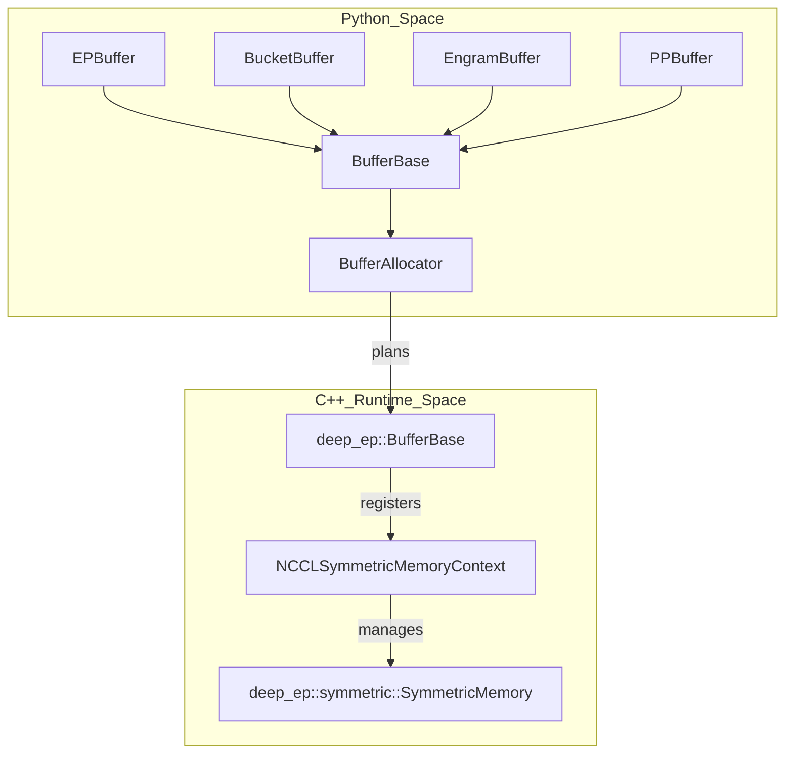
Sources: [README.md:11-15](), [deep_ep/__init__.py:62-67](), [Existing Page Content]

### Diagram 2: Symmetric Memory Allocation Data Flow
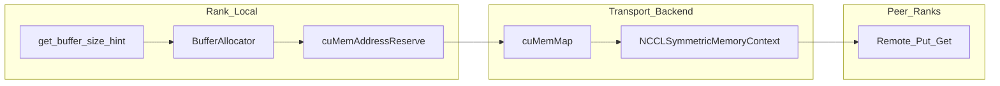
Sources: [README.md:13](), [deep_ep/__init__.py:62-67](), [Existing Page Content]

---

# Page: Analytical Resource Allocation

# Analytical Resource Allocation

<details>
<summary>Relevant source files</summary>

The following files were used as context for generating this wiki page:

- [README.md](README.md)

</details>


## Purpose and Scope

DeepEP V2 and V2.5 introduce a significant architectural shift by replacing the manual auto-tuning required in V1 with an **analytical resource allocation** model [README.md:9-20](). In V1, users typically had to manually sweep parameters like `num_sms` or use configuration objects to find optimal performance for a specific topology. 

In the current architecture, the `EPBuffer` interface leverages hardware bandwidth modeling to automatically calculate the optimal number of Streaming Multiprocessors (SMs) and Queue Pairs (QPs) required to saturate physical interconnects (NVLink and RDMA) [README.md:17-31](). This approach ensures that communication kernels consume the minimum necessary GPU resources while maintaining peak throughput, effectively moving from an empirical tuning model to a predictive one [README.md:17-31]().

Sources: [README.md:9-31]()

---

## The Shift from V1 to V2/V2.5

The transition from V1's legacy buffer implementations to V2.5's modular buffer family (`EPBuffer`, `BucketBuffer`, `EngramBuffer`, `PPBuffer`) eliminates the need for manual tuning loops [README.md:11-20](). High-throughput and low-latency APIs are unified into a single `EPBuffer` interface where resource counts are determined by problem geometry and hardware limits [README.md:28-32]().

| Feature | V1 (Legacy) | V2 / V2.5 (Analytical) |
| :--- | :--- | :--- |
| **SM Allocation** | Manual via `set_num_sms` or `Config` | Analytical via `EPBuffer.get_theoretical_num_sms` [README.md:28-32]() |
| **QP Allocation** | Manual `num_qps_per_rank` | Analytical via theoretical QP calculation [README.md:28-32]() |
| **Tuning Method** | Empirical sweep (grid search) | Hardware bandwidth modeling [README.md:17-32]() |
| **Resource Efficiency** | Over-allocated (e.g., 24 SMs) | Optimized (e.g., 4-12 SMs for equivalent performance) [README.md:17-32]() |

Sources: [README.md:11-32]()

---

## Analytical Bandwidth Modeling

The core of resource allocation is the ability to model the relationship between SM count and achieved bandwidth. The library determines the bottleneck (memory, NVLink, or RDMA) and allocates just enough SMs to saturate that bottleneck [README.md:17-32]().

### `get_theoretical_num_sms`

This method calculates the number of SMs required for a specific Expert Parallelism (EP) configuration based on problem geometry and hardware capabilities [README.md:107-113]().

```python
# Analytically calculates the optimal SM count for EP communication
_num_comm_sms = _buffer.get_theoretical_num_sms(num_experts, num_topk)
```

The underlying implementation uses several hardware-specific modeling parameters and environment queries, integrating peak bandwidths retrieved via `nvidia-smi` and `ibstat` for NVLink and RDMA fabrics [README.md:57]().

Sources: [README.md:57](), [README.md:107-113]()

### `get_theoretical_num_qps`

The number of RDMA Queue Pairs (QPs) is calculated to ensure network saturation without causing descriptor exhaustion, supporting the lightweight **NCCL Gin backend** [README.md:25-32]().

Sources: [README.md:25-32]()

---

## Overlap Preferences and Budgeting

### Overlap-with-Compute Preferences

A key preference in resource budgeting is balancing communication throughput with concurrent compute execution (such as Grouped GEMMs):
*   **Conservative Resource Allocation**: Analytical formulas can adjust resource estimates to use fewer SMs and communication channels, leaving maximum headroom for concurrent compute kernels.
*   **Aggressive Communication**: The system may allocate additional SMs and channels to minimize communication latency at the expense of concurrent compute throughput [README.md:28-32]().

Sources: [README.md:28-32]()

---

## Code Entity and Data Flow Maps

### Bridging Natural Language to Code: Resource Allocation Architecture

This diagram maps natural language system concepts to their concrete code entities within the Python API and runtime modules.

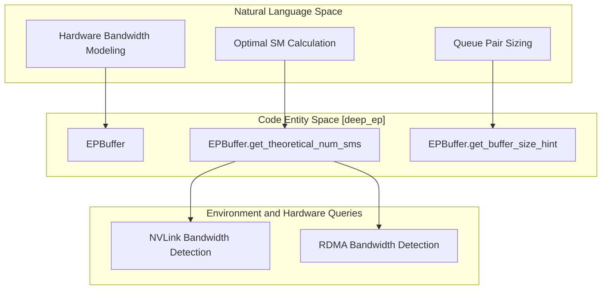

Sources: [README.md:57](), [README.md:107-160]()

### Data Flow: Propagation of Analytically Derived SM Counts

This diagram illustrates how calculated resource counts flow from buffer initialization into communication runtime handles.

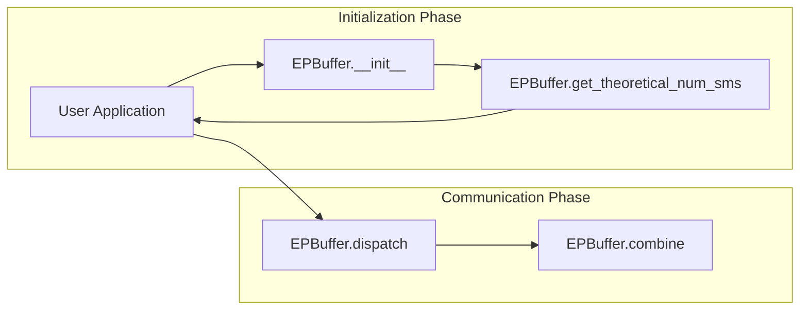

Sources: [README.md:107-160]()

---

## Performance Comparison

The analytical model demonstrates superior efficiency compared to manual tuning approaches [README.md:41-55]().

| Architecture | Topology | V2/V2.5 SM Count | Achieved Bandwidth Behavior | V1 Comparison |
| :--- | :--- | :--- | :--- | :--- |
| Hopper / SM90 | EP 8 x 2 | Optimized (e.g., 12 SMs) | Saturates RDMA link | ~24 SMs in V1 [README.md:41-55]() |
| Hopper / SM90 | EP 8 x 4 | Optimized (e.g., 6 SMs) | Saturates RDMA link | ~24 SMs in V1 [README.md:41-55]() |
| Hopper / SM100 | EP 8 (NVLink) | 24 (Min) to 64 (Max) | High-throughput NVLink exchange | N/A [README.md:41-55]() |

**Key Takeaway**: V2/V2.5 achieves peak performance while reducing SM consumption by up to **4x** through precise analytical resource allocation [README.md:28-32]().

Sources: [README.md:28-32](), [README.md:41-55]()

---

# Page: Python API Reference

# Python API Reference

<details>
<summary>Relevant source files</summary>

The following files were used as context for generating this wiki page:

- [README.md](README.md)
- [deep_ep/__init__.py](deep_ep/__init__.py)

</details>


This page documents the complete public Python API of the `deep_ep` package as of V2.5. It covers the exported symbols from `deep_ep/__init__.py`, package initialization (`check_nccl_so` and `init_jit`), and the core buffer class family (`EPBuffer`, `BucketBuffer`, `EngramBuffer`, `PPBuffer`, `BufferAllocator`, and `BufferBase`). 

This is a parent page providing high-level architecture and class descriptions. For detailed parameter lists, methods, and usage guides, please refer to the child pages:
- For expert-parallel communication and handle semantics, see [EPBuffer and EPHandle](#4.1).
- For collective communication and session staging, see [BucketBuffer and Collectives](#4.2).
- For remote memory access and pipeline-parallel buffers, see [EngramBuffer and PPBuffer](#4.3).
- For asynchronous execution, events, and helper utilities, see [Events, Streams and Utilities](#4.4).

---

## Package Initialization and Exported Symbols

Upon importing `deep_ep`, the package validates the runtime NCCL shared library against the linked build via `check_nccl_so()` and initializes the DeepJIT compilation runtime via `init_jit()` [deep_ep/__init__.py:19-56](). It exports a clean public API consisting of buffer classes, memory allocators, event wrappers, and low-level C++ type aliases [deep_ep/__init__.py:59-77]().

### Diagram: Package Initialization and Symbol Mapping
```mermaid
graph TD
    subgraph "Initialization Space"
        A["import deep_ep"] --> B["check_nccl_so()"]
        A --> C["init_jit()"]
        C --> D["deep_ep._C.init_jit()"]
    end
    subgraph "Code Entity Space"
        E["deep_ep.EPBuffer"]
        F["deep_ep.BucketBuffer"]
        G["deep_ep.EngramBuffer"]
        H["deep_ep.PPBuffer"]
        I["deep_ep.BufferAllocator"]
        J["deep_ep.EventOverlap"]
    end
    B --> E
    C --> E
    E --> F
    E --> G
    E --> H
    E --> I
    E --> J
```
Sources: [deep_ep/__init__.py:1-79]()

The public symbols exposed by `deep_ep/__init__.py` are summarized below:

| Symbol Name | Source Module / Entity | Role / Description |
|---|---|---|
| `EPBuffer`, `EPHandle` | `deep_ep.buffers.ep` | Core expert-parallel communication buffer and routing metadata handle. |
| `BucketBuffer`, `BucketSession` | `deep_ep.buffers.bucket` | Collective communication buffer (all-gather, reduce-scatter, all-reduce) and tensor staging session. |
| `EngramBuffer` | `deep_ep.buffers.engram` | Multi-layer GPU/CPU RMA storage buffer with per-layer fetch/write hooks. |
| `PPBuffer` | `deep_ep.buffers.pp` | Pipeline-parallel send/recv buffer for RDMA-only ring groups. |
| `BufferAllocator` | `deep_ep.buffers.allocator` | Symmetric memory allocation planner used before buffer instantiation. |
| `BufferBase` | `deep_ep.buffers.base` | Abstract base class governing the symmetric allocation lifecycle. |
| `EventOverlap`, `EventHandle` | `deep_ep.utils.event` | CUDA event wrappers for asynchronous communication-compute overlap and graph capture. |
| `topk_idx_t`, alignment APIs | `deep_ep._C` | Low-level C++ type aliases (`topk_idx_t`) and alignment queries (`get_num_tma_alignment`, etc.). |

Sources: [deep_ep/__init__.py:59-77]()

---

## Buffer Class Family Overview

In V2.5, DeepEP refactored its communication primitives into a unified family of buffers (`EPBuffer`, `BucketBuffer`, `EngramBuffer`, and `PPBuffer`), all inheriting from `BufferBase` (`deep_ep/buffers/base.py`) and utilizing symmetric memory windows allocated via `BufferAllocator` (`deep_ep/buffers/allocator.py`).

### Diagram: Buffer Class Hierarchy
```mermaid
graph TD
    subgraph "Natural Language Space"
        NL1["Abstract Symmetric Base"]
        NL2["Expert Parallel Buffer"]
        NL3["Bucket Collective Buffer"]
        NL4["Engram RMA Buffer"]
        NL5["Pipeline Parallel Buffer"]
    end
    subgraph "Code Entity Space"
        CE1["deep_ep.buffers.base.BufferBase"]
        CE2["deep_ep.buffers.ep.EPBuffer"]
        CE3["deep_ep.buffers.bucket.BucketBuffer"]
        CE4["deep_ep.buffers.engram.EngramBuffer"]
        CE5["deep_ep.buffers.pp.PPBuffer"]
    end
    NL1 --> CE1
    NL2 --> CE2
    NL3 --> CE3
    NL4 --> CE4
    NL5 --> CE5
    CE2 --> CE1
    CE3 --> CE1
    CE4 --> CE1
    CE5 --> CE1
```
Sources: [deep_ep/__init__.py:62-67](), [deep_ep/buffers/base.py]()

### 1. `EPBuffer` and `EPHandle`
`EPBuffer` handles high-throughput and low-latency MoE expert parallel dispatch and combine operations, as well as dynamic redundant expert weight prefetching (`lb_prefetch_weights`) and gradient reduction (`lb_reduce_grads`) [README.md:15-29](). `EPHandle` captures expanded layouts and routing metadata essential for inference caching and deferred epilogues [README.md:16]().
- For full details, see [EPBuffer and EPHandle](#4.1).

### 2. `BucketBuffer` and `BucketSession`
`BucketBuffer` provides batched collective communication primitives—including `all_gather`, `reduce_scatter`, and `all_reduce`—designed for context parallelism (CP) and data parallelism (DP). `BucketSession` manages tensor staging for ordinary PyTorch tensors [README.md:14,35]().
- For full details, see [BucketBuffer and Collectives](#4.2).

### 3. `EngramBuffer` and `PPBuffer`
`EngramBuffer` supports multi-layer GPU/CPU remote memory access (RMA) with write and fetch operations utilizing per-layer hooks. `PPBuffer` handles pipeline-parallel send/recv operations within RDMA-only ring topologies [README.md:17,33-34]().
- For full details, see [EngramBuffer and PPBuffer](#4.3).

### 4. Events, Streams, and Global Utilities
The package provides event wrappers (`EventOverlap`, `EventHandle`) in `deep_ep/utils/event.py` for stream synchronization and overlapping communication with compute. Global topology functions (`get_physical_domain_size`, `get_logical_domain_size`) and communication helpers reside in the `comm` and `utils` modules [deep_ep/__init__.py:60-69]().
- For full details, see [Events, Streams and Utilities](#4.4).

Sources: [README.md:11-35](), [deep_ep/__init__.py:59-70]()

---

# Page: EPBuffer and EPHandle

# EPBuffer and EPHandle

<details>
<summary>Relevant source files</summary>

The following files were used as context for generating this wiki page:

- [README.md](README.md)
- [deep_ep/__init__.py](deep_ep/__init__.py)

</details>


## Purpose and Scope

The `EPBuffer` and `EPHandle` classes (defined in `deep_ep/buffers/ep.py`) provide the primary interface for expert-parallel (EP) communication in DeepEP [README.md:1-29](). In DeepEP V2.5, `ElasticBuffer` was split into specialized buffer classes sharing the common `BufferBase` lifecycle, with `EPBuffer` dedicated specifically to high-throughput and low-latency MoE dispatch, combine, and expert load-balancing operations [README.md:11-15](), [deep_ep/__init__.py:63-64]().

Key capabilities documented in this section include:
- **Unified EP Interface**: Managing token routing, expanded layouts, and expert alignments for training, prefill, and decoding [README.md:28-30]().
- **Expert Load Balancing**: Primitives (`lb_prefetch_weights` and `lb_reduce_grads`) for dynamic redundant experts over NVLink [README.md:15]().
- **Handle Caching Semantics**: Reusing routing metadata via `EPHandle` to optimize inference decoding [README.md:109]().
- **Analytical Resource Management**: Automatic calculation of optimal SM and Queue Pair (QP) counts [README.md:31]().

Sources: [README.md:11-31](), [deep_ep/__init__.py:63-64]()

---

## EPBuffer Initialization and Constructor Arguments

`EPBuffer` initializes communication resources, symmetric memory windows, and context for an expert-parallel process group [README.md:107-110]().

### Constructor: `__init__`

**Signature:**
```python
def __init__(
    self,
    group: dist.ProcessGroup,
    num_bytes: Optional[int] = None,
    num_cpu_bytes: int = 0,
    num_max_tokens_per_rank: int = 0,
    hidden: int = 0,
    num_topk: int = 0,
    use_fp8_dispatch: bool = False,
    deterministic: bool = False,
    allow_hybrid_mode: bool = True,
    allow_multiple_reduction: bool = True,
    prefer_overlap_with_compute: bool = True,
    sl_idx: int = 3,
    num_allocated_qps: int = 0,
    num_cpu_timeout_secs: int = 300,
    num_gpu_timeout_secs: int = 100,
    explicitly_destroy: bool = False
)
```

**Parameters:**
| Parameter | Type | Description |
|-----------|------|-------------|
| `group` | `dist.ProcessGroup` | PyTorch distributed process group used to extract the NCCL communicator [README.md:107-114](). |
| `num_bytes` | `int` | Total buffer size (GPU + CPU). If `None`, calculated automatically from MoE settings [README.md:107-114](). |
| `num_cpu_bytes` | `int` | Portion of `num_bytes` allocated in CPU pinned memory for hybrid storage [README.md:107-114](). |
| `num_max_tokens_per_rank` | `int` | Maximum tokens per rank used for buffer sizing [README.md:107-114](). |
| `hidden` | `int` | Hidden dimension size of the model [README.md:107-114](). |
| `num_topk` | `int` | Number of experts selected per token (`num_topk`) [README.md:107-114](). |
| `use_fp8_dispatch` | `bool` | Whether to use FP8 quantization for token dispatching [README.md:107-114](). |
| `deterministic` | `bool` | Ensure deterministic reduction in combine by sorting received tokens [README.md:107-114](). |
| `allow_hybrid_mode` | `bool` | Enable hierarchical RDMA + NVLink communication [README.md:28-32](). |
| `allow_multiple_reduction` | `bool` | Allow multiple reduction passes for precision control [README.md:1-533](). |
| `prefer_overlap_with_compute` | `bool` | Optimize resource allocation for overlapping communication with compute [README.md:1-533](). |
| `sl_idx` | `int` | RDMA Service Level / Virtual Lane (default 3) [README.md:100-101](). |
| `num_allocated_qps` | `int` | Number of RDMA Queue Pairs to allocate [README.md:1-533](). |
| `explicitly_destroy` | `bool` | If `True`, requires manual `destroy()` call to prevent resource leaks [README.md:1-533](). |

Sources: [README.md:107-114](), [deep_ep/__init__.py:63-64]()

---

## Core Operations: Dispatch and Combine

### Method: `dispatch`

`dispatch` performs all-to-all token routing based on `topk_idx`. It returns the routed token tensor (or list of tensors for FP8) and an `EPHandle` containing routing metadata for the subsequent `combine` operation [README.md:28-30]().

**Data Flow and Code Entity Association:**

```mermaid
graph TD
    subgraph "NaturalLanguageSpace"
        Input["InputTokens"]
        Routing["ExpertRoutingIndices"]
        Comm["AllToAllCommunication"]
        Output["ExpertInputs"]
    end

    subgraph "CodeEntitySpace"
        X["x_tensor"]
        TopK["topk_idx_tensor"]
        EBuf["EPBuffer_dispatch"]
        Handle["EPHandle_metadata"]
        RecvX["recv_x_tensor"]
        
        X --> EBuf
        TopK --> EBuf
        EBuf --> Handle
        EBuf --> RecvX
    end

    Input -.-> X
    Routing -.-> TopK
    Comm -.-> EBuf
    Output -.-> RecvX
```
Sources: [README.md:28-30](), [deep_ep/__init__.py:64]()

**Signature:**
```python
def dispatch(
    self,
    x: Union[torch.Tensor, List[torch.Tensor]],
    topk_idx: torch.Tensor,
    num_experts: int,
    expert_alignment: int = 1,
    num_sms: int = -1,
    config: Optional[Config] = None,
    previous_event: Optional[EventOverlap] = None,
    async_with_compute_stream: bool = False,
    allocate_on_comm_stream: bool = False,
    handle: Optional[EPHandle] = None
) -> Tuple[Union[torch.Tensor, List[torch.Tensor]], EPHandle]
```

### Method: `combine`

`combine` reverses the token routing performed during dispatch, gathering processed tokens from expert ranks back to their source ranks and applying weighted reduction via `topk_weights` [README.md:28-30]().

**Signature:**
```python
def combine(
    self,
    x: torch.Tensor,
    handle: EPHandle,
    topk_weights: Optional[torch.Tensor] = None,
    num_sms: int = -1,
    config: Optional[Config] = None,
    previous_event: Optional[EventOverlap] = None,
    async_with_compute_stream: bool = False,
    allocate_on_comm_stream: bool = False
) -> torch.Tensor
```

Sources: [README.md:28-30](), [deep_ep/__init__.py:64]()

---

## Expert Load Balancing Primitives

DeepEP V2.5 introduces native support for dynamic redundant experts via NVLink weight prefetching and gradient reduction [README.md:15]().

### Method: `lb_prefetch_weights`
Prefetches expert weights and quantization scales over NVLink prior to expert computation for redundant experts [README.md:15]().
- **Purpose**: Minimizes latency overhead when replicating experts dynamically across ranks for load balancing [README.md:15]().

### Method: `lb_reduce_grads`
Accumulates redundant experts' FP32 gradients back into the original experts during the backward pass [README.md:15]().
- **Purpose**: Ensures correct gradient synchronization across replicated expert nodes [README.md:15]().

Sources: [README.md:11-19](), [deep_ep/__init__.py:64]()

---

## EPHandle Attributes and Caching Semantics

`EPHandle` stores routing metadata generated during `dispatch` [README.md:28-30](). 

**Caching Semantics in Inference Decoding:**
During autoregressive decoding, token routing patterns or sequence lengths often remain stable across consecutive layers or decoding steps. When a cached `EPHandle` is passed back into `dispatch`:
- The kernel bypasses runtime routing metadata calculation [README.md:109]().
- It reuses `recv_src_metadata` from the handle, significantly reducing kernel launch latency [README.md:109]().

```mermaid
graph LR
    subgraph "NaturalLanguageSpace"
        DecodingStep["AutoregressiveDecodingStep"]
        MetadataReuse["RoutingMetadataReuse"]
    end

    subgraph "CodeEntitySpace"
        DispatchCall["EPBuffer_dispatch"]
        HandleObj["EPHandle_cached"]
        RecvMeta["recv_src_metadata"]
        
        DispatchCall --> HandleObj
        HandleObj --> RecvMeta
        RecvMeta --> DispatchCall
    end

    DecodingStep -.-> DispatchCall
    MetadataReuse -.-> HandleObj
```
Sources: [README.md:107-110](), [deep_ep/__init__.py:64]()

---

## Size Hints and Analytical Resource Allocation

Before constructing an `EPBuffer`, static methods can be used to calculate memory and resource requirements:

| Method | Description |
|--------|-------------|
| `EPBuffer.get_buffer_size_hint` | Calculates total buffer size needed for EP dispatch/combine based on token count, hidden dimensions, and expert count [README.md:107-134](). |
| `EPBuffer.get_theoretical_num_sms` | Determines the optimal number of GPU SMs required to saturate communication bandwidth [README.md:31](). |
| `EPBuffer.get_theoretical_num_qps` | Calculates required RDMA Queue Pairs based on scaleout topology [README.md:31](). |

Sources: [README.md:31](), [README.md:107-134](), [deep_ep/__init__.py:64]()

---

## Lifecycle and Utilities

- **`destroy()`**: Explicitly releases underlying C++ resources, NCCL contexts, and symmetric memory windows [README.md:11-18]().
- **`barrier()`**: Synchronizes all ranks in the process group using the lightweight NCCL Gin barrier [README.md:25-28]().
- **`get_comm_stream()`**: Returns the dedicated CUDA stream used for communication kernels [README.md:1-533]().

Sources: [README.md:15-28](), [deep_ep/__init__.py:64]()

---

# Page: BucketBuffer and Collectives

# BucketBuffer and Collectives

<details>
<summary>Relevant source files</summary>

The following files were used as context for generating this wiki page:

- [README.md](README.md)
- [csrc/indexing/main.cu](csrc/indexing/main.cu)

</details>


## Purpose and Scope
This page details the implementation and usage of `BucketBuffer` and `BucketSession` (`deep_ep/buffers/bucket.py`), which provide high-performance batched collective operations (`all_gather`, `reduce_scatter`, and `all_reduce`) tailored for Context Parallelism (CP) and Data Parallelism (DP). It covers buffer storage requirements, size hints, session staging, and underlying transport mechanics across NVLink, RDMA, and hybrid modes.

Sources: `README.md`, `deep_ep/buffers/bucket.py`, `csrc/buffers/bucket.hpp`

---

## Python API and Buffer Lifecycle
`BucketBuffer` manages symmetric memory allocations for batched bucket collectives, adhering to the `BufferBase` lifecycle model. It works alongside `BucketSession` to stage ordinary PyTorch tensors for communication.

### Key Classes and Functions
- `BucketBuffer`: Manages communication buffers, calculates storage requirements, and exposes collective methods.
- `BucketSession`: Context manager for staging tensors during batched bucket operations.
- `get_buffer_size_hint`: Estimates memory requirements for bucket operations.

```python
# Conceptual usage of BucketBuffer and BucketSession
from deep_ep import BucketBuffer

# Initialize buffer with process group and size hints
bucket_buffer = BucketBuffer(group=dp_group, size_hint=...)
with bucket_buffer.session() as session:
    session.all_gather(tensor_in, tensor_out)
```

Sources: `README.md`, `deep_ep/buffers/bucket.py`, `csrc/buffers/bucket.hpp`

---

## Collective Operations & Transports
`BucketBuffer` supports three primary collective operations across multiple transport domains (NVLink for intra-node, RDMA for inter-node, and hybrid):
1. `all_gather`: Gathers tensors across all ranks in the parallel group.
2. `reduce_scatter`: Reduces tensors and scatters the results across ranks.
3. `all_reduce`: Performs an all-reduce across the collective domain.

### Architecture to Code Mapping
The following diagram links the conceptual collective operations and buffer management to their corresponding Python and C++ code entities.

```mermaid
graph TD
    subgraph "Natural Language Space"
    A["BucketBufferAllocation"] -->|Manages memory| B["BatchedCollectiveOperations"]
    B -->|All-Gather| C["GatherAcrossRanks"]
    B -->|Reduce-Scatter| D["ReduceAndScatterTensors"]
    B -->|All-Reduce| E["AllReduceAcrossDomain"]
    end

    subgraph "Code Entity Space"
    F["BucketBuffer (deep_ep/buffers/bucket.py)"] --> G["BucketSession (deep_ep/buffers/bucket.py)"]
    G --> H["csrc/buffers/bucket.hpp"]
    H --> I["impls/bucket/all_gather/"]
    H --> J["impls/bucket/reduce_scatter/"]
    H --> K["impls/bucket/all_reduce/"]
    end

    A -.-> F
    B -.-> G
    C -.-> I
    D -.-> J
    E -.-> K
```
Sources: `README.md`, `deep_ep/buffers/bucket.py`, `csrc/buffers/bucket.hpp`, `csrc/indexing/main.cu`

---

## Kernel Implementations and Layouts
The header-only CUDA kernel layer implements transport-specific routines for each collective under `deep_ep/include/deep_ep/impls/bucket/` and layout management under `deep_ep/include/deep_ep/layout/bucket/`.

### Transport Subdirectories
- **NVLink (`nvlink.cuh`)**: Optimized intra-node communication utilizing NVLink bandwidth.
- **RDMA (`rdma.cuh`)**: Inter-node communication over RDMA networks.
- **Hybrid (`hybrid.cuh`)**: Combined intra-node and inter-node routing for large-scale deployments.
- **Copy Engine & Layouts (`copy_engine.cuh`, `reduce_scatter.cuh`)**: Memory layout transformations and data movement primitives.

### Transport Kernel Routing
```mermaid
graph TD
    subgraph "Collective Dispatch"
    L["BucketOperationRequest"] --> M{"TransportSelection"}
    end

    subgraph "Code Implementation Space"
    M -->|NVLink Domain| N["impls/bucket/reduce_scatter/nvlink.cuh"]
    M -->|RDMA Domain| O["impls/bucket/all_gather/rdma.cuh"]
    M -->|Hybrid Domain| P["impls/bucket/reduce_scatter/hybrid.cuh"]
    Q["layout/bucket/copy_engine.cuh"] --> N
    R["layout/bucket/reduce_scatter.cuh"] --> O
    end
```
Sources: `csrc/indexing/main.cu`

---

# Page: EngramBuffer and PPBuffer

# EngramBuffer and PPBuffer

<details>
<summary>Relevant source files</summary>

The following files were used as context for generating this wiki page:

- [README.md](README.md)
- [csrc/indexing/main.cu](csrc/indexing/main.cu)

</details>


## Purpose and Scope

This page covers **EngramBuffer** and **PPBuffer**, two specialized buffer classes in DeepEP V2.5 (succeeding the legacy `ElasticBuffer`) [README.md:11-12](). 
- **EngramBuffer** provides multi-layer GPU or CPU Remote Memory Access (RMA) storage, supporting write and fetch operations with per-layer synchronization hooks via the `ncclGin` backend [README.md:17]().
- **PPBuffer** provides pipeline-parallel (PP) send and receive operations operating within RDMA-only ring groups [README.md:34]().

---

## 1. EngramBuffer Multi-Layer RMA Storage

`EngramBuffer` facilitates direct remote memory read/write operations with near-zero SM overhead by leveraging RDMA `ncclGin` transport [README.md:3, 17, 33](). In V2.5, it supports multi-layer storage distributed across GPU VRAM or CPU system memory, allowing users to issue asynchronous fetches across multiple layers and wait on per-layer hooks [README.md:17]().

### EngramBuffer Data Flow and Code Mapping

The following diagram bridges the high-level natural language concept of multi-layer engram fetching to the precise C++ and CUDA code entities.

```mermaid
graph TD
    subgraph "Python API Space"
        UserCall["EngramBuffer.engram_fetch(indices)<br/>[tests/engram/test_engram.py:67-68]"]
    end

    subgraph "C++ & JIT Space"
        CPP_Engram["deep_ep::EngramBuffer::engram_fetch<br/>[csrc/indexing/main.cu:29-30]"]
        LaunchEngram["launch_engram_fetch<br/>[csrc/indexing/main.cu:29]"]
        KernelLaunch["engram_fetch_impl (JIT Kernel)<br/>[deep_ep/include/deep_ep/impls/engram/engram_fetch.cuh:23-106]"]
    end

    subgraph "Hardware / Backend Space"
        GinGet["gin.get&lt;team_t, ...&gt;(storage, fetched, ...)<br/>[deep_ep/include/deep_ep/impls/engram/engram_fetch.cuh:46-49]"]
        RDMA["RDMA Read via NIC"]
        RemoteMem["Remote Symmetric Memory"]
    end

    UserCall --> CPP_Engram
    CPP_Engram --> LaunchEngram
    LaunchEngram --> KernelLaunch
    KernelLaunch --> GinGet
    GinGet --> RDMA
    RDMA --> RemoteMem
```

Sources: [README.md:17](), [csrc/indexing/main.cu:29-30](), [deep_ep/include/deep_ep/impls/engram/engram_fetch.cuh:23-106]()

### Core Implementation: Fetch and Wait

The underlying JIT-compiled CUDA kernels handle the distributed RMA transfer and synchronization:
* **`engram_fetch_impl`**: Issues warp-level RDMA read requests using `gin.get` with `ncclGinOptFlagsAggregateRequests`, issuing a `flush_async` per peer to commit requests on the queue pair (`QP`) [deep_ep/include/deep_ep/impls/engram/engram_fetch.cuh:46-81]().
* **`engram_fetch_wait_impl`**: Iterates through request descriptors and blocks via `gin.wait` until the per-layer asynchronous transfer completes [deep_ep/include/deep_ep/impls/engram/engram_fetch_wait.cuh:20-28]().

Sources: [README.md:17](), [deep_ep/include/deep_ep/impls/engram/engram_fetch.cuh:23-106](), [deep_ep/include/deep_ep/impls/engram/engram_fetch_wait.cuh:20-28]()

---

## 2. PPBuffer Pipeline-Parallel Transport

`PPBuffer` manages pipeline-parallel point-to-point communications (`send` and `recv`) restricted to RDMA-only ring topologies [README.md:34](). Unlike EP dispatch/combine routines which rely on hybrid NVLink/RDMA fabrics, pipeline parallelism across stages typically flows strictly through internode RDMA channels [README.md:34, 101]().

### PPBuffer Data Flow and Code Mapping

The diagram below connects the high-level pipeline communication request to the underlying CUDA kernel implementation.

```mermaid
graph TD
    subgraph "Python API Space"
        PPCall["PPBuffer.send_recv(...)<br/>[tests/pp/test_pp.py:45-50]"]
    end

    subgraph "C++ & JIT Space"
        CPP_PP["deep_ep::PPBuffer::send_recv<br/>[csrc/indexing/main.cu:25-26]"]
        LaunchPP["launch_pp_send_recv<br/>[csrc/indexing/main.cu:26]"]
        KernelLaunch["pp_send_recv_impl (JIT Kernel)<br/>[deep_ep/include/deep_ep/impls/pp/pp_send_recv.cuh:15-60]"]
    end

    subgraph "Hardware / Backend Space"
        RDMA_Trans["RDMA Send/Recv Engine"]
        PeerNode["Adjacent Pipeline Stage Node"]
    end

    PPCall --> CPP_PP
    CPP_PP --> LaunchPP
    LaunchPP --> KernelLaunch
    KernelLaunch --> RDMA_Trans
    RDMA_Trans --> PeerNode
```

Sources: [README.md:34](), [csrc/indexing/main.cu:25-26](), [deep_ep/include/deep_ep/impls/pp/pp_send_recv.cuh:15-60]()

Sources: [README.md:34](), [csrc/indexing/main.cu:25-26](), [deep_ep/include/deep_ep/impls/pp/pp_send_recv.cuh:15-60]()

---

## Summary of Buffer Operations

| Buffer Class | Primary Transport | Key Operations | Synchronization Hook | Source Citation |
|--------------|-------------------|----------------|----------------------|-----------------|
| `EngramBuffer` | RDMA (`ncclGin`) | `engram_write`, `engram_fetch` | Per-layer wait hook | [README.md:17, 33]() |
| `PPBuffer`     | RDMA-only ring    | `send`, `recv` | Stage completion barrier | [README.md:34]() |

Sources: [README.md:17, 33-34]()

---

# Page: Events, Streams and Utilities

# Events, Streams and Utilities

<details>
<summary>Relevant source files</summary>

The following files were used as context for generating this wiki page:

- [deep_ep/__init__.py](deep_ep/__init__.py)
- [deep_ep/utils/event.py](deep_ep/utils/event.py)

</details>


## Purpose and Scope

The `deep_ep.utils.event` module and related helper utilities provide foundational primitives for asynchronous execution, CUDA event management, stream coordination, JIT initialization, NCCL root discovery, and tensor/math helper routines. These components enable seamless overlap of communication and computation, robust environment configuration, and package setup across DeepEP.

Sources: [`deep_ep/__init__.py:1-80`](), [`deep_ep/utils/event.py:1-107`]()

---

## Event Management: `EventOverlap` and `EventHandle`

`EventOverlap` (`deep_ep/utils/event.py`) is a Python wrapper class designed to manage CUDA events (`EventHandle`, bound from `deep_ep._C`) and streamline stream synchronization for communication-computation overlapping [deep_ep/utils/event.py:8-15]().

### Key Classes and Methods

- **`EventHandle`**: A low-level C++ bound CUDA event wrapper imported from `deep_ep._C` [deep_ep/utils/event.py:5-5]().
- **`EventOverlap.__init__`**: Initializes with an optional `EventHandle` and `extra_tensors`, and sets up `hook_after_wait` [deep_ep/utils/event.py:17-38]().
- **`EventOverlap.current_stream_wait`**: Invokes `self.event.current_stream_wait()` on `torch.cuda.current_stream()`, triggers any registered `hook_after_wait`, and optionally releases the event handle [deep_ep/utils/event.py:39-60]().
- **`EventOverlap.wait`**: Alias for `current_stream_wait()` [deep_ep/utils/event.py:62-64]().
- **`EventOverlap.register_hook_after_wait`**: Registers a callback to run after the stream wait completes, used for deterministic sorting or post-processing [deep_ep/utils/event.py:66-72]().
- **Context Manager (`__enter__`/`__exit__`)**: Enables `with event_overlap:` syntax to automatically block the current stream upon exiting the scope [deep_ep/utils/event.py:84-106]().

```mermaid
graph TD
    subgraph "Natural Language Space"
        A["Asynchronous Communication Execution"] --> B["CUDA Event Capture"]
        B --> C["Stream Synchronization"]
        C --> D["Epilogue Hook Trigger"]
    end

    subgraph "Code Entity Space"
        E["deep_ep._C.EventHandle"] --> F["deep_ep.utils.event.EventOverlap"]
        F --> G["EventOverlap.current_stream_wait()"]
        G --> H["EventOverlap.hook_after_wait()"]
    end

    A -.-> E
    B -.-> F
    C -.-> G
    D -.-> H
```

Asynchronous Execution Sequence:
```mermaid
sequenceDiagram
    participant User as "Python Application"
    participant Stream as "Current CUDA Stream"
    participant EO as "EventOverlap"
    participant EH as "EventHandle"

    User->>EH: "Capture Communication Event"
    User->>EO: "Wrap in EventOverlap(event)"
    Note over User, Stream: "Compute kernels execute concurrently"
    User->>EO: "with event_overlap:"
    EO->>EH: "current_stream_wait()"
    EH-->>Stream: "Stream waits for event"
    EO->>EO: "Trigger hook_after_wait() if registered"
```

Sources: [`deep_ep/utils/event.py:1-107`](), [`deep_ep/__init__.py:69-69`]()

---

## Communication Module Utilities

The communication subsystem exposes management functions and helpers under `deep_ep.comm` (imported in `deep_ep/__init__.py`) for domain size queries and communicator lifecycle management [`deep_ep/__init__.py:60-61`]().

- **`destroy_all_managed_nccl_comm`**: Cleans up and destroys all managed NCCL communicators [`deep_ep/__init__.py:61`]().
- **`get_physical_domain_size`**: Queries physical hardware domain dimensions (e.g., scaleup NVLink domain size) [`deep_ep/__init__.py:61`]().
- **`get_logical_domain_size`**: Queries logical domain dimensions for expert parallelism [`deep_ep/__init__.py:61`]().

```mermaid
graph TD
    subgraph "Natural Language Space"
        A["Communicator Cleanup"] --> B["Physical Domain Size Query"]
        A --> C["Logical Domain Size Query"]
    end

    subgraph "Code Entity Space"
        D["deep_ep.comm.destroy_all_managed_nccl_comm"] --> E["deep_ep.comm.get_physical_domain_size"]
        D --> F["deep_ep.comm.get_logical_domain_size"]
    end

    A -.-> D
    B -.-> E
    C -.-> F
```

Sources: [`deep_ep/__init__.py:60-61`]()

---

## Helper Utilities in `deep_ep/utils`

DeepEP incorporates various infrastructure utilities under `deep_ep/utils`:

- **`envs.py`**: Manages persistent environment variables (such as `persistent_envs`) injected at setup time and populated into `os.environ` [`deep_ep/__init__.py:9-16`]().
- **`find_pkgs.py`**: Provides `find_nccl_root()` to locate NCCL installation paths for binary validation and JIT compilation [`deep_ep/__init__.py:6`]().
- **`math.py`**: Supplies numeric scaling and casting helpers (e.g., FP8 scale factors, rounding utilities).
- **`gate.py`, `refs.py`, `semantic.py`**: Provide testing gates, reference implementations, and semantic validation helpers for distributed verification.

```mermaid
graph TD
    subgraph "Natural Language Space"
        A["Environment Setup"] --> B["NCCL Path Discovery"]
        A --> C["Numeric & Casting Helpers"]
        A --> D["Testing & Reference Helpers"]
    end

    subgraph "Code Entity Space"
        E["deep_ep.envs.persistent_envs"] --> F["deep_ep.utils.find_pkgs.find_nccl_root"]
        F --> G["deep_ep.__init__.check_nccl_so"]
        G --> H["deep_ep.__init__.init_jit"]
    end

    A -.-> E
    B -.-> F
    C -.-> G
    D -.-> H
```

Sources: [`deep_ep/__init__.py:1-56`](), [`deep_ep/utils/event.py:1-107`]()

---

# Page: Kernel Architecture

# Kernel Architecture

<details>
<summary>Relevant source files</summary>

The following files were used as context for generating this wiki page:

- [csrc/indexing/main.cu](csrc/indexing/main.cu)
- [deep_ep/include/deep_ep/common/ptx.cuh](deep_ep/include/deep_ep/common/ptx.cuh)

</details>


The kernel architecture of DeepEP is a header-only CUDA layer located in `deep_ep/include/deep_ep/` (`impls/`, `layout/`, `comm/`, and `common/`) [csrc/indexing/main.cu:1-31](). It provides high-performance, JIT-compiled primitives that back each buffer type (`EPBuffer`, `BucketBuffer`, `EngramBuffer`, and `PPBuffer`). By separating kernel definitions into templated header files and leveraging runtime compilation via DeepJIT, DeepEP adapts its token routing, collective operations, and synchronization primitives to specific hardware topologies (NVLink scaleup vs. RDMA scaleout) and MoE configurations without binary bloat.

### Kernel Layer Structure Diagram

The following diagram illustrates the relationship between the natural language subsystem names and the underlying code entities in the header-only kernel layer and indexing translation units.

```mermaid
graph TB
    subgraph "Natural Language Space"
        EP["Expert-Parallel Dispatch & Combine"]
        Bucket["Bucket Collectives"]
        EngramPP["Engram, Pipeline Parallelism & Barriers"]
        CommonPTX["PTX Primitives & Common Headers"]
    end

    subgraph "Code Entity Space (deep_ep/include/deep_ep/)"
        SubEP["impls/ep/dispatch.cuh<br/>impls/ep/combine.cuh"]
        SubBucket["impls/bucket/reduce_scatter.cuh<br/>impls/bucket/all_gather.cuh"]
        SubEngramPP["impls/engram/engram_fetch.cuh<br/>impls/pp/pp_send_recv.cuh"]
        SubCommon["common/ptx.cuh<br/>common/compiled.cuh"]
    end

    EP --- SubEP
    Bucket --- SubBucket
    EngramPP --- SubEngramPP
    CommonPTX --- SubCommon
```

Sources: [csrc/indexing/main.cu:1-31]()

---

## 5.1 Expert-Parallel Kernels

Expert-parallel kernels manage token routing, dispatch, combine, and weight/gradient prefetching across distributed nodes. Located in `deep_ep/include/deep_ep/impls/ep/` and structured around layouts in `deep_ep/include/deep_ep/layout/ep/`, these kernels utilize specialized warp roles, expert alignment, and deferred epilogues to maximize overlap between communication and computation.

For details, see [Expert-Parallel Kernels](#5.1).

Sources: [csrc/indexing/main.cu:15-24]()

---

## 5.2 Bucket Collective Kernels

Bucket collective kernels provide foundational communication primitives—`reduce_scatter`, `all_gather`, and `all_reduce`—optimized across NVLink, RDMA, and hybrid transports. Located in `deep_ep/include/deep_ep/impls/bucket/`, they interact with copy engines and buffer layouts defined in `deep_ep/include/deep_ep/layout/bucket/` to support Collective Parallelism (CP) and Data Parallelism (DP).

For details, see [Bucket Collective Kernels](#5.2).

Sources: [csrc/indexing/main.cu:4-14]()

---

## 5.3 Engram, PP and Barrier Kernels

Synchronization and specialized domain primitives are implemented across `impls/engram/`, `impls/pp/`, and `impls/comm/`. These include multi-layer GPU/CPU RMA storage fetch routines (`engram_fetch.cuh`, `engram_fetch_wait.cuh`) [csrc/indexing/main.cu:28-30](), pipeline-parallel send/recv operations (`pp_send_recv.cuh`) [csrc/indexing/main.cu:25-27](), and low-level barrier synchronization primitives (`barrier.cuh`) [csrc/indexing/main.cu:1-3]().

For details, see [Engram, PP and Barrier Kernels](#5.3).

Sources: [csrc/indexing/main.cu:1-3,25-30]()

---

## 5.4 PTX Primitives and Common Headers

The foundational hardware-acceleration layer is implemented in `deep_ep/include/deep_ep/common/ptx.cuh`, which wraps low-level PTX instructions such as Tensor Memory Accelerator (TMA), hardware `mbarrier` synchronization, multimem/NVLink collectives, predicated load/stores, and warp-level intrinsics [deep_ep/include/deep_ep/common/ptx.cuh:1-189](). These are accompanied by compilation helpers (`compiled.cuh`) and robust exception handling (`exception.cuh`).

### PTX and Hardware Primitives Map

```mermaid
graph LR
    subgraph "Hardware Features"
        TMA["TMA Bulk Loads/Stores"]
        MBarrier["Hardware mbarrier"]
        Multimem["Multimem NVLink Collectives"]
    end

    subgraph "Code Entities (deep_ep/include/deep_ep/common/ptx.cuh)"
        TMAFuncs["tma_load_1d / tma_store_1d<br/>(ptx.cuh:122-146)"]
        BarrierFuncs["mbarrier_init_with_fence / mbarrier_wait<br/>(ptx.cuh:49-83)"]
        MultiFuncs["multimem_ld_reduce_add_f32<br/>(ptx.cuh:162-186)"]
    end

    TMA --- TMAFuncs
    MBarrier --- BarrierFuncs
    Multimem --- MultiFuncs
```

Sources: [deep_ep/include/deep_ep/common/ptx.cuh:1-189]()

For details, see [PTX Primitives and Common Headers](#5.4).

---

# Page: Expert-Parallel Kernels

# Expert-Parallel Kernels

<details>
<summary>Relevant source files</summary>

The following files were used as context for generating this wiki page:

- [csrc/indexing/main.cu](csrc/indexing/main.cu)

</details>


## Purpose and Scope

This page documents the Expert-Parallel (EP) kernel implementations located in `deep_ep/include/deep_ep/impls/ep/` and their corresponding memory layouts in `deep_ep/include/deep_ep/layout/ep/`. These header-only, JIT-compiled CUDA kernels implement high-performance token dispatch, token combination, weight prefetching, and gradient reduction for Mixture-of-Experts (MoE) workloads using the NCCL Gin backend and TMA/NVLink primitives.

Sources: [csrc/indexing/main.cu:15-24]()

---

## JIT Template Instantiation Pattern

DeepEP uses a Just-In-Time (JIT) compilation template pattern where EP kernels are instantiated from parameterized templates at runtime. This allows specialization for specific hidden dimensions, expert counts, and hardware resource allocations without pre-compiled binary bloat.

Key template parameters include:
- `kNumSMs`: Streaming Multiprocessors allocated to the kernel execution. [csrc/indexing/main.cu:15-24]()
- `kNumQPs`: Number of InfiniBand Queue Pairs for RDMA scaleout transfers. [csrc/indexing/main.cu:15-24]()
- `kNumExperts`: Total number of active/redundant experts in the layer. [csrc/indexing/main.cu:15-24]()
- `kNumTopk`: Number of routing choices selected per token. [csrc/indexing/main.cu:15-24]()
- `kHidden`: Token hidden dimension size. [csrc/indexing/main.cu:15-24]()

Sources: [csrc/indexing/main.cu:15-24]()

---

## Dispatch Kernels (`dispatch.cuh` & `hybrid_dispatch.cuh`)

The dispatch subsystem routes input tokens from local ranks to their assigned remote or local experts based on routing indices (`topk_idx`). 

### Warp Roles
Within `dispatch_impl` [csrc/indexing/main.cu:16-16]() and `hybrid_dispatch_impl` [csrc/indexing/main.cu:20-20](), warps are assigned specialized hardware roles:
- **Notify Warp**: Manages synchronization flags and metadata exchanges (such as token counts per expert) using atomic primitives across ranks.
- **Dispatch / Scaleout Warp**: Handles cross-node data movement over RDMA transports via the `ncclGin` interface.
- **Forward Warp**: Manages intra-node scale-up transfers over NVLink domains, often utilizing Tensor Memory Accelerator (TMA) instructions.

### Natural Language to Code Entity Mapping: Dispatch
The following diagram bridges conceptual dispatch tasks to their concrete implementations in `deep_ep/include/deep_ep/impls/ep/`.

```mermaid
flowchart TD
    subgraph "Conceptual Dispatch"
        N1["Token Routing Metadata"]
        N2["Scaleout RDMA Transfer"]
        N3["Scaleup NVLink Transfer"]
    end

    subgraph "Code Entity Space [deep_ep/include/deep_ep/impls/ep/]"
        C1["dispatch.cuh::dispatch_impl"]
        C2["hybrid_dispatch.cuh::hybrid_dispatch_impl"]
        C3["dispatch_copy_epilogue.cuh"]
    end

    N1 --> C1
    N2 --> C2
    N3 --> C2
    C1 --> C3
```

Sources: [csrc/indexing/main.cu:16-20]()

---

## Combine Kernels (`combine.cuh` & `hybrid_combine.cuh`)

The combine phase reverses the dispatch routing, gathering processed tokens from experts back to their originating ranks.

- **Combine Implementation**: `combine_impl` [csrc/indexing/main.cu:17-17]() and `hybrid_combine_impl` [csrc/indexing/main.cu:21-21]() manage multi-cast and point-to-point data retrieval from experts.
- **Vectorization and Alignment**: Kernels utilize vector types (e.g., `int4` or specialized traits) to maximize memory throughput based on `kHidden` alignment.
- **Reduction Epilogue**: `combine_reduce_epilogue.cuh` [csrc/indexing/main.cu:19-19]() and `combine_utils.cuh` [csrc/indexing/main.cu:17-17]() handle token summation and bias addition across multiple expert outputs.

Sources: [csrc/indexing/main.cu:17-23]()

---

## Epilogues and Utilities (`dispatch_copy_epilogue`, `combine_reduce_epilogue`, `combine_utils`)

Specialized epilogue modules handle post-communication data layout transformations and reductions:
- **`dispatch_copy_epilogue.cuh`**: Moves received tokens from communication buffers into destination activation tensors, supporting expanded and non-expanded layouts [csrc/indexing/main.cu:18-18]().
- **`combine_reduce_epilogue.cuh`**: Performs reduction operations on incoming combined tokens before writing them back to model tensors [csrc/indexing/main.cu:19-19]().
- **`combine_utils.cuh`**: Provides shared math, vectorized data types, and summation helpers for combine kernels [csrc/indexing/main.cu:17-17]().

Sources: [csrc/indexing/main.cu:18-23]()

---

## Advanced EP Kernels: Weight Prefetching and Gradient Reduction (`prefetch_weights.cuh` & `reduce_grads.cuh`)

To support dynamic expert load balancing and redundant expert allocation:
- **`prefetch_weights.cuh`**: Implements weight prefetching over NVLink, allowing ranks to fetch replicated or load-balanced expert weights ahead of execution [csrc/indexing/main.cu:22-22]().
- **`reduce_grads.cuh`**: Handles backward pass gradient accumulation across redundant experts, performing FP32/FP16 reduction sweeps [csrc/indexing/main.cu:23-23]().

Sources: [csrc/indexing/main.cu:22-23]()

---

## Layout Architecture (`layout/ep`)

Expert-parallel layouts define how token tensors, expert buffers, and routing metadata are laid out in memory across ranks.

### Natural Language to Code Entity Mapping: Layouts
The following diagram connects layout abstractions to the codebase structure.

```mermaid
flowchart LR
    subgraph "Layout Concepts"
        L1["Expanded Token Layout"]
        L2["Rank-Ordered Workspace"]
        L3["Expert Alignment Mapping"]
    end

    subgraph "Code Space [deep_ep/include/deep_ep/]"
        C1["layout/ep/"]
        C2["impls/ep/dispatch_copy_epilogue.cuh"]
        C3["impls/ep/combine_reduce_epilogue.cuh"]
    end

    L1 --> C1
    L2 --> C2
    L3 --> C3
```

Sources: [csrc/indexing/main.cu:15-24]()

---

# Page: Bucket Collective Kernels

# Bucket Collective Kernels

<details>
<summary>Relevant source files</summary>

The following files were used as context for generating this wiki page:

- [csrc/indexing/main.cu](csrc/indexing/main.cu)

</details>


This page documents the bucket collective kernel layer in DeepEP (`impls/bucket/` and `layout/bucket/`), which provides optimized communication primitives—specifically `reduce_scatter`, `all_gather`, and `all_reduce`—operating across NVLink, RDMA, and hybrid transport topologies for tensor and context parallelism (CP/DP).

Sources: `csrc/indexing/main.cu:4-14`

---

## 1. Bucket Layout Architecture

The layout subsystem for bucket collectives defines how tensors are mapped, aligned, and moved through buffers during collective operations. 

- `reduce_scatter.cuh`: Manages chunking, sizing, and memory layout configurations for distributed reduce-scatter reductions across ranks.
- `copy_engine.cuh`: Implements high-throughput copy operations optimized for staging tensor chunks into bucket memory regions prior to network transmission or local reduction.

Sources: `csrc/indexing/main.cu:5-6`

---

## 2. Reduce-Scatter Transport Implementations

The reduce-scatter primitives combine local input tensors across participating ranks and scatter the reduced results such that each rank receives a distinct chunk. DeepEP provides three transport specializations:

- **NVLink (`nvlink.cuh`)**: Leverages high-bandwidth, low-latency NVLink interconnects within scale-up domains, utilizing direct load/store and atomic operations on symmetric memory windows.
- **RDMA (`rdma.cuh`)**: Coordinates multi-node scale-out transfers using InfiniBand/RoCE verbs, InfiniBand atomics, and Queue Pair (QP) management.
- **Hybrid (`hybrid.cuh`)**: Combines intra-node NVLink staging with inter-node RDMA transfers to optimize multi-node cluster performance without bottlenecking on inter-node links.

Sources: `csrc/indexing/main.cu:7-9`

---

## 3. All-Gather Transport Implementations

All-gather operations collect chunks from all ranks and distribute the concatenated result to every participant. DeepEP implements all-gather for scale-out and hybrid topologies:

- **RDMA (`rdma.cuh`)**: Orchestrates peer-to-peer RDMA read/write operations to pull or push data chunks across remote nodes.
- **Hybrid (`hybrid.cuh`)**: Uses NVLink for fast local intra-node broadcasting combined with RDMA transfers across nodes to minimize network traversal overhead.

Sources: `csrc/indexing/main.cu:10-11`

---

## 4. All-Reduce Transport Implementations

All-reduce aggregates tensor data across all ranks so that every rank receives the fully reduced output.

- **NVLink (`nvlink.cuh`)**: Executes hierarchical or ring-based all-reduces entirely within the scale-up domain using symmetric memory and CUDA atomics.
- **RDMA (`rdma.cuh`)**: Implements multi-node all-reduce using network-level reduction capabilities or explicit scatter-reduce-gather phases over InfiniBand transports.

Sources: `csrc/indexing/main.cu:12-13`

---

## 5. Architectural Data Flow

The following diagram illustrates how bucket collective operations map from high-level layout transformations to transport-specific kernel implementations.

```mermaid
graph TD
    A["BucketSessionBuffer"] --> B["Layout Engine"]
    B --> C["LayoutTransform: copy_engine.cuh"]
    B --> D["LayoutTransform: reduce_scatter.cuh"]
    
    C --> E["Transport Dispatch"]
    D --> E
    
    E --> F["NVLink Transport: nvlink.cuh"]
    E --> G["RDMA Transport: rdma.cuh"]
    E --> H["Hybrid Transport: hybrid.cuh"]
    
    F --> I["Reduce-Scatter / All-Reduce"]
    G --> I
    G --> J["All-Gather"]
    H --> I
    H --> J
```

Sources: `csrc/indexing/main.cu:4-14`, `deep_ep/layout/bucket/copy_engine.cuh`, `deep_ep/layout/bucket/reduce_scatter.cuh`

---

# Page: Engram, PP and Barrier Kernels

# Engram, PP and Barrier Kernels

<details>
<summary>Relevant source files</summary>

The following files were used as context for generating this wiki page:

- [csrc/indexing/main.cu](csrc/indexing/main.cu)

</details>


## Purpose and Scope

This section covers the specialized CUDA header-only synchronization and communication kernels implemented in DeepEP: the Engram remote memory access (RMA) fetch and wait kernels (`impls/engram/engram_fetch.cuh` and `impls/engram/engram_fetch_wait.cuh`), the Pipeline Parallelism (PP) send and receive communication primitives (`impls/pp/pp_send_recv.cuh`), and the low-level barrier synchronization primitives (`impls/comm/barrier.cuh`). These kernels provide the underlying synchronization and data movement foundations for non-standard parallelism modes, multi-layer caching, and inter-rank coordination beyond standard expert-parallel dispatch and combine.

Sources: `csrc/indexing/main.cu:1-34`

---

## Barrier Synchronization Primitives

The barrier communication primitives reside in `impls/comm/barrier.cuh` and are indexed via `csrc/indexing/main.cu` [csrc/indexing/main.cu:2-2](). They handle inter-rank and inter-block synchronization across different execution phases.

### Core Mechanics
* **Inter-Block and Inter-Rank Sync:** Coordinates execution flags and memory visibility across distributed GPU nodes using hardware-accelerated fences and atomic updates.
* **Integration with NCCL Gin Context:** Works alongside symmetric memory windows and queue pairs to guarantee that dependent asynchronous memory operations complete before downstream consumers proceed.

```mermaid
graph TD
    subgraph NaturalLanguageSpace["Conceptual Barriers"]
        BarrierSync["Rank Synchronization"]
        MemoryFence["Memory Visibility Fence"]
    end
    subgraph CodeEntitySpace["Code Entity Space"]
        MainCu["csrc/indexing/main.cu"]
        BarrierCuh["deep_ep/impls/comm/barrier.cuh"]
    end
    BarrierSync --> BarrierCuh
    MemoryFence --> BarrierCuh
    MainCu --> BarrierCuh
```
*Figure 1: Mapping barrier concepts to code entities.*

Sources: `csrc/indexing/main.cu:2-3`

---

## Engram Fetch and Wait Kernels

The Engram buffer architecture relies on `impls/engram/engram_fetch.cuh` and `impls/engram/engram_fetch_wait.cuh` [csrc/indexing/main.cu:29-30]() to manage multi-layer GPU/CPU RMA storage operations, enabling asynchronous writes and fetches with per-layer hooks.

### Implementation Details
* **`engram_fetch.cuh`:** Initiates asynchronous data retrieval from remote or cached RMA memory regions across multi-layer storage hierarchies. It leverages low-level GPU communication engines to pull weights or activation states without blocking the main compute stream.
* **`engram_fetch_wait.cuh`:** Provides the synchronization counterparts that block or poll until the initiated Engram fetches complete. It ensures memory consistency before downstream layers consume the fetched weights or data.

```mermaid
graph TD
    subgraph NaturalLanguageSpace["Engram Operations"]
        InitiateFetch["Async RMA Fetch"]
        WaitForFetch["Completion Wait / Poll"]
    end
    subgraph CodeEntitySpace["Code Entity Space"]
        FetchCuh["deep_ep/impls/engram/engram_fetch.cuh"]
        WaitCuh["deep_ep/impls/engram/engram_fetch_wait.cuh"]
        IndexingUnit["csrc/indexing/main.cu"]
    end
    InitiateFetch --> FetchCuh
    WaitForFetch --> WaitCuh
    IndexingUnit --> FetchCuh
    IndexingUnit --> WaitCuh
```
*Figure 2: Engram fetch and wait kernel architecture.*

Sources: `csrc/indexing/main.cu:28-31`

---

## Pipeline Parallelism Send/Recv Kernels

Pipeline parallelism (PP) communication primitives are implemented in `impls/pp/pp_send_recv.cuh` [csrc/indexing/main.cu:26-26]() and back the `PPBuffer` class family for RDMA-only ring groups.

### Characteristics
* **Ring-Group Data Transfer:** Facilitates peer-to-peer tensor transfers between adjacent or remote pipeline stages over high-speed RDMA transports.
* **Streamlined Latency:** Minimizes CPU overhead by driving point-to-point communication directly from optimized CUDA kernel routines, bypassing heavy runtime scheduling layers where possible.

Sources: `csrc/indexing/main.cu:25-27`

---

## Compilation and Translation Unit Integration

All synchronization and specialized communication kernels are included in the primary IDE and JIT indexing translation unit, `csrc/indexing/main.cu`, ensuring proper template instantiation, syntax checking, and symbol visibility during DeepJIT compilation.

```mermaid
graph LR
    subgraph TranslationUnit["Translation Unit"]
        MainCu["csrc/indexing/main.cu"]
    end
    subgraph Kernels["Kernel Headers"]
        Barrier["impls/comm/barrier.cuh"]
        PP["impls/pp/pp_send_recv.cuh"]
        EngramFetch["impls/engram/engram_fetch.cuh"]
        EngramWait["impls/engram/engram_fetch_wait.cuh"]
    end
    MainCu --> Barrier
    MainCu --> PP
    MainCu --> EngramFetch
    MainCu --> EngramWait
```
*Figure 3: Inclusion graph for synchronization and specialized kernels.*

Sources: `csrc/indexing/main.cu:1-34`

---

# Page: PTX Primitives and Common Headers

# PTX Primitives and Common Headers

<details>
<summary>Relevant source files</summary>

The following files were used as context for generating this wiki page:

- [deep_ep/include/deep_ep/common/compiled.cuh](deep_ep/include/deep_ep/common/compiled.cuh)
- [deep_ep/include/deep_ep/common/ptx.cuh](deep_ep/include/deep_ep/common/ptx.cuh)

</details>


This section details the low-level hardware abstraction layer provided by `deep_ep/include/deep_ep/common/ptx.cuh` and `deep_ep/include/deep_ep/common/compiled.cuh`. These headers expose optimized PTX inline assembly, CUDA asynchronous execution mechanisms (such as Tensor Memory Accelerator and `mbarrier`), NVLink `multimem` collectives, thread election routines, and compile-time constants required across DeepEP's kernel implementations.

---

## 1. Compilation Setup and Global Constants (`compiled.cuh`)

The `compiled.cuh` header manages host/device cross-compilation configurations, IDE indexing compatibility (e.g., CLion definitions), PyTorch type restrictions, and fundamental alignment/communication limits used across DeepEP.

Key configuration aspects defined in `compiled.cuh`:
- **Top-K Index Bitwidth**: Configures `topk_idx_t` based on `EP_NUM_TOPK_IDX_BITS` (defaulting to 64-bit integer routing indices) [deep_ep/include/deep_ep/common/compiled.cuh:45-58].
- **Scale-Factor Packs**: Defines `sf_pack_t` unions for FP8/quantization tile packing [deep_ep/include/deep_ep/common/compiled.cuh:59-64].
- **Alignment Rules**: Enforces strict memory boundaries for TMA (`kNumTMAAlignmentBytes` = 32), RDMA (`kNumRDMAAlignmentBytes` = 64), and symmetric buffer allocations (`kNumAllocationAlignmentBytes` = 2 MB) [deep_ep/include/deep_ep/common/compiled.cuh:66-72].
- **Communication Limits**: Establishes upper bounds on ranks (`kNumMaxRanks` = 1024), contexts, QPs, and signal sizes [deep_ep/include/deep_ep/common/compiled.cuh:73-83].

```mermaid
graph TD
    sub54_compiled["compiled.cuh Configuration"] --> sub54_bits["topk_idx_t (EP_NUM_TOPK_IDX_BITS)"]
    sub54_compiled --> sub54_align["Alignment Constants (32B TMA, 64B RDMA, 2MB Alloc)"]
    sub54_compiled --> sub54_limits["Communication Limits (kNumMaxRanks=1024)"]
    sub54_compiled --> sub54_sf["sf_pack_t FP8 / UE8M0 SF Packing"]
```
Sources: `deep_ep/include/deep_ep/common/compiled.cuh:1-85`

---

## 2. Warp and Execution Control Primitives (`ptx.cuh`)

`deep_ep/include/deep_ep/common/ptx.cuh` implements warp-level intrinsics and thread control wrappers.

- **`trap()`**: Triggers an unconditional execution trap via assembly [deep_ep/include/deep_ep/common/ptx.cuh:17-20].
- **`get_warp_idx()` and `get_lane_idx()`**: Determines local thread coordinates within a block and warp using shuffle and register move instructions [deep_ep/include/deep_ep/common/ptx.cuh:22-31].
- **`elect_one_sync()`**: Executes the PTX `elect.sync` instruction to select a single leader thread within a predicated warp mask [deep_ep/include/deep_ep/common/ptx.cuh:33-46].

```mermaid
graph TD
    sub54_ptx_warp["Warp Control Space"] --> sub54_warp_idx["get_warp_idx()"]
    sub54_ptx_warp --> sub54_lane_idx["get_lane_idx()"]
    sub54_ptx_warp --> sub54_elect["elect.sync -> elect_one_sync()"]
    sub54_ptx_warp --> sub54_trap["trap()"]
```
Sources: `deep_ep/include/deep_ep/common/ptx.cuh:17-46`

---

## 3. Asynchronous Barriers and TMA Operations

DeepEP heavily leverages Hopper's Tensor Memory Accelerator (TMA) and hardware `mbarrier` primitives for asynchronous global-to-shared memory data movement.

### Mbarrier Functions
- **`mbarrier_init_with_fence()`**: Initializes shared memory barriers with an arrival count and issues a cluster-scoped release fence [deep_ep/include/deep_ep/common/ptx.cuh:49-53].
- **`mbarrier_arrive()` / `mbarrier_arrive_and_set_tx()`**: Signals completion or expected incoming byte counts on an `mbarrier` object [deep_ep/include/deep_ep/common/ptx.cuh:60-68].
- **`mbarrier_wait_and_flip_phase()`**: Spins on `mbarrier.try_wait.parity` until the expected phase completes, then flips the local phase bit [deep_ep/include/deep_ep/common/ptx.cuh:70-83].

### TMA and Bulk Data Movement
- **`st_bulk`**: Performs weak bulk stores into shared memory or falls back to parallel lane stores on pre-Hopper architectures [deep_ep/include/deep_ep/common/ptx.cuh:85-101].
- **`tma_load_1d()` / `tma_store_1d()`**: Wraps `cp.async.bulk` operations utilizing `L2CacheHint` (`kEvictFirst`, `kEvictNormal`) to control cache persistence during streaming data movement [deep_ep/include/deep_ep/common/ptx.cuh:117-146].
- **`tma_store_reduce_add_f32()`**: Issues asynchronous reduction-store operations (`cp.reduce.async.bulk.global`) for accumulating FP32 gradients or features directly to global memory [deep_ep/include/deep_ep/common/ptx.cuh:148-156].

```mermaid
graph TD
    sub54_tma_flow["TMA & mbarrier Data Flow"] --> sub54_init["mbarrier_init_with_fence()"]
    sub54_init --> sub54_load["tma_load_1d() / cp.async.bulk"]
    sub54_load --> sub54_wait["mbarrier_wait_and_flip_phase()"]
    sub54_wait --> sub54_compute["Kernel Shared Memory Compute"]
    sub54_compute --> sub54_store["tma_store_1d() / tma_store_reduce_add_f32()"]
    sub54_store --> sub54_commit["tma_store_commit()"]
```
Sources: `deep_ep/include/deep_ep/common/ptx.cuh:49-160`

---

## 4. Multimem and NVLink Collectives

For high-bandwidth peer-to-peer operations across the NVLink scaleup domain, `ptx.cuh` provides bindings to `multimem` instructions. These allow single instructions to atomically load, reduce, or multicast across multiple peer memory addresses simultaneously.

- **`multimem_ld_reduce_add_f32_with_gt_pred()`**: Executes `multimem.ld_reduce.relaxed.gpu.global.add.v4.f32` guarded by a predicate check (`setp.gt.s32`) [deep_ep/include/deep_ep/common/ptx.cuh:162-174].
- **`multimem_st_f32_with_gt_pred()`**: Performs a multicast store across NVLink peers using `multimem.st.relaxed.gpu.global.v4.f32` [deep_ep/include/deep_ep/common/ptx.cuh:176-186].
- **`multimem_cp_async_bulk()`**: Initiates asynchronous bulk copies via multimem endpoints [deep_ep/include/deep_ep/common/ptx.cuh:188-189].

```mermaid
graph TD
    sub54_mm_space["Multimem Code Entity Space"] --> sub54_ld["multimem_ld_reduce_add_f32_with_gt_pred()"]
    sub54_mm_space --> sub54_st["multimem_st_f32_with_gt_pred()"]
    sub54_mm_space --> sub54_cp["multimem_cp_async_bulk()"]
    sub54_ld --> sub54_nvlink["NVLink Peer-to-Peer Fabric"]
    sub54_st --> sub54_nvlink
    sub54_cp --> sub54_nvlink
```
Sources: `deep_ep/include/deep_ep/common/ptx.cuh:162-189`

---

## 5. Exception Handling and Common Utilities

Complementing `ptx.cuh` and `compiled.cuh`, `exception.cuh` provides assertions, error-checking macros, and runtime exception propagation wrappers that integrate CUDA driver error codes with Python bindings.

Sources: `deep_ep/include/deep_ep/common/compiled.cuh:1-85`, `deep_ep/include/deep_ep/common/ptx.cuh:1-189`

---

# Page: C++ Runtime and Backend

# C++ Runtime and Backend

<details>
<summary>Relevant source files</summary>

The following files were used as context for generating this wiki page:

- [csrc/CMakeLists.txt](csrc/CMakeLists.txt)
- [csrc/kernels/CMakeLists.txt](csrc/kernels/CMakeLists.txt)

</details>


The C++ runtime and backend layer bridges Python APIs and native CUDA execution in DeepEP. Located primarily under `csrc/`, this layer manages buffer life cycles, Pybind11 bindings, NCCL Gin communication contexts, lazy CUDA driver loading, and JIT compilation infrastructure [csrc/CMakeLists.txt:1](), [csrc/kernels/CMakeLists.txt:1-14]().

**C++ Runtime Architecture**
```mermaid
graph TD
    subgraph "Natural Language Space"
        PythonAPI["Python API Layer"]
        BufferManagement["Buffer Classes"]
        CommContext["NCCL Gin Backend"]
        DriverWrappers["CUDA Driver Layer"]
        JITRuntime["DeepJIT Runtime"]
    end

    subgraph "Code Entity Space"
        PyBind["csrc/python_api.cpp"]
        Buffers["csrc/buffers/"]
        Comm["csrc/kernels/comm/"]
        Driver["csrc/utils/lazy_driver.hpp"]
        Runtime["csrc/runtime"]
    end

    PythonAPI --> PyBind
    BufferManagement --> Buffers
    CommContext --> Comm
    DriverWrappers --> Driver
    JITRuntime --> Runtime
```
Sources: [csrc/CMakeLists.txt:1](), [csrc/kernels/CMakeLists.txt:1-14]()

## 6.1 Buffer C++ Classes and python_api

The buffer management classes define the underlying C++ structures for expert parallelism, buckets, engrams, and pipeline parallelism. These classes interface with Python via Pybind11 registration to map high-level tensor operations directly to JIT-compiled kernel launches.

For details, see [Buffer C++ Classes and python_api](#6.1).

Sources: [csrc/CMakeLists.txt:1]()

## 6.2 NCCL Gin Backend and Symmetric Memory

The NCCL Gin communication backend manages distributed communication contexts, communicator creation and reuse, symmetric memory window allocation, InfiniBand Queue Pair (QP) management, and RDMA service levels. 

**Communication and Backend Architecture**
```mermaid
graph TD
    subgraph "Natural Language Space"
        CommContext["Communication Context"]
        SymmetricMemory["Symmetric Memory"]
        QPManagement["QP Allocation"]
    end

    subgraph "Code Entity Space"
        API["csrc/kernels/comm/api.hpp"]
        Barrier["csrc/kernels/comm/barrier.hpp"]
        Context["csrc/kernels/comm/context.cpp"]
        Symmetric["csrc/kernels/comm/symmetric.hpp"]
    end

    CommContext --> Context
    SymmetricMemory --> Symmetric
    QPManagement --> API
    Barrier --> Barrier
```
Sources: [csrc/kernels/CMakeLists.txt:1-14]()

For details, see [NCCL Gin Backend and Symmetric Memory](#6.2).

## 6.3 CUDA Driver Layer

The CUDA driver subsystem provides lazy `dlopen`/`dlsym` binding of `libcuda.so.1` using specialized macros and driver wrapper functions. This allows DeepEP to interact with low-level CUDA virtual memory and IPC primitives without requiring hard linkage against the driver stub at build time.

For details, see [CUDA Driver Layer](#6.3).

Sources: [csrc/kernels/CMakeLists.txt:11-14]()

## 6.4 JIT Compilation with DeepJIT

DeepEP integrates the DeepJIT submodule (`third-party/deep_jit`) with the `csrc/runtime` module to compile and instantiate CUDA kernel templates dynamically. This layer handles cache directories (`EP_JIT_CACHE_DIR`), debug environment variables, and translation units like `csrc/indexing/main.cu` that serve IDE indexing and runtime compilation needs.

For details, see [JIT Compilation with DeepJIT](#6.4).

Sources: [csrc/CMakeLists.txt:1]()

---

# Page: Buffer C++ Classes and python_api

# Buffer C++ Classes and python_api

<details>
<summary>Relevant source files</summary>

The following files were used as context for generating this wiki page:

- [csrc/indexing/main.cu](csrc/indexing/main.cu)
- [deep_ep/__init__.py](deep_ep/__init__.py)

</details>


## Purpose and Scope

This page documents the C++ buffer class hierarchy (`csrc/buffers/base.hpp`, `csrc/buffers/ep.hpp`, `csrc/buffers/bucket.hpp`, `csrc/buffers/engram.hpp`, and `csrc/buffers/pp.hpp`) and their registration in `csrc/python_api.cpp` using pybind11. These classes form the low-level execution engine of DeepEP, mapping high-level Python buffer methods (`EPBuffer`, `BucketBuffer`, `EngramBuffer`, `PPBuffer`) to Just-In-Time (JIT) compiled CUDA kernels, symmetric memory spaces, and NCCL Gin communication primitives.

---

## C++ Buffer Class Hierarchy

DeepEP organizes its communication and tensor staging memory around a base class abstraction (`BufferBase`) and specialized subclass implementations tailored to specific distributed parallelism primitives.

```mermaid
graph TD
    BB["BufferBase"] --> EP["EPBuffer"]
    BB --> BK["BucketBuffer"]
    BB --> EG["EngramBuffer"]
    BB --> PP["PPBuffer"]

    subgraph "Code Entity Space"
        BB
        EP
        BK
        EG
        PP
    end
```
*Sources: [deep_ep/buffers/base.py](), [deep_ep/buffers/ep.py](), [deep_ep/buffers/bucket.py](), [deep_ep/buffers/engram.py](), [deep_ep/buffers/pp.py]()*

### Class Responsibilities
* **`BufferBase` (`csrc/buffers/base.hpp`)**: Manages lifetime, device contexts, symmetric memory allocations via the NCCL Gin backend, and communication streams.
* **`EPBuffer` (`csrc/buffers/ep.hpp`)**: Coordinates Expert Parallelism (EP) token routing, dispatch, combine, expert weight prefetching, and gradient reduction [deep_ep/__init__.py:64]().
* **`BucketBuffer` (`csrc/buffers/bucket.hpp`)**: Implements collective communication primitives for Context Parallelism (CP) and Data Parallelism (DP), including `all_gather`, `reduce_scatter`, and `all_reduce` [deep_ep/__init__.py:66]().
* **`EngramBuffer` (`csrc/buffers/engram.hpp`)**: Manages multi-layer GPU/CPU Remote Memory Access (RMA) storage for KV caching [deep_ep/__init__.py:65]().
* **`PPBuffer` (`csrc/buffers/pp.hpp`)**: Manages point-to-point pipeline parallel send and receive operations in RDMA-only ring topologies [deep_ep/__init__.py:67]().

---

## Python API Registration (`csrc/python_api.cpp`)

The pybind11 bindings in `csrc/python_api.cpp` expose the C++ buffer classes and runtime initialization functions to Python. The initialization routine `init_jit` compiles and loads kernels dynamically using `deep_ep._C` [deep_ep/__init__.py:44-51]().

```mermaid
graph LR
    PY["Python API Call"] --> PYBIND["csrc/python_api.cpp"]
    PYBIND --> BUF["C++ Buffer Classes"]
    BUF --> JIT["DeepJIT Runtime Compiler"]
    JIT --> KER["CUDA Kernel Launch"]

    subgraph "Code Entity Space"
        PYBIND
        BUF
        JIT
        KER
    end
```
*Sources: [deep_ep/__init__.py:44-51](), [csrc/indexing/main.cu:1-35]*

### Pybind11 Binding Structure
The extension module exposes:
1. JIT runtime initialization (`init_jit`) [deep_ep/__init__.py:51]().
2. Alignment query helpers (`get_num_allocation_alignment`, `get_num_rdma_alignment`, `get_num_tma_alignment`) [deep_ep/__init__.py:72-76]().
3. Buffer constructors and member functions for `EPBuffer`, `BucketBuffer`, `EngramBuffer`, and `PPBuffer`.

---

## Data Flow: Python to JIT Kernel Execution

```mermaid
sequenceDiagram
    participant PY as "Python Buffer API"
    participant C as "csrc/python_api.cpp"
    participant BUF as "C++ Buffer Class"
    participant JIT as "DeepJIT Runtime"
    participant GPU as "CUDA Kernel Launch"

    PY->>C: "Invoke buffer method (e.g., dispatch)"
    C->>BUF: "Execute C++ method implementation"
    BUF->>JIT: "Lookup / Compile JIT kernel template"
    JIT-->>BUF: "Return compiled kernel handle"
    BUF->>GPU: "Launch kernel on comm_stream"
    GPU-->>PY: "Return output tensors and event handles"
```
*Sources: [deep_ep/__init__.py:44-51](), [csrc/indexing/main.cu:1-35]*

---

## Sources

* `deep_ep/__init__.py` [deep_ep/__init__.py:1-79]()
* `csrc/indexing/main.cu` [csrc/indexing/main.cu:1-34]()
* `deep_ep/buffers/base.py`
* `deep_ep/buffers/ep.py`
* `deep_ep/buffers/bucket.py`
* `deep_ep/buffers/engram.py`
* `deep_ep/buffers/pp.py`

---

# Page: NCCL Gin Backend and Symmetric Memory

# NCCL Gin Backend and Symmetric Memory

<details>
<summary>Relevant source files</summary>

The following files were used as context for generating this wiki page:

- [csrc/kernels/CMakeLists.txt](csrc/kernels/CMakeLists.txt)
- [deep_ep/__init__.py](deep_ep/__init__.py)

</details>


## Purpose and Scope

This page documents the NCCL Gin backend and symmetric memory subsystem in DeepEP, located in `csrc/kernels/comm/` (`api.hpp`, `barrier.hpp`, `context.cpp`, `symmetric.hpp`) and `csrc/comm/`. It covers NCCL communicator creation and reuse, symmetric window allocation, Queue Pair (QP) allocation, RDMA service levels, and domain size queries.

Sources: [deep_ep/__init__.py:1-79](), [csrc/kernels/CMakeLists.txt:1-14]()

---

## NCCL Symmetric Memory Management and Context

The core of the communication backend is the symmetric memory abstraction and the NCCL communication context (`context.cpp`), which manages cross-node memory visibility, device communicators, and window registration.

### NCCLSymmetricMemoryContext

Managed via C++ and exposed through bindings, this structure coordinates NCCL communicators, memory windows, and transport configuration.

| Function / Component | Role |
|---|---|
| `NCCLSymmetricMemoryContext` | Initializes device communicators, registers symmetric memory windows, and sets up QPs. |
| `get_sym_ptr` | Calculates the device pointer for a specific rank's symmetric memory window by offset. |
| Communicator creation/reuse | Integrates with NCCL and PyTorch to create or reuse communicators. |

Sources: [deep_ep/__init__.py:60-67]()

### Memory Allocation and Symmetric Windows

DeepEP uses NCCL's symmetric memory features and CUDA virtual memory management (VMM) to allocate contiguous, registerable memory windows across GPUs and CPU RAM.

**Diagram: NCCL Window Allocation Flow**

```mermaid
sequenceDiagram
    participant P as "BufferAllocator"
    participant C as "Context"
    participant N as "NCCLSymmetricMemoryContext"
    participant S as "symmetric::alloc"
    participant NCCL as "NCCL Library"

    P->>C: "Allocate symmetric buffer"
    C->>N: "Initialize NCCLSymmetricMemoryContext"
    N->>S: "Allocate GPU/CPU segments"
    S->>S: "cuMemAddressReserve & cuMemMap"
    N->>NCCL: "ncclCommWindowRegister"
    Note over N, NCCL: "Collective registration across ranks"
    N->>NCCL: "ncclGetLsaDevicePointer"
    N->>C: "Return context with device pointers"
    C->>P: "Buffer ready"
```

Sources: [deep_ep/__init__.py:60-67]()

---

## Domain Size and Topology

DeepEP distinguishes between **Physical** and **Logical** domains to support hierarchical topologies (NVLink + RDMA). 

| Function | Description |
|---|---|
| `get_physical_domain_size` | Returns physical topology dimensions (`num_rdma_nodes`, `num_nvl_ranks_per_node`). |
| `get_logical_domain_size` | Returns logical domain sizes (`num_scaleout_ranks`, `num_scaleup_ranks`) based on hybrid mode configuration. |

Sources: [deep_ep/__init__.py:61-61]()

---

## QP Allocation and RDMA Service Levels

The NCCL Gin backend configures Queue Pairs (QPs) and InfiniBand Service Levels (`sl_idx`) via NCCL properties:
- `ginContextCount`: Allocated based on `num_allocated_qps`.
- `ginQueueDepth`: Configured to `kGinQPDepth`.
- `ginTrafficClass`: Mapped to the InfiniBand Service Level (`sl_idx`).
- `ginSignalCount`: Configured for customized RDMA barriers (`barrier.hpp`).

Sources: [deep_ep/__init__.py:72-77]()

---

## Bridge Diagram: Natural Language Space to Code Entity Space

To connect conceptual entities to code implementations in `csrc/kernels/comm/`:

```mermaid
classDiagram
    class NCCLSymmetricMemoryContext {
        +comm: ncclComm_t
        +dev_comm: jit::NoRefPtr
        +window: ncclWindow_t
        +mapped_window_ptr: void*
        +get_sym_ptr()
    }
    class NCCLCommHandle {
        +nccl_comm: int
        +managed: bool
        +destroy()
    }
    class SymmetricMemory {
        +alloc()
        +free()
    }
    class Barrier {
        +sync()
    }

    NCCLSymmetricMemoryContext "1" *-- "1" SymmetricMemory : "allocates"
    NCCLSymmetricMemoryContext ..> NCCLCommHandle : "uses/wraps"
    NCCLSymmetricMemoryContext ..> Barrier : "synchronizes via barrier.hpp"
```

Sources: [deep_ep/__init__.py:60-67]()

---

# Page: CUDA Driver Layer

# CUDA Layer

<details>
<summary>Relevant source files</summary>

The following files were used as context for generating this wiki page:

- [csrc/utils/lazy_driver.hpp](csrc/utils/lazy_driver.hpp)

</details>


## Purpose and Scope

The CUDA Driver Layer, implemented in `csrc/utils/lazy_driver.hpp`, provides a zero-link-time dependency mechanism for binding the CUDA Driver API (`libcuda.so.1`) at runtime. By utilizing dynamic loading via `dlopen` and `dlsym`, DeepEP avoids direct link dependencies on the CUDA driver library, ensuring robust binary portability across varied execution environments and CUDA driver versions. This layer defines static helper functions and macros that wrap CUDA Virtual Memory Management (VMM), module loading, context management, and stream operations.

Sources: [csrc/utils/lazy_driver.hpp:1-60]()

---

## 1. Lazy Loading Infrastructure

To prevent hard-linked dependencies on `libcuda.so.1`, the codebase initializes the driver library handle on demand through the `get_driver_handle()` function [csrc/utils/lazy_driver.hpp:11-18](). 

The `get_driver_handle()` routine uses a local static variable to ensure `dlopen` is executed exactly once per process. It attempts to load `libcuda.so.1` with `RTLD_LAZY | RTLD_LOCAL` flags and triggers a host-side assertion (`EP_HOST_ASSERT`) if the handle resolution fails [csrc/utils/lazy_driver.hpp:13-16]().

```mermaid
graph TD
    A["Client Code Invocation"] --> B["get_driver_handle()"]
    B --> C{"handle == nullptr?"}
    C -->|Yes| D["dlopen libcuda.so.1, RTLD_LAZY | RTLD_LOCAL"]
    D --> E{"handle != nullptr?"}
    E -->|No| F["EP_HOST_ASSERT Failure"]
    E -->|Yes| G["Cache Static handle"]
    C -->|No| G
    G --> H["Return void* handle"]

    classDef default fill:#fff,stroke:#000,stroke-width:1px;
```

*Diagram 1: Runtime Resolution Flow of `get_driver_handle()` [csrc/utils/lazy_driver.hpp:11-18]().*

Sources: [csrc/utils/lazy_driver.hpp:11-18]()

---

## 2. The `DECL_LAZY_CUDA_DRIVER_FUNCTION` Macro

Symbol resolution is automated using the `DECL_LAZY_CUDA_DRIVER_FUNCTION` macro [csrc/utils/lazy_driver.hpp:24-34](). This macro constructs a template wrapper function prefixed with `lazy_` that matches the signature of the target CUDA driver entry point.

On its initial invocation, the wrapper checks if the resolved function pointer is `nullptr`. If uninitialized, it queries `dlsym` using `get_driver_handle()` and stringifies the API name via `EP_CUDA_STRINGIFY` [csrc/utils/lazy_driver.hpp:28-32](). Subsequent calls bypass the `dlsym` lookup overhead by executing the cached function pointer directly.

```mermaid
graph LR
    subgraph "Code Entity Space"
    A["DECL_LAZY_CUDA_DRIVER_FUNCTION(cuMemMap)"] --> B["lazy_cuMemMap(Args...)"]
    B --> C["dlsym(get_driver_handle(), cuMemMap)"]
    C --> D["Cache FuncType func"]
    end

    subgraph "Execution Space"
    D --> E["func(Forward Args)"]
    end

    classDef default fill:#fff,stroke:#000,stroke-width:1px;
```

*Diagram 2: Macro Expansion and Caching Architecture in `DECL_LAZY_CUDA_DRIVER_FUNCTION` [csrc/utils/lazy_driver.hpp:24-34]().*

Sources: [csrc/utils/lazy_driver.hpp:20-34]()

---

## 3. Bound CUDA Driver API Surface

The header explicitly binds a targeted subset of the CUDA driver API required for advanced virtual memory management, IPC sharing, module execution, and stream batching operations. 

The complete list of bound driver functions includes:
* **Error Handling & Contexts**: `cuGetErrorName`, `cuGetErrorString`, `cuCtxGetDevice`, `cuDeviceGet`, `cuDeviceGetAttribute` [csrc/utils/lazy_driver.hpp:36-57]().
* **Module & Kernel Management**: `cuFuncSetAttribute`, `cuModuleLoad`, `cuModuleUnload`, `cuModuleGetFunction`, `cuLaunchKernelEx` [csrc/utils/lazy_driver.hpp:38-42]().
* **Virtual Memory Management (VMM)**: `cuMemSetAccess`, `cuMemRetainAllocationHandle`, `cuMemGetAddressRange_v2`, `cuMemAddressReserve`, `cuMemAddressFree`, `cuMemMap`, `cuMemUnmap`, `cuMemCreate`, `cuMemRelease`, `cuMemImportFromShareableHandle`, `cuMemExportToShareableHandle`, `cuMemGetAllocationGranularity` [csrc/utils/lazy_driver.hpp:43-55]().
* **Stream Operations**: `cuStreamBatchMemOp` [csrc/utils/lazy_driver.hpp:58]().

Sources: [csrc/utils/lazy_driver.hpp:36-59]()

---

# Page: JIT Compilation with DeepJIT

# JIT Compilation with DeepJIT

<details>
<summary>Relevant source files</summary>

The following files were used as context for generating this wiki page:

- [.gitmodules](.gitmodules)
- [csrc/indexing/main.cu](csrc/indexing/main.cu)
- [deep_ep/include/deep_ep/common/compiled.cuh](deep_ep/include/deep_ep/common/compiled.cuh)

</details>


The JIT (Just-In-Time) compilation subsystem in DeepEP uses the DeepJIT submodule (`third-party/deep_jit`) to enable high-performance CUDA kernel specialization at runtime. Instead of relying on pre-compiled binaries for every permutation of expert counts, SM configurations, block sizes, and data types, DeepEP compiles header-only implementations on-demand via NVRTC. This leaf page describes the DeepJIT submodule integration, runtime initialization via `init_jit`, caching mechanisms governed by `EP_JIT_CACHE_DIR`, debugging environment variables, and `csrc/indexing/main.cu` as the IDE-indexing translation unit.

---

### 1. DeepJIT Submodule and Architecture Overview

The DeepJIT framework is integrated as a Git submodule under `third-party/deep_jit` [.-gitmodules:1-4](). It provides the underlying compiler infrastructure, caching logic, and template instantiation utilities that translate Python-level tensor parameters and configurations into specialized `.cubin` artifacts.

```mermaid
graph TD
    subgraph "NaturalLanguageSpace"
        A["PythonJITRequest"] --> B["DeepJITSubmoduleEngine"]
        B --> C["NVRTCCompilation"]
        C --> D["DeviceKernelExecution"]
    end

    subgraph "CodeEntitySpace"
        E["deep_ep/__init__.py"] -- "Invokes" --> F["init_jit"]
        F --> G["third-party/deep_jit"]
        G --> H["deep_ep/include/deep_ep/impls/*.cuh"]
        H --> I["csrc/indexing/main.cu"]
    end

    style A stroke-dasharray: 5 5
    style B stroke-dasharray: 5 5
    style C stroke-dasharray: 5 5
    style D stroke-dasharray: 5 5
```
Sources: `.gitmodules:1-4](), `csrc/indexing/main.cu:1-35`()

---

### 2. Environment Variables and Caching

The JIT compiler behavior, caching directories, and diagnostic flags are controlled via specific environment variables:

| Environment Variable | Description |
| :--- | :--- |
| `EP_JIT_CACHE_DIR` | Directory path used for storing compiled `.cubin` cache files on disk. |
| `EP_JIT_DEBUG` | When enabled, compiles kernels with debug symbols and relaxed optimization levels. |
| `EP_JIT_WITH_LINEINFO` | Embeds device line information into binaries for profiling with Nsight Systems. |
| `EP_JIT_DUMP_SASS` | Dumps generated SASS (Streaming Assembler) code for inspection. |
| `EP_JIT_PTXAS_CHECK` | Invokes `ptxas` to validate generated PTX prior to binary emission. |

Sources: `.gitmodules:1-4]()`

---

### 3. IDE Indexing Translation Unit (`csrc/indexing/main.cu`)

Because DeepEP relies heavily on header-only CUDA templates located in `deep_ep/include/deep_ep/impls/`, standard IDEs (such as CLion or VS Code) cannot resolve symbols or provide accurate code completion without a dedicated translation unit. DeepEP provides `csrc/indexing/main.cu` exclusively for IDE indexing [csrc/indexing/main.cu:1-34](). It includes communication barriers, bucket reduction/all-gather/all-reduce implementations, expert-parallel dispatch/combine routines, pipeline-parallel send/recv primitives, and Engram fetch utilities without participating in the production binary runtime [csrc/indexing/main.cu:1-34]().

```mermaid
graph LR
    subgraph "NaturalLanguageSpace"
        A["IDENavigation"] --> B["SymbolResolution"]
    end

    subgraph "CodeEntitySpace"
        B --> C["csrc/indexing/main.cu"]
        C --> D["deep_ep/include/deep_ep/impls/comm/barrier.cuh"]
        C --> E["deep_ep/include/deep_ep/impls/ep/dispatch.cuh"]
        C --> F["deep_ep/include/deep_ep/impls/bucket/reduce_scatter/nvlink.cuh"]
        C --> G["deep_ep/include/deep_ep/common/compiled.cuh"]
    end

    style A stroke-dasharray: 5 5
    style B stroke-dasharray: 5 5
```
Sources: `csrc/indexing/main.cu:1-35]()`, `deep_ep/include/deep_ep/common/compiled.cuh:1-8`()

---

### 4. Common Compiled Environment (`compiled.cuh`)

The header `deep_ep/include/deep_ep/common/compiled.cuh` establishes core definitions required across all JIT compilation units. It includes IDE compatibility macros (`__CLION_IDE__`) [deep_ep/include/deep_ep/common/compiled.cuh:1-8](), lifts Torch half/bfloat16 conversion restrictions [deep_ep/include/deep_ep/common/compiled.cuh:10-25](), defines 256-bit load/store data structures (`longlong4_t`) [deep_ep/include/deep_ep/common/compiled.cuh:33-43](), maps top-k index bit widths to `topk_idx_t` [deep_ep/include/deep_ep/common/compiled.cuh:45-57](), and specifies global alignment and communication rank limits [deep_ep/include/deep_ep/common/compiled.cuh:66-84]().

Sources: `deep_ep/include/deep_ep/common/compiled.cuh:1-85`()

---

# Page: Advanced Features

# Advanced Features

<details>
<summary>Relevant source files</summary>

The following files were used as context for generating this wiki page:

- [README.md](README.md)

</details>


Purpose and scope: This page covers specialized capabilities of DeepEP beyond basic expert-parallel dispatch and combine operations [README.md:3-3](). These features include expert load balancing for redundant experts, asynchronous execution with deferred epilogues for compute-communication overlapping, and FP8 quantization with advanced numerics [README.md:15-16](). As a parent page, this section provides a high-level overview; detailed technical mechanics are covered in the respective child pages.

- [Expert Load Balancing](#7.1)
- [Asynchronous Execution and Overlapping](#7.2)
- [FP8 Quantization and Numerics](#7.3)

```mermaid
graph TD
    A["EPBuffer"] --> B["ExpertLoadBalancing"]
    A --> C["AsyncExecution"]
    A --> D["FP8Quantization"]
    B --> E["prefetch_weights.cuh"]
    B --> F["reduce_grads.cuh"]
    C --> G["EventOverlap"]
    D --> H["math.py"]
```
Sources: [README.md:3-3](), [README.md:15-16]()

---

## 7.1 Expert Load Balancing

DeepEP provides native support for dynamic redundant experts to mitigate load imbalance in large-scale Mixture-of-Experts (MoE) models [README.md:15-15](). Using APIs such as `redundancy_mapping`, `lb_allocation_plan_or_num_bytes`, `lb_prefetch_weights`, and `lb_reduce_grads`, ranks can replicate heavily used experts, prefetch expert weights and quantization scales over NVLink prior to expert computation, and accumulate redundant experts' FP32 gradients into the original experts during backward passes [README.md:15-15]().

The underlying communication and reduction kernels, such as `prefetch_weights.cuh` and `reduce_grads.cuh`, execute over the NVLink fabric to minimize latency [README.md:15-15](). These primitives support advanced expert-replication frameworks [README.md:15-15]().

For details, see [Expert Load Balancing](#7.1).

Sources: [README.md:15-15]()

---

## 7.2 Asynchronous Execution and Overlapping

To hide communication latency behind model training and inference computations, DeepEP supports asynchronous execution models and compute-communication overlapping [README.md:3-3](). Using parameters such as `async_with_compute_stream`, `defer_epilogue`, and synchronization primitives like `EventOverlap.wait` and `previous_event`, communication kernels operate concurrently on dedicated communication streams [README.md:16-16]().

These mechanisms integrate with CUDA graph capture workflows to ensure zero-overhead orchestration during high-performance execution [README.md:16-16]().

For details, see [Asynchronous Execution and Overlapping](#7.2).

Sources: [README.md:3-3](), [README.md:16-16]()

---

## 7.3 FP8 Quantization and Numerics

To reduce effective communication bandwidth requirements, DeepEP supports FP8 dispatch with scale-factor packing [README.md:3-3](). Per-token casting helpers in `deep_ep/utils/math.py` facilitate manual and integrated quantization tasks, while stochastic rounding operations are supported via `third-party/tilelang_ops` [README.md:15-15]().

Additionally, reduction precision controls ensure numerical stability during multi-rank tensor aggregations and scaling operations [README.md:15-15]().

For details, see [FP8 Quantization and Numerics](#7.3).

Sources: [README.md:3-3](), [README.md:15-15]()

---

# Page: Expert Load Balancing

# Expert Load Balancing

<details>
<summary>Relevant source files</summary>

The following files were used as context for generating this wiki page:

- [README.md](README.md)
- [csrc/indexing/main.cu](csrc/indexing/main.cu)

</details>


## Purpose and Scope

This page details the expert load balancing architecture in DeepEP V2.5. It covers dynamic redundant experts designed to handle load imbalances in Mixture-of-Experts (MoE) models. The implementation relies on redundancy mappings, buffer allocation planning (`lb_allocation_plan_or_num_bytes`), NVLink-based weight prefetching (`lb_prefetch_weights`), and FP32 gradient accumulation (`lb_reduce_grads`), backed by the header-only CUDA kernel implementations `prefetch_weights.cuh` and `reduce_grads.cuh`.

Sources: `README.md:11-19`, `csrc/indexing/main.cu:22-24`

---

## 1. Dynamic Redundant Experts and Allocation Planning

To mitigate hot-spot experts where certain ranks receive a disproportionate number of tokens, DeepEP supports dynamic redundant experts (similar to strategies explored in MoonEP and UltraEP). This functionality relies on explicit redundancy mapping and pre-allocated buffer plans.

- **Redundancy Mapping (`redundancy_mapping`)**: Maps primary expert indices to redundant replica indices across the NVLink scale-up domain.
- **Allocation Planning (`lb_allocation_plan_or_num_bytes`)**: Determines the memory footprint and structural layout required to hold replicated expert weights and their associated scaling factors before buffer instantiation.

```mermaid
graph TD
    A["EPBufferInit"] --> B["lb_allocation_plan_or_num_bytes"]
    B --> C["RedundancyMappingSetup"]
    C --> D["redundancy_mapping"]
```

Sources: `README.md:11-19`

---

## 2. Weight Prefetching over NVLink

Before executing expert computations (such as grouped GEMMs), replica ranks must fetch updated expert weights and quantization scales from the source ranks hosting the primary expert parameters. 

- **Python Interface (`lb_prefetch_weights`)**: Exposed on `EPBuffer`, this method initiates a high-throughput NVLink transfer of expert weights to the local buffer space designated for redundant experts.
- **CUDA Kernel Implementation (`prefetch_weights.cuh`)**: Executes the low-level data movement across the NVLink topology, leveraging optimized warp roles and memory streaming primitives.

```mermaid
graph TD
    A["EPBuffer.lb_prefetch_weights"] --> B["NVLinkTransportLayer"]
    B --> C["prefetch_weights.cuh"]
    C --> D["LocalReplicaExpertWeights"]
```

Sources: `README.md:15-15`, `csrc/indexing/main.cu:22-22`

---

## 3. FP32 Gradient Accumulation

During the backward pass, redundant experts compute gradients independently based on the tokens routed to them. Because these experts are replicas of primary parameters, their gradients must be accumulated back into the original expert parameters residing on source ranks.

- **Python Interface (`lb_reduce_grads`)**: Coordinates the gradient reduction phase across the NVLink domain during backward execution.
- **CUDA Kernel Implementation (`reduce_grads.cuh`)**: Performs high-precision FP32 gradient accumulation, ensuring that updates from redundant replicas correctly sum into the primary expert gradient tensors without precision loss.

```mermaid
graph TD
    A["BackwardPassExecution"] --> B["EPBuffer.lb_reduce_grads"]
    B --> C["reduce_grads.cuh"]
    C --> D["PrimaryExpertFP32Gradients"]
```

Sources: `README.md:15-15`, `csrc/indexing/main.cu:23-23`

---

## 4. Verification and Testing

Validation of the expert load balancing primitives is supported by dedicated test suites included in the repository structure:

- Weight prefetch testing: `tests/ep/test_prefetch_weights.py`
- Gradient reduction testing: `tests/ep/test_reduce_grads.py`

Sources: `README.md:95-96`

---

# Page: Asynchronous Execution and Overlapping

# Asynchronous Execution and Overlapping

<details>
<summary>Relevant source files</summary>

The following files were used as context for generating this wiki page:

- [README.md](README.md)
- [deep_ep/utils/event.py](deep_ep/utils/event.py)

</details>


This page details DeepEP's asynchronous execution architecture, designed to overlap communication with compute in MoE and distributed training workloads. By decoupling kernel execution across dedicated communication and compute streams, DeepEP hides latency via mechanisms such as `async_with_compute_stream`, deferred epilogues (`defer_epilogue`), event synchronization (`EventOverlap` and `EventHandle`), previous-event dependency chaining (`previous_event`), and CUDA graph capture compatibility.

---

## 1. Overview and Core Mechanisms

DeepEP enables overlapping communication with computation across the `EPBuffer` and broader buffer family through a multi-stream, event-driven model [README.md:12-16](). Key components include:
- **Dual-Stream Architecture**: Segregating communication kernels onto a dedicated, high-priority communication stream (`comm_stream`) while user computation runs on the default compute stream.
- **Hook-Based Execution**: Functions like dispatch and combine accept `async_with_compute_stream=True` to return execution control immediately while communication runs asynchronously [deep_ep/utils/event.py:8-64]().
- **Deferred Epilogues**: Using `defer_epilogue` alongside `EventOverlap.wait` to postpone unpacking, scaling, or permutation operations until just before compute consumption.
- **Event Synchronization**: Leveraging C++ `EventHandle` and Python `EventOverlap` wrappers to manage cross-stream barriers and tensor lifecycles [deep_ep/utils/event.py:8-31]().

```mermaid
graph TD
    subgraph "NaturalLanguageSpace"
    A["CommunicationStream"]
    B["ComputeStream"]
    C["AsyncDispatch"]
    D["DeferredEpilogue"]
    end

    subgraph "CodeEntitySpace"
    E["EPBuffer"]
    F["EventHandle"]
    G["EventOverlap"]
    H["async_with_compute_stream"]
    end

    A -->|"Managed by"| E
    B -->|"Coordinates via"| F
    G -->|"Wraps"| F
    C -->|"Accepts"| H
    D -->|"Waits via"| G

    classDef default fill:#fff,stroke:#000,stroke-width:1px;
```

Sources: [README.md:12-16](), [deep_ep/utils/event.py:8-64]()

---

## 2. Communication Stream Architecture

DeepEP allocates and manages a dedicated communication stream during buffer initialization. This stream operates independently of user-managed PyTorch compute streams.

### Stream Management and Capture

In the underlying C++ and Python buffer wrappers, the communication stream is maintained to execute all internode (RDMA) and intranode (NVLink) communication kernels [README.md:54-55](). Users can query or interact with streams and capture synchronization states using event handles [deep_ep/utils/event.py:8-31]().

```mermaid
graph TD
    subgraph "CodeEntitySpace"
    SB["EPBuffer"]
    CS["comm_stream"]
    EH["EventHandle"]
    end

    SB -- "Initializes" --> CS
    SB -- "capture()" --> EH
    EH -- "Tracks state on" --> CS

    classDef default fill:#fff,stroke:#000,stroke-width:1px;
```

Sources: [deep_ep/utils/event.py:8-31]()

---

## 3. Event-Based Synchronization (`EventHandle` and `EventOverlap`)

Cross-stream synchronization is handled via the C++ `EventHandle` class (exposed via pybind11) and wrapped in Python by `EventOverlap` [deep_ep/utils/event.py:5-15]().

### `EventOverlap` Lifecycle and Methods

`EventOverlap` manages CUDA events and tensor lifecycles to ensure memory remains valid while asynchronous kernels are in-flight [deep_ep/utils/event.py:8-31]():
- `current_stream_wait(release_handle: bool)`: Forces `torch.cuda.current_stream()` to wait for the recorded event to complete [deep_ep/utils/event.py:39-61]().
- `wait()`: Alias for `current_stream_wait()` [deep_ep/utils/event.py:62-64]().
- Context manager (`__enter__` / `__exit__`): Automatically waits on the event when exiting the scope [deep_ep/utils/event.py:84-106]().

```mermaid
graph TD
    subgraph "CodeEntitySpace"
    EO["EventOverlap"]
    EH["EventHandle"]
    CS["current_stream_wait"]
    WK["hook_after_wait"]
    end

    EO -- "Wraps" --> EH
    EO -- "Invokes" --> CS
    CS -- "Triggers optional" --> WK

    classDef default fill:#fff,stroke:#000,stroke-width:1px;
```

Sources: [deep_ep/utils/event.py:8-72]()

---

## 4. Hook-Based Asynchronous Execution (`async_with_compute_stream` and `defer_epilogue`)

When executing dispatch or combine operations, setting `async_with_compute_stream=True` offloads execution to the communication stream and returns control back to the compute stream immediately [README.md:12-16](). 

### Execution Sequence with `defer_epilogue`

When `defer_epilogue=True` is combined with async execution, data movement finishes while compute proceeds. The user then invokes `EventOverlap.wait()` to trigger any deferred epilogue transformations (such as unpacking or unpermuting tokens) right before consumption.

```mermaid
sequenceDiagram
    participant Compute as "ComputeStream"
    participant Comm as "CommStream"
    participant Buf as "EPBuffer"
    
    Compute->>Buf: "dispatch(async_with_compute_stream=True, defer_epilogue=True)"
    Buf->>Comm: Launch dispatch communication kernels
    Buf-->>Compute: Return (tensors..., event_overlap)
    
    Note over Compute: Compute stream runs local layers (e.g. Attention)
    Note over Comm: Comm stream transfers tokens via NVLink/RDMA
    
    Compute->>Compute: "event_overlap.wait()"
    Note over Compute: Synchronizes with CommStream & executes deferred epilogue
    Compute->>Compute: Consume dispatched tokens for Expert GEMM
```

Sources: [README.md:12-16](), [deep_ep/utils/event.py:39-64]()

---

## 5. Dependency Chaining with `previous_event`

To prevent race conditions where communication kernels start before previous dependent compute tasks finish on the GPU, DeepEP supports the `previous_event` parameter [README.md:12-16]().

```python
# Capture current compute stream state
prev_event = buffer.capture()

# Dispatch with dependency on the previous compute work
recv_x, ..., event_overlap = buffer.dispatch(
    x, topk_idx,
    async_with_compute_stream=True,
    previous_event=prev_event
)
```

Sources: [README.md:12-16]()

---

## 6. CUDA Graph Compatibility

DeepEP's asynchronous design is fully compatible with PyTorch CUDA graph capture:
- **`extra_tensors`**: Maintains tensor references inside `EventOverlap` to prevent premature garbage collection without breaking graph capture [deep_ep/utils/event.py:12-30]().
- **Graph-Safe Synchronization**: `EventHandle.current_stream_wait()` records a wait operation directly into the graph node structure [deep_ep/utils/event.py:39-48]().
- **Deterministic Hook Support**: `EventOverlap` supports registering `hook_after_wait` for operations like deterministic sorting that must execute immediately following stream synchronization [deep_ep/utils/event.py:35-54]().

Sources: [deep_ep/utils/event.py:12-54]()

---

# Page: FP8 Quantization and Numerics

# FP8 Quantization and Numerics

<details>
<summary>Relevant source files</summary>

The following files were used as context for generating this wiki page:

- [README.md](README.md)
- [deep_ep/include/deep_ep/common/ptx.cuh](deep_ep/include/deep_ep/common/ptx.cuh)

</details>


This page details the FP8 quantization, scale-factor packing, per-token cast helpers in `deep_ep/utils/math.py`, stochastic rounding mechanisms in `third-party/tilelang_ops`, and reduction precision controls implemented in DeepEP V2.

## Overview

DeepEP provides high-throughput, low-precision communication primitives to reduce network bandwidth requirements in Mixture-of-Experts (MoE) dispatch and combine operations. By utilizing Hopper (SM90) architecture features and specialized software utilities, DeepEP achieves efficient FP8 data movement without sacrificing numerical stability.

| Feature | Description | Key Code Entities |
| :--- | :--- | :--- |
| **FP8 Dispatch** | BF16/FP32 to E4M3 conversion with per-token scaling during MoE dispatch. | `EPBuffer`, `use_fp8_dispatch`, `sf_pack_t` [README.md:15-15](), [deep_ep/include/deep_ep/impls/dispatch_copy_epilogue.cuh:22-33]() |
| **Per-Token Cast** | Python helpers for casting tensors between high precision and FP8 with scale extraction. | `per_token_cast_to_fp8`, `per_token_cast_back` [README.md:15-15]() |
| **Stochastic Rounding** | Tilelang-based stochastic rounding operations for precision preservation in quantization. | `third-party/tilelang_ops` [README.md:3-3]() |
| **Reduction Precision Controls** | Flags controlling intermediate reduction behaviors to prevent precision loss. | `allow_multiple_reduction` [README.md:15-15]() |

Sources: [README.md:3-15](), [deep_ep/include/deep_ep/impls/dispatch_copy_epilogue.cuh:22-33]()

---

## FP8 Dispatch and Scale-Factor Packing

In DeepEP V2, FP8 support is integrated directly into the `EPBuffer` workflow [README.md:15-15](). When `use_fp8_dispatch` is enabled, dispatch kernels expect quantized FP8 tensors alongside packed scale factor structures (`sf_pack_t`) [README.md:15-15]().

```mermaid
graph TD
    subgraph "Data Flow: FP8 Dispatch Pipeline"
        Input["Input BF16/FP32 Tokens<br/>(num_tokens, hidden)"]
        Cast["per_token_cast_to_fp8<br/>(deep_ep/utils/math.py)"]
        FP8Data["FP8 E4M3 Data<br/>(num_tokens, hidden)"]
        SFPack["sf_pack_t (Scales)<br/>(num_tokens, hidden/128)"]
        
        Buffer["EPBuffer.dispatch<br/>(use_fp8_dispatch=True)"]
        
        Input --> Cast
        Cast --> FP8Data
        Cast --> SFPack
        FP8Data --> Buffer
        SFPack --> Buffer
    end
    
    subgraph "Code Entities"
        EB["EPBuffer Class"]
        Math["deep_ep/utils/math.py"]
        SF["sf_pack_t"]
    end
    
    Buffer -- "Managed by" --> EB
    Cast -- "Defined in" --> Math
    SFPack -- "Packed type" --> SF
```
**Diagram: FP8 Dispatch Data Flow and Code Entities**

Sources: [README.md:15-15](), [deep_ep/include/deep_ep/impls/dispatch_copy_epilogue.cuh:22-33]()

### Scale Factor Management (`sf_pack_t`)
To prevent underflow/overflow during low-bitwidth communication, DeepEP computes per-token (or per-block) scale factors. These are packed into `sf_pack_t` structures, allowing efficient memory transfers alongside the primary FP8 token payloads. Kernels utilize template parameters such as `kNumSFPacks` to process scale factor packs per iteration, maximizing memory bandwidth utilization [deep_ep/include/deep_ep/impls/dispatch_copy_epilogue.cuh:11-21]().

Sources: [README.md:15-15](), [deep_ep/include/deep_ep/impls/dispatch_copy_epilogue.cuh:11-33]()

---

## Per-Token Cast Helpers

DeepEP supplies high-performance quantization utilities in `deep_ep/utils/math.py` to prepare tensors prior to communication [README.md:15-15]().

*   **`per_token_cast_to_fp8`**: Converts high-precision tensors (BF16 or FP32) into FP8 (E4M3 format) on a per-token basis, returning both the quantized tensor and the corresponding scale factor packs [README.md:15-15]().
*   **`per_token_cast_back`**: Reverses the quantization process, converting FP8 data back to BF16/FP32 using the associated scale factor packs [README.md:15-15]().

Sources: [README.md:15-15]()

---

## Stochastic Rounding in `third-party/tilelang_ops`

To mitigate quantization bias and preserve numerical representation accuracy when converting high-precision weights or activations to low-precision formats, DeepEP integrates stochastic rounding primitives via `third-party/tilelang_ops` [README.md:3-3]().

```mermaid
graph LR
    subgraph "Stochastic Rounding & Quantization"
        HighPrec["High-Precision Tensor<br/>(BF16 / FP32)"]
        SR["Stochastic Rounding<br/>(third-party/tilelang_ops)"]
        Quant["FP8 Quantized Output<br/>(E4M3)"]
        
        HighPrec --> SR --> Quant
    end
    
    subgraph "Code Entities"
        TL["third-party/tilelang_ops"]
    end
    
    SR -- "Implemented in" --> TL
```
**Diagram: Stochastic Rounding Integration**

Sources: [README.md:3-3]()

---

## Reduction Precision Controls

Numerical precision during communication and reduction phases is governed by configuration flags in `EPBuffer` [README.md:15-15]().

*   **`allow_multiple_reduction`**: Controls whether intermediate reduction stages are permitted during communication operations [README.md:15-15](). When disabled, the runtime avoids intermediate rounding steps that could accumulate error in FP8/BF16 pipelines, prioritizing maximum numerical accuracy over raw communication throughput.
*   **Gradient Accumulation Precision**: For operations like `lb_reduce_grads`, redundant experts accumulate gradients in high-precision (FP32) before updating weights, mitigating rounding errors across distributed ranks [README.md:15-15]().

Sources: [README.md:15-15]()

---

# Page: Testing and Development

# Testing and Development

<details>
<summary>Relevant source files</summary>

The following files were used as context for generating this wiki page:

- [README.md](README.md)
- [setup.py](setup.py)

</details>


## Purpose and Scope

This page provides a high-level overview of the testing infrastructure, test suite layout, and build/CI tooling for DeepEP. With the V2.5 refactoring, tests are organized under dedicated directories covering expert parallelism (`tests/ep`), bucket collectives (`tests/bucket`), memory-access features (`tests/engram`), pipeline parallelism (`tests/pp`), buffer allocation (`tests/buffer`), communication helpers (`tests/comm`), and utilities (`tests/utils`) [README.md:83-100](). 

This is a parent page. For detailed breakdowns of specific test cases and helpers, see [Test Suite (#8.1)](). For details on `setup.py`, compilation flags, and build tooling, see [Build System and Tooling (#8.2)]().

Sources: [README.md:83-100](), [setup.py:1-140]()

---

## Test Suite Layout and Organization

The DeepEP test suite validates correctness and performance across all communication primitives and buffer families. Distributed tests rely on multi-process spawning or cluster orchestration (`MASTER_ADDR`, `MASTER_PORT`, `WORLD_SIZE`, `RANK`) configured via environment helpers [README.md:101]().

The test directory layout includes:
- `tests/ep/`: Validates expert parallelism operations (`test_ep.py`, `test_prefetch_weights.py`, `test_reduce_grads.py`) [README.md:90-96]().
- `tests/bucket/`: Tests bucket collectives (`test_all_gather.py`, `test_reduce_scatter.py`, `test_all_reduce.py`, mixed, perf, session) [README.md:91-93]().
- `tests/engram/` & `tests/pp/`: Validates experimental Engram storage and pipeline-parallel communication [README.md:97-98]().
- `tests/buffer/`: Tests symmetric buffer allocation strategies (`test_allocation.py`) [README.md:94]().
- `tests/comm/` & `tests/utils/`: Validates low-level communication primitives, math wrappers, and reference validation functions.

For detailed test harnesses, assertions, and test parameters, see [Test Suite (#8.1)]().

Diagram: "Test Infrastructure Mapping"
```mermaid
graph TD
    subgraph "Natural_Language_Space"
        dist_init["Distributed Initialization"]
        perf_bench["Performance Benchmarking"]
        correct_ref["Correctness Reference"]
        stress_test["Stress Orchestration"]
    end

    subgraph "Code_Entity_Space"
        init_dist_fn["deep_ep.utils.envs.init_dist"]
        bench_fn["deep_ep.utils.testing.bench"]
        kineto_fn["deep_ep.utils.testing.bench_kineto"]
        refs_mod["deep_ep.utils.refs"]
        gate_mod["deep_ep.utils.gate"]
    end

    dist_init --- init_dist_fn
    perf_bench --- bench_fn
    perf_bench --- kineto_fn
    correct_ref --- refs_mod
    stress_test --- gate_mod
```
Sources: [README.md:83-100](), [setup.py:1-140]()

---

## Build System and Tooling

DeepEP uses `setup.py` alongside `install.sh` and PyTorch's `CppExtension` framework to build the host-side C++ extension (`deep_ep._C`) [setup.py:11-139](). Runtime kernel compilation is managed via DeepJIT [README.md:3].

Key components of the build and tooling layer:
- **`setup.py`**: Configures C++20 compilation flags, persistent environment capture (`persistent_env_names`), NCCL root discovery via `find_pkgs`, and version stamping from git revision metadata [setup.py:1-140]().
- **Environment Integration**: Preserves essential configuration variables (`EP_JIT_CACHE_DIR`, `EP_NCCL_ROOT_DIR`, `EP_NUM_TOPK_IDX_BITS`, etc.) into generated module files (`deep_ep/envs.py`) during building [setup.py:14-75]().
- **CI and Formatting**: Automated scripts ensure compliance with standard code formatting and validation rules across updates.

For a full breakdown of build configurations, CMake debug paths, and packaging rules, see [Build System and Tooling (#8.2)]().

Diagram: "Build and Execution Flow"
```mermaid
graph TD
    subgraph "Natural_Language_Space"
        env_setup["Environment Discovery"]
        ext_build["Extension Compilation"]
        jit_compilation["Runtime JIT Compilation"]
    end

    subgraph "Code_Entity_Space"
        find_nccl_fn["deep_ep.utils.find_pkgs.find_nccl_root"]
        setup_script["setup.py"]
        cpp_ext["CUDAExtension.deep_ep._C"]
        deep_jit_mod["third-party/deep_jit"]
    end

    env_setup --- find_nccl_fn
    ext_build --- setup_script
    ext_build --- cpp_ext
    jit_compilation --- deep_jit_mod
```
Sources: [README.md:57-79](), [setup.py:1-140]()

---

## Child Pages

- [Test Suite (#8.1)]() — Detailed breakdown of test directories (`tests/ep`, `tests/bucket`, `tests/engram`, `tests/pp`, `tests/buffer`, `tests/comm`, `tests/utils`) and shared helper modules (`deep_ep/utils/testing.py`, `envs.py`, `refs.py`, `gate.py`).
- [Build System and Tooling (#8.2)]() — Detailed analysis of `setup.py`, CMake integration, version stamping, environment variables, and CI tooling.

Sources: [README.md:83-101](), [setup.py:1-140]()

---

# Page: Test Suite

# Test Suite

<details>
<summary>Relevant source files</summary>

The following files were used as context for generating this wiki page:

- [README.md](README.md)
- [deep_ep/__init__.py](deep_ep/__init__.py)

</details>


## Purpose and Scope

The DeepEP test suite provides comprehensive distributed test harnesses across multiple modules (`tests/ep`, `tests/bucket`, `tests/engram`, `tests/pp`, `tests/buffer`, `tests/comm`, `tests/utils`) [README.md:83-100](). These tests validate the correctness, performance, and functionality of DeepEP V2.5 primitives including `EPBuffer`, `BucketBuffer`, `EngramBuffer`, `PPBuffer`, Buffer allocation planning, weight prefetching, gradient reduction, and shared utility modules (`deep_ep/utils/testing.py`, `envs.py`, `refs.py`, `gate.py`) [README.md:12-18]().

Sources: [README.md:83-100]()

---

## Shared Test Utilities (`deep_ep/utils/`)

The test suite relies on common helper modules for environment setup, rank distribution, reference implementations, and communication handle caching:
- Environment & Distribution (`envs.py`): Initializes distributed process groups (`init_dist`), synchronized printing (`dist_print`), and deterministic random seeds (`init_seed`) [deep_ep/utils/envs.py:1-84]().
- Testing & Benchmarking (`testing.py`): Measures execution times (`bench`), captures PyTorch Kineto traces (`bench_kineto`), and evicts L2 cache (`flush_l2_cache`) [deep_ep/utils/testing.py:1-52]().
- Reference Implementations & Gating (`refs.py`, `gate.py`): Provides CPU-based reference dispatch/combine functions (`ref_dispatch`, `ref_combine`) and synthetic expert routing scores (`get_unbalanced_scores`) [deep_ep/utils/refs.py:1-85](), [deep_ep/utils/gate.py:1-36]().

Sources: [deep_ep/utils/envs.py:1-84](), [deep_ep/utils/testing.py:1-52](), [deep_ep/utils/refs.py:1-85](), [deep_ep/utils/gate.py:1-36]()

---

## Expert Parallelism Tests (`tests/ep/`)

The `tests/ep` directory validates core expert parallelism features:
- `test_ep.py`: Core `EPBuffer.dispatch` and `EPBuffer.combine` correctness, FP8 round-trips, handle caching, and EP modes [README.md:90]().
- `test_prefetch_weights.py`: Validates `EPBuffer.lb_prefetch_weights` for dynamic redundant experts over NVLink [README.md:15](), [README.md:95]().
- `test_reduce_grads.py`: Validates `EPBuffer.lb_reduce_grads` for accumulating FP32 gradients of redundant experts during backward [README.md:15](), [README.md:96]().

### Data Flow and Code Entity Mapping

```mermaid
flowchart TD
    subgraph Natural_Language_Space ["Natural Language Space"]
        T["TokenTensors"]
        G["ExpertRouter"]
        V_CORR["CorrectnessValidation"]
    end

    subgraph Code_Entity_Space ["Code Entity Space"]
        ENUM["enumerate_ep_modes()"]
        REF_D["ref_dispatch() (refs.py)"]
        REF_C["ref_combine() (refs.py)"]
        BUFF_DISP["EPBuffer.dispatch()"]
        BUFF_COMB["EPBuffer.combine()"]
        H["EPHandle"]
    end

    T --> BUFF_DISP
    G --> BUFF_DISP
    ENUM --> BUFF_DISP
    BUFF_DISP --> H
    H --> BUFF_COMB
    BUFF_DISP -.-> REF_D
    BUFF_COMB -.-> REF_C
    REF_D --> V_CORR
    REF_C --> V_CORR
    BUFF_DISP --> V_CORR
    BUFF_COMB --> V_CORR
```
*Figure 1: Expert Parallelism Test Flow and Code Mapping*

Sources: [README.md:15](), [README.md:90-96](), [deep_ep/utils/refs.py:1-85]()

---

## Bucket Collectives Tests (`tests/bucket/`)

The `tests/bucket` test suite exercises experimental collective communication primitives and sessions (`BucketBuffer` / `BucketSession`) [README.md:14](), [README.md:35]():
- `all_gather.py`: Validates batched and multi-tensor all-gather operations [README.md:91]().
- `reduce_scatter.py`: Validates reduce-scatter collectives across CP/DP domains [README.md:92]().
- `all_reduce.py`: Validates all-reduce primitives [README.md:93]().
- `mixed.py`: Tests mixed collective sequences.
- `perf.py`: Benchmarks collective throughput and latency.
- `session.py`: Exercises `BucketSession` staging and ordinary PyTorch tensor integration [README.md:14]().

### Bucket Test Architecture

```mermaid
flowchart LR
    subgraph Natural_Language_Space ["Natural Language Space"]
        REQ["CollectiveRequest"]
        SESS_REQ["StagedSession"]
    end

    subgraph Code_Entity_Space ["Code Entity Space"]
        BB["BucketBuffer"]
        BS["BucketSession"]
        AG["BucketBuffer.all_gather()"]
        RS["BucketBuffer.reduce_scatter()"]
        AR["BucketBuffer.all_reduce()"]
    end

    REQ --> BB
    BB --> AG
    BB --> RS
    BB --> AR
    SESS_REQ --> BS
    BS --> BB
```
*Figure 2: Bucket Collectives Architecture and Code Mapping*

Sources: [README.md:14](), [README.md:35](), [README.md:91-93]()

---

## Engram, Pipeline Parallelism, Buffer, Comm and Utils Tests

- `tests/engram/`: Validates multi-layer GPU/CPU RMA storage (`EngramBuffer.engram_write`, `EngramBuffer.engram_fetch`, with per-layer wait hooks) [README.md:17](), [README.md:97]().
- `tests/pp/`: Tests pipeline-parallel send/recv operations in RDMA-only ring groups (`PPBuffer`) [README.md:98]().
- `tests/buffer/`: Exercises `BufferAllocator` symmetric memory planning and buffer size hints (`test_allocation.py`) [README.md:13](), [README.md:94]().
- `tests/comm/`: Tests distributed communicators, barriers, and NCCL Gin handles.
- `tests/utils/`: Validates utility functions such as environment configuration and mathematical helpers.

Sources: [README.md:13](), [README.md:17](), [README.md:94-98]()

---

# Page: Build System and Tooling

# Build System and Tooling

<details>
<summary>Relevant source files</summary>

The following files were used as context for generating this wiki page:

- [.gitignore](.gitignore)
- [LICENSE](LICENSE)
- [csrc/CMakeLists.txt](csrc/CMakeLists.txt)
- [csrc/kernels/CMakeLists.txt](csrc/kernels/CMakeLists.txt)
- [install.sh](install.sh)
- [setup.py](setup.py)

</details>


This page documents the DeepEP build system, centered around `setup.py`, and the compilation options, CMake integration, and tooling available to developers. DeepEP uses a hybrid build approach: a primary Python-based build for the extension module (`deep_ep._C`) and a Just-In-Time (JIT) compilation system for performance-critical kernels.

---

## 1. setup.py and Extension Build Architecture

DeepEP employs `setuptools` and PyTorch's `CUDAExtension` to compile the C++ and CUDA backend [setup.py:5-11](). The build process orchestrates dependency discovery via helper modules, source file selection, git-clean version stamping, and persistent environment generation.

### Source Files and Extension Compilation
The main build script compiles `deep_ep._C` using a targeted set of C++ and CUDA source files [setup.py:81-83, 132]():
* `csrc/python_api.cpp`: Implements the pybind11 module bindings mapping Python invocations to runtime functions.
* `csrc/kernels/comm/context.cpp`: Manages NCCL Gin communication contexts and window setup.
* `csrc/kernels/driver/driver.cpp`: Handles CUDA driver interactions.

Include directories point to `deep_ep/include`, `third-party/deep_jit/include`, CCCL headers (`/usr/local/cuda/include/cccl`), and discovered NCCL directories [setup.py:84-93]().

### Custom Build Pipeline and Persistent Environments
`CustomBuildPy` inherits from `setuptools.command.build_py.build_py` to customize the packaging phase [setup.py:10, 43](). It executes two primary actions before standard python file copying:
1. `generate_default_envs()`: Captures pre-defined environment variables from `persistent_env_names` (`EP_JIT_CACHE_DIR`, `EP_JIT_PRINT_COMPILER_COMMAND`, `EP_JIT_CPP_STANDARD`, `EP_NUM_TOPK_IDX_BITS`, `EP_NCCL_ROOT_DIR`, `EP_DEFAULT_RDMA_SL`, `EP_OVERRIDE_RDMA_SL`) and writes them out to `deep_ep/envs.py` [setup.py:14-15, 46, 63-74]().
2. `prepare_agent_files()`: Copies the entire `csrc` directory into the build wheel (excluding local `cmake-build-*` directories) to allow agent-side error lookups [setup.py:49, 54-62]().

### Version Stamping and Git Clean Validation
Version resolution is managed by `get_package_version()`, which reads the semantic version from `deep_ep/__init__.py` [setup.py:23-26](). It enforces that the git working directory is clean by running `git status --porcelain`; if uncommitted changes exist, the build fails or records a warning/assertion [setup.py:29-34](). It then appends the short git commit hash obtained via `git rev-parse --short HEAD` (or `+local` on failure) [setup.py:36-39]().

**Title: DeepEP Build Logic and Entity Mapping**
```mermaid
graph TD
    ENV["Environment Variables<br/>(EP_NCCL_ROOT_DIR, EP_NUM_TOPK_IDX_BITS)"] -->|Read by| SETUP["setup.py"]
    
    subgraph "Source Selection"
        API["csrc/python_api.cpp"]
        CTX["csrc/kernels/comm/context.cpp"]
        DRV["csrc/kernels/driver/driver.cpp"]
    end
    
    SETUP -->|Orchestrates| CUDAEXT["CUDAExtension<br/>(name='deep_ep._C')"]
    API --> CUDAEXT
    CTX --> CUDAEXT
    DRV --> CUDAEXT
    
    SETUP -->|Triggers| CUSTBUILD["CustomBuildPy::run()"]
    CUSTBUILD -->|Calls| GENENV["generate_default_envs()"]
    GENENV -->|Writes| ENVS["deep_ep/envs.py"]
    
    CUSTBUILD -->|Calls| PREP["prepare_agent_files()"]
    PREP -->|Copies| CSRC["csrc/"]
    
    CUDAEXT -->|Compiles to| SO["deep_ep._C shared library"]
    
    ENVS -.->|Imported by| RUNTIME["Python Runtime"]
    SO -.->|Loaded by| RUNTIME
```
Sources: [setup.py:13-90](), [setup.py:131-138]()

---

## Sources: [setup.py:1-140]()

---

## 2. Environment Variables and Persistent Build Options

DeepEP's compilation and runtime behavior rely heavily on environment variables listed in `persistent_env_names` [setup.py:14-15]():
* `EP_JIT_CACHE_DIR`: Specifies the filesystem path for caching JIT-compiled PTX/cubin artifacts.
* `EP_JIT_PRINT_COMPILER_COMMAND`: Controls whether JIT compiler diagnostic commands are printed.
* `EP_JIT_CPP_STANDARD`: Sets the target C++ standard for JIT compilation.
* `EP_NUM_TOPK_IDX_BITS`: Configures the integer bit-width for `topk_idx` routing representations, adding `-DEP_NUM_TOPK_IDX_BITS=...` to compilation flags [setup.py:14, 96-98]().
* `EP_NCCL_ROOT_DIR`: Points to the NCCL installation path, discovered via `find_pkgs.find_nccl_root()` [setup.py:14, 78]().
* `EP_DEFAULT_RDMA_SL` / `EP_OVERRIDE_RDMA_SL`: Configures service level parameters for RDMA communications [setup.py:14-15]().

Sources: [setup.py:14-115]()

---

## 3. CMake Integration and Target Structure

While `setup.py` builds the primary Python extension, `CMakeLists.txt` provides structured C++ library definitions under `csrc/` [csrc/CMakeLists.txt:1]() and `csrc/kernels/CMakeLists.txt` [csrc/kernels/CMakeLists.txt:1-14]().

### Library Targets and `add_deep_ep_library`
The helper function `add_deep_ep_library` defined in `csrc/kernels/CMakeLists.txt` standardizes static library target creation [csrc/kernels/CMakeLists.txt:1-9]():
* Sets properties for position-independent code (`POSITION_INDEPENDENT_CODE ON`) and enforces C++20 (`CXX_STANDARD 20`, `CXX_STANDARD_REQUIRED ON`) [csrc/kernels/CMakeLists.txt:3-7]().
* Links target libraries against `CUDA::cudart` [csrc/kernels/CMakeLists.txt:8]().

Subdirectories such as `comm` and `driver` are included via `add_subdirectory`, populating internal runtime libraries [csrc/kernels/CMakeLists.txt:11-12](). The aggregate runtime CUDA libraries are exposed through the internal CMake cache variable `RUNTIME_CUDA_LIBRARIES`, aggregating `runtime_comm` and `runtime_driver` [csrc/kernels/CMakeLists.txt:14]().

**Title: CMake Hierarchy and Target Entity Mapping**
```mermaid
graph TD
    ROOT["csrc/CMakeLists.txt"] -->|add_subdirectory| KERNELS["csrc/kernels/CMakeLists.txt"]
    
    subgraph "add_deep_ep_library Function"
        PROP["set_target_properties<br/>(POSITION_INDEPENDENT_CODE ON, CXX_STANDARD 20)"]
        LINK["target_link_libraries<br/>(CUDA::cudart)"]
    end
    
    KERNELS -->|add_subdirectory| COMM["comm/"]
    KERNELS -->|add_subdirectory| DRIVER["driver/"]
    
    COMM -->|Applies| PROP
    DRIVER -->|Applies| PROP
    COMM -->|Applies| LINK
    DRIVER -->|Applies| LINK
    
    KERNELS -->|Sets Cache Variable| RUNTIME["RUNTIME_CUDA_LIBRARIES<br/>(runtime_comm, runtime_driver)"]
```
Sources: [csrc/CMakeLists.txt:1](), [csrc/kernels/CMakeLists.txt:1-14]()

---

## Sources: [csrc/CMakeLists.txt:1](), [csrc/kernels/CMakeLists.txt:1-14]()

---

## 4. Helper Scripts, Ignore Rules, and Licensing

### Installation Script (`install.sh`)
The `install.sh` shell script streamlines local development and wheel installation [install.sh:1-12]():
1. Changes current working directory to the script's root path [install.sh:1-4]().
2. Cleans up any existing `dist/` artifacts [install.sh:7]().
3. Invokes `python setup.py bdist_wheel` to build the wheel [install.sh:8]().
4. Installs the resulting wheel using `pip install dist/*.whl` [install.sh:9]().

### Ignore Patterns and Licensing
* **`.gitignore`**: Excludes IDE files (`.vscode/`, `.idea/`, `.clangd`, `compile_commands.json`), build artifacts (`build/`, `dist/`, `*.so`, `deep_ep.egg-info/`, `*/cmake-build-*/`), Python cache files (`*.pyc`), and agent logs [.gitignore:1-28]().
* **Licensing**: DeepEP is licensed under the MIT License (Copyright (c) 2025 DeepSeek), permitting free use, modification, and distribution under standard MIT terms [LICENSE:1-21]().

Sources: [install.sh:1-12](), [.gitignore:1-28](), [LICENSE:1-21]()

---

# Page: Glossary

# Glossary

<details>
<summary>Relevant source files</summary>

The following files were used as context for generating this wiki page:

- [README.md](README.md)
- [deep_ep/__init__.py](deep_ep/__init__.py)
- [figures/normal.png](figures/normal.png)

</details>


This page provides definitions for codebase-specific terms, jargon, and domain concepts used in DeepEP. It covers the V2.5 architecture, buffer family (`EPBuffer`, `BucketBuffer`, `EngramBuffer`, `PPBuffer`), communication backends (`NCCL Gin`), runtime compilation (`DeepJIT`), hardware concepts (`SM`, `TMA`, `mbarrier`, `multimem`, `QP`), and specialized algorithms.

## Definitions and Code Pointers

### MoE (Mixture of Experts)
A neural network architecture where input tokens are dynamically routed to a subset of specialized expert networks using a gating function (`topk_idx`).
*   **Sources**: [README.md:1-3]()

### EP / CP / DP / PP
Distributed parallelism modes supported or targeted by DeepEP:
*   **EP (Expert Parallelism)**: Distributing Mixture-of-Experts expert layers across GPUs using `EPBuffer` dispatch and combine operations.
*   **CP (Context Parallelism)**: Distributing long-context sequence lengths across ranks, utilizing `BucketBuffer` collectives (all-gather, reduce-scatter).
*   **DP (Data Parallelism)**: Distributing batches across workers with synchronized gradients or parameters via `BucketBuffer`.
*   **PP (Pipeline Parallelism)**: Distributing model layers sequentially across pipeline stages using `PPBuffer` send/recv primitives.
*   **Sources**: [README.md:1-3](), [README.md:11-15]()

### Dispatch / Combine
*   **Dispatch**: The forward routing phase of MoE where tokens are moved from source ranks to the ranks hosting their assigned experts. Handled by `EPBuffer.dispatch` [README.md:29]().
*   **Combine**: The backward routing phase of MoE where processed token activations are returned from expert GPUs back to their original source ranks. Handled by `EPBuffer.combine`.
*   **Sources**: [README.md:2-3](), [README.md:29]()

### Epilogue
The final post-processing phase of a communication kernel (e.g., `dispatch_copy_epilogue` or `combine_reduce_epilogue`) that stores or reduces data into its destination tensor memory layout. Supports `defer_epilogue` for overlapping communication with previous compute layers.
*   **Sources**: [README.md:16]()

### Engram
An experimental feature for remote memory access (RMA) used to fetch KV cache or model states between GPU or CPU memory tiers with near-zero SM overhead via RDMA using `EngramBuffer`.
*   **Sources**: [README.md:17](), [README.md:33]()

### Bucket
A collection abstraction (`BucketBuffer`, `BucketSession`) that manages batched collective communication (all-gather, reduce-scatter, all-reduce) for CP and DP workflows on ordinary PyTorch tensors.
*   **Sources**: [README.md:14](), [README.md:35]()

### NCCL Gin Backend
The lightweight device-side communication transport backend introduced in V2 that replaces NVSHMEM, using header-only CUDA APIs (`ncclDevComm_t`, `ncclWindow_t`) to orchestrate NVLink and RDMA operations while reusing existing NCCL communicators.
*   **Sources**: [README.md:20](), [README.md:25-27]()

### DeepJIT
The runtime just-in-time kernel compilation module (sub-project `third-party/deep_jit`) that compiles highly-specialized CUDA communication kernels against active hardware configurations and dimensions.
*   **Sources**: [README.md:3](), [README.md:24]()

### QP (Queue Pair)
An InfiniBand / RDMA work queue pair used for message posting and completion tracking, budgeted analytically via DeepEP resource models.
*   **Sources**: [README.md:31]()

### SM (Streaming Multiprocessor)
NVIDIA GPU processing core unit. DeepEP communication kernels explicitly allocate a budgeted number of SMs (`_num_comm_sms`) to execute warp-specialized communication routines.
*   **Sources**: [README.md:39]()

### TMA (Tensor Memory Accelerator)
Hopper hardware feature (`SM90`) used for asynchronous, multi-dimensional tensor bulk data movement between global memory and shared memory (`shared_storage`).
*   **Sources**: [deep_ep/__init__.py:75]()

### mbarrier
Hopper hardware synchronization primitive (`mbarrier`) used in CUDA kernels to coordinate asynchronous TMA data transfers and thread-block execution milestones.
*   **Sources**: [README.md:49]()

### Multimem
NVIDIA hardware instructions (`multimem.ld` / `multimem.st`) allowing single-instruction broadcast or reduction operations across peer NVLink memory windows.
*   **Sources**: [README.md:54]()

### Scaleup vs. Scaleout
*   **Scaleup**: Intranode communication domain leveraging NVLink high-bandwidth switch fabrics and multimem.
*   **Scaleout**: Internode communication domain leveraging RDMA / InfiniBand network interfaces.
*   **Hybrid Transport**: A hierarchical communication strategy combining scaleup (NVLink) and scaleout (RDMA) phases.
*   **Sources**: [README.md:20](), [README.md:32]()

### EPHandle
An opaque metadata structure returned by `EPBuffer.dispatch` that stores routing alignment maps, receive token counts, and expanded layout descriptors needed by the matching `combine` operation or cached for inference decoding.
*   **Sources**: [README.md:29]()

### BufferAllocator
A utility class (`BufferAllocator`) used to plan symmetric tensor allocations across ranks before initializing buffer instances.
*   **Sources**: [README.md:13](), [deep_ep/__init__.py:62]()

### Redundancy Mapping
A configuration mechanism (`redundancy_mapping`) supporting dynamic redundant experts, coupled with `lb_prefetch_weights` and `lb_reduce_grads` for prefetching expert weights over NVLink and accumulating FP32 gradients across replicas.
*   **Sources**: [README.md:15]()

### Deferred Epilogue
An execution mode (`defer_epilogue=True`) where communication is initiated without executing the final write epilogue immediately, allowing host or device code to overlap computation before invoking an event wait handle (`EventOverlap.wait`).
*   **Sources**: [README.md:16]()

### Symmetric Memory
Memory allocated across all ranks with identical virtual memory layouts, enabling peer-to-peer RMA writes and reads via NCCL window registrations.
*   **Sources**: [README.md:13]()

### topk_idx_t
The data type representation for token routing indices (`topk_idx`), exposed via PyTorch bindings to configure token-to-expert mapping precision (controlled by `EP_NUM_TOPK_IDX_BITS`).
*   **Sources**: [deep_ep/__init__.py:76]()

### RDMA SL (Service Level)
InfiniBand Service Level configuration index (`NCCL_IB_SL` or `EP_OVERRIDE_RDMA_SL`) controlling virtual lanes and traffic priority for internode RDMA messages.
*   **Sources**: [README.md:101]()

### Key Environment Variables
Configuration variables recognized by DeepEP:
*   `EP_JIT_CACHE_DIR`: Directory path for caching DeepJIT compiled binaries.
*   `EP_NCCL_ROOT_DIR`: Root directory containing NCCL header files (`include/`) and libraries (`lib/`).
*   `EP_NUM_TOPK_IDX_BITS`: Bit-width configuration for `topk_idx_t`.
*   `EP_SUPPRESS_NCCL_CHECK`: Disables binary-identity runtime checks for `libnccl.so`.
*   `EP_OVERRIDE_RDMA_SL`: Overrides InfiniBand Service Level.
*   **Sources**: [README.md:69](), [deep_ep/__init__.py:24]()

---

## Architecture Mapping Diagrams

### Terminology to Code Entity Mapping
The following diagram bridges conceptual names used throughout documentation to their concrete Python and C++ source code symbols.

```mermaid
graph TD
    subgraph "Natural Language Concepts"
        A["EPBuffer Dispatch/Combine"] -->|Implemented by| B["EPBuffer (deep_ep/buffers/ep.py)"]
        C["NCCL Gin Transport"] -->|Backed by| D["comm module (deep_ep/comm/)"]
        E["Symmetric Buffer Allocation"] -->|Managed by| F["BufferAllocator (deep_ep/buffers/allocator.py)"]
        G["JIT Compilation"] -->|Executed via| H["init_jit (deep_ep/__init__.py)"]
    end

    subgraph "C++ Runtime & Kernel Layer"
        B --> I["csrc/buffers/ep.hpp"]
        D --> J["csrc/kernels/comm/symmetric.hpp"]
        F --> K["csrc/buffers/base.hpp"]
        H --> L["third-party/deep_jit"]
    end
```
**Sources**: [deep_ep/__init__.py:44-52](), [deep_ep/__init__.py:61-67](), [README.md:11-18]()

### Execution Flow: Deferred Epilogue & Event Overlap
This diagram illustrates the operational path when using deferred epilogues and event overlapping for compute-communication concurrency.

```mermaid
graph LR
    subgraph "Host Python Space"
        A["EPBuffer.dispatch(..., defer_epilogue=True)"] --> B["EventOverlap.wait()"]
    end

    subgraph "C++ / CUDA Runtime"
        A --> C["Launch dispatch kernel (no epilogue)"]
        C --> D["Execute intermediate compute layers"]
        D --> B
        B --> E["Launch dispatch_copy_epilogue"]
    end
```
**Sources**: [README.md:16](), [deep_ep/__init__.py:69]()

---
Sources: [README.md:1-110](), [deep_ep/__init__.py:1-79]()