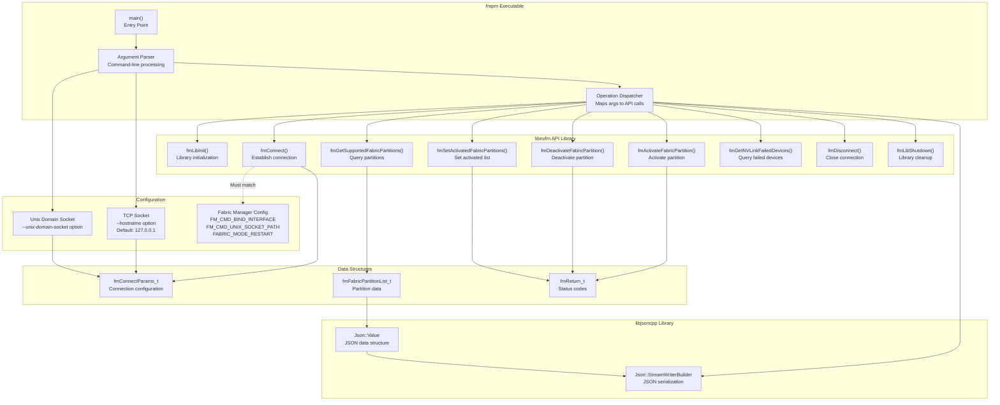
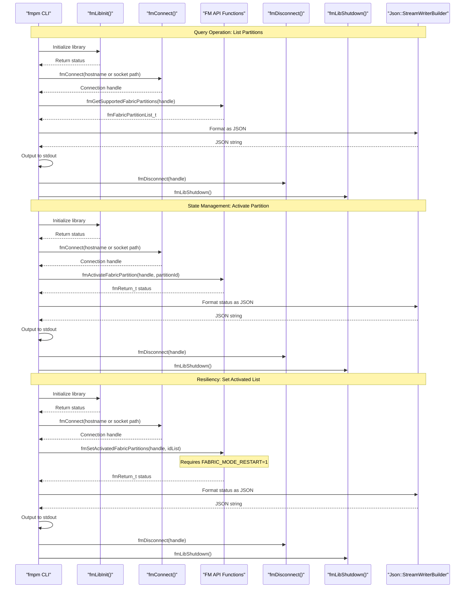
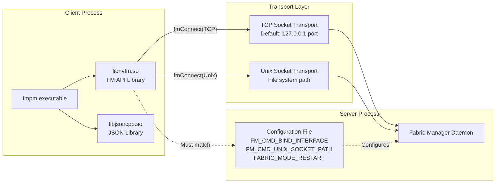

<!-- source: DeepWiki mcp.deepwiki.com · repo NVIDIA/Fabric-Manager-Client · page 1 Overview · fetched 2026-11-11 -->

# Overview

<details>
<summary>Relevant source files</summary>

The following files were used as context for generating this wiki page:

- [README.md](README.md)

</details>


## Purpose and Scope

This document provides an overview of the NVIDIA Fabric Manager Client repository, which contains the `fmpm` (Fabric Manager Partition Manager) command-line utility. The `fmpm` tool enables system administrators and automation scripts to manage GPU partitions in NVIDIA data center environments equipped with NVSwitch fabric technology.

This page introduces the core concepts, system architecture, and capabilities of `fmpm`. For detailed setup instructions, see [Getting Started](#2). For command reference and usage examples, see [User Guide](#3). For technical implementation details, see [Technical Reference](#4).

**Sources:** [README.md:1-3]()

## What is Fabric Manager Client

The Fabric Manager Client is a C++ command-line utility that provides programmatic control over GPU partition management in NVIDIA Fabric Manager deployments. It operates as a client application that communicates with the NVIDIA Fabric Manager service to execute partition management operations.

The primary executable is `fmpm`, which acts as a thin client wrapper around the `libnvfm` API library. All operations are executed remotely on the Fabric Manager service, with `fmpm` serving as the interface layer that translates command-line arguments into API calls and formats responses as JSON.

**Sources:** [README.md:1-5]()

## Key Concepts

### GPU Partitions

GPU partitions represent logical groupings of NVIDIA GPUs connected through NVSwitch fabric. The Shared NVSwitch feature allows multiple GPU partitions to coexist on the same physical NVSwitch infrastructure. Each partition can be independently activated or deactivated, enabling dynamic reconfiguration of GPU resources without hardware changes.

Partitions are identified by numeric IDs and contain:
- One or more GPUs with their UUIDs and PCI bus IDs
- NVLink connectivity information
- Active/inactive state
- Support status (some hardware configurations may result in unsupported partitions)

### NVSwitch Fabric

NVSwitch is NVIDIA's high-speed interconnect technology that provides GPU-to-GPU communication across a fabric. It enables all-to-all GPU connectivity at high bandwidth using NVLink protocol. The fabric manager monitors the health of NVLink connections and can detect failed devices at the GPU and switch level.

### Fabric Manager Service

The NVIDIA Fabric Manager is a background service (daemon) that manages the NVSwitch fabric and GPU partitions. It provides:
- Partition lifecycle management (activation/deactivation)
- NVLink health monitoring
- Persistent state management (Resiliency Mode)
- API interface for remote management

The Fabric Manager service must be configured to accept connections via TCP sockets (`FM_CMD_BIND_INTERFACE`) or Unix domain sockets (`FM_CMD_UNIX_SOCKET_PATH`).

**Sources:** [README.md:3-14]()

## System Components

The following diagram maps the major system components to their code entities:



**Sources:** [README.md:8-28]()

## Core Capabilities

The `fmpm` utility provides two categories of operations:

| Operation Type | Commands | Description | API Functions |
|---------------|----------|-------------|---------------|
| **Query Operations** | `-l` | List all partitions with active/inactive state | `fmGetSupportedFabricPartitions()` |
| | `--get-nvlink-failed-devices` | Retrieve all GPUs and switches with NVLink failures | `fmGetNVLinkFailedDevices()` |
| | `--list-unsupported-partitions` | Identify partitions that cannot be managed | (API function TBD) |
| | `-v` | Display version information | N/A |
| **State Management** | `-a <ID>` | Activate a single partition | `fmActivateFabricPartition()` |
| | `-d <ID>` | Deactivate a single partition | `fmDeactivateFabricPartition()` |
| | `--set-activated-list <IDs>` | Set list of activated partitions for resiliency | `fmSetActivatedFabricPartitions()` |
| **Connection Options** | `--hostname <IP>` | Connect via TCP socket | TCP transport in `fmConnect()` |
| | `--unix-domain-socket <path>` | Connect via Unix domain socket | Unix socket transport in `fmConnect()` |

All operations output results in JSON format to stdout, enabling integration with automation frameworks and parsing by downstream tools.

**Sources:** [README.md:8-28]()

## Operational Model

The following diagram illustrates the typical API call sequence for common operations:



**Sources:** [README.md:8-28]()

## Integration Points

### Build-Time Dependencies

| Component | Ubuntu Package | RHEL Package | Purpose |
|-----------|---------------|--------------|---------|
| Fabric Manager API | `nvidia-fabricmanager-dev-<version>` | `nvidia-fabricmanager-devel-<version>` | Provides `libnvfm` headers and library |
| JSON Library | `libjsoncpp-dev` | `jsoncpp-devel` | Provides JSON serialization via `libjsoncpp` |
| Build Tools | Standard dev tools | Standard dev tools | C++ compiler, `pkg-config` |

The RHEL `jsoncpp-devel` package requires the EPEL repository to be configured.

**Sources:** [README.md:31-38]()

### Runtime Dependencies

The `fmpm` executable requires:
1. **Fabric Manager Service**: Must be running and configured to accept connections
2. **Configuration Alignment**: Client connection method (`--hostname` or `--unix-domain-socket`) must match server configuration (`FM_CMD_BIND_INTERFACE` or `FM_CMD_UNIX_SOCKET_PATH`)
3. **Network Connectivity**: If using TCP sockets, network access to the Fabric Manager host
4. **Resiliency Mode**: If using `--set-activated-list`, Fabric Manager must have `FABRIC_MODE_RESTART=1` configured

**Sources:** [README.md:12-27]()

## Communication Architecture



The client and server communicate through a request-response protocol over either TCP or Unix domain sockets. The connection method is determined by command-line arguments to `fmpm`, but must match the Fabric Manager's configured interface. If both `--hostname` and `--unix-domain-socket` are specified, the Unix domain socket takes precedence.

**Sources:** [README.md:12-19]()

## Use Cases

### Local Management
System administrators use `fmpm` on the same host as Fabric Manager to manage partitions:
```
$ fmpm -l
$ fmpm -a 3
$ fmpm -d 3
```

### Remote Management
Administrators manage Fabric Manager from a remote host via network:
```
$ fmpm -l --hostname 10.0.0.5
$ fmpm -a 3 --hostname 10.0.0.5
```

### High-Performance Local Management
For reduced latency, Unix domain sockets can be used for local management:
```
$ fmpm -l --unix-domain-socket /var/run/nvidia-fabricmanager/fabricmanager.sock
```

### Automation and Orchestration
Scripts and orchestration tools integrate `fmpm` by parsing JSON output:
```bash
#!/bin/bash
partitions=$(fmpm -l | jq '.partitions')
# Process partition data...
```

### Resiliency Mode
In production environments requiring automatic recovery, `--set-activated-list` persists partition state:
```
$ fmpm --set-activated-list 1,2,3,5
```
After Fabric Manager restarts, partitions 1, 2, 3, and 5 are automatically restored to active state.

**Sources:** [README.md:8-28]()

## Repository Structure

The repository contains:
- **Source Code**: C++ implementation of the `fmpm` utility
- **Build System**: Makefile for compilation and linking
- **Documentation**: README with usage instructions and configuration requirements
- **License**: NVIDIA Software License Agreement

For build instructions, see [Building from Source](#2.2). For license terms and restrictions, see [License and Legal](#5).

**Sources:** [README.md:1-39]()

## Related Pages

- **[Getting Started](#2)**: Installation, building, and initial configuration
- **[Command-Line Reference](#3.1)**: Complete reference for all `fmpm` options
- **[Managing GPU Partitions](#3.2)**: Detailed partition management workflows
- **[Resiliency Mode](#3.4)**: Automatic partition restoration configuration
- **[Architecture Overview](#4.1)**: In-depth technical architecture
- **[Communication Protocols](#4.2)**: TCP and Unix socket protocol details
- **[Software License Agreement](#5.1)**: Legal terms and usage restrictions

---

