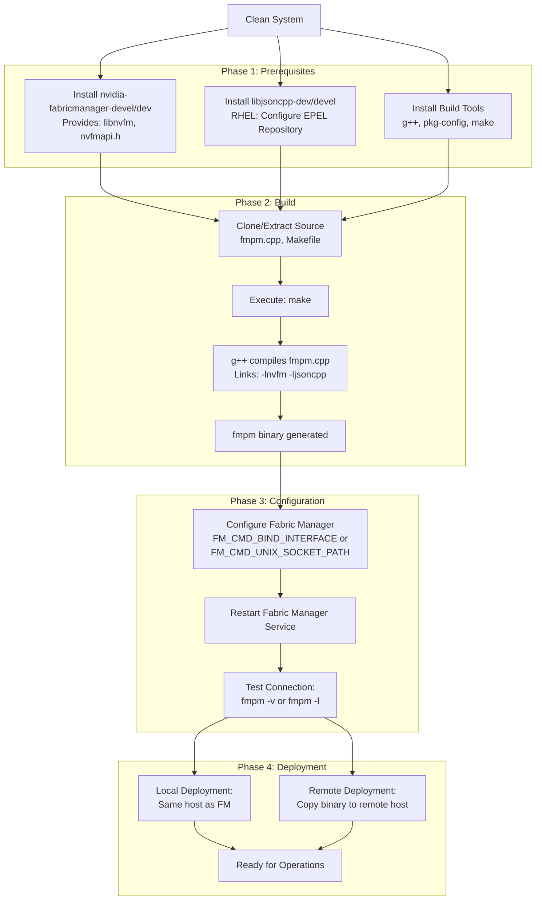
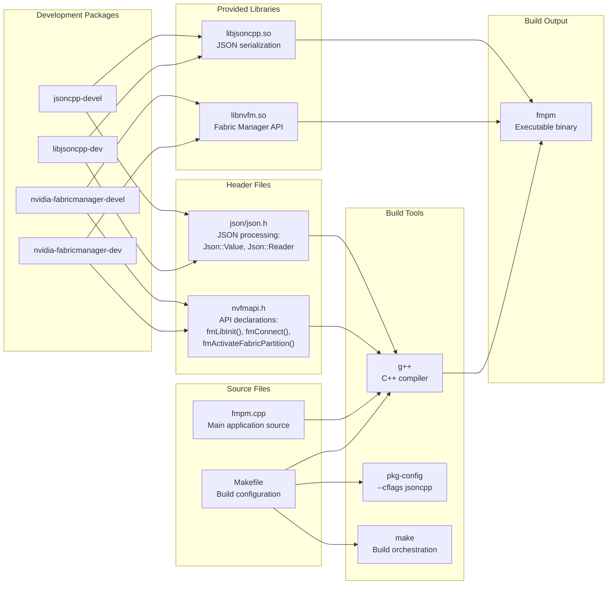
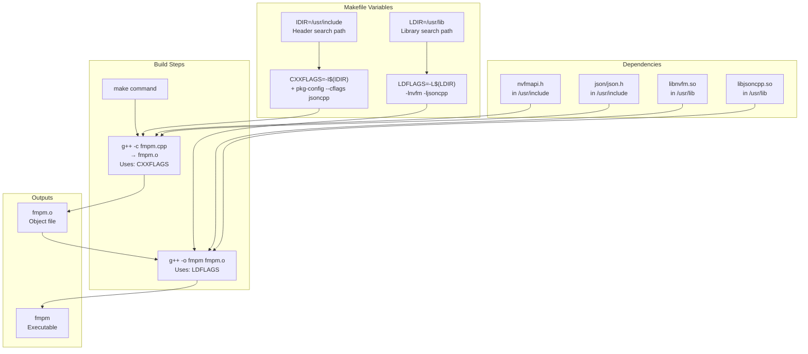

<!-- source: DeepWiki mcp.deepwiki.com · repo NVIDIA/Fabric-Manager-Client · page 2 Getting Started · fetched 2026-11-11 -->

# Getting Started

<details>
<summary>Relevant source files</summary>

The following files were used as context for generating this wiki page:

- [Makefile](Makefile)
- [README.md](README.md)

</details>


This page provides an overview of the initial setup process for the NVIDIA Fabric Manager Client (`fmpm`). It covers the workflow from installing dependencies through building the client binary and preparing it for use. For detailed command usage and operational workflows, see [User Guide](#3). For architectural and implementation details, see [Technical Reference](#4).

## Purpose and Scope

The setup process transforms the source code into a functional `fmpm` binary that can communicate with the NVIDIA Fabric Manager service to manage GPU partitions. This involves:

1. Installing development dependencies
2. Compiling the C++ source code
3. Configuring communication channels between client and server

This page provides a roadmap of the setup workflow. Detailed instructions for each step are covered in the child pages:
- [Prerequisites and Dependencies](#2.1) - System requirements and package installation
- [Building from Source](#2.2) - Compilation process and Makefile usage
- [Configuration](#2.3) - Client-server communication setup

## Setup Workflow Overview

The following diagram illustrates the complete setup workflow, from a clean system to a functional deployment:

**Diagram: Setup Workflow from Dependencies to Deployment**



Sources: [README.md:31-38](), [Makefile:1-13]()

## Build Environment Components

The build process requires specific development packages and tools. This diagram maps the high-level requirements to actual package names and code entities:

**Diagram: Build Dependencies and Code Entities**



Sources: [README.md:31-38](), [Makefile:1-13]()

## Platform-Specific Package Names

The required development packages have different names across Linux distributions:

| Component | Ubuntu/Debian | RHEL/CentOS | Additional Notes |
|-----------|--------------|-------------|------------------|
| Fabric Manager Dev | `nvidia-fabricmanager-dev` | `nvidia-fabricmanager-devel` | Provides `libnvfm` and `nvfmapi.h` |
| JSON Library Dev | `libjsoncpp-dev` | `jsoncpp-devel` | RHEL requires EPEL repository |
| C++ Compiler | `g++` (in `build-essential`) | `gcc-c++` (in `Development Tools`) | Standard toolchain |
| Package Config | `pkg-config` | `pkgconfig` | Used by Makefile |
| Build System | `make` | `make` | Standard GNU Make |

Sources: [README.md:31-38]()

## Quick Start Summary

For experienced users familiar with C++ build environments, here is a condensed setup sequence:

```bash
# 1. Install dependencies (Ubuntu example)
sudo apt-get install nvidia-fabricmanager-dev libjsoncpp-dev build-essential pkg-config

# 2. Build
make

# 3. Configure Fabric Manager
# Edit Fabric Manager config file to set:
# FM_CMD_BIND_INTERFACE=127.0.0.1  (for TCP)
# or
# FM_CMD_UNIX_SOCKET_PATH=/var/run/nvfm.sock  (for Unix socket)

# 4. Restart Fabric Manager service
sudo systemctl restart nvidia-fabricmanager

# 5. Test
./fmpm -v
./fmpm -l
```

For detailed explanations of each step, see the following pages:
- [Prerequisites and Dependencies](#2.1) - Detailed package installation instructions
- [Building from Source](#2.2) - Compilation process and troubleshooting
- [Configuration](#2.3) - Client-server communication configuration

## Compilation Process Details

The build process is managed by a Makefile that orchestrates compilation and linking. The following diagram shows the compilation flow and key Makefile variables:

**Diagram: Compilation Flow and Makefile Variables**



Sources: [Makefile:1-13]()

### Makefile Target Reference

The Makefile provides the following targets:

| Target | Description | Command Line Variables |
|--------|-------------|----------------------|
| `fmpm` (default) | Compiles and links the executable | Uses variables from [Makefile:1-5]() |
| `clean` | Removes build artifacts (`fmpm.o`, `fmpm`) | N/A |

The linking step [Makefile:8]() uses two critical flags:
- `-lnvfm`: Links against the Fabric Manager API library
- `-ljsoncpp`: Links against the JSON processing library

Sources: [Makefile:7-12]()

## Configuration Synchronization

A critical aspect of setup is ensuring the client's connection method matches the Fabric Manager service configuration. The following diagram illustrates the required configuration alignment:

**Diagram: Client-Server Configuration Matching**

```mermaid
graph TB
    subgraph "fmpm Client Options"
        TCPClient["--hostname <IP><br/>Default: 127.0.0.1"]
        UnixClient["--unix-domain-socket <path>"]
    end
    
    subgraph "Fabric Manager Configuration File"
        TCPServer["FM_CMD_BIND_INTERFACE=<IP>"]
        UnixServer["FM_CMD_UNIX_SOCKET_PATH=<path>"]
    end
    
    subgraph "Valid Configurations"
        Config1["Configuration 1: TCP<br/>Client: --hostname 10.0.0.1<br/>Server: FM_CMD_BIND_INTERFACE=10.0.0.1"]
        Config2["Configuration 2: Localhost TCP<br/>Client: (default or --hostname 127.0.0.1)<br/>Server: FM_CMD_BIND_INTERFACE=127.0.0.1"]
        Config3["Configuration 3: Unix Socket<br/>Client: --unix-domain-socket /var/run/nvfm.sock<br/>Server: FM_CMD_UNIX_SOCKET_PATH=/var/run/nvfm.sock"]
    end
    
    subgraph "Invalid Configurations"
        Mismatch1["Client uses --hostname<br/>Server only has FM_CMD_UNIX_SOCKET_PATH"]
        Mismatch2["Client uses --unix-domain-socket<br/>Server only has FM_CMD_BIND_INTERFACE"]
        Mismatch3["Client: --hostname 10.0.0.1<br/>Server: FM_CMD_BIND_INTERFACE=192.168.1.1"]
    end
    
    TCPClient -.->|Must match| TCPServer
    UnixClient -.->|Must match| UnixServer
    
    TCPClient --> Config1
    TCPClient --> Config2
    UnixClient --> Config3
    
    TCPClient -.->|Fails| Mismatch1
    UnixClient -.->|Fails| Mismatch2
    TCPClient -.->|Fails| Mismatch3
```



Sources: [README.md:12-19]()

Configuration mismatches result in connection failures. The client will report connection errors if it cannot establish communication with the Fabric Manager service. For detailed configuration instructions, see [Configuration](#2.3).

## Post-Build Verification

After successful compilation, verify the binary was created and has proper library linkages:

```bash
# Verify binary exists
ls -lh fmpm

# Check dynamic library dependencies
ldd fmpm | grep -E "nvfm|jsoncpp"
```

Expected output includes:
- `libnvfm.so => /usr/lib/x86_64-linux-gnu/libnvfm.so`
- `libjsoncpp.so => /usr/lib/x86_64-linux-gnu/libjsoncpp.so`

If libraries are not found, ensure the development packages are correctly installed and the library search paths in [Makefile:4-5]() are correct for your system.

## Deployment Models

Once built, the `fmpm` binary can be deployed in two configurations:

**Local Deployment**
- Binary runs on the same host as Fabric Manager service
- Can use Unix domain socket (lowest latency) or TCP localhost
- Typical for single-node management

**Remote Deployment**
- Binary deployed to separate management host
- Must use TCP socket communication
- Requires network connectivity to Fabric Manager host
- Enables centralized management of multiple GPU systems

For both models, the client and server configurations must be synchronized as shown in the previous diagram.

## Next Steps

After completing the setup process:

1. **For command usage**: See [Command-Line Reference](#3.1) for all available options
2. **For partition management**: See [Managing GPU Partitions](#3.2) for operational workflows
3. **For troubleshooting**: See [Error Handling and Return Codes](#4.5) for common issues
4. **For architectural understanding**: See [Architecture Overview](#4.1)

The following pages in this section provide detailed instructions:
- [Prerequisites and Dependencies](#2.1) - Comprehensive dependency installation guide
- [Building from Source](#2.2) - Detailed compilation instructions and troubleshooting
- [Configuration](#2.3) - Step-by-step configuration for TCP and Unix socket communication

Sources: [README.md:1-39](), [Makefile:1-13]()

---

