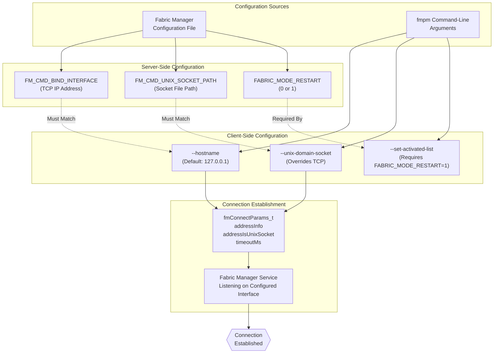
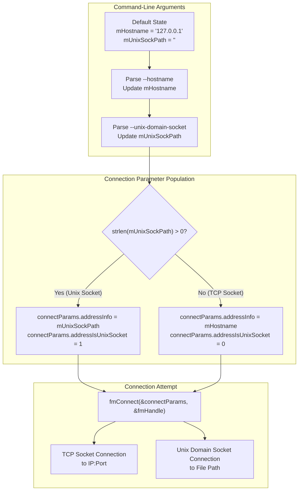
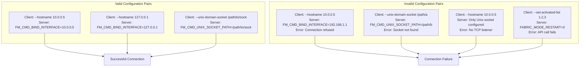

<!-- source: DeepWiki mcp.deepwiki.com · repo NVIDIA/Fabric-Manager-Client · page 2.3 Configuration · fetched 2026-11-11 -->

# Configuration

<details>
<summary>Relevant source files</summary>

The following files were used as context for generating this wiki page:

- [README.md](README.md)
- [fmpm.cpp](fmpm.cpp)

</details>


## Purpose and Scope

This page explains how to configure communication between the `fmpm` client and the NVIDIA Fabric Manager service. Configuration involves setting up both the server-side Fabric Manager service and the client-side `fmpm` utility to enable proper communication via TCP sockets or Unix domain sockets.

For information about building the client from source, see [Building from Source](#2.2). For details on using the configured client to manage partitions, see [Managing GPU Partitions](#3.2). For resiliency mode-specific configuration, see [Resiliency Mode](#3.4).

---

## Configuration Overview

The `fmpm` client and Fabric Manager service use a **two-sided configuration model** where both endpoints must be configured with matching communication parameters. Configuration mismatch results in connection failures with no automatic discovery or fallback mechanism.

| Configuration Aspect | Server Component | Client Component |
|---------------------|------------------|------------------|
| **TCP Socket** | `FM_CMD_BIND_INTERFACE` | `--hostname` |
| **Unix Domain Socket** | `FM_CMD_UNIX_SOCKET_PATH` | `--unix-domain-socket` |
| **Resiliency Mode** | `FABRIC_MODE_RESTART` | `--set-activated-list` |
| **Default Behavior** | Localhost binding | `127.0.0.1` |



**Diagram: Configuration Flow and Matching Requirements**

Sources: [README.md:12-19](), [fmpm.cpp:414-438]()

---

## Fabric Manager Service Configuration

The Fabric Manager service is configured through its configuration file. The configuration parameters control which interfaces the service listens on and what operational modes are enabled.

### Configuration Parameters

| Parameter | Purpose | Valid Values | Default |
|-----------|---------|--------------|---------|
| `FM_CMD_BIND_INTERFACE` | TCP socket IP address binding | Valid IP address | Typically localhost |
| `FM_CMD_UNIX_SOCKET_PATH` | Unix domain socket file path | Valid filesystem path | Not set by default |
| `FABRIC_MODE_RESTART` | Enables resiliency mode for partition state persistence | `0` (disabled) or `1` (enabled) | `0` |

### TCP Socket Configuration

To enable TCP socket communication, configure the Fabric Manager with:

```
FM_CMD_BIND_INTERFACE=<IP address>
```

The IP address must be accessible to the `fmpm` client. For local-only access, use `127.0.0.1`. For remote access, use the server's network interface IP address.

**Example:**
```
FM_CMD_BIND_INTERFACE=10.0.0.5
```

This configuration allows remote `fmpm` clients to connect to the Fabric Manager service at IP address `10.0.0.5`.

Sources: [README.md:14](), [README.md:313]()

### Unix Domain Socket Configuration

To enable Unix domain socket communication, configure the Fabric Manager with:

```
FM_CMD_UNIX_SOCKET_PATH=<socket file path>
```

The path must be accessible to both the Fabric Manager service (for creation) and the `fmpm` client (for connection). Ensure proper filesystem permissions.

**Example:**
```
FM_CMD_UNIX_SOCKET_PATH=/var/run/nvidia-fabricmanager/fabricmanager.sock
```

Unix domain sockets provide lower latency and higher throughput for local communication compared to TCP sockets.

Sources: [README.md:18](), [README.md:316-317]()

### Resiliency Mode Configuration

To enable Fabric Manager Resiliency Mode, which allows partition state persistence across service restarts:

```
FABRIC_MODE_RESTART=1
```

This configuration is **required** to use the `--set-activated-list` command. When enabled, the Fabric Manager persists the activated partition list and automatically restores it after service restarts or failures.

Sources: [README.md:24](), [README.md:322]()

---

## fmpm Client Configuration

The `fmpm` client is configured entirely through command-line arguments. There is no configuration file for the client.

### Connection Options

| Option | Parameter | Purpose | Default Value |
|--------|-----------|---------|---------------|
| `--hostname` | IP address or hostname | Connect via TCP socket | `127.0.0.1` |
| `--unix-domain-socket` | File path | Connect via Unix domain socket | Not set |

### Default Connection Behavior

When no connection options are specified, `fmpm` defaults to connecting via TCP socket to localhost (`127.0.0.1`):

```bash
fmpm -l
# Equivalent to: fmpm -l --hostname 127.0.0.1
```

This default behavior is implemented in [fmpm.cpp:332-333]():

```cpp
/* Default to connect to localhost */
strncpy(mHostname, "127.0.0.1", sizeof(mHostname));
```

Sources: [README.md:12-13](), [fmpm.cpp:332-333]()

### TCP Socket Connection

To connect to a remote or specific Fabric Manager instance via TCP:

```bash
fmpm -l --hostname 10.0.0.5
```

The hostname can be an IP address or resolvable hostname. The client stores this value and uses it during connection establishment.

Command-line parsing for `--hostname` is implemented in [fmpm.cpp:379-387]():

```cpp
else if (std::string(argv[i]) == "--hostname") {
    if (i + 1 < argc) {
        std::string str = argv[i + 1];
        snprintf(mHostname, MAX_PATH_LEN, "%s", str.c_str());
        ++i;
    }
```

Sources: [README.md:12-15](), [fmpm.cpp:379-387]()

### Unix Domain Socket Connection

To connect via Unix domain socket:

```bash
fmpm -l --unix-domain-socket /var/run/nvidia-fabricmanager/fabricmanager.sock
```

**Important:** When `--unix-domain-socket` is specified, it takes **priority** over TCP socket configuration, even if `--hostname` is also provided.

Command-line parsing for `--unix-domain-socket` is implemented in [fmpm.cpp:388-396]():

```cpp
else if (std::string(argv[i]) == "--unix-domain-socket") {
    if (i + 1 < argc) {
        std::string str = argv[i + 1];
        snprintf(mUnixSockPath, MAX_PATH_LEN, "%s", str.c_str());
        ++i;
    }
```

Sources: [README.md:16-19](), [fmpm.cpp:388-396]()

---

## Connection Parameter Resolution

The `fmpm` client translates command-line arguments into the `fmConnectParams_t` structure used by the FM API. This resolution process determines whether TCP or Unix domain socket communication is used.



**Diagram: Connection Parameter Resolution Logic**

### Resolution Implementation

The resolution logic is implemented in [fmpm.cpp:414-438](). The key decision logic:

1. **Initialize `fmConnectParams_t`** [fmpm.cpp:414-416]():
```cpp
fmConnectParams_t connectParams;
connectParams.timeoutMs = 1000; // in milliseconds
connectParams.version = fmConnectParams_version;
```

2. **Check Unix socket path first** [fmpm.cpp:419-423]():
```cpp
if ( strnlen(mUnixSockPath, MAX_PATH_LEN) > 0 )
{
    snprintf(connectParams.addressInfo, MAX_PATH_LEN, "%s", mUnixSockPath);
    connectParams.addressIsUnixSocket = 1;
}
```

3. **Fall back to TCP hostname** [fmpm.cpp:424-428]():
```cpp
if ( strnlen(mHostname, MAX_PATH_LEN) > 0 )
{
    snprintf(connectParams.addressInfo, MAX_PATH_LEN, "%s", mHostname);
    connectParams.addressIsUnixSocket = 0;
}
```

### Connection Structure Members

The `fmConnectParams_t` structure contains:

| Member | Type | Purpose |
|--------|------|---------|
| `version` | Version identifier | API version compatibility |
| `addressInfo` | Character array | IP address or socket file path |
| `addressIsUnixSocket` | Integer flag | `0` = TCP socket, `1` = Unix socket |
| `timeoutMs` | Integer | Connection timeout in milliseconds (default: 1000) |

Sources: [fmpm.cpp:414-438]()

---

## Configuration Matching Requirements

**Critical:** The client and server configurations must match exactly for successful connection. There is no automatic discovery, negotiation, or fallback mechanism.



**Diagram: Configuration Matching Examples**

### Common Misconfiguration Scenarios

| Misconfiguration | Symptom | Resolution |
|------------------|---------|------------|
| Client connects to wrong IP | "Failed to connect to Fabric Manager instance" | Verify `FM_CMD_BIND_INTERFACE` matches `--hostname` |
| Unix socket path mismatch | Connection timeout or "socket not found" | Verify paths match exactly, check filesystem permissions |
| Client uses TCP, server only has Unix socket | Connection refused | Configure server TCP binding or use `--unix-domain-socket` on client |
| Using `--set-activated-list` without resiliency mode | API call returns error | Enable `FABRIC_MODE_RESTART=1` in Fabric Manager configuration |
| Firewall blocking TCP connection | Connection timeout | Configure firewall rules to allow traffic on Fabric Manager port |

Sources: [README.md:12-27](), [fmpm.cpp:434-438]()

---

## Connection Timeout Configuration

The connection timeout is hardcoded in the client at 1000 milliseconds (1 second). This timeout applies to both TCP and Unix domain socket connections.

From [fmpm.cpp:415]():
```cpp
connectParams.timeoutMs = 1000; // in milliseconds
```

If the Fabric Manager service does not respond within this timeout:
- The `fmConnect()` call fails
- The client outputs: "Failed to connect to Fabric Manager instance."
- The client exits with the error return code

**Note:** There is no command-line option to override the timeout value. Modifications require recompiling the client.

Sources: [fmpm.cpp:415](), [fmpm.cpp:434-437]()

---

## Configuration Verification

### Verify TCP Socket Configuration

1. **Check Fabric Manager configuration file** for `FM_CMD_BIND_INTERFACE`
2. **Test connectivity** from client machine:
   ```bash
   telnet <IP_ADDRESS> <FABRIC_MANAGER_PORT>
   ```
3. **Attempt connection** with `fmpm`:
   ```bash
   fmpm -l --hostname <IP_ADDRESS>
   ```

### Verify Unix Domain Socket Configuration

1. **Check Fabric Manager configuration file** for `FM_CMD_UNIX_SOCKET_PATH`
2. **Verify socket file exists**:
   ```bash
   ls -l /var/run/nvidia-fabricmanager/fabricmanager.sock
   ```
3. **Check permissions** (must be readable/writable by client process user)
4. **Attempt connection** with `fmpm`:
   ```bash
   fmpm -l --unix-domain-socket /var/run/nvidia-fabricmanager/fabricmanager.sock
   ```

### Verify Resiliency Mode Configuration

1. **Check Fabric Manager configuration file** for `FABRIC_MODE_RESTART=1`
2. **Restart Fabric Manager service** to apply configuration
3. **Test with `fmpm`**:
   ```bash
   fmpm --set-activated-list 1,2,3 --hostname <IP_ADDRESS>
   ```

If resiliency mode is not enabled, the `fmSetActivatedFabricPartitions()` API call will fail and the client will output an error.

Sources: [README.md:22-27](), [fmpm.cpp:449-451]()

---

## Configuration File Locations

The Fabric Manager service configuration file location depends on the installation method and operating system. Common locations include:

- `/etc/nvidia/fabricmanager.cfg`
- `/usr/share/nvidia/nvswitch/fabricmanager.cfg`

Refer to the [Fabric Manager User Guide](https://docs.nvidia.com/datacenter/tesla/fabric-manager-user-guide/) for platform-specific configuration file locations.

**Note:** The `fmpm` client does not use a configuration file. All configuration is performed via command-line arguments.

Sources: [README.md:14-19]()

---

