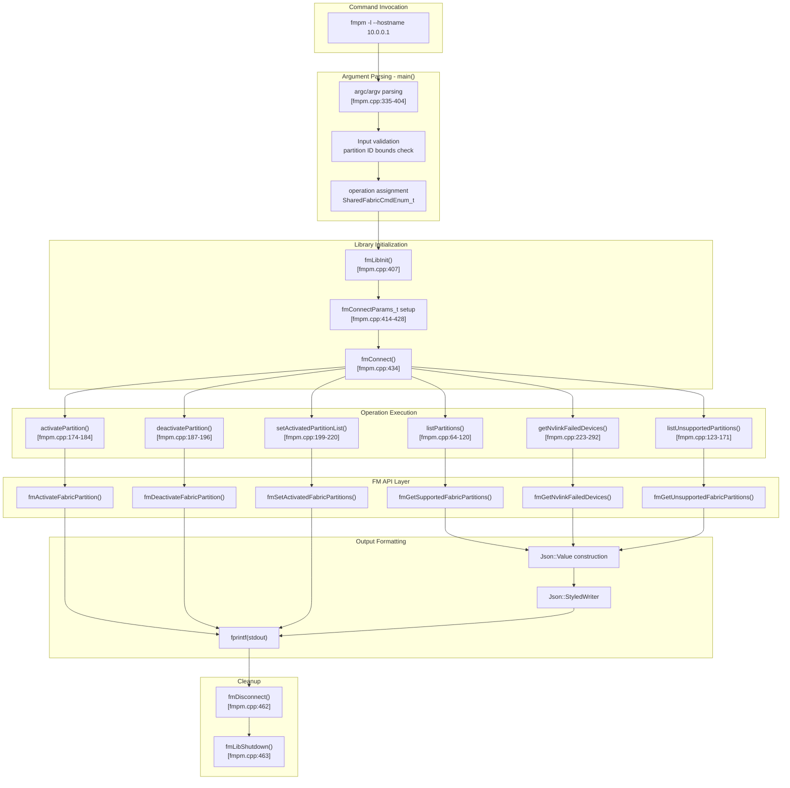
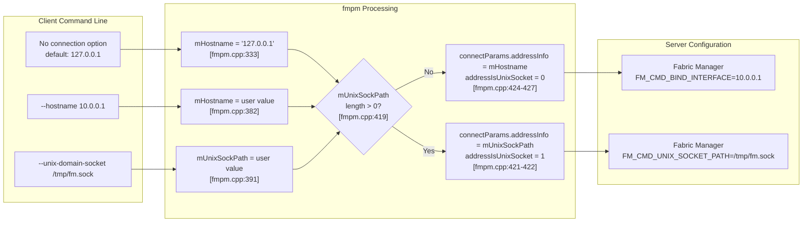
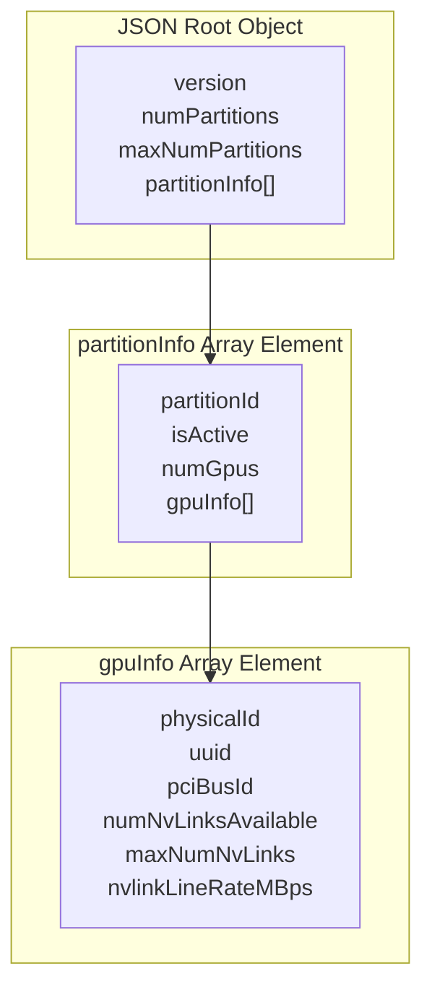
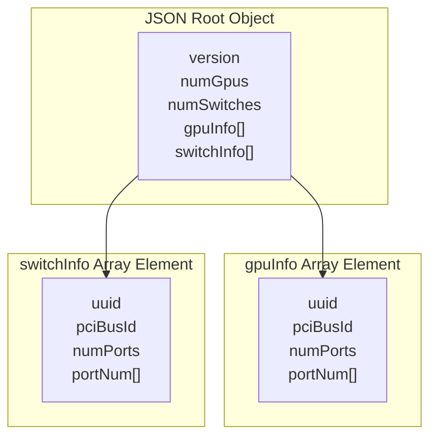
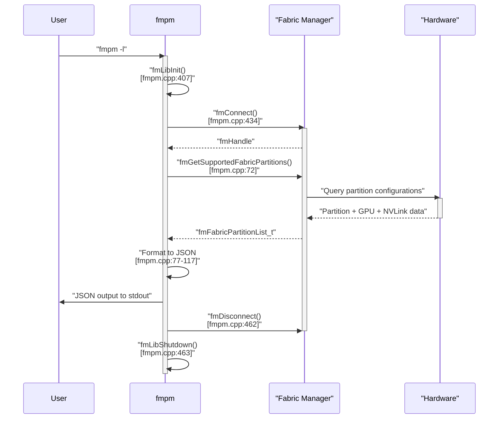
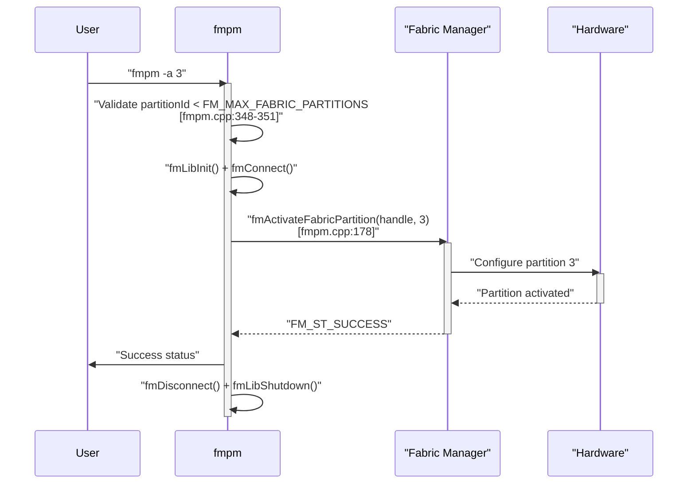
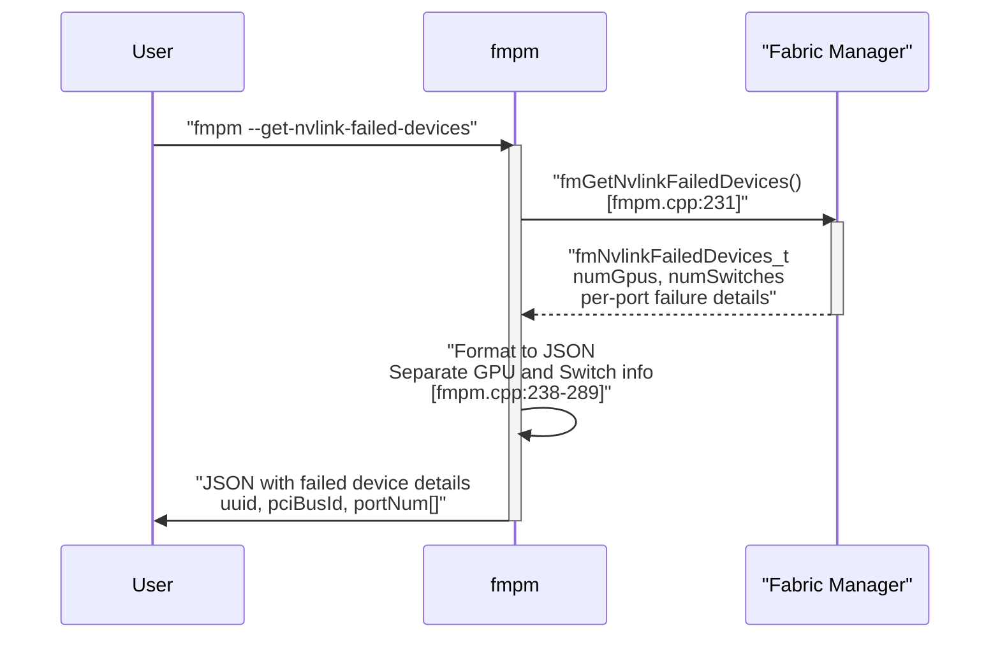
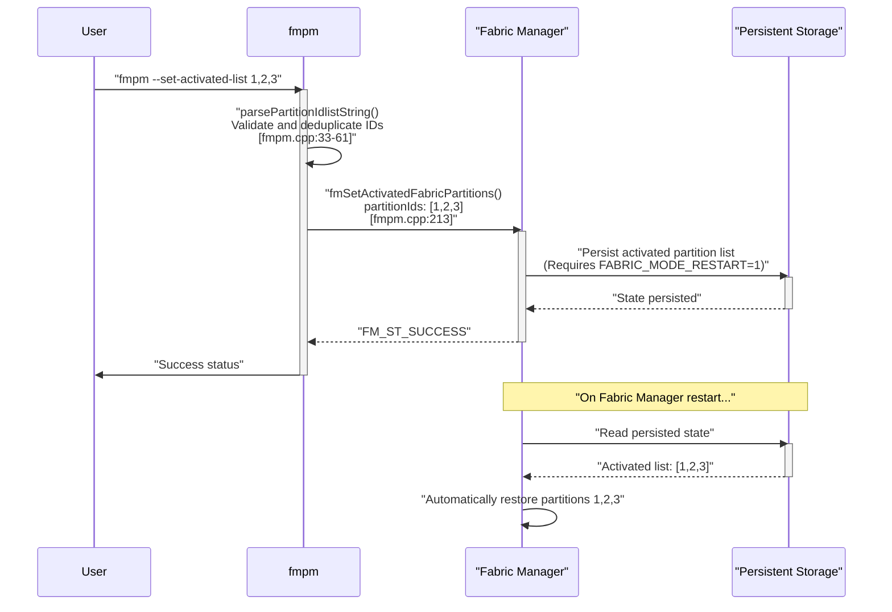

<!-- source: DeepWiki mcp.deepwiki.com · repo NVIDIA/Fabric-Manager-Client · page 3 User Guide · fetched 2026-11-11 -->

# User Guide

<details>
<summary>Relevant source files</summary>

The following files were used as context for generating this wiki page:

- [README.md](README.md)
- [fmpm.cpp](fmpm.cpp)

</details>


This document provides comprehensive guidance for using the `fmpm` command-line utility to manage GPU partitions in NVIDIA Fabric Manager deployments. It covers all available commands, connection options, output formats, and common operational workflows.

**Scope**: This guide focuses on the practical usage of the `fmpm` binary and its command-line interface. For installation and build instructions, see [Getting Started](#2). For detailed technical architecture and API internals, see [Technical Reference](#4). For license terms and usage restrictions, see [License and Legal](#5).

---

## Overview

The `fmpm` (Fabric Manager Partition Manager) utility is a command-line client that communicates with the NVIDIA Fabric Manager service to manage GPU partitions in shared NVSwitch environments. All operations are executed via the Fabric Manager API and results are returned as formatted JSON to stdout.

**Key Capabilities**:
- Query partition state and configuration
- Activate and deactivate individual partitions
- Bulk partition management for resiliency scenarios
- Diagnose NVLink hardware failures
- Identify unsupported partition configurations

Sources: [README.md:1-39](), [fmpm.cpp:1-465]()

---

## Command Execution Model

The following diagram illustrates the execution flow from command-line invocation to JSON output:



**Execution Pattern**:
1. **Argument Parsing**: The `main()` function at [fmpm.cpp:294]() processes all command-line arguments and determines the operation to execute via the `SharedFabricCmdEnum_t` enumeration [fmpm.cpp:12-29]()
2. **Library Initialization**: `fmLibInit()` prepares the Fabric Manager API client library [fmpm.cpp:407]()
3. **Connection Establishment**: `fmConnect()` establishes TCP or Unix socket connection to Fabric Manager [fmpm.cpp:434]()
4. **Operation Dispatch**: Based on the `operation` variable, the appropriate handler function is called [fmpm.cpp:440-458]()
5. **JSON Formatting**: Query operations format responses using `libjsoncpp`, while state operations output simple status
6. **Cleanup**: Connection and library resources are released [fmpm.cpp:462-463]()

Sources: [fmpm.cpp:294-465](), [README.md:8-29]()

---

## Connection Configuration

The `fmpm` client supports two connection mechanisms for communicating with the Fabric Manager service. The connection method must match the Fabric Manager's configured interface.

### Connection Options

| Option | Description | Default | Server Configuration Required |
|--------|-------------|---------|-------------------------------|
| `--hostname <IP>` | TCP socket connection to specified IP address or hostname | `127.0.0.1` | `FM_CMD_BIND_INTERFACE=<IP>` in Fabric Manager config |
| `--unix-domain-socket <path>` | Unix domain socket connection using filesystem path | None | `FM_CMD_UNIX_SOCKET_PATH=<path>` in Fabric Manager config |

**Priority**: If `--unix-domain-socket` is specified, it overrides any `--hostname` setting [fmpm.cpp:419-428]().

**Timeout**: All connections have a 1000ms timeout configured via `fmConnectParams_t.timeoutMs` [fmpm.cpp:415]().

Sources: [fmpm.cpp:414-434](), [README.md:12-19]()

### Connection Configuration Flow



**Configuration Matching**: The client's connection method must align with the server's configured interface. Mismatches result in connection failures with no automatic fallback.

Sources: [fmpm.cpp:414-438](), [README.md:12-19]()

### Connection Examples

**Local TCP Connection (Default)**:
```bash
$ fmpm -l
# Connects to 127.0.0.1 via TCP
# Server requires: FM_CMD_BIND_INTERFACE=127.0.0.1
```

**Remote TCP Connection**:
```bash
$ fmpm -l --hostname 192.168.1.100
# Connects to 192.168.1.100 via TCP
# Server requires: FM_CMD_BIND_INTERFACE=192.168.1.100
```

**Unix Domain Socket Connection**:
```bash
$ fmpm -l --unix-domain-socket /var/run/nvidia-fabricmanager/fmapi.sock
# Connects via Unix socket at specified path
# Server requires: FM_CMD_UNIX_SOCKET_PATH=/var/run/nvidia-fabricmanager/fmapi.sock
```

Sources: [README.md:8-19](), [fmpm.cpp:330-438]()

---

## Output Format

All `fmpm` operations return structured JSON output to stdout. This enables both human readability and programmatic parsing by automation scripts.

### JSON Formatting Implementation

The client uses the `Json::StyledWriter` class from `libjsoncpp` to produce formatted output [fmpm.cpp:115-117](), [fmpm.cpp:166-168](), [fmpm.cpp:287-289](). The JSON structure varies by operation but always includes a `version` field for compatibility tracking.

### Output Structure by Operation

| Operation | Root Object | Key Fields | Example Usage |
|-----------|-------------|------------|---------------|
| List Partitions (`-l`) | `fmFabricPartitionList_t` | `numPartitions`, `partitionInfo[]` | Query all available partitions with GPU details |
| Get Failed Devices | `fmNvlinkFailedDevices_t` | `numGpus`, `numSwitches`, `gpuInfo[]`, `switchInfo[]` | Diagnose NVLink hardware failures |
| List Unsupported | `fmUnsupportedFabricPartitionList_t` | `numPartitions`, `partitionInfo[]` | Identify incompatible configurations |
| Activate/Deactivate | Text output | Success/error message | Confirm state change operations |
| Set Activated List | Text output | Success/error message | Confirm resiliency configuration |
| Version (`-v`) | Plain text | Version string | Display `fmpm` version (currently `1.0.1`) |

Sources: [fmpm.cpp:64-292](), [fmpm.cpp:6]()

### List Partitions Output Schema



**Data Source**: Constructed from `fmFabricPartitionList_t` structure at [fmpm.cpp:77-118]().

**Example Output**:
```json
{
   "version" : 65536,
   "numPartitions" : 2,
   "maxNumPartitions" : 8,
   "partitionInfo" : [
      {
         "partitionId" : 0,
         "isActive" : true,
         "numGpus" : 4,
         "gpuInfo" : [
            {
               "physicalId" : 0,
               "uuid" : "GPU-abcd1234...",
               "pciBusId" : "00000000:17:00.0",
               "numNvLinksAvailable" : 18,
               "maxNumNvLinks" : 18,
               "nvlinkLineRateMBps" : 25000
            }
         ]
      }
   ]
}
```

Sources: [fmpm.cpp:64-120]()

### NVLink Failed Devices Output Schema



**Data Source**: Constructed from `fmNvlinkFailedDevices_t` structure at [fmpm.cpp:238-289]().

**Port Numbers**: The `portNum[]` arrays contain the specific NVLink port indices that have failed, enabling targeted hardware diagnosis [fmpm.cpp:259-264](), [fmpm.cpp:277-283]().

Sources: [fmpm.cpp:223-292]()

---

## Command-Line Operations

The following table maps command-line flags to their corresponding implementation functions and API calls:

| Command Flag | Argument | Operation Enum | Handler Function | FM API Call | Lines |
|--------------|----------|----------------|------------------|-------------|-------|
| `-h` | None | `SHARED_FABRIC_CMD_HELP` | Inline help text | None | [fmpm.cpp:306-328]() |
| `-l` | None | `SHARED_FABRIC_CMD_LIST_PARTITION` | `listPartitions()` | `fmGetSupportedFabricPartitions()` | [fmpm.cpp:64-120]() |
| `-a <ID>` | Partition ID | `SHARED_FABRIC_CMD_ACTIVATE_PARTITION` | `activatePartition()` | `fmActivateFabricPartition()` | [fmpm.cpp:174-184]() |
| `-d <ID>` | Partition ID | `SHARED_FABRIC_CMD_DEACTIVATE_PARTITION` | `deactivatePartition()` | `fmDeactivateFabricPartition()` | [fmpm.cpp:187-196]() |
| `--set-activated-list <IDs>` | Comma-separated IDs | `SHARED_FABRIC_CMD_SET_ACTIVATED_PARTITION_LIST` | `setActivatedPartitionList()` | `fmSetActivatedFabricPartitions()` | [fmpm.cpp:199-220]() |
| `--get-nvlink-failed-devices` | None | `SHARED_FABRIC_CMD_GET_NVLINK_FAILED_DEVICES` | `getNvlinkFailedDevices()` | `fmGetNvlinkFailedDevices()` | [fmpm.cpp:223-292]() |
| `--list-unsupported-partitions` | None | `SHARED_FABRIC_CMD_LIST_UNSUPPORTED_PARTITION` | `listUnsupportedPartitions()` | `fmGetUnsupportedFabricPartitions()` | [fmpm.cpp:123-171]() |
| `-v` | None | N/A | Version output | None | [fmpm.cpp:397-400]() |

Sources: [fmpm.cpp:12-29](), [fmpm.cpp:335-404](), [fmpm.cpp:440-458]()

### Input Validation

The client performs input validation before making API calls:

**Partition ID Bounds**: Partition IDs must be less than `FM_MAX_FABRIC_PARTITIONS` [fmpm.cpp:348-351](). Invalid IDs return `FM_ST_BADPARAM` error code.

**Partition List Parsing**: The `parsePartitionIdlistString()` function at [fmpm.cpp:33-61]() validates comma-separated partition lists:
- Rejects IDs outside valid range [fmpm.cpp:44-48]()
- Deduplicates repeated IDs [fmpm.cpp:50-52]()
- Returns array of unique partition IDs

**Argument Requirements**: Commands requiring arguments (`-a`, `-d`, `--set-activated-list`, `--hostname`, `--unix-domain-socket`) validate argument presence [fmpm.cpp:341-396]().

Sources: [fmpm.cpp:33-61](), [fmpm.cpp:335-404]()

---

## Basic Workflows

### Workflow 1: Query Available Partitions



**Command**:
```bash
$ fmpm -l --hostname 10.0.0.1
```

**Use Case**: Discover all available partitions in the system, including their active/inactive state, GPU membership, and NVLink availability. This is typically the first command run in any management session.

Sources: [fmpm.cpp:64-120](), [fmpm.cpp:440-442]()

### Workflow 2: Activate a Partition



**Command**:
```bash
$ fmpm -a 3 --hostname 10.0.0.1
```

**Use Case**: Enable a specific partition for GPU workload execution. Activating a partition makes its GPUs available for compute tasks. Only supported partition configurations can be activated (check `--list-unsupported-partitions` for restrictions).

**Return Codes**: Success returns `FM_ST_SUCCESS` (0). Failures return error codes such as `FM_ST_BADPARAM` or `FM_ST_ERROR` [fmpm.cpp:179-183]().

Sources: [fmpm.cpp:174-184](), [fmpm.cpp:443-445]()

### Workflow 3: Deactivate a Partition

```bash
$ fmpm -d 3 --hostname 10.0.0.1
```

**Use Case**: Disable a partition to release its GPU resources or prepare for reconfiguration. The implementation mirrors activation but calls `fmDeactivateFabricPartition()` [fmpm.cpp:191]().

Sources: [fmpm.cpp:187-196](), [fmpm.cpp:446-448]()

### Workflow 4: Diagnose NVLink Failures



**Command**:
```bash
$ fmpm --get-nvlink-failed-devices --hostname 10.0.0.1
```

**Use Case**: Identify GPUs and NVSwitches with failed NVLink ports. The output includes:
- **GPUs**: UUID, PCI Bus ID, failed port numbers [fmpm.cpp:252-266]()
- **Switches**: UUID, PCI Bus ID, failed port numbers [fmpm.cpp:270-284]()

This diagnostic information is critical for hardware maintenance and understanding why certain partitions may be unsupported.

Sources: [fmpm.cpp:223-292](), [fmpm.cpp:452-454]()

### Workflow 5: Check Unsupported Partitions

```bash
$ fmpm --list-unsupported-partitions --hostname 10.0.0.1
```

**Use Case**: Identify partition configurations that cannot be activated due to hardware limitations, incompatible GPU combinations, or NVLink topology issues. The output lists partition IDs with their GPU physical IDs [fmpm.cpp:147-162]().

**Why Partitions are Unsupported**: Common reasons include:
- Insufficient NVLink connections between GPUs
- Incompatible GPU models in the same partition
- Failed NVLink ports (cross-reference with `--get-nvlink-failed-devices`)
- Hardware topology constraints

Sources: [fmpm.cpp:123-171](), [fmpm.cpp:455-457]()

### Workflow 6: Resiliency Mode - Set Activated List



**Command**:
```bash
$ fmpm --set-activated-list 1,2,3 --hostname 10.0.0.1
```

**Critical Requirement**: This command requires `FABRIC_MODE_RESTART=1` in the Fabric Manager configuration. Without this setting, the command may fail or the persistent state will not be restored after restart [README.md:24]().

**Use Case**: Configure Fabric Manager's Resiliency Mode to automatically restore a specific set of partitions after service restarts or crashes. This enables stateful operation where partition configurations survive Fabric Manager failures.

**Partition List Format**: Comma-separated partition IDs with no spaces [README.md:23](). The `parsePartitionIdlistString()` function handles parsing and validation [fmpm.cpp:33-61]().

**Difference from Individual Activate**: Unlike `-a` which performs immediate activation, `--set-activated-list` sets the persistent configuration that survives restarts. It is designed for production resilience, not ad-hoc testing.

Sources: [fmpm.cpp:199-220](), [fmpm.cpp:449-451](), [README.md:22-27]()

---

## Common Usage Patterns

### Pattern 1: Initial System Discovery

```bash
# Step 1: List all available partitions
$ fmpm -l

# Step 2: Check for unsupported configurations
$ fmpm --list-unsupported-partitions

# Step 3: Check for hardware failures
$ fmpm --get-nvlink-failed-devices
```

This three-step sequence provides complete system visibility before making any configuration changes.

### Pattern 2: Partition State Management

```bash
# Activate partitions for workload execution
$ fmpm -a 0
$ fmpm -a 1
$ fmpm -a 2

# Verify activation
$ fmpm -l | grep '"isActive" : true'

# Later, release resources
$ fmpm -d 0
$ fmpm -d 1
$ fmpm -d 2
```

### Pattern 3: Resiliency Configuration

```bash
# Step 1: Identify desired partitions via listing
$ fmpm -l

# Step 2: Configure persistent activated list
# (Requires FABRIC_MODE_RESTART=1 in FM config)
$ fmpm --set-activated-list 0,1,2,3

# Step 3: Verify configuration survives FM restart
# Restart Fabric Manager service, then:
$ fmpm -l
# Partitions 0,1,2,3 should show isActive: true
```

### Pattern 4: Scripted Automation

```bash
#!/bin/bash
# Example: Activate all supported partitions

# Get partition list as JSON
PARTITIONS=$(fmpm -l --hostname 10.0.0.1)

# Parse and activate each partition (pseudo-code concept)
# In practice, use jq or python to parse JSON
# Example with jq:
# echo "$PARTITIONS" | jq -r '.partitionInfo[].partitionId' | \
#   while read pid; do fmpm -a "$pid" --hostname 10.0.0.1; done
```

The JSON output format is specifically designed to enable scripted automation [fmpm.cpp:115]().

Sources: [fmpm.cpp:64-465](), [README.md:8-29]()

---

## Error Handling

### Error Codes and Return Values

The `fmpm` utility returns integer exit codes that align with `fmReturn_t` enumeration values from the Fabric Manager API:

| Exit Code | Constant | Meaning | Common Causes |
|-----------|----------|---------|---------------|
| `0` | `FM_ST_SUCCESS` | Operation completed successfully | N/A |
| `1` | General error | Command-line parsing failure or connection error | Invalid arguments, missing hostname |
| Non-zero | `FM_ST_ERROR`, `FM_ST_BADPARAM`, etc. | API-level error | Invalid partition ID, FM configuration mismatch, hardware error |

**Error Output**: Error messages are written to stderr or stdout depending on the error type [fmpm.cpp:74](), [fmpm.cpp:134](), [fmpm.cpp:180](), [fmpm.cpp:193](), [fmpm.cpp:216](), [fmpm.cpp:234]().

Sources: [fmpm.cpp:73-75](), [fmpm.cpp:179-183](), [fmpm.cpp:409-411](), [fmpm.cpp:435-438]()

### Common Error Scenarios

**Connection Failures**:
```bash
$ fmpm -l --hostname 10.0.0.99
Failed to connect to Fabric Manager instance.
# Exit code: non-zero fmReturn value
```

**Causes**: 
- Incorrect hostname/IP
- Fabric Manager not running
- Firewall blocking connection
- Configuration mismatch (client uses TCP, server uses Unix socket)

**Invalid Partition ID**:
```bash
$ fmpm -a 999
Invalid Partition ID.
# Exit code: FM_ST_BADPARAM
```

**Validation**: Occurs at [fmpm.cpp:348-351]() before API call.

**Library Initialization Failure**:
```bash
$ fmpm -l
Failed to initialize Fabric Manager API interface library.
# Exit code: non-zero fmReturn value
```

**Causes**: Missing or incompatible `libnvfm` library installation [fmpm.cpp:407-411]().

Sources: [fmpm.cpp:348-351](), [fmpm.cpp:407-411](), [fmpm.cpp:434-438]()

---

## Version Information

**Current Version**: `1.0.1` [fmpm.cpp:6]()

Display version:
```bash
$ fmpm -v
1.0.1
```

Version output is provided as plain text for simple version checks in scripts [fmpm.cpp:397-400]().

Sources: [fmpm.cpp:6](), [fmpm.cpp:397-400]()

---

## Additional Resources

- **Fabric Manager User Guide**: Referenced throughout the code for detailed information on GPU partitions, API interface, Unix domain sockets, and resiliency mode [fmpm.cpp:313](), [fmpm.cpp:317](), [fmpm.cpp:324-325]()
- **Configuration Documentation**: See [Configuration](#2.3) for details on matching client and server settings
- **Build Instructions**: See [Building from Source](#2.2) for compilation requirements
- **License Terms**: See [License and Legal](#5) for usage restrictions and legal obligations

Sources: [README.md:1-39](), [fmpm.cpp:310-326]()

---

