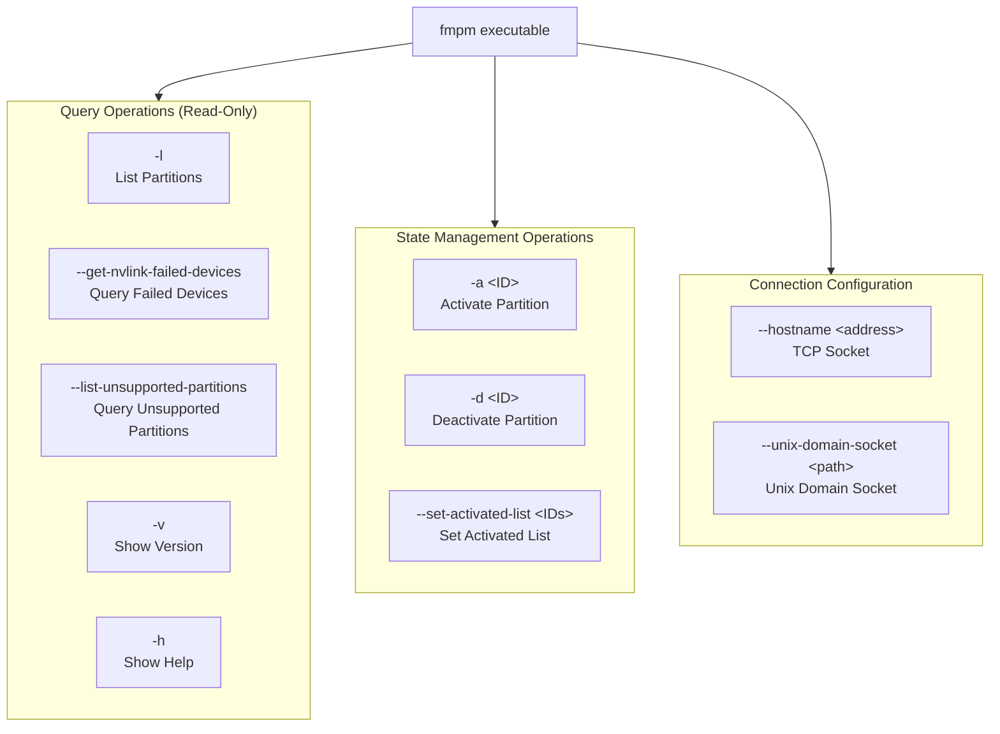
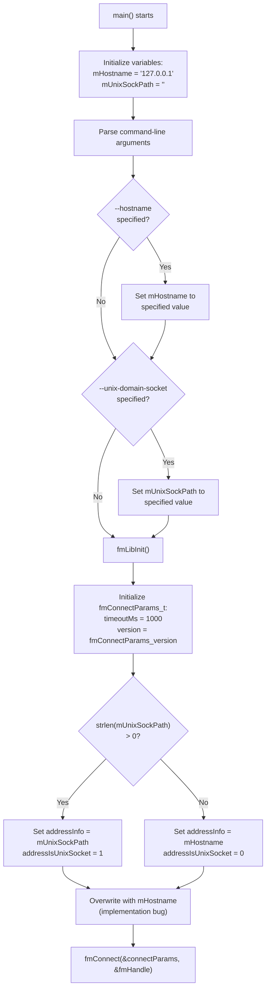
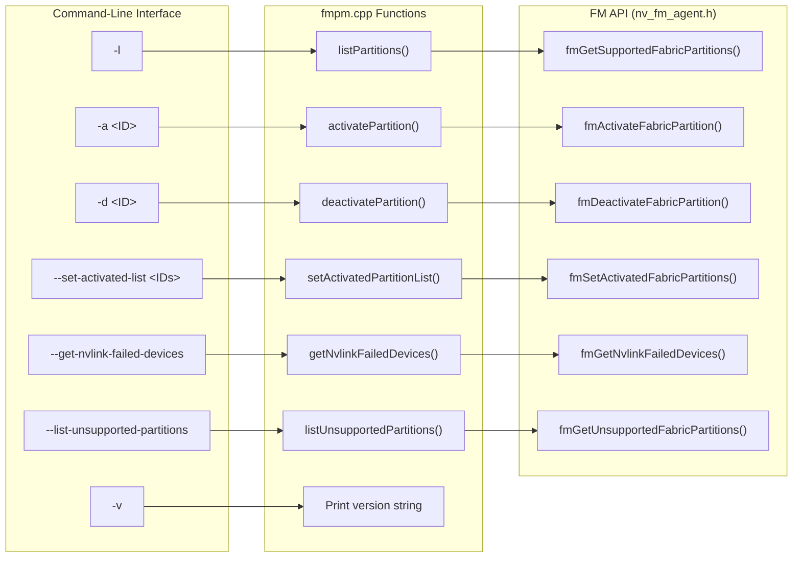
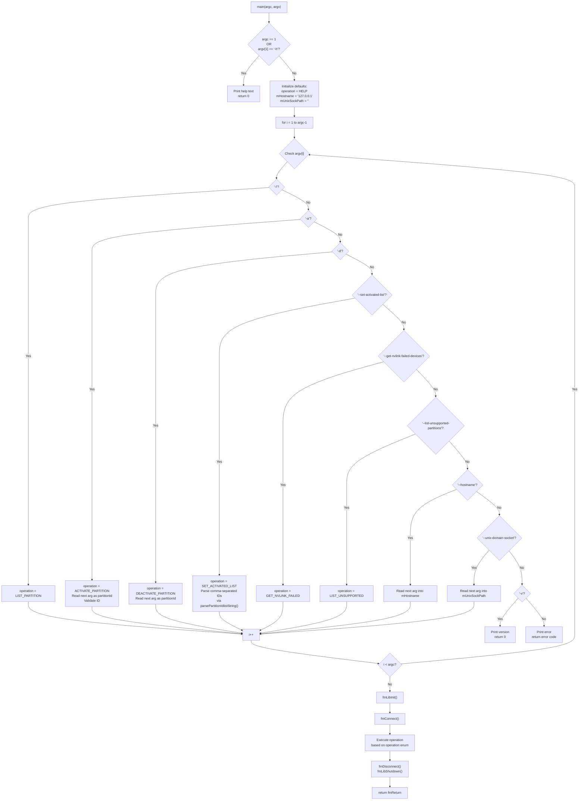
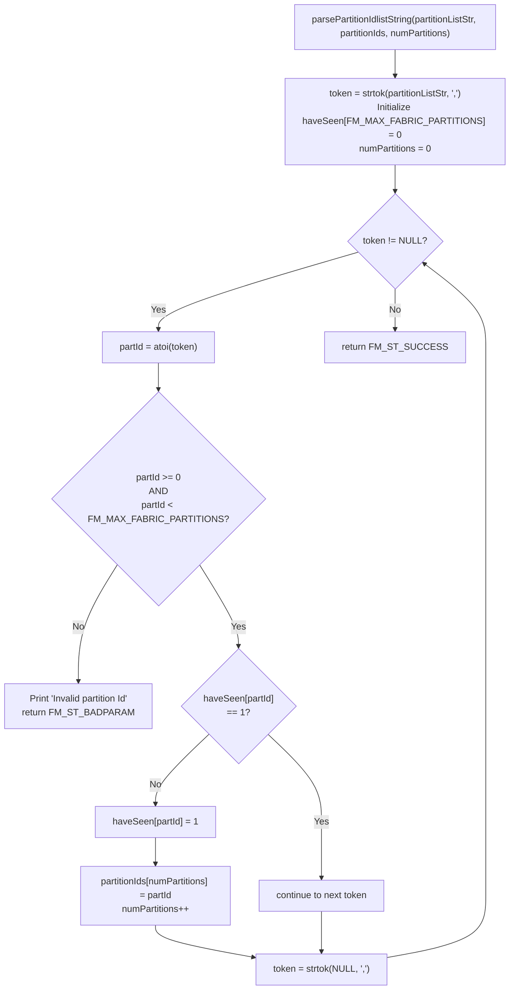

<!-- source: DeepWiki mcp.deepwiki.com · repo NVIDIA/Fabric-Manager-Client · page 3.1 Command-Line Reference · fetched 2026-11-11 -->

# Command-Line Reference

<details>
<summary>Relevant source files</summary>

The following files were used as context for generating this wiki page:

- [README.md](README.md)
- [fmpm.cpp](fmpm.cpp)

</details>


This page provides a complete reference of all command-line options, arguments, and flags available in the `fmpm` utility. The `fmpm` (Fabric Manager Partition Manager) command-line tool enables administrators and automation scripts to manage GPU partitions in NVIDIA Fabric Manager's Shared NVSwitch feature.

For information about the underlying architecture and communication mechanisms, see [Architecture Overview](#4.1). For practical usage workflows and examples, see [Managing GPU Partitions](#3.2). For configuration of the Fabric Manager service that `fmpm` connects to, see [Configuration](#2.3).

## Command Syntax Overview

The general syntax for `fmpm` commands follows this pattern:

```
fmpm [OPERATION] [ARGUMENTS] [CONNECTION_OPTIONS]
```

Where:
- **OPERATION**: A single operation flag that specifies the action to perform
- **ARGUMENTS**: Operation-specific arguments (e.g., partition IDs)
- **CONNECTION_OPTIONS**: Optional flags to specify how to connect to Fabric Manager

All output from `fmpm` is formatted as JSON and written to stdout, making it suitable for both interactive use and programmatic parsing.

**Sources:** [README.md:8-29](), [fmpm.cpp:294-404]()

---

## Command Categories



**Diagram: Command Category Organization**

**Sources:** [fmpm.cpp:12-29](), [README.md:8-29]()

---

## Query Operations

Query operations retrieve information from the Fabric Manager without modifying system state. All query operations return structured JSON output to stdout.

### `-l` : List Partitions

Lists all available GPU partitions with their current state and configuration.

| Property | Value |
|----------|-------|
| **Command** | `-l` |
| **Arguments** | None |
| **Output** | JSON object with partition list |
| **API Function** | `fmGetSupportedFabricPartitions()` |
| **Implementation** | `listPartitions()` |

**Output Structure:**
```json
{
  "version": <integer>,
  "numPartitions": <integer>,
  "maxNumPartitions": <integer>,
  "partitionInfo": [
    {
      "partitionId": <integer>,
      "isActive": <boolean>,
      "numGpus": <integer>,
      "gpuInfo": [
        {
          "physicalId": <integer>,
          "uuid": "<string>",
          "pciBusId": "<string>",
          "numNvLinksAvailable": <integer>,
          "maxNumNvLinks": <integer>,
          "nvlinkLineRateMBps": <integer>
        }
      ]
    }
  ]
}
```

**Sources:** [fmpm.cpp:63-120](), [fmpm.cpp:337-338](), [fmpm.cpp:440-442](), [README.md:9]()

### `--get-nvlink-failed-devices` : Query Failed Devices

Retrieves all GPUs and NVSwitches that have NVLink port failures. This diagnostic command helps identify hardware issues affecting partition availability.

| Property | Value |
|----------|-------|
| **Command** | `--get-nvlink-failed-devices` |
| **Arguments** | None |
| **Output** | JSON object with failed device details |
| **API Function** | `fmGetNvlinkFailedDevices()` |
| **Implementation** | `getNvlinkFailedDevices()` |

**Output Structure:**
```json
{
  "version": <integer>,
  "numGpus": <integer>,
  "numSwitches": <integer>,
  "gpuInfo": [
    {
      "uuid": "<string>",
      "pciBusId": "<string>",
      "numPorts": <integer>,
      "portNum": [<array of failed port numbers>]
    }
  ],
  "switchInfo": [
    {
      "uuid": "<string>",
      "pciBusId": "<string>",
      "numPorts": <integer>,
      "portNum": [<array of failed port numbers>]
    }
  ]
}
```

**Sources:** [fmpm.cpp:222-292](), [fmpm.cpp:375-376](), [fmpm.cpp:452-454](), [README.md:20]()

### `--list-unsupported-partitions` : Query Unsupported Partitions

Lists partition configurations that exist in hardware but cannot be managed due to incompatibility or hardware limitations.

| Property | Value |
|----------|-------|
| **Command** | `--list-unsupported-partitions` |
| **Arguments** | None |
| **Output** | JSON object with unsupported partition details |
| **API Function** | `fmGetUnsupportedFabricPartitions()` |
| **Implementation** | `listUnsupportedPartitions()` |

**Output Structure:**
```json
{
  "version": <integer>,
  "numPartitions": <integer>,
  "partitionInfo": [
    {
      "partitionId": <integer>,
      "numGpus": <integer>,
      "gpuPhysicalIds": [<array of GPU physical IDs>]
    }
  ]
}
```

**Sources:** [fmpm.cpp:122-171](), [fmpm.cpp:377-378](), [fmpm.cpp:455-457](), [README.md:21]()

### `-v` : Show Version

Displays the version number of the `fmpm` utility.

| Property | Value |
|----------|-------|
| **Command** | `-v` |
| **Arguments** | None |
| **Output** | Version string (plain text) |
| **Current Version** | "1.0.1" |

**Sources:** [fmpm.cpp:6](), [fmpm.cpp:397-400](), [README.md:28]()

### `-h` : Show Help

Displays usage information and a list of all available commands.

| Property | Value |
|----------|-------|
| **Command** | `-h` (or running `fmpm` with no arguments) |
| **Arguments** | None |
| **Output** | Help text (plain text) |

**Sources:** [fmpm.cpp:306-328](), [README.md:8]()

---

## State Management Operations

State management operations modify the runtime configuration of GPU partitions. These operations require that the Fabric Manager service is properly configured and accessible.

### `-a <Partition ID>` : Activate Partition

Activates a single GPU partition, making it available for compute workloads.

| Property | Value |
|----------|-------|
| **Command** | `-a <Partition ID>` |
| **Arguments** | Partition ID (unsigned integer, 0 to `FM_MAX_FABRIC_PARTITIONS`) |
| **Output** | Success or error message |
| **API Function** | `fmActivateFabricPartition()` |
| **Implementation** | `activatePartition()` |

**Validation:**
- Partition ID must be less than `FM_MAX_FABRIC_PARTITIONS`
- Partition must exist and be supported
- Partition must not already be active

**Example:**
```bash
fmpm -a 3
```

**Sources:** [fmpm.cpp:173-184](), [fmpm.cpp:339-352](), [fmpm.cpp:443-445](), [README.md:10]()

### `-d <Partition ID>` : Deactivate Partition

Deactivates a single GPU partition, removing it from the pool of available compute resources.

| Property | Value |
|----------|-------|
| **Command** | `-d <Partition ID>` |
| **Arguments** | Partition ID (unsigned integer) |
| **Output** | Success or error message |
| **API Function** | `fmDeactivateFabricPartition()` |
| **Implementation** | `deactivatePartition()` |

**Validation:**
- Partition ID must be valid
- Partition must be currently active

**Example:**
```bash
fmpm -d 3
```

**Sources:** [fmpm.cpp:186-196](), [fmpm.cpp:352-360](), [fmpm.cpp:446-448](), [README.md:11]()

### `--set-activated-list <Partition IDs>` : Set Activated Partition List

Sets a list of partition IDs that should remain activated. This command is designed for use with Fabric Manager Resiliency Mode and enables automatic restoration of partitions after service restarts.

| Property | Value |
|----------|-------|
| **Command** | `--set-activated-list <Partition IDs>` |
| **Arguments** | Comma-separated partition IDs (no spaces) |
| **Output** | Success or error message |
| **API Function** | `fmSetActivatedFabricPartitions()` |
| **Implementation** | `setActivatedPartitionList()` |
| **Requires** | `FABRIC_MODE_RESTART=1` in Fabric Manager config |

**Format:**
- Comma-separated list with no spaces
- Example: `1,2,3` or `0,5,7,9`
- Duplicate IDs are silently ignored
- Invalid IDs (< 0 or >= `FM_MAX_FABRIC_PARTITIONS`) cause error

**Behavior:**
- Fabric Manager persists this list to storage
- On restart, Fabric Manager automatically activates these partitions
- This command replaces the entire list (not additive)

**Example:**
```bash
fmpm --set-activated-list 1,2,3
```

For details on Resiliency Mode, see [Resiliency Mode](#3.4).

**Sources:** [fmpm.cpp:198-220](), [fmpm.cpp:32-61](), [fmpm.cpp:361-374](), [fmpm.cpp:449-451](), [README.md:22-27]()

---

## Connection Configuration Options

Connection options specify how the `fmpm` client communicates with the Fabric Manager service. These options can be used with any operation.

### `--hostname <address>` : TCP Socket Connection

Specifies the hostname or IP address of the Fabric Manager service when using TCP socket communication.

| Property | Value |
|----------|-------|
| **Command** | `--hostname <address>` |
| **Arguments** | Hostname or IP address (string) |
| **Default** | `127.0.0.1` (localhost) |
| **Protocol** | TCP socket |
| **Requires** | `FM_CMD_BIND_INTERFACE=<IP>` in Fabric Manager config |

**Usage:**
```bash
fmpm -l --hostname 10.0.0.5
fmpm -a 2 --hostname myserver.example.com
```

**Configuration Requirement:**
The Fabric Manager service must be configured to listen on the specified interface. Set `FM_CMD_BIND_INTERFACE` in the Fabric Manager configuration file to match the IP address. For details, see [Configuration](#2.3).

**Sources:** [fmpm.cpp:301](), [fmpm.cpp:379-387](), [fmpm.cpp:414-432](), [README.md:12-15]()

### `--unix-domain-socket <path>` : Unix Domain Socket Connection

Specifies the path to a Unix domain socket for local communication with the Fabric Manager service. This option provides lower latency than TCP sockets for local connections.

| Property | Value |
|----------|-------|
| **Command** | `--unix-domain-socket <path>` |
| **Arguments** | File system path to Unix socket (string) |
| **Default** | None (uses TCP if not specified) |
| **Protocol** | Unix domain socket |
| **Requires** | `FM_CMD_UNIX_SOCKET_PATH=<path>` in Fabric Manager config |
| **Priority** | Overrides `--hostname` if both specified |

**Usage:**
```bash
fmpm -l --unix-domain-socket /var/run/nvidia-fabricmanager/fabricmanager.sock
```

**Configuration Requirement:**
The Fabric Manager service must be configured to create a Unix domain socket at the specified path. Set `FM_CMD_UNIX_SOCKET_PATH` in the Fabric Manager configuration file to match. For details, see [Configuration](#2.3).

**Priority Behavior:**
If both `--unix-domain-socket` and `--hostname` are specified, the Unix domain socket takes precedence. However, due to implementation details in [fmpm.cpp:419-432](), the final connection uses the Unix socket path if non-empty.

**Sources:** [fmpm.cpp:302](), [fmpm.cpp:388-396](), [fmpm.cpp:414-432](), [README.md:16-19]()

---

## Connection Configuration Flow



**Diagram: Connection Parameter Resolution Flow**

**Note:** The implementation in [fmpm.cpp:431-432]() unconditionally overwrites the connection parameters with `mHostname` and TCP socket mode, which may be a bug when Unix domain socket is specified. In practice, the earlier check at [fmpm.cpp:419-422]() should have already set the correct values.

**Sources:** [fmpm.cpp:330-438]()

---

## Command-to-API Function Mapping

The following diagram illustrates how command-line operations map to internal functions and Fabric Manager API calls:



**Diagram: Command-to-Function-to-API Mapping**

**Sources:** [fmpm.cpp:63-292](), [fmpm.cpp:337-457]()

---

## Argument Parsing Implementation

The argument parsing logic uses a sequential scan through `argv` to identify operations and their parameters.



**Diagram: Argument Parsing and Execution Flow**

**Sources:** [fmpm.cpp:294-465]()

---

## Partition ID Parsing

The `--set-activated-list` command requires special parsing logic to handle comma-separated partition IDs.



**Diagram: Partition ID List Parsing Logic**

**Key Features:**
- Uses `strtok()` to tokenize comma-separated string
- Validates each ID is in range `[0, FM_MAX_FABRIC_PARTITIONS)`
- Automatically deduplicates IDs using `haveSeen[]` array
- Returns `FM_ST_BADPARAM` on invalid ID

**Sources:** [fmpm.cpp:32-61]()

---

## Return Codes

The `fmpm` utility returns `fmReturn_t` status codes to indicate success or failure. These codes are defined in the FM API header `nv_fm_agent.h`.

| Return Code | Value | Meaning | Common Causes |
|-------------|-------|---------|---------------|
| `FM_ST_SUCCESS` | 0 | Operation completed successfully | - |
| `FM_ST_BADPARAM` | Non-zero | Invalid parameter provided | Invalid partition ID, malformed argument |
| `FM_ST_ERROR` | Non-zero | General error | Connection failure, API error |

**Note:** The exact numeric values and full list of return codes are defined in `nv_fm_agent.h` from the `nvidia-fabricmanager-devel` package. For comprehensive error handling information, see [Error Handling and Return Codes](#4.5).

**Sources:** [fmpm.cpp:47-48](), [fmpm.cpp:73-75](), [fmpm.cpp:179-183](), [fmpm.cpp:191-194]()

---

## Usage Examples

### Basic Query Operations

```bash
# List all partitions (using default localhost connection)
fmpm -l

# List partitions on a remote host
fmpm -l --hostname 192.168.1.100

# List partitions using Unix domain socket
fmpm -l --unix-domain-socket /var/run/nvidia-fabricmanager/fabricmanager.sock

# Check for NVLink failures
fmpm --get-nvlink-failed-devices

# List unsupported partitions
fmpm --list-unsupported-partitions

# Show version
fmpm -v

# Show help
fmpm -h
```

### State Management Operations

```bash
# Activate partition 2
fmpm -a 2

# Activate partition on remote host
fmpm -a 3 --hostname 10.0.0.50

# Deactivate partition 2
fmpm -d 2

# Set resiliency list (partitions 1, 2, 3 should auto-restore)
fmpm --set-activated-list 1,2,3

# Set resiliency list on remote host
fmpm --set-activated-list 0,4,7 --hostname 10.0.0.50
```

### Combined Options

```bash
# List partitions using Unix socket (overrides hostname)
fmpm -l --hostname 10.0.0.1 --unix-domain-socket /tmp/fm.sock

# Note: Unix socket takes precedence over TCP in this case
```

**Sources:** [README.md:7-29](), [fmpm.cpp:306-328]()

---

## Command Reference Table

The following table provides a quick reference for all available commands:

| Command | Arguments | Operation Enum | Function | API Call | Output Type |
|---------|-----------|----------------|----------|----------|-------------|
| `-l` | None | `SHARED_FABRIC_CMD_LIST_PARTITION` | `listPartitions()` | `fmGetSupportedFabricPartitions()` | JSON |
| `-a` | `<Partition ID>` | `SHARED_FABRIC_CMD_ACTIVATE_PARTITION` | `activatePartition()` | `fmActivateFabricPartition()` | Text |
| `-d` | `<Partition ID>` | `SHARED_FABRIC_CMD_DEACTIVATE_PARTITION` | `deactivatePartition()` | `fmDeactivateFabricPartition()` | Text |
| `--set-activated-list` | `<ID,ID,...>` | `SHARED_FABRIC_CMD_SET_ACTIVATED_PARTITION_LIST` | `setActivatedPartitionList()` | `fmSetActivatedFabricPartitions()` | Text |
| `--get-nvlink-failed-devices` | None | `SHARED_FABRIC_CMD_GET_NVLINK_FAILED_DEVICES` | `getNvlinkFailedDevices()` | `fmGetNvlinkFailedDevices()` | JSON |
| `--list-unsupported-partitions` | None | `SHARED_FABRIC_CMD_LIST_UNSUPPORTED_PARTITION` | `listUnsupportedPartitions()` | `fmGetUnsupportedFabricPartitions()` | JSON |
| `--hostname` | `<address>` | `SHARED_FABRIC_CMD_HOSTNAME` | Sets `mHostname` | N/A | N/A |
| `--unix-domain-socket` | `<path>` | `SHARED_FABRIC_CMD_UNIX_DOMAIN_SOCKET` | Sets `mUnixSockPath` | N/A | N/A |
| `-v` | None | N/A | Prints version | N/A | Text |
| `-h` | None | `SHARED_FABRIC_CMD_HELP` | Prints help | N/A | Text |

**Sources:** [fmpm.cpp:12-29](), [fmpm.cpp:63-292](), [fmpm.cpp:335-465]()

---

## Constants and Limits

The following constants define limits for command-line parsing and partition management:

| Constant | Value | Definition Location | Description |
|----------|-------|---------------------|-------------|
| `MAX_PATH_LEN` | 256 | [fmpm.cpp:8]() | Maximum length for hostname and socket path strings |
| `FM_MAX_FABRIC_PARTITIONS` | (Defined in API) | `nv_fm_agent.h` | Maximum number of fabric partitions supported |
| `fmConnectParams_t.timeoutMs` | 1000 | [fmpm.cpp:415]() | Connection timeout in milliseconds |
| Default hostname | "127.0.0.1" | [fmpm.cpp:333]() | Default TCP connection target |

**Sources:** [fmpm.cpp:8](), [fmpm.cpp:333](), [fmpm.cpp:415]()

---

