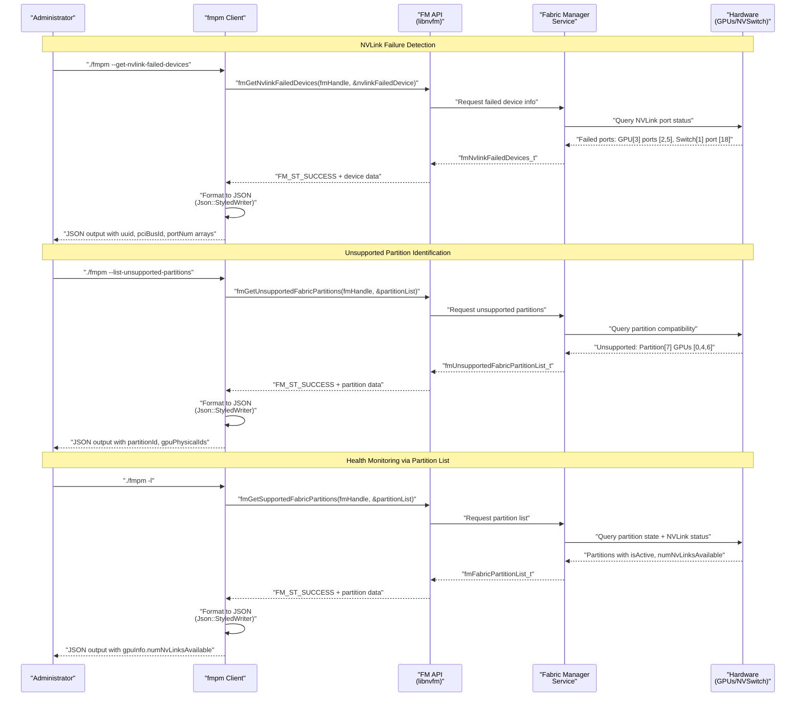
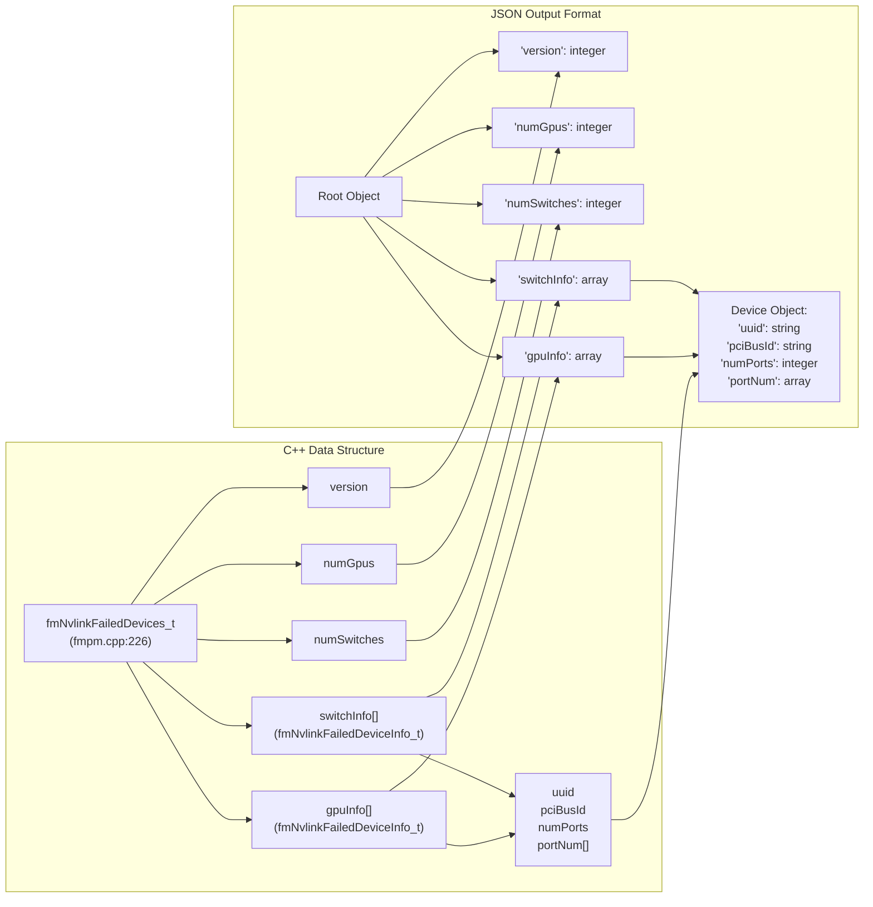
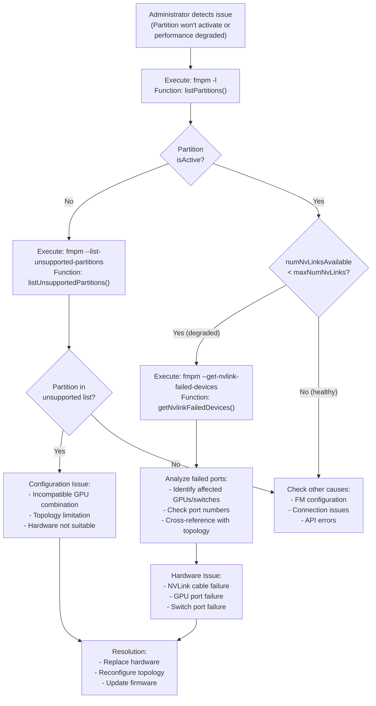

<!-- source: DeepWiki mcp.deepwiki.com · repo NVIDIA/Fabric-Manager-Client · page 3.3 Monitoring and Diagnostics · fetched 2026-11-11 -->

# Monitoring and Diagnostics

<details>
<summary>Relevant source files</summary>

The following files were used as context for generating this wiki page:

- [README.md](README.md)
- [fmpm.cpp](fmpm.cpp)

</details>


This page covers the diagnostic and monitoring capabilities of the `fmpm` client for identifying hardware failures and configuration issues in GPU partition infrastructure. These read-only query operations allow administrators to detect NVLink failures, identify unsupported partition configurations, and assess the health of the fabric without modifying system state.

For information about listing and managing active partitions, see [Managing GPU Partitions](#3.2). For complete command syntax, see [Command-Line Reference](#3.1). For error code interpretation, see [Error Handling and Return Codes](#4.5).

## Overview of Diagnostic Commands

The `fmpm` client provides three primary diagnostic operations that query the Fabric Manager service for hardware health and configuration information:

| Command | Function | Primary Use Case |
|---------|----------|------------------|
| `--get-nvlink-failed-devices` | Query failed NVLink ports | Detecting hardware failures in GPUs and NVSwitch fabric |
| `--list-unsupported-partitions` | Query unsupported configurations | Identifying partitions that cannot be activated due to hardware limitations |
| `-l` (list partitions) | Query partition state and NVLink availability | Monitoring active/inactive status and link health per partition |

All diagnostic commands output structured JSON to `stdout`, enabling both human interpretation and programmatic processing by monitoring systems.

Sources: [README.md:20-21](), [fmpm.cpp:222-292](), [fmpm.cpp:122-171]()

## Diagnostic Data Flow

The following diagram illustrates how diagnostic information flows from the hardware layer through the Fabric Manager service to the client output:



Sources: [fmpm.cpp:222-292](), [fmpm.cpp:122-171](), [fmpm.cpp:63-120]()

## NVLink Failed Device Detection

### Command Usage

The `--get-nvlink-failed-devices` command queries the Fabric Manager for all GPUs and NVSwitches with NVLink port failures:

```bash
./fmpm --get-nvlink-failed-devices [--hostname <IP>]
./fmpm --get-nvlink-failed-devices --unix-domain-socket <path>
```

This operation calls `fmGetNvlinkFailedDevices()` API function [fmpm.cpp:231]() and returns detailed port-level failure information.

### Data Structure Mapping

The diagnostic operation uses the `fmNvlinkFailedDevices_t` structure internally and transforms it to JSON:



Sources: [fmpm.cpp:226-292]()

### JSON Output Format

The command outputs a JSON object containing failed device information for both GPUs and switches:

```json
{
   "version" : 65536,
   "numGpus" : 2,
   "numSwitches" : 1,
   "gpuInfo" : [
      {
         "uuid" : "GPU-12345678-1234-1234-1234-123456789abc",
         "pciBusId" : "00000000:03:00.0",
         "numPorts" : 2,
         "portNum" : [ 2, 5 ]
      },
      {
         "uuid" : "GPU-87654321-4321-4321-4321-cba987654321",
         "pciBusId" : "00000000:07:00.0",
         "numPorts" : 1,
         "portNum" : [ 3 ]
      }
   ],
   "switchInfo" : [
      {
         "uuid" : "SWT-aaaaaaaa-bbbb-cccc-dddd-eeeeeeeeeeee",
         "pciBusId" : "00000000:0a:00.0",
         "numPorts" : 1,
         "portNum" : [ 18 ]
      }
   ]
}
```

**Key Fields:**
- `version`: API version identifier from `fmNvlinkFailedDevices_version`
- `numGpus`: Count of GPUs with at least one failed NVLink port
- `numSwitches`: Count of NVSwitches with at least one failed port
- `gpuInfo[]`: Array of GPU failure details
- `switchInfo[]`: Array of switch failure details
- `uuid`: Unique identifier for the device
- `pciBusId`: PCI address of the device
- `numPorts`: Number of failed ports on this device
- `portNum[]`: Array of specific port numbers that have failed

### Implementation Details

The `getNvlinkFailedDevices()` function [fmpm.cpp:222-292]() implements the following workflow:

1. Initialize `fmNvlinkFailedDevices_t` structure with version number [fmpm.cpp:228-229]()
2. Call `fmGetNvlinkFailedDevices()` API [fmpm.cpp:231]()
3. Check return status; output error if `FM_ST_SUCCESS` not returned [fmpm.cpp:232-236]()
4. Iterate through GPU failures [fmpm.cpp:252-266]():
   - Extract device UUID, PCI Bus ID
   - Build array of failed port numbers
5. Iterate through switch failures [fmpm.cpp:270-284]():
   - Extract device UUID, PCI Bus ID
   - Build array of failed port numbers
6. Format complete structure to JSON using `Json::StyledWriter` [fmpm.cpp:287-289]()

Sources: [fmpm.cpp:222-292]()

## Unsupported Partition Identification

### Command Usage

The `--list-unsupported-partitions` command identifies partition configurations that cannot be activated due to hardware limitations or incompatibilities:

```bash
./fmpm --list-unsupported-partitions [--hostname <IP>]
./fmpm --list-unsupported-partitions --unix-domain-socket <path>
```

This operation calls `fmGetUnsupportedFabricPartitions()` API function [fmpm.cpp:131]() to retrieve partitions that the Fabric Manager cannot manage.

### Use Cases

Unsupported partitions typically occur when:
- GPU combinations are incompatible for fabric partitioning
- Hardware configuration doesn't meet NVSwitch requirements
- GPU models within a partition have mismatched NVLink capabilities
- Physical topology prevents proper fabric isolation

Identifying these partitions prevents wasted activation attempts and clarifies hardware limitations.

### JSON Output Format

The command outputs a JSON object listing unsupported partition configurations:

```json
{
   "version" : 65536,
   "numPartitions" : 2,
   "partitionInfo" : [
      {
         "partitionId" : 7,
         "numGpus" : 3,
         "gpuPhysicalIds" : [ 0, 4, 6 ]
      },
      {
         "partitionId" : 15,
         "numGpus" : 2,
         "gpuPhysicalIds" : [ 2, 9 ]
      }
   ]
}
```

**Key Fields:**
- `version`: API version identifier from `fmUnsupportedFabricPartitionList_version`
- `numPartitions`: Count of unsupported partition configurations
- `partitionInfo[]`: Array of unsupported partition details
- `partitionId`: Numeric identifier for the partition
- `numGpus`: Number of GPUs in this unsupported configuration
- `gpuPhysicalIds[]`: Array of physical GPU IDs that form the incompatible partition

### Implementation Details

The `listUnsupportedPartitions()` function [fmpm.cpp:122-171]() implements:

1. Initialize `fmUnsupportedFabricPartitionList_t` structure [fmpm.cpp:128-129]()
2. Call `fmGetUnsupportedFabricPartitions()` API [fmpm.cpp:131]()
3. Validate return status [fmpm.cpp:132-136]()
4. Iterate through unsupported partitions [fmpm.cpp:147-162]():
   - Extract partition ID and GPU count
   - Build array of physical GPU IDs
   - Append to JSON partition info list
5. Format structure to JSON [fmpm.cpp:166-168]()

Sources: [fmpm.cpp:122-171]()

## Monitoring Partition Health

### Using List Partitions for Health Monitoring

While the `-l` command is primarily for listing partitions (documented in [Managing GPU Partitions](#3.2)), it also provides critical health monitoring information through the `numNvLinksAvailable` field for each GPU.

### NVLink Availability Monitoring

The partition list output includes per-GPU NVLink health information:

```json
{
   "partitionInfo" : [
      {
         "partitionId" : 3,
         "isActive" : true,
         "numGpus" : 4,
         "gpuInfo" : [
            {
               "physicalId" : 0,
               "uuid" : "GPU-12345678-1234-1234-1234-123456789abc",
               "pciBusId" : "00000000:03:00.0",
               "numNvLinksAvailable" : 12,
               "maxNumNvLinks" : 12,
               "nvlinkLineRateMBps" : 25000
            },
            {
               "physicalId" : 1,
               "uuid" : "GPU-23456789-2345-2345-2345-234567890bcd",
               "pciBusId" : "00000000:07:00.0",
               "numNvLinksAvailable" : 10,
               "maxNumNvLinks" : 12,
               "nvlinkLineRateMBps" : 25000
            }
         ]
      }
   ]
}
```

**Health Indicators:**
- `numNvLinksAvailable` vs `maxNumNvLinks`: If these differ, the GPU has degraded NVLink connectivity
- `nvlinkLineRateMBps`: Indicates link bandwidth capability
- Compare across multiple queries to detect progressive failures

Sources: [fmpm.cpp:63-120](), [fmpm.cpp:103-105]()

## Diagnostic Workflow

The following diagram shows the recommended diagnostic workflow for troubleshooting partition and NVLink issues:



Sources: [fmpm.cpp:63-120](), [fmpm.cpp:222-292](), [fmpm.cpp:122-171]()

## Interpreting Diagnostic Results

### Empty Results Interpretation

When diagnostic commands return empty arrays, this indicates healthy status:

```json
{
   "version" : 65536,
   "numGpus" : 0,
   "numSwitches" : 0,
   "gpuInfo" : [ ],
   "switchInfo" : [ ]
}
```

An empty `gpuInfo` and `switchInfo` from `--get-nvlink-failed-devices` indicates no NVLink failures in the system.

Similarly, empty `partitionInfo` from `--list-unsupported-partitions` indicates all partition configurations are supported.

### Correlation Analysis

For comprehensive diagnostics, correlate results across multiple commands:

| Scenario | `-l` Output | `--get-nvlink-failed-devices` | `--list-unsupported-partitions` | Diagnosis |
|----------|-------------|-------------------------------|--------------------------------|-----------|
| Healthy partition | `isActive: true`<br/>`numNvLinksAvailable: 12` | Empty arrays | Partition not listed | Normal operation |
| Degraded partition | `isActive: true`<br/>`numNvLinksAvailable: 10` | GPU listed with failed ports | Partition not listed | Active with link failures |
| Failed activation | `isActive: false` | GPUs listed | Partition not listed | Hardware failure preventing activation |
| Incompatible config | Partition not in supported list | May or may not show failures | Partition listed | Configuration not supported by hardware |

### Device Identification

Both commands provide multiple identifiers for cross-referencing:

1. **UUID**: Globally unique identifier, persistent across reboots
2. **PCI Bus ID**: System-level address, can change with PCIe configuration
3. **Physical ID**: Index in Fabric Manager's device list

Use UUIDs for tracking specific hardware units across different systems or configurations.

Sources: [fmpm.cpp:101-102](), [fmpm.cpp:255-256](), [fmpm.cpp:273-274]()

## Command Options for Diagnostics

All diagnostic commands support both TCP and Unix domain socket connections:

### TCP Socket (Default)

```bash
# Default localhost connection
./fmpm --get-nvlink-failed-devices

# Remote Fabric Manager
./fmpm --get-nvlink-failed-devices --hostname 10.0.0.50
```

### Unix Domain Socket

```bash
# Local Unix socket (higher performance)
./fmpm --get-nvlink-failed-devices --unix-domain-socket /var/run/fabricmanager.sock
./fmpm --list-unsupported-partitions --unix-domain-socket /var/run/fabricmanager.sock
```

The connection method must match the Fabric Manager configuration. See [Configuration](#2.3) for details on `FM_CMD_BIND_INTERFACE` and `FM_CMD_UNIX_SOCKET_PATH` settings.

Sources: [README.md:12-19](), [fmpm.cpp:414-438]()

## Error Handling in Diagnostic Operations

All diagnostic functions check the return status from API calls and output error messages to `stderr`:

```cpp
fmReturn = fmGetNvlinkFailedDevices(fmHandle, &nvlinkFailedDevice);
if ( fmReturn != FM_ST_SUCCESS )
{
    std::cout << "Failed to NVLink failed devices. fmReturn: " << fmReturn << std::endl;
    return fmReturn;
}
```

Common error scenarios:

| Error Condition | Return Code | Cause | Resolution |
|----------------|-------------|-------|------------|
| Connection failure | `FM_ST_ERROR` | Fabric Manager not running or unreachable | Verify FM service status and network connectivity |
| Timeout | `FM_ST_ERROR` | API timeout (1000ms default) | Check system load, increase timeout in `fmConnectParams_t` |
| Invalid handle | `FM_ST_BADPARAM` | Connection not established | Ensure `fmConnect()` succeeded before diagnostic calls |
| API version mismatch | `FM_ST_ERROR` | Client/server version incompatibility | Update client or server to matching versions |

See [Error Handling and Return Codes](#4.5) for complete error reference.

Sources: [fmpm.cpp:232-236](), [fmpm.cpp:132-136](), [fmpm.cpp:73-75]()

## Automation and Monitoring Integration

### JSON Parsing for Scripts

All diagnostic output uses structured JSON, enabling automated monitoring:

```bash
#!/bin/bash
# Example: Alert on NVLink failures

FAILED_JSON=$(./fmpm --get-nvlink-failed-devices --hostname 10.0.0.50)
NUM_FAILED_GPUS=$(echo "$FAILED_JSON" | jq '.numGpus')

if [ "$NUM_FAILED_GPUS" -gt 0 ]; then
    echo "ALERT: $NUM_FAILED_GPUS GPUs have NVLink failures"
    echo "$FAILED_JSON" | jq '.gpuInfo[]'
fi
```

### Continuous Monitoring

Diagnostic commands are read-only and safe for frequent execution:

```bash
# Poll every 5 minutes
while true; do
    ./fmpm -l --hostname 10.0.0.50 > /var/log/fabric/partition-status.json
    ./fmpm --get-nvlink-failed-devices --hostname 10.0.0.50 > /var/log/fabric/nvlink-failures.json
    sleep 300
done
```

### Return Code Checking

The `fmpm` binary exits with the `fmReturn_t` value, enabling shell-level error detection:

```bash
./fmpm --get-nvlink-failed-devices
if [ $? -ne 0 ]; then
    echo "Diagnostic command failed"
    # Check logs, send alert, etc.
fi
```

Sources: [fmpm.cpp:464](), [fmpm.cpp:291](), [fmpm.cpp:170]()

---

