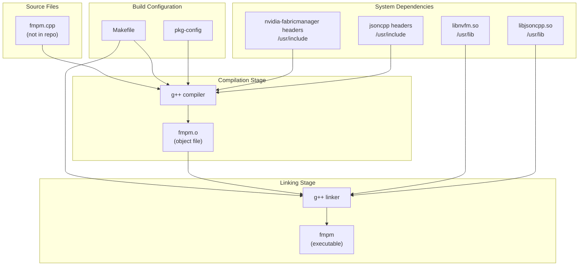
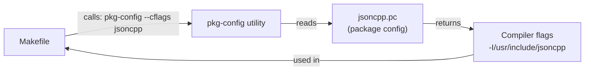
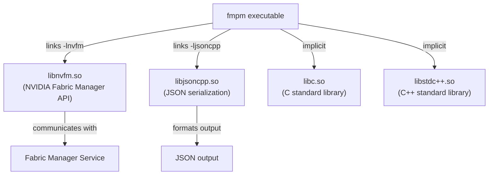
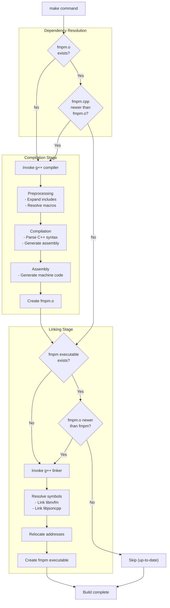
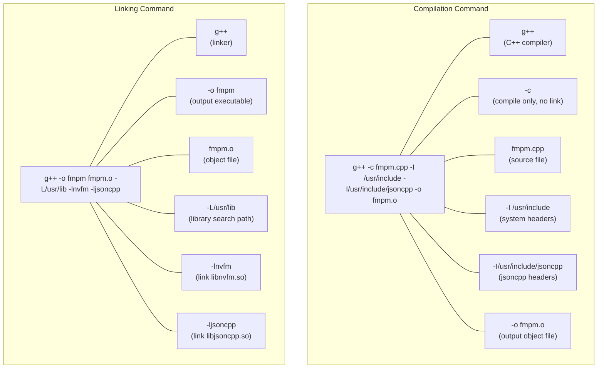

<!-- source: DeepWiki mcp.deepwiki.com · repo NVIDIA/Fabric-Manager-Client · page 4.4 Build System Details · fetched 2026-11-11 -->

# Build System Details

<details>
<summary>Relevant source files</summary>

The following files were used as context for generating this wiki page:

- [Makefile](Makefile)

</details>


## Purpose and Scope

This page provides technical documentation of the build system used to compile the `fmpm` client utility from source. It covers the Makefile structure, compiler and linker configuration, dependency management via `pkg-config`, and the complete build process flow.

For instructions on building the client as an end-user, see [Building from Source](#2.2). For information about runtime dependencies and development packages, see [Prerequisites and Dependencies](#2.1).

**Sources:** [Makefile:1-13]()

---

## Build System Architecture

The Fabric Manager Client uses a simple, single-file Makefile-based build system that produces one executable binary (`fmpm`). The build system is designed for Unix-like environments and relies on standard GNU Make conventions.

### Build System Diagram



**Sources:** [Makefile:1-13]()

---

## Compiler Configuration

The compiler configuration specifies how source files are compiled into object files.

### Include Directory Configuration

```makefile
IDIR := /usr/include
```

The `IDIR` variable points to the system include directory where header files are located. This directory contains:
- NVIDIA Fabric Manager API headers (from `nvidia-fabricmanager-dev` or `nvidia-fabricmanager-devel` package)
- Standard system headers

**Sources:** [Makefile:1]()

### Compiler Flags

```makefile
CXXFLAGS = -I $(IDIR) $(shell pkg-config --cflags jsoncpp)
```

The `CXXFLAGS` variable defines compilation flags:

| Flag/Component | Purpose | Value |
|----------------|---------|-------|
| `-I $(IDIR)` | Add include search path | `/usr/include` |
| `$(shell pkg-config --cflags jsoncpp)` | Dynamically retrieve jsoncpp compiler flags | Varies by system (typically includes `-I/usr/include/jsoncpp`) |

The `pkg-config` command dynamically determines the correct compiler flags for the installed `jsoncpp` library version, ensuring compatibility across different distributions and library versions.

**Sources:** [Makefile:2]()

### pkg-config Integration

The build system uses `pkg-config` to query system library metadata. The `pkg-config` tool reads `.pc` (package configuration) files installed by library packages and returns appropriate compiler and linker flags.



**Sources:** [Makefile:2]()

---

## Linker Configuration

The linker configuration specifies how object files are linked into the final executable.

### Library Directory Configuration

```makefile
LDIR := /usr/lib
```

The `LDIR` variable points to the system library directory where shared objects are located.

**Sources:** [Makefile:4]()

### Linker Flags

```makefile
LDFLAGS= -L$(LDIR) -lnvfm -ljsoncpp
```

The `LDFLAGS` variable defines linker flags and library dependencies:

| Flag | Purpose | Description |
|------|---------|-------------|
| `-L$(LDIR)` | Library search path | Add `/usr/lib` to library search path |
| `-lnvfm` | Link NVIDIA Fabric Manager library | Links against `libnvfm.so` (FM API client library) |
| `-ljsoncpp` | Link JSON library | Links against `libjsoncpp.so` (JSON serialization) |

### Library Dependencies Diagram



**Sources:** [Makefile:5]()

---

## Build Targets

The Makefile defines two primary targets: the default build target and a clean target.

### Default Target: fmpm

```makefile
fmpm: fmpm.o
	g++ -o $@ $< $(CXXFLAGS) $(LDFLAGS)
```

This target produces the final executable:
- **Dependency:** `fmpm.o` (object file compiled from `fmpm.cpp`)
- **Command:** Links `fmpm.o` into the `fmpm` executable using `g++`
- **Variables:**
  - `$@` - Target name (`fmpm`)
  - `$<` - First prerequisite (`fmpm.o`)
  - `$(CXXFLAGS)` - Compiler flags (included for header visibility during link-time template instantiation)
  - `$(LDFLAGS)` - Linker flags and libraries

**Sources:** [Makefile:7-8]()

### Implicit Rule: fmpm.o

While not explicitly defined in the Makefile, GNU Make's implicit rules automatically handle the compilation of `fmpm.cpp` to `fmpm.o`:

```
fmpm.o: fmpm.cpp
	g++ -c fmpm.cpp $(CXXFLAGS) -o fmpm.o
```

The implicit rule:
- Compiles `fmpm.cpp` source file
- Produces `fmpm.o` object file
- Uses `$(CXXFLAGS)` for compilation

**Sources:** [Makefile:7]() (implicit dependency)

### Clean Target

```makefile
clean:
	-@rm -f fmpm.o
	-@rm -f fmpm
```

This target removes build artifacts:
- Removes `fmpm.o` object file
- Removes `fmpm` executable
- **Flags:**
  - `-` prefix: Ignore errors (continue if file doesn't exist)
  - `@` prefix: Suppress command echo
  - `rm -f`: Force removal without prompting

**Sources:** [Makefile:10-12]()

### Build Targets Summary Table

| Target | Command | Produces | Dependencies |
|--------|---------|----------|--------------|
| `fmpm` (default) | `make` or `make fmpm` | `fmpm` executable | `fmpm.o` |
| `fmpm.o` (implicit) | Automatic | `fmpm.o` object file | `fmpm.cpp`, headers |
| `clean` | `make clean` | (removes artifacts) | None |

**Sources:** [Makefile:7-12]()

---

## Build Process Flow

The complete build process follows these stages:



### Stage Descriptions

| Stage | Description | Input | Output | Error Conditions |
|-------|-------------|-------|--------|------------------|
| **Dependency Resolution** | Make determines if rebuild is needed | Timestamps of source/object/executable | Decision to compile/link | N/A |
| **Compilation** | C++ source to object code | `fmpm.cpp`, headers | `fmpm.o` | Syntax errors, missing headers, type errors |
| **Linking** | Combine object code with libraries | `fmpm.o`, `libnvfm.so`, `libjsoncpp.so` | `fmpm` executable | Undefined symbols, library not found |

**Sources:** [Makefile:1-13]()

---

## Dependency Management

The build system relies on external dependencies that must be installed before compilation.

### System Package Dependencies

| Dependency Type | Package Name (Ubuntu/Debian) | Package Name (RHEL/CentOS) | Purpose |
|----------------|------------------------------|----------------------------|---------|
| Development headers | `nvidia-fabricmanager-dev` | `nvidia-fabricmanager-devel` | NVIDIA FM API headers (`nvfm.h`, etc.) |
| Development headers | `libjsoncpp-dev` | `jsoncpp-devel` | JSON C++ library headers |
| Runtime library | `nvidia-fabricmanager` | `nvidia-fabricmanager` | `libnvfm.so` shared library |
| Runtime library | `libjsoncpp` | `jsoncpp` | `libjsoncpp.so` shared library |
| Build tool | `make` | `make` | GNU Make build system |
| Compiler | `g++` | `gcc-c++` | C++ compiler |
| Build tool | `pkg-config` | `pkgconfig` | Package configuration tool |

### Repository Requirements

On RHEL-based systems, `jsoncpp` packages are available in the EPEL (Extra Packages for Enterprise Linux) repository:

```bash
# Enable EPEL repository (RHEL/CentOS)
sudo yum install epel-release
sudo yum install jsoncpp-devel
```

**Sources:** Referenced from diagrams in context

### pkg-config Files Required

The build system expects the following `.pc` files to be installed:

| Package Config File | Provided By | Contains |
|---------------------|-------------|----------|
| `jsoncpp.pc` | `libjsoncpp-dev` or `jsoncpp-devel` | Compiler flags (`-I` paths) and linker flags for jsoncpp |

**Sources:** [Makefile:2]()

---

## Build Artifacts

The build process produces the following artifacts:

### Intermediate Files

| File | Type | Purpose | Cleaned by `make clean` |
|------|------|---------|-------------------------|
| `fmpm.o` | Object file | Compiled machine code from `fmpm.cpp` | Yes |

### Final Output

| File | Type | Purpose | Cleaned by `make clean` |
|------|------|---------|-------------------------|
| `fmpm` | ELF executable | Final runnable binary | Yes |

### Artifact Inspection

The generated `fmpm` executable can be inspected using standard Unix tools:

```bash
# View shared library dependencies
ldd fmpm

# Expected output includes:
#   libnvfm.so => /usr/lib/x86_64-linux-gnu/libnvfm.so
#   libjsoncpp.so => /usr/lib/x86_64-linux-gnu/libjsoncpp.so
#   libstdc++.so.6 => /usr/lib/x86_64-linux-gnu/libstdc++.so.6
#   libc.so.6 => /lib/x86_64-linux-gnu/libc.so.6

# View symbol table
nm fmpm | grep -E 'fmLib|Json'

# View ELF header
readelf -h fmpm
```

**Sources:** [Makefile:7-12]()

---

## Build System Limitations and Considerations

### Single-File Source

The build system assumes all source code is contained in `fmpm.cpp`. There are no provisions for:
- Multiple source files
- Subdirectories
- Header-only implementations

This design keeps the build system simple but limits modularity.

### Hardcoded Paths

The include and library directories are hardcoded to `/usr/include` and `/usr/lib`:
- Works for standard system installations
- May fail for custom library installations (e.g., `/usr/local`, `/opt`)
- Users with non-standard installations must modify the Makefile

**Sources:** [Makefile:1,4]()

### No Optimization Flags

The `CXXFLAGS` does not include optimization flags:
- No `-O2` or `-O3` for performance optimization
- No `-g` for debug symbols
- No `-Wall` or `-Wextra` for warnings
- Users building for production should add optimization flags

### No Install Target

The Makefile does not provide an `install` target to copy the binary to system directories (e.g., `/usr/bin` or `/usr/local/bin`). Users must manually install:

```bash
sudo cp fmpm /usr/local/bin/
sudo chmod +x /usr/local/bin/fmpm
```

**Sources:** [Makefile:1-13]()

### Platform Assumptions

The build system assumes:
- Linux or Unix-like operating system
- GNU Make compatibility
- GCC/G++ compiler availability
- Shared library support (`.so` files)

No support for:
- Windows builds (would require `.lib` static libraries or `.dll` dynamic libraries)
- Static linking (no `-static` flag)
- Cross-compilation

**Sources:** [Makefile:1-13]()

---

## Customization Examples

### Adding Debug Symbols

To build with debug symbols for use with `gdb`:

```makefile
CXXFLAGS = -I $(IDIR) $(shell pkg-config --cflags jsoncpp) -g -O0
```

### Adding Optimization

For production builds with optimization:

```makefile
CXXFLAGS = -I $(IDIR) $(shell pkg-config --cflags jsoncpp) -O3 -DNDEBUG
```

### Custom Library Paths

For libraries installed in non-standard locations:

```makefile
IDIR := /opt/nvidia/include
LDIR := /opt/nvidia/lib64
```

### Static Linking

To create a statically-linked binary (if static libraries are available):

```makefile
LDFLAGS= -L$(LDIR) -static -lnvfm -ljsoncpp -lpthread
```

**Sources:** [Makefile:1-13]()

---

## Compilation Command Expansion

### Full Compilation Command

When Make executes the compilation (implicit rule), the expanded command is approximately:

```bash
g++ -c fmpm.cpp -I /usr/include -I/usr/include/jsoncpp -o fmpm.o
```

### Full Linking Command

When Make executes the linking step, the expanded command is:

```bash
g++ -o fmpm fmpm.o -I /usr/include -I/usr/include/jsoncpp -L/usr/lib -lnvfm -ljsoncpp
```

### Command Breakdown Diagram



**Sources:** [Makefile:2,5,7-8]()

---

## Build Verification

After building, verify the binary is correctly linked:

### Check Executable Properties

```bash
# Verify executable is created
ls -lh fmpm

# Expected: -rwxr-xr-x ... fmpm (executable bit set)
```

### Verify Library Dependencies

```bash
ldd fmpm | grep -E 'nvfm|jsoncpp'

# Expected output:
#   libnvfm.so => /usr/lib/x86_64-linux-gnu/libnvfm.so (0x...)
#   libjsoncpp.so.25 => /usr/lib/x86_64-linux-gnu/libjsoncpp.so.25 (0x...)
```

If libraries are "not found", check:
- Library packages are installed
- Library paths are in `/etc/ld.so.conf` or `LD_LIBRARY_PATH`
- Run `sudo ldconfig` to update library cache

### Verify Binary Functionality

```bash
# Test basic execution (should show usage or error)
./fmpm -v

# Expected: Version information or help text
```

**Sources:** [Makefile:7-8]()

---

