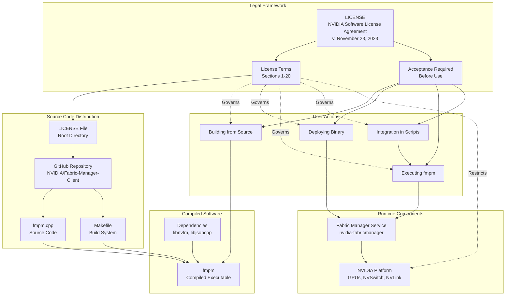
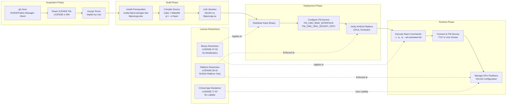
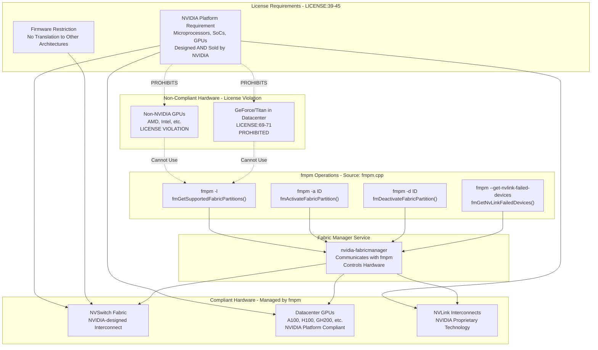
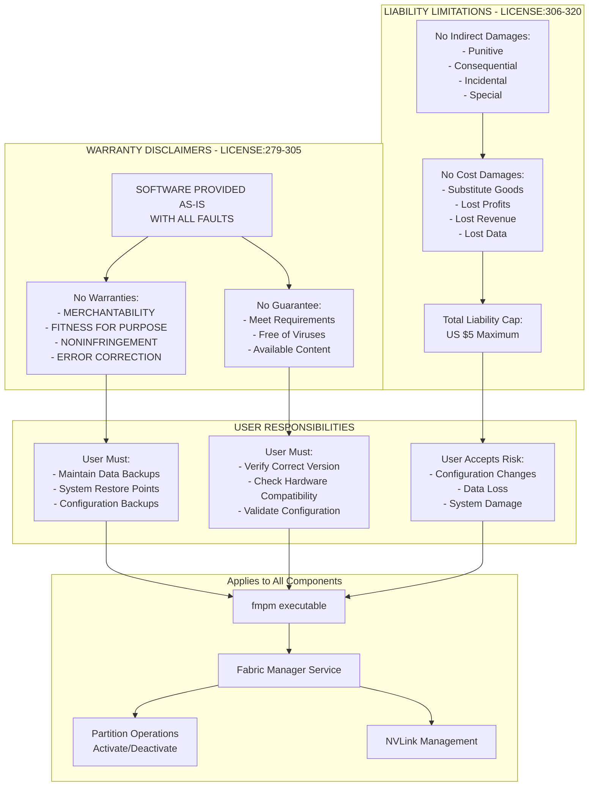
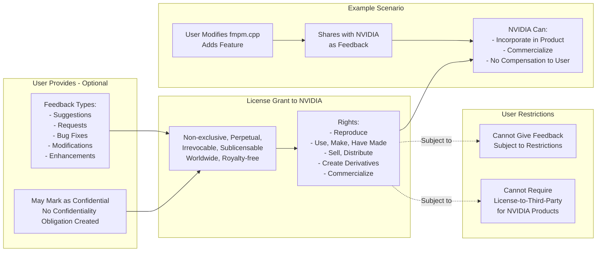
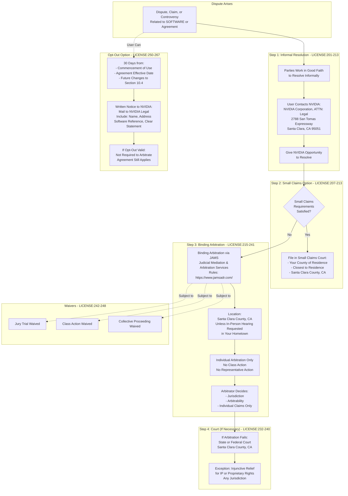

<!-- source: DeepWiki mcp.deepwiki.com · repo NVIDIA/Fabric-Manager-Client · page 5 License and Legal · fetched 2026-11-11 -->

# License and Legal

Relevant source files

The following files were used as context for generating this wiki page:

- [LICENSE](LICENSE)

## Purpose and Scope

This page provides an overview of the legal framework governing the use of the NVIDIA Fabric Manager Client (fmpm) software. The software is distributed under the NVIDIA Software License Agreement, which imposes specific terms, restrictions, and obligations on users. This document summarizes the key legal considerations, compliance requirements, and how the license terms relate to the software architecture and usage.

For detailed information on specific aspects of the license:
- For complete license terms and grant of rights, see [Software License Agreement](#5.1)
- For platform requirements and prohibited actions, see [Usage Restrictions and Requirements](#5.2)
- For warranty disclaimers and liability limitations, see [Disclaimers and Liability](#5.3)
- For intellectual property and feedback provisions, see [Intellectual Property and Feedback](#5.4)
- For arbitration and legal proceedings, see [Dispute Resolution](#5.5)

**Sources:** [LICENSE:1-408]()

---

## License Applicability

The NVIDIA Software License Agreement governs all aspects of the Fabric Manager Client software, including source code, compiled binaries, documentation, and usage. The license establishes a binding legal agreement between the user and NVIDIA Corporation that must be accepted before using the software.

### License Hierarchy

**Sources:** [LICENSE:1-20](), [fmpm.cpp](), [Makefile]()

---

## License Grant and Restrictions Summary

The license provides specific rights while imposing mandatory restrictions. All users must understand and comply with these terms.

### Granted Rights

| Right | Scope | Reference |
|-------|-------|-----------|
| **Install and Use** | Install and use copies of the SOFTWARE | [LICENSE:21]() |
| **Modify Source** | Modify and create derivative works of source code portions | [LICENSE:23-24]() |
| **Deploy** | Deploy on infrastructure you own or lease | [LICENSE:26-27]() |
| **Distribute (Limited)** | Distribute with OSI-approved open source OS, unmodified binaries only | [LICENSE:29-33]() |

### Key Restrictions

| Restriction | Description | Impact on fmpm | Reference |
|-------------|-------------|----------------|-----------|
| **NVIDIA Platform Only** | SOFTWARE only licensed for use with NVIDIA-designed and NVIDIA-sold hardware | `fmpm` cannot be used with non-NVIDIA GPUs | [LICENSE:39-45]() |
| **No Reverse Engineering** | Cannot reverse engineer, decompile, or disassemble binary portions | Binary `fmpm` executable must not be reverse engineered | [LICENSE:47-49]() |
| **No Binary Modification** | Cannot modify or create derivative works of binary portions | Compiled `fmpm` must not be modified | [LICENSE:51-52]() |
| **GeForce/Titan Datacenter Ban** | GeForce/Titan SOFTWARE not licensed for datacenter deployment | Does not apply to Fabric Manager (datacenter product) | [LICENSE:69-71]() |
| **Critical Application Disclaimer** | Not tested/certified for critical applications (medical, automotive, avionics) | Users assume full liability for critical application use | [LICENSE:77-87]() |

**Sources:** [LICENSE:15-98]()

---

## License Compliance Checkpoints

The following diagram illustrates where license compliance requirements apply throughout the software lifecycle, mapped to specific code entities and system components.

### Software Lifecycle Compliance Points

**Sources:** [LICENSE:5-10](), [LICENSE:15-98](), [Makefile](), [fmpm.cpp]()

---

## Platform and Hardware Restrictions

The license explicitly restricts the software to NVIDIA Platform hardware. This section maps license restrictions to actual hardware components managed by the software.

### Platform Restriction Architecture

**Sources:** [LICENSE:39-45](), [LICENSE:69-71](), [fmpm.cpp]()

---

## Critical Application Disclaimer

Section 2.10 of the license explicitly disclaims liability for critical applications. This applies to all usage of the `fmpm` client and Fabric Manager system.

### Critical Application Categories

| Application Type | Examples | License Position | User Responsibility |
|------------------|----------|------------------|---------------------|
| **Avionics** | Flight control systems, navigation | Not tested or certified | Full liability for safety features |
| **Automotive** | Autonomous driving, vehicle control | Not tested or certified | Comply with regulatory standards |
| **Medical** | Life support, surgical systems | Not tested or certified | Full liability for medical device compliance |
| **Military** | Weapons systems, command and control | Not tested or certified | Full liability for military applications |
| **Life Critical** | Emergency response, nuclear systems | Not tested or certified | Ensure sufficient redundancy |

**Key License Terms:**
- NVIDIA is **not liable** for claims or damages from critical application use
- Users are **solely responsible** for safety and redundancy features
- Users must comply with **all applicable legal and regulatory standards**
- Users must **defend and indemnify** NVIDIA from claims arising from critical application use

**Sources:** [LICENSE:77-87]()

---

## Warranty Disclaimers and Liability Limits

The license includes comprehensive disclaimers and liability limitations that apply to all components of the system.

### Disclaimer and Liability Framework

**Sources:** [LICENSE:279-320]()

---

## License Termination and Enforcement

The license can terminate automatically under specific conditions. Understanding termination triggers is critical for continued legal use of the software.

### Termination Conditions

| Condition | Description | Effect | Reference |
|-----------|-------------|--------|-----------|
| **Breach of Terms** | Failure to comply with any license term | Automatic termination without notice | [LICENSE:161-163]() |
| **Legal Proceeding** | Commencing legal action against NVIDIA regarding SOFTWARE | Automatic termination | [LICENSE:161-163]() |
| **User Termination** | User stops using and destroys all copies | Voluntary termination | [LICENSE:165-166]() |
| **Post-Termination Obligations** | Must stop using and destroy all SOFTWARE copies | Required immediately | [LICENSE:164]() |

### Survival of Terms

Upon termination, all provisions survive **except** for the licenses granted to you. This means:
- Warranty disclaimers remain in effect
- Liability limitations remain in effect
- Indemnification obligations remain in effect
- Prior distributions according to the Agreement are not affected

**Sources:** [LICENSE:159-168]()

---

## Intellectual Property and Ownership

All intellectual property in the SOFTWARE remains the exclusive property of NVIDIA or its licensors. Users receive only the limited license rights explicitly granted in the Agreement.

### Ownership Structure

| Component | Owner | User Rights | Restrictions |
|-----------|-------|-------------|--------------|
| **fmpm Source Code** | NVIDIA | Modify source, create derivatives | Cannot distribute modified headers |
| **fmpm Binary** | NVIDIA | Use, deploy, distribute (limited) | Cannot modify or reverse engineer |
| **libnvfm Library** | NVIDIA | Link and use | Cannot reverse engineer |
| **FM API** | NVIDIA | Call API functions | Cannot bypass security mechanisms |
| **Documentation** | NVIDIA | Use for permitted purposes | Cannot remove copyright notices |

**Key Ownership Terms:**
- NVIDIA reserves **all rights, interests, and remedies** not expressly granted
- **No implied licenses** or rights by estoppel
- Users must **cooperate with compliance verification** by NVIDIA
- Users cannot **misrepresent authorship** of the SOFTWARE

**Sources:** [LICENSE:170-178]()

---

## Feedback and Contributions

If users provide feedback, suggestions, or modifications to NVIDIA, the license includes specific terms regarding intellectual property rights.

### Feedback Provisions

**Important:** Users grant NVIDIA broad rights to any feedback provided. If you want to retain rights to modifications, do not share them with NVIDIA as feedback.

**Sources:** [LICENSE:180-197]()

---

## Dispute Resolution Process

The license mandates a specific dispute resolution process, including informal resolution, arbitration, and limitations on legal proceedings.

### Dispute Resolution Flow

**Key Points:**
- Disputes must first be attempted to be resolved informally
- Arbitration is mandatory unless user opts out within 30 days
- Arbitration location is Santa Clara County, California (unless user requests hometown hearing)
- Class actions are prohibited
- Jury trials are waived

**Sources:** [LICENSE:199-277]()

---

## Governing Law

All disputes are governed by specific legal jurisdictions and laws.

### Legal Jurisdiction

| Aspect | Governing Authority | Reference |
|--------|---------------------|-----------|
| **Primary Law** | Federal Arbitration Act | [LICENSE:270-271]() |
| **State Law** | Delaware State Law (substantive) | [LICENSE:270-271]() |
| **Federal Law** | United States Federal Law | [LICENSE:270-271]() |
| **Conflict of Laws** | Not applicable (explicitly disclaimed) | [LICENSE:271-272]() |
| **International Sales** | UN Convention on International Sale of Goods disclaimed | [LICENSE:272-273]() |
| **Language** | English version governs if conflict with translation | [LICENSE:274-277]() |

**Sources:** [LICENSE:269-277]()

---

## Additional Legal Provisions

### Trade Compliance

Users must comply with all applicable export, import, trade, and economic sanctions laws, including:
- U.S. Export Administration Regulations
- Office of Foreign Assets Control (OFAC) regulations
- Restrictions on destinations, end-users, and end-use

**Sources:** [LICENSE:349-354]()

### Government Use

If supplying the SOFTWARE to the U.S. Government, specific requirements apply:
- SOFTWARE must be treated as commercial computer software
- Developed at private expense
- Subject to this Agreement's terms
- Rights limited to 48 C.F.R. 52.227-19(b)(1)-(2) or 252.227-7013(c)

**Sources:** [LICENSE:356-372]()

### Data Collection

On Windows operating systems, NVIDIA collects data at installation time for:
- System configuration and optimization
- Content/service delivery
- Product improvement

Information collected may include GPU, CPU, and operating system configuration data.

**Sources:** [LICENSE:322-339]()

---

## Contact Information

For questions or legal notices regarding the license:

| Purpose | Contact Method |
|---------|----------------|
| **Legal Notices** | NVIDIA Corporation Attention: Legal Department 2788 San Tomas Expressway Santa Clara, CA 95051, USA |
| **Licensing Questions** | Email: driver-licensing@nvidia.com |
| **Privacy Policy** | https://www.nvidia.com/en-us/about-nvidia/privacy-policy |

**Sources:** [LICENSE:374-406]()

---

## License Version and Effective Date

**Current License Version:** November 23, 2023

This license agreement was last updated on November 23, 2023. Users should verify they are operating under the current license terms.

**Sources:** [LICENSE:408]()

---

## Summary of User Obligations

The following table summarizes key user obligations when using the fmpm software:

| Obligation | Requirement | Compliance Action |
|------------|-------------|-------------------|
| **Accept Terms** | Accept all license terms before use | Read and agree to LICENSE file |
| **NVIDIA Platform** | Use only with NVIDIA-designed and NVIDIA-sold hardware | Verify GPU/NVSwitch hardware |
| **No Modification** | Do not modify fmpm binary | Use unmodified compiled executable |
| **No Reverse Engineering** | Do not reverse engineer binaries | Use as provided |
| **Critical App Disclaimer** | Accept full liability for critical applications | Ensure safety features and compliance |
| **Indemnification** | Defend and indemnify NVIDIA from claims | Accept liability for product development |
| **Data Backup** | Maintain backups and restore points | Implement backup procedures |
| **Trade Compliance** | Comply with export/import regulations | Follow applicable trade laws |
| **Dispute Resolution** | Follow informal resolution and arbitration | Contact NVIDIA legal for disputes |

**Sources:** [LICENSE:1-408]()

---

