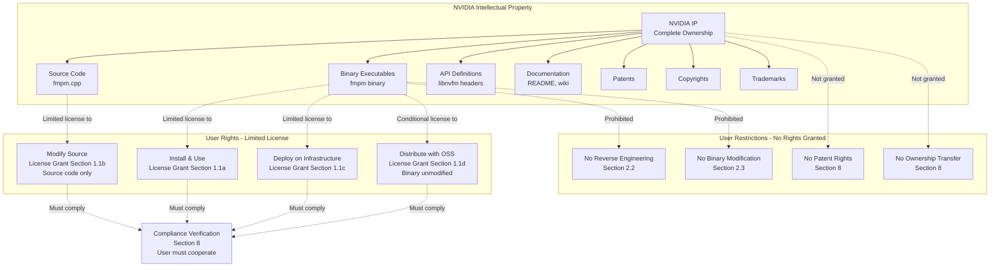
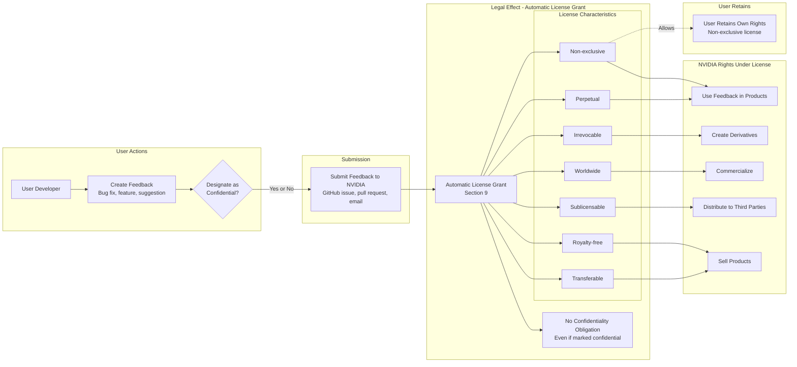
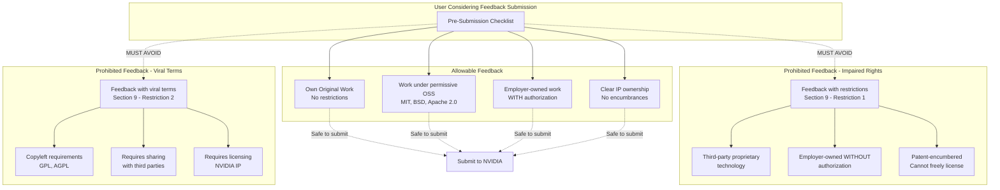
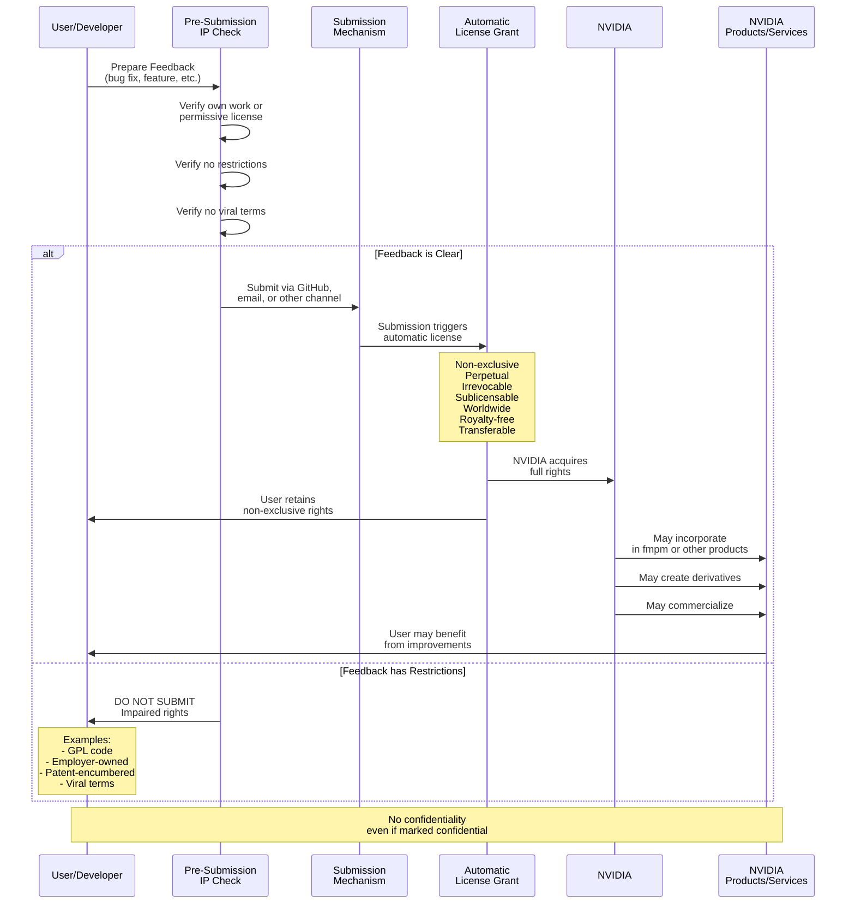

<!-- source: DeepWiki mcp.deepwiki.com · repo NVIDIA/Fabric-Manager-Client · page 5.4 Intellectual Property and Feedback · fetched 2026-11-11 -->

# Intellectual Property and Feedback

Relevant source files

The following files were used as context for generating this wiki page:

- [LICENSE](LICENSE)

This page documents the intellectual property ownership and feedback provisions governing the Fabric Manager Client software. It covers who owns the software and its components, what rights NVIDIA retains, and how user-provided feedback and contributions are legally handled. For the overall license terms, see [Software License Agreement](#5.1). For usage restrictions, see [Usage Restrictions and Requirements](#5.2).

## Ownership Rights

### NVIDIA's Intellectual Property

The SOFTWARE (including the `fmpm` utility, all associated libraries, documentation, and related materials) remains the sole and exclusive property of NVIDIA Corporation or its licensors. This ownership encompasses all intellectual property rights, including but not limited to copyrights, patents, trade secrets, and trademarks.

| Owned Component | Description | Scope of NVIDIA Ownership |
|----------------|-------------|--------------------------|
| Source Code | All C++ source files, headers | Complete ownership, including modifications made by users |
| Binary Executables | Compiled `fmpm` binary | Cannot be modified or redistributed without restrictions |
| Documentation | README, wiki, technical specs | All rights reserved |
| API Interfaces | `libnvfm` API definitions | Interface design and implementation |
| Intellectual Property | Patents, copyrights, trademarks | All rights, interests, and remedies |

**Sources:** [LICENSE:170-178]()

### Reserved Rights

Except for the limited rights explicitly granted in Section 1 of the License Agreement, NVIDIA reserves all rights, interests, and remedies in connection with the SOFTWARE. No additional licenses or rights are granted by implication, estoppel, or otherwise.

The license agreement specifies:
- Users do NOT acquire ownership of the SOFTWARE
- Users do NOT acquire patent rights beyond the scope of use
- Users do NOT acquire trademark rights
- Users do NOT acquire the right to reverse engineer binary components

**Sources:** [LICENSE:170-178]()

### Compliance Verification

Users agree to cooperate with NVIDIA and provide reasonably requested information to verify compliance with the Agreement. This provision allows NVIDIA to audit usage and ensure the SOFTWARE is being used within the bounds of the license grant.

**Sources:** [LICENSE:176-178]()

## Ownership Structure Diagram

**Sources:** [LICENSE:15-97](), [LICENSE:170-178]()

## Feedback Provisions

### Definition of Feedback

"Feedback" is defined broadly to include any suggestions, requests, fixes, modifications, enhancements, or other feedback provided by users regarding the SOFTWARE. This encompasses:

- Bug reports and fixes
- Feature requests
- Performance improvement suggestions
- Code modifications and patches
- Enhancement proposals
- Documentation improvements
- API design suggestions

**Sources:** [LICENSE:180-197]()

### Voluntary Nature

Users are NOT obligated to provide Feedback. The provision of Feedback is entirely voluntary and at the user's discretion.

**Sources:** [LICENSE:182-183]()

### Confidentiality Treatment

**Critical provision:** Even if users designate Feedback as confidential, it will NOT create any confidentiality obligation for NVIDIA or its affiliates. Users should not submit Feedback that they wish to keep confidential.

**Sources:** [LICENSE:184-185]()

## Feedback License Grant

When users provide Feedback to NVIDIA, they automatically grant NVIDIA an extremely broad license:

### License Terms

| License Attribute | Scope |
|------------------|-------|
| **Exclusivity** | Non-exclusive (user retains rights to use their own feedback) |
| **Duration** | Perpetual (never expires) |
| **Revocability** | Irrevocable (cannot be taken back) |
| **Sublicensing** | Sublicensable (NVIDIA can grant rights to third parties) |
| **Geography** | Worldwide |
| **Royalties** | Royalty-free (no payment required) |
| **Payment Status** | Fully paid-up (no future payments) |
| **Transferability** | Transferable (NVIDIA can transfer to others) |

**Sources:** [LICENSE:186-192]()

### Permitted Actions by NVIDIA

Under the Feedback license, NVIDIA is granted rights to:

1. **Publicly perform** the Feedback
2. **Publicly display** the Feedback
3. **Reproduce** the Feedback
4. **Use** the Feedback
5. **Make** products incorporating the Feedback
6. **Have made** (third-party manufacturing) products with the Feedback
7. **Sell** products incorporating the Feedback
8. **Offer for sale** such products
9. **Distribute** (through multiple tiers) products with the Feedback
10. **Import** products incorporating the Feedback
11. **Create derivative works** based on the Feedback
12. **Commercialize and exploit** the Feedback at NVIDIA's discretion

All of these actions can be performed under the user's intellectual property rights, meaning NVIDIA can use any patents, copyrights, or other IP the user holds in the Feedback.

**Sources:** [LICENSE:186-192]()

## Feedback Contribution Flow

**Sources:** [LICENSE:180-197]()

## Feedback Restrictions

### Prohibited Feedback Types

Users must NOT provide Feedback in the following circumstances:

#### Restriction 1: Impaired Rights

Users will not give Feedback that they have reason to believe is subject to any restriction that impairs NVIDIA's exercise of the license grant. Examples include:

- Feedback based on code licensed under restrictive terms
- Feedback incorporating third-party proprietary technology
- Feedback subject to employer ownership where employer has not authorized submission
- Feedback covered by patents that cannot be freely licensed

**Sources:** [LICENSE:192-194]()

#### Restriction 2: Viral License Terms

Users will not give Feedback subject to license terms which seek to require any product incorporating or developed using such Feedback (or other NVIDIA intellectual property) to be:
- Licensed to third parties
- Shared with third parties
- Made available under open source terms (copyleft provisions)

This restriction prevents users from attempting to impose obligations on NVIDIA through the Feedback mechanism.

**Sources:** [LICENSE:194-197]()

## Feedback Restrictions Diagram

**Sources:** [LICENSE:192-197]()

## Practical Implications

### For Individual Contributors

| Scenario | Can Submit? | Considerations |
|----------|-------------|----------------|
| Bug fix in `fmpm.cpp` written by user | ✅ Yes | User owns the fix, can grant broad license |
| Enhancement to JSON formatting using original code | ✅ Yes | User's original work, no restrictions |
| Documentation improvements written by user | ✅ Yes | User owns content, appropriate for feedback |
| Code copied from GPL project | ❌ No | GPL is viral license, prohibited under Section 9 |
| Employer-owned code without permission | ❌ No | Impaired rights, user cannot grant full license |
| Algorithm from published paper with patent | ⚠️ Depends | Only if user holds patent or it's unencumbered |

**Sources:** [LICENSE:180-197]()

### For Corporate Contributors

Corporate employees must ensure:

1. **Corporate Authorization**: Employer has authorized the Feedback submission
2. **IP Assignment**: Employee's IP is assigned to employer, and employer authorizes grant to NVIDIA
3. **No Conflicting Agreements**: No agreements with third parties restrict the license grant
4. **Patent Clearance**: Any patents incorporated are owned/licensed by employer

Many corporations have Contributor License Agreements (CLAs) that explicitly address these requirements.

**Sources:** [LICENSE:180-197]()

### For Open Source Contributors

Contributors familiar with open source should note key differences:

| Aspect | Typical Open Source CLA | NVIDIA Feedback License |
|--------|------------------------|------------------------|
| Triggered by | Explicit signature/agreement | **Automatic upon submission** |
| License scope | Often limited to project | **Extremely broad - any use** |
| Confidentiality | Sometimes preserved | **Never preserved** |
| Revocation | Sometimes possible | **Never possible (irrevocable)** |
| Copyleft compatibility | Often addressed | **Explicitly prohibited** |

Users accustomed to submitting patches to open source projects should be aware that the NVIDIA Feedback provisions are significantly broader and more permissive (to NVIDIA) than typical open source CLAs.

**Sources:** [LICENSE:180-197]()

## Feedback Lifecycle

**Sources:** [LICENSE:180-197]()

## Coordination with Other License Terms

### Relationship to License Grant

The Feedback provisions exist separately from the license grant that allows users to use the SOFTWARE. Users receive a limited license to use the SOFTWARE (Section 1), but when they provide Feedback, they grant a much broader license back to NVIDIA (Section 9).

| User Rights to Use SOFTWARE | NVIDIA Rights to User's Feedback |
|----------------------------|----------------------------------|
| Non-exclusive | Non-exclusive |
| Revocable | **Irrevocable** |
| Non-transferable | **Transferable** |
| Non-sublicensable | **Sublicensable** |
| Limited to specific uses | **Unlimited uses** |

**Sources:** [LICENSE:15-33](), [LICENSE:180-197]()

### Termination Effects

If the license agreement terminates (due to breach or other reasons per Section 7), users must stop using and destroy all copies of the SOFTWARE. However, the Feedback license granted to NVIDIA persists:

- User's license to use SOFTWARE: **Terminates**
- NVIDIA's license to user's Feedback: **Continues perpetually**

This asymmetry means users should carefully consider what Feedback they provide, as NVIDIA's rights to that Feedback will outlast the user's rights to use the SOFTWARE.

**Sources:** [LICENSE:159-168](), [LICENSE:186-188]()

## Verification and Compliance

### User Obligations

Users must cooperate with NVIDIA to verify compliance with the Agreement. This includes:

- Providing information about how the SOFTWARE is being used
- Demonstrating that Feedback submissions comply with the restrictions
- Allowing NVIDIA to verify that prohibited Feedback has not been submitted

**Sources:** [LICENSE:176-178]()

### Enforcement

While the license agreement does not specify specific enforcement mechanisms for the Feedback provisions, breach of the restrictions could constitute a violation of Section 9, potentially resulting in:

1. Termination of the license agreement (Section 7)
2. Claims for breach of contract
3. Potential intellectual property infringement claims if viral terms were imposed

**Sources:** [LICENSE:159-168](), [LICENSE:192-197]()

## Summary Table

| Aspect | Key Points | License Reference |
|--------|-----------|-------------------|
| **Ownership** | SOFTWARE remains NVIDIA property; no ownership transfer to users | Section 8 |
| **Reserved Rights** | All rights not explicitly granted are reserved by NVIDIA | Section 8 |
| **Feedback Obligation** | Voluntary; users are not required to provide Feedback | Section 9 |
| **Feedback License** | Extremely broad: perpetual, irrevocable, sublicensable, royalty-free, worldwide | Section 9 |
| **Confidentiality** | Not maintained even if marked confidential | Section 9 |
| **Restricted Feedback** | Cannot have impaired rights or viral terms | Section 9 |
| **User Retention** | Users retain non-exclusive rights to their own Feedback | Section 9 (implicit) |
| **Compliance** | Users must cooperate with NVIDIA verification requests | Section 8 |

**Sources:** [LICENSE:170-197]()

---

