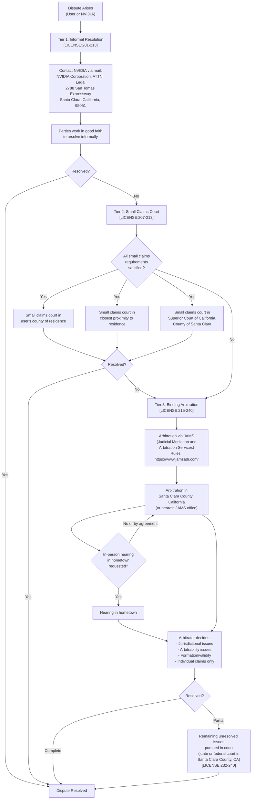
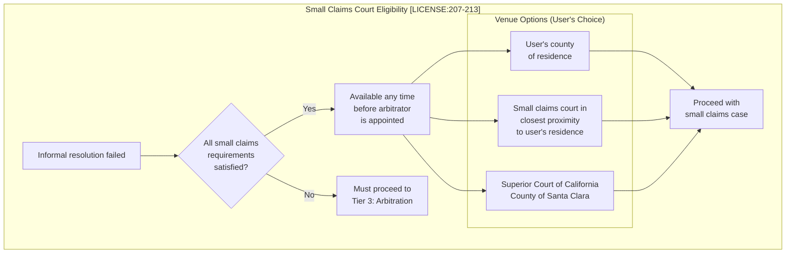
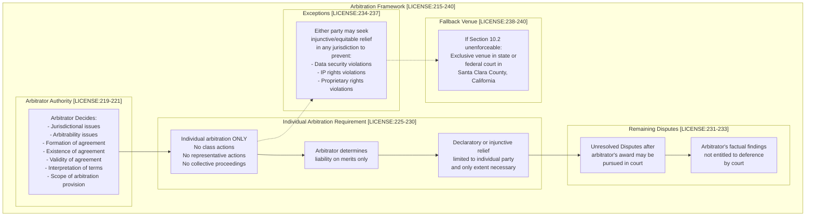
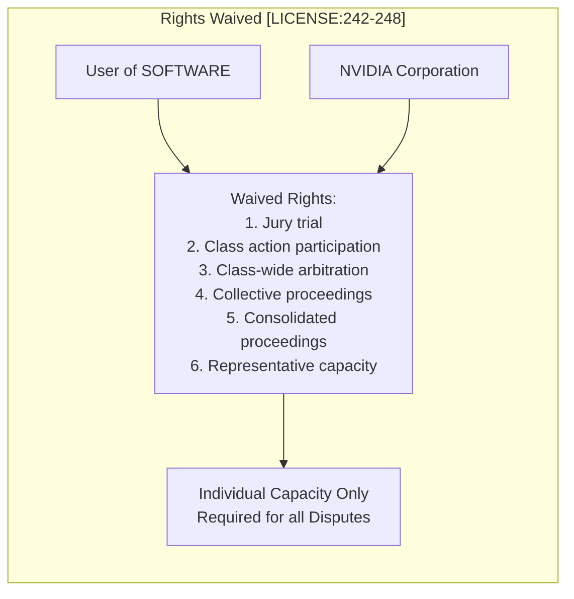
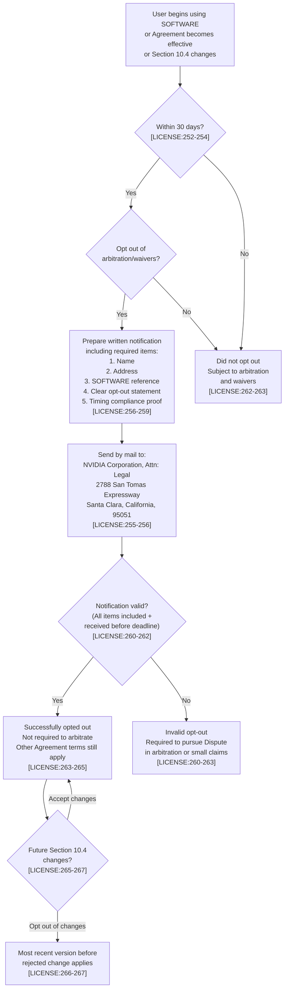
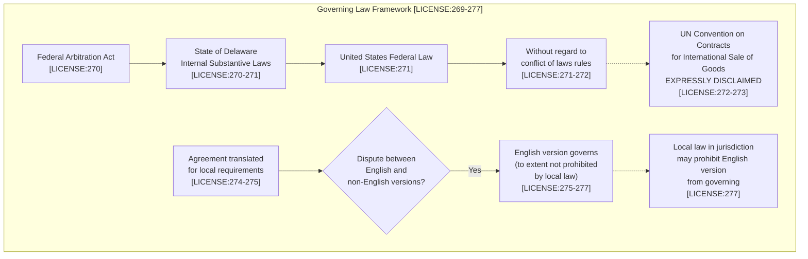
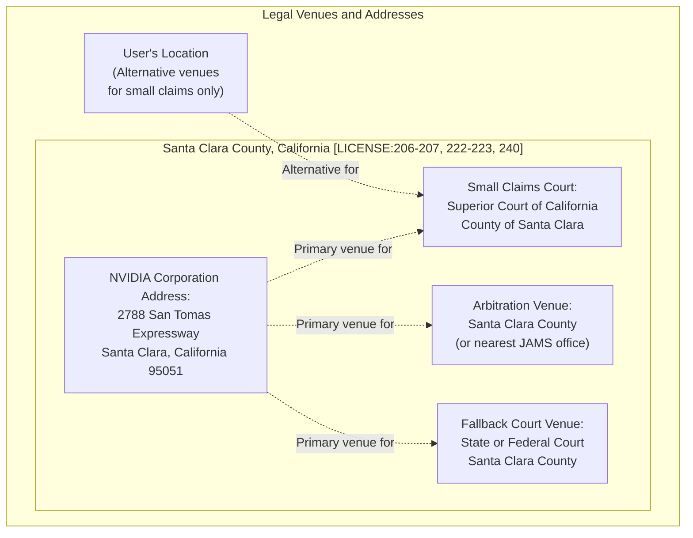

<!-- source: DeepWiki mcp.deepwiki.com · repo NVIDIA/Fabric-Manager-Client · page 5.5 Dispute Resolution · fetched 2026-11-11 -->

# Dispute Resolution

Relevant source files

The following files were used as context for generating this wiki page:

- [LICENSE](LICENSE)

## Purpose and Scope

This page documents the dispute resolution procedures defined in the NVIDIA Software License Agreement that govern the use of the Fabric Manager Client software. It provides a technical reference for the legal processes required when disputes arise between users and NVIDIA Corporation regarding the SOFTWARE.

For the broader license terms and grant of rights, see [Software License Agreement](#5.1). For usage restrictions and requirements, see [Usage Restrictions and Requirements](#5.2). For warranty disclaimers and liability terms, see [Disclaimers and Liability](#5.3).

**Sources:** [LICENSE:199-277]()

---

## Dispute Resolution Framework

The LICENSE agreement establishes a three-tier dispute resolution framework that must be followed in sequence for any dispute, claim, or controversy arising from the SOFTWARE or Agreement (collectively referred to as "Dispute" in the license text).

### Definition of Dispute

A "Dispute" is defined in [LICENSE:202-203]() as any dispute, claim, or controversy arising out of or relating to:
- The SOFTWARE itself
- The terms of the License Agreement
- Use or misuse of the SOFTWARE
- Intellectual property claims
- Breach of contract allegations

**Sources:** [LICENSE:201-203]()

---

## Three-Tier Resolution Process

**Diagram: Dispute Resolution Process Flow**

**Sources:** [LICENSE:199-240]()

---

## Tier 1: Informal Resolution

The first tier requires parties to attempt good faith informal resolution before escalating to formal proceedings.

### Contact Requirements

| Requirement | Specification | Source |
|-------------|---------------|--------|
| **Method** | Mail (physical letter) | [LICENSE:204-207]() |
| **Recipient** | NVIDIA Corporation, ATTN: Legal | [LICENSE:205-206]() |
| **Address** | 2788 San Tomas Expressway, Santa Clara, California, 95051 | [LICENSE:206-207]() |
| **Obligation** | Mandatory first step | [LICENSE:201-204]() |
| **Purpose** | Give NVIDIA opportunity to resolve | [LICENSE:204-205]() |

### Process

1. User identifies a Dispute related to SOFTWARE or Agreement
2. User contacts NVIDIA via mail at the specified address
3. Parties work in good faith to resolve the Dispute informally
4. If unresolved, parties may proceed to Tier 2 or Tier 3

**Sources:** [LICENSE:201-207]()

---

## Tier 2: Small Claims Court

If informal resolution fails, either party may pursue the Dispute in small claims court, provided all jurisdictional requirements are met.

### Small Claims Court Options

**Diagram: Small Claims Court Venue Selection**

### Venue Specifications

| Venue | Description | Citation |
|-------|-------------|----------|
| **User's County** | Small claims court in the county where user resides | [LICENSE:209-211]() |
| **Closest Proximity** | Small claims court in closest proximity to user's residence | [LICENSE:210-211]() |
| **Santa Clara County** | Superior Court of California, County of Santa Clara | [LICENSE:212-213]() |

### Temporal Constraints

- Small claims option available "at any time before an arbitrator is appointed" [LICENSE:211-212]()
- Once arbitrator is appointed, small claims option is no longer available
- Parties may choose small claims instead of arbitration as long as timing requirement is met

**Sources:** [LICENSE:207-213]()

---

## Tier 3: Binding Arbitration

For Disputes not resolved informally or by small claims court, the Agreement mandates binding arbitration through JAMS (Judicial Mediation and Arbitration Services).

### Arbitration Requirements

| Element | Specification | Source |
|---------|---------------|--------|
| **Forum** | JAMS (Judicial Mediation and Arbitration Services) | [LICENSE:217-218]() |
| **Rules** | JAMS rules available at https://www.jamsadr.com/ | [LICENSE:218]() |
| **Location (Default)** | Santa Clara County, California (or nearest JAMS office) | [LICENSE:222-223]() |
| **Location (Optional)** | User's hometown if in-person hearing requested | [LICENSE:223]() |
| **Binding** | Yes - results are legally binding on both parties | [LICENSE:215-216]() |
| **Arbitrator Authority** | All issues including jurisdiction, arbitrability, formation, existence, validity, interpretation, scope | [LICENSE:219-221]() |

### Arbitration Scope and Limitations

**Diagram: Arbitration Scope and Authority Structure**

### Individual Arbitration Requirement

The Agreement explicitly requires individual arbitration [LICENSE:225-230]():

- All Disputes must be brought by a party in its individual capacity
- Not as plaintiff or class member in any class or representative proceeding
- Arbitrator may only award relief in favor of the individual party seeking relief
- Relief limited to extent necessary for that individual party's claim
- All Disputes subject to individual arbitration first before any court proceedings

**Sources:** [LICENSE:215-240]()

---

## Waivers and Restrictions

### Mandatory Waivers

The Agreement requires both parties to waive certain rights as a condition of use [LICENSE:242-248]():

| Waiver Type | Description | Citation |
|-------------|-------------|----------|
| **Jury Trial** | Both parties waive right to jury trial | [LICENSE:245]() |
| **Class Action** | Cannot participate in class action lawsuits | [LICENSE:245-246]() |
| **Class-Wide Arbitration** | Cannot participate in class-wide arbitrations | [LICENSE:246]() |
| **Collective Proceedings** | Cannot participate in collective proceedings | [LICENSE:246-247]() |
| **Consolidated Proceedings** | Cannot participate in consolidated proceedings | [LICENSE:247]() |
| **Representative Capacity** | Cannot act in representative capacity | [LICENSE:247-248]() |

**Diagram: Waived Rights Under Section 10.3**

### Equitable Relief Exception

Despite the arbitration requirement, either party may seek injunctive or equitable relief from courts in any jurisdiction to prevent [LICENSE:234-237]():

- Actual or threatened violation of data security
- Actual or threatened violation of intellectual property rights
- Actual or threatened violation of other proprietary rights

This exception allows immediate court intervention for urgent IP and security matters without going through arbitration.

**Sources:** [LICENSE:234-237](), [LICENSE:242-248]()

---

## Opt-Out Procedure

The Agreement provides a mechanism for users to opt out of the jury trial, class action, arbitration, and waiver provisions.

### Opt-Out Requirements

| Requirement | Specification | Citation |
|-------------|---------------|----------|
| **Timing** | Within 30 days of commencement of SOFTWARE use, OR within 30 days of Agreement effective date, OR within 30 days of any future change to Section 10.4 | [LICENSE:252-254]() |
| **Method** | Written notification by mail | [LICENSE:255]() |
| **Recipient** | NVIDIA Corporation, Attn: Legal | [LICENSE:255]() |
| **Address** | 2788 San Tomas Expressway, Santa Clara, California, 95051 | [LICENSE:256]() |

### Required Content

The opt-out notification must include [LICENSE:256-259]():

1. Your name
2. Your address
3. Reference to NVIDIA software to which the notice relates
4. Clear statement indicating you do not wish to resolve disputes through arbitration
5. Demonstration of compliance with 30-day time limit

### Opt-Out Decision Tree

**Diagram: Opt-Out Process and Validation**

### Opt-Out Effects

If user successfully opts out [LICENSE:263-265]():

- Not subject to arbitration requirement
- Not subject to jury trial waiver
- Not subject to class action waiver
- All other terms and conditions of Agreement still apply
- Does not affect Agreement validity

If user opts out of future changes to Section 10.4 [LICENSE:265-267]():

- Most recent version of Section 10.4 before the rejected change applies to user
- User maintains previous dispute resolution terms

**Sources:** [LICENSE:250-267]()

---

## Governing Law

The legal framework governing all Disputes is specified in [LICENSE:269-277]().

### Applicable Law

| Legal Framework | Specification | Citation |
|----------------|---------------|----------|
| **Primary** | Federal Arbitration Act | [LICENSE:270]() |
| **Substantive Law** | Internal substantive laws of State of Delaware | [LICENSE:270-271]() |
| **Federal Law** | United States federal law | [LICENSE:271]() |
| **Conflicts** | Without regard to conflict of laws rules or principles | [LICENSE:271-272]() |
| **Excluded** | United Nations Convention on Contracts for the International Sale of Goods (expressly disclaimed) | [LICENSE:272-273]() |

### Translation and Jurisdiction

**Diagram: Governing Law Hierarchy**

### Language Precedence

For translated versions of the Agreement [LICENSE:274-277]():

- Translations are provided for local legal requirements
- If dispute arises between English and non-English versions
- English version governs to the extent not prohibited by local law in user's jurisdiction
- Local law may override English version precedence in some jurisdictions

**Sources:** [LICENSE:269-277]()

---

## Key Contact Information

All dispute-related communications must be directed to the following addresses as specified in the LICENSE:

| Purpose | Address | Citation |
|---------|---------|----------|
| **Informal Resolution Contact** | NVIDIA Corporation, ATTN: Legal 2788 San Tomas Expressway Santa Clara, California, 95051 | [LICENSE:205-207]() |
| **Opt-Out Notification** | NVIDIA Corporation, Attn: Legal 2788 San Tomas Expressway Santa Clara, California, 95051 | [LICENSE:255-256]() |
| **General Legal Correspondence** | NVIDIA Corporation 2788 San Tomas Expressway Santa Clara, California 95051 United States of America Attention: Legal Department | [LICENSE:376-378]() |
| **License Questions** | driver-licensing@nvidia.com | [LICENSE:406]() |

### Geographic Concentration

**Diagram: Geographic Concentration of Legal Venues**

All formal dispute resolution mechanisms (arbitration and fallback court proceedings) center on Santa Clara County, California, where NVIDIA Corporation is headquartered. Only small claims court offers venue options in the user's location.

**Sources:** [LICENSE:205-207](), [LICENSE:222-223](), [LICENSE:240](), [LICENSE:376-378](), [LICENSE:406]()

---

## Interaction with Other License Provisions

The dispute resolution procedures interact with other sections of the LICENSE:

| License Section | Interaction | Reference |
|----------------|-------------|-----------|
| **Termination (Section 7)** | Agreement automatically terminates if user commences legal proceeding against NVIDIA regarding SOFTWARE; may trigger dispute resolution if proceeding relates to Agreement enforcement | [LICENSE:161-163]() |
| **Feedback (Section 9)** | Disputes regarding feedback ownership, confidentiality obligations, or license grants subject to this dispute resolution process | [LICENSE:180-197]() |
| **Disclaimers (Section 11)** | Challenges to warranty disclaimers or representations must follow dispute resolution procedures | [LICENSE:279-304]() |
| **Liability Limitations (Section 12)** | Claims for damages beyond specified limitations must be pursued through dispute resolution framework | [LICENSE:306-320]() |
| **Entire Agreement (Section 18)** | If court rules provision unenforceable during dispute resolution, provision deemed modified to make enforceable | [LICENSE:392-395]() |

For more information on these related provisions, see:
- [Software License Agreement](#5.1) for grant of rights and license scope
- [Usage Restrictions and Requirements](#5.2) for restrictions that may trigger disputes
- [Disclaimers and Liability](#5.3) for warranty and liability terms
- [Intellectual Property and Feedback](#5.4) for IP ownership and feedback provisions

**Sources:** [LICENSE:161-163](), [LICENSE:180-197](), [LICENSE:279-320](), [LICENSE:392-395]()

---

## Summary

The NVIDIA Software License Agreement establishes a mandatory three-tier dispute resolution process:

1. **Informal Resolution** [LICENSE:201-213](): Contact NVIDIA by mail at legal department address; work in good faith to resolve
2. **Small Claims Court** [LICENSE:207-213](): Optional venue if jurisdictional requirements met; available in user's location or Santa Clara County
3. **Binding Arbitration** [LICENSE:215-240](): Mandatory JAMS arbitration in Santa Clara County for unresolved disputes; individual arbitration only

Key waivers include jury trial, class action, and collective proceedings [LICENSE:242-248](). Users may opt out within 30 days via written notification [LICENSE:250-267](). Governing law is Federal Arbitration Act plus Delaware substantive law [LICENSE:269-277]().

All legal communications should be directed to NVIDIA Corporation, ATTN: Legal, 2788 San Tomas Expressway, Santa Clara, California, 95051.

**Sources:** [LICENSE:199-277](), [LICENSE:376-378](), [LICENSE:405-406]()