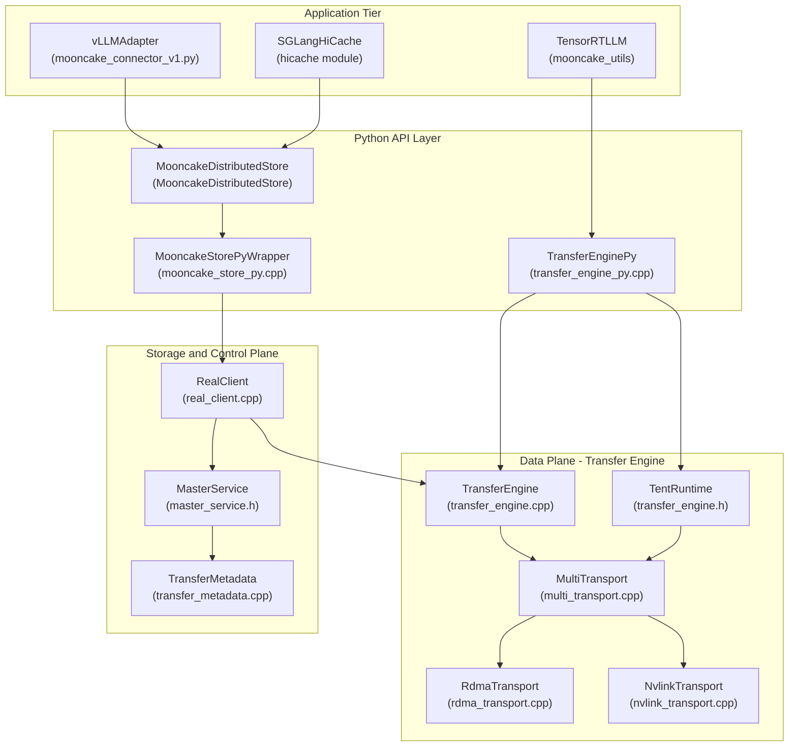
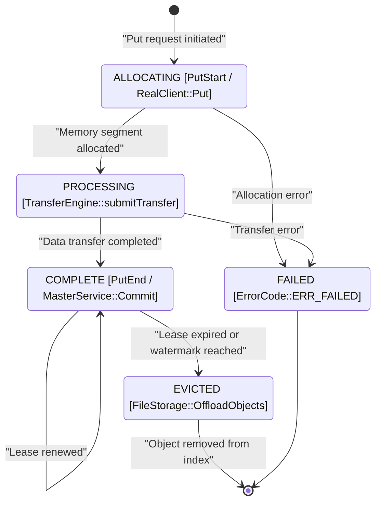

<!-- source: DeepWiki mcp.deepwiki.com · repo kvcache-ai/Mooncake · page 1 Overview · fetched 2026-11-11 -->

# Overview

<details>
<summary>Relevant source files</summary>

The following files were used as context for generating this wiki page:

- [README.md](README.md)
- [docs/source/design/conductor/conductor-architecture-design.md](docs/source/design/conductor/conductor-architecture-design.md)
- [docs/source/design/store/metadata-management.md](docs/source/design/store/metadata-management.md)
- [docs/source/design/store/mooncake-store.md](docs/source/design/store/mooncake-store.md)
- [docs/source/getting_started/build.md](docs/source/getting_started/build.md)
- [docs/source/getting_started/quick-start.md](docs/source/getting_started/quick-start.md)
- [docs/source/getting_started/supported-protocols.md](docs/source/getting_started/supported-protocols.md)
- [docs/source/index.md](docs/source/index.md)
- [docs/source/zh_archive/build.md](docs/source/zh_archive/build.md)
- [docs/source/zh_archive/run-examples.md](docs/source/zh_archive/run-examples.md)
- [mooncake-common/common.cmake](mooncake-common/common.cmake)
- [mooncake-conductor/include/conductor/kvevent/config.h](mooncake-conductor/include/conductor/kvevent/config.h)
- [mooncake-conductor/include/conductor/kvevent/event_manager.h](mooncake-conductor/include/conductor/kvevent/event_manager.h)
- [mooncake-conductor/include/conductor/prefixindex/prefix_indexer.h](mooncake-conductor/include/conductor/prefixindex/prefix_indexer.h)
- [mooncake-conductor/src/kvevent/config.cpp](mooncake-conductor/src/kvevent/config.cpp)
- [mooncake-conductor/src/kvevent/event_manager.cpp](mooncake-conductor/src/kvevent/event_manager.cpp)
- [mooncake-conductor/src/main.cpp](mooncake-conductor/src/main.cpp)
- [mooncake-conductor/src/prefixindex/prefix_indexer.cpp](mooncake-conductor/src/prefixindex/prefix_indexer.cpp)
- [mooncake-conductor/tests/prefix_indexer_test.cpp](mooncake-conductor/tests/prefix_indexer_test.cpp)
- [mooncake-conductor/tests/prefix_indexer_test_peer.h](mooncake-conductor/tests/prefix_indexer_test_peer.h)
- [mooncake-store/CMakeLists.txt](mooncake-store/CMakeLists.txt)
- [mooncake-store/include/version.h.in](mooncake-store/include/version.h.in)
- [mooncake-transfer-engine/CMakeLists.txt](mooncake-transfer-engine/CMakeLists.txt)
- [mooncake-transfer-engine/include/cuda_alike.h](mooncake-transfer-engine/include/cuda_alike.h)
- [mooncake-transfer-engine/src/CMakeLists.txt](mooncake-transfer-engine/src/CMakeLists.txt)
- [mooncake-transfer-engine/src/transport/CMakeLists.txt](mooncake-transfer-engine/src/transport/CMakeLists.txt)

</details>


Mooncake is a KVCache-centric disaggregated architecture designed for large language model (LLM) serving [README.md:4-4](). It serves as the production platform for [Kimi](https://kimi.ai/), a leading conversational LLM service operated by [Moonshot AI](https://www.moonshot.cn/) [README.md:32-33](). By decoupling prefill and decode execution clusters and leveraging underutilized CPU, DRAM, and SSD resources to form a unified KVCache pool, Mooncake addresses memory capacity and bandwidth bottlenecks typical in long-context LLM deployments [docs/source/index.md:30-32]().

Under real-world workloads, Mooncake enables inference engines to handle 75% more requests while strictly adhering to Service Level Objectives (SLOs) [README.md:33-33](). The system is composed chiefly of two open-source subsystems:

- **Transfer Engine / TENT** — A high-performance, asynchronous, zero-copy data movement engine supporting various transports including RDMA, NVLink, and TCP for cross-node and cross-device transfers [docs/source/index.md:25-26](), [mooncake-transfer-engine/src/multi_transport.cpp:23-83]().
- **Mooncake Store** — A distributed object storage system engineered for KVCache management with features such as multi-replica support, automatic tiering across DRAM, GPU, CXL, SSD, and asynchronous eviction policies [docs/source/index.md:25-26](), [README.md:40-40]().

Mooncake is integrated within multiple LLM inference frameworks including vLLM, SGLang HiCache, and TensorRT-LLM, joined the PyTorch Ecosystem, and is recognized in the FAST 2025 conference publication [README.md:39-59]().

This overview page introduces these key aspects at a high level and links to child pages for detailed topics:

- System architecture and data flow: [System Architecture](#1.1)
- Core concepts, terminology, and data model: [Key Concepts and Terminology](#1.2)
- Supported protocols and hardware backends: [Supported Protocols and Hardware](#1.3)
- Performance metrics, benchmarks, and research traces: [Performance Characteristics](#1.4)

Sources: [README.md:4-33](), [docs/source/index.md:25-32]()

---

## 1.1. System Architecture

Mooncake adopts a modular three-tier architecture that cleanly separates concerns of high-throughput data transport, cluster-wide metadata management, and integration with high-level LLM serving frameworks. This separation enables scalable, efficient KVCache disaggregation.

### System Architecture and Code Mapping

Sources: [README.md:1-33](), [docs/source/index.md:1-38](), [mooncake-transfer-engine/src/multi_transport.cpp:23-83](), [mooncake-transfer-engine/src/transfer_engine.cpp:72-215](), [mooncake-integration/transfer_engine/transfer_engine_py.cpp:124-212]()

- **Data Plane (Transfer Engine / TENT):** Handles asynchronous, zero-copy data transfers across nodes and devices, supporting multiple transport protocols via `MultiTransport` [mooncake-transfer-engine/src/multi_transport.cpp:140-148](). The `TransferEngine` manages memory registration, segment allocation, and transfer requests [mooncake-transfer-engine/src/transfer_engine.cpp:156-166]().
- **Storage and Control Plane (Mooncake Store):** Manages cluster metadata, node and object lifecycle, allocation and eviction policies via `MasterService`. Local clients (`RealClient`) handle memory management and serve remote requests.
- **Integration Layer:** Provides Python API bindings and adapters to LLM serving frameworks (e.g., vLLM, SGLang) for transparent KVCache disaggregation [mooncake-integration/transfer_engine/transfer_engine_py.cpp:124-212]().

For details, see [System Architecture](#1.1).

Sources: [README.md:39-59](), [docs/source/index.md:25-36](), [mooncake-transfer-engine/src/multi_transport.cpp:140-148](), [mooncake-transfer-engine/src/transfer_engine.cpp:156-166]()

---

## 1.2. Key Concepts and Terminology

Mooncake introduces specialized domain concepts to efficiently manage distributed KV caches for LLM serving:

- **Segment:** A continuous memory allocation unit residing on DRAM, GPU VRAM, CXL devices, or SSD.
- **Replica:** Multiple copies of a segment across devices or nodes for fault tolerance and load balancing.
- **Batch and Slice:** Granular units of transfer requests; batches group slices which specify partial data ranges.
- **Lease:** A timed ownership token allowing clients to hold objects for safe concurrent access.
- **Metadata Services:** Backends (e.g., ETCD, Redis, HTTP) supporting cluster-wide metadata synchronization.
- **KVCache Disaggregation:** Separation of key-value cache storage from LLM computation clusters.
- **PD Disaggregation:** Prefill-Decode disaggregation pattern separating prefill and decode stages.
- **XpYd Notation:** Configuration scheme indicating numbers of prefill ($X$) and decode ($Y$) clusters.

### Object Lifecycle State Machine

Sources: [README.md:1-33](), [docs/source/index.md:1-38](), [mooncake-store/include/version.h.in:1-21]()

Refer to [Key Concepts and Terminology](#1.2) for formal definitions and detailed explanations.

Sources: [README.md:40-40](), [docs/source/index.md:30-38]()

---

## 1.3. Supported Protocols and Hardware

Mooncake supports a broad spectrum of transport protocols and hardware accelerators to maximize efficiency and flexibility on diverse platforms:

- **Transport Protocols:** RDMA (InfiniBand, RoCE, eRDMA), TCP, AWS EFA (libfabric SRD), NVLink (multi-node/intra-node), CXL, HIP, MUSA, Barex, SHM, and others [docs/source/getting_started/build.md:116-130](), [docs/source/getting_started/quick-start.md:28-36]().
- **Hardware Accelerators:** NVIDIA CUDA with GPUDirect RDMA, AMD ROCm/HIP, Huawei Ascend NPU, Moore Threads MUSA, Cambricon MLU, MetaX MACA, Hygon DCU, Iluvatar CoreX, and Biren GPUs.

A typical initialization snippet using the Python API with RDMA transport:

```python
engine.initialize(
    hostname="node1",
    metadata_server="etcd://10.0.0.1:2379",
    protocol="rdma",
    device_name="mlx5_0"
)
```
Sources: [docs/source/getting_started/build.md:116-130](), [docs/source/getting_started/quick-start.md:28-36]()

For detailed compatibility matrices, environment setup, and configuration options, see [Supported Protocols and Hardware](#1.3).

Sources: [docs/source/getting_started/build.md:116-130](), [docs/source/getting_started/quick-start.md:28-36]()

---

## 1.4. Performance Characteristics

Mooncake delivers high throughput and low latency for long-context LLM workloads by optimizing data transfer pathways, zero-copy pipelines, NUMA-aware allocations, and prediction-based early request rejection [docs/source/index.md:30-38]().

Benchmarking and trace tools include:
- The Transfer Engine benchmark utility measuring raw RDMA/TCP throughput.
- Storage backend benchmarks demonstrating scalability and eviction policies.
- $XpYd$ benchmark configurations evaluating disaggregated prefill-decode scenarios.
- FAST25 research traces detailing real workload performance characteristics.

For comprehensive performance results, tuning guides, and profiling data, refer to [Performance Characteristics](#1.4).

Sources: [README.md:6-8](), [docs/source/index.md:30-38]()

---

Sources:  
[README.md:1-59](), [docs/source/index.md:1-38](), [mooncake-transfer-engine/src/multi_transport.cpp:23-148](), [mooncake-transfer-engine/src/transfer_engine.cpp:72-166](), [mooncake-integration/transfer_engine/transfer_engine_py.cpp:124-212](), [docs/source/getting_started/build.md:116-130](), [docs/source/getting_started/quick-start.md:28-36]()

---

