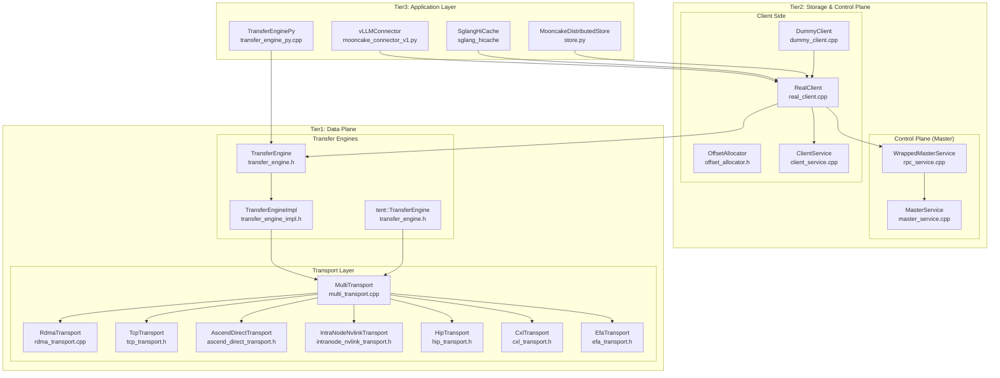
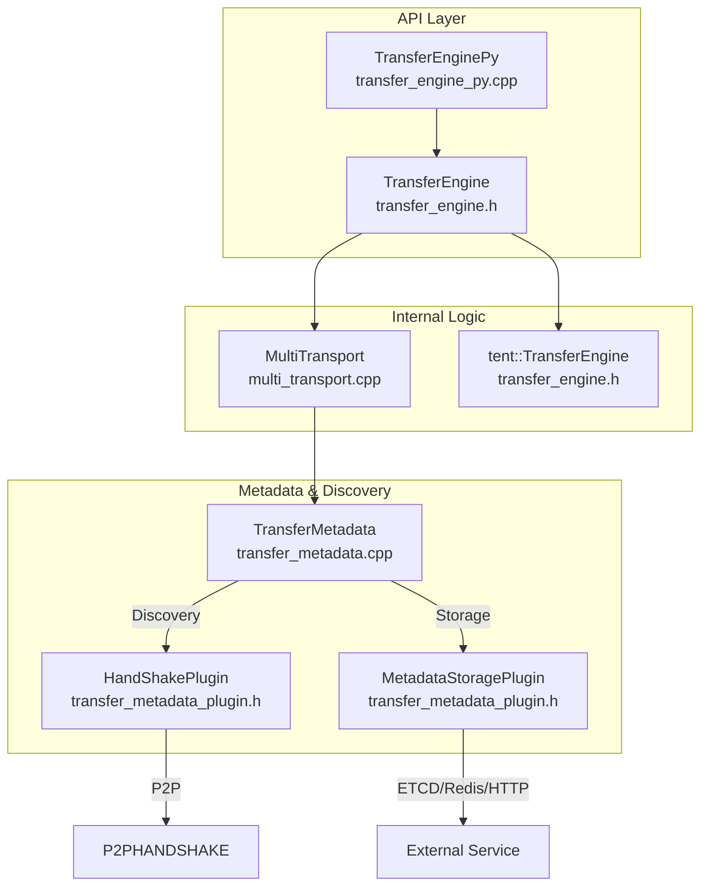
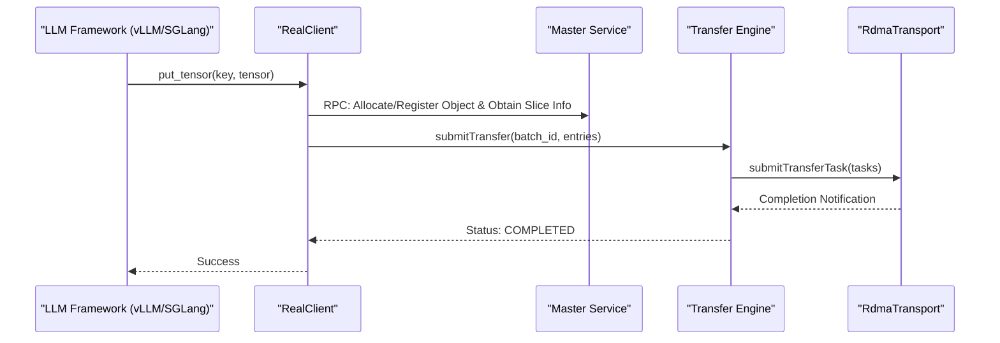

<!-- source: DeepWiki mcp.deepwiki.com · repo kvcache-ai/Mooncake · page 1.1 System Architecture · fetched 2026-11-11 -->

# System Architecture

Relevant source files

The following files were used as context for generating this wiki page:

- [README.md](README.md)
- [docs/source/design/architecture.md](docs/source/design/architecture.md)
- [docs/source/design/conductor/conductor-architecture-design.md](docs/source/design/conductor/conductor-architecture-design.md)
- [docs/source/design/store/metadata-management.md](docs/source/design/store/metadata-management.md)
- [docs/source/design/store/mooncake-store.md](docs/source/design/store/mooncake-store.md)
- [docs/source/getting_started/build.md](docs/source/getting_started/build.md)
- [docs/source/getting_started/quick-start.md](docs/source/getting_started/quick-start.md)
- [docs/source/getting_started/supported-protocols.md](docs/source/getting_started/supported-protocols.md)
- [docs/source/index.md](docs/source/index.md)
- [docs/source/zh_archive/build.md](docs/source/zh_archive/build.md)
- [docs/source/zh_archive/run-examples.md](docs/source/zh_archive/run-examples.md)
- [mooncake-common/common.cmake](mooncake-common/common.cmake)
- [mooncake-conductor/include/conductor/kvevent/config.h](mooncake-conductor/include/conductor/kvevent/config.h)
- [mooncake-conductor/include/conductor/kvevent/event_manager.h](mooncake-conductor/include/conductor/kvevent/event_manager.h)
- [mooncake-conductor/include/conductor/prefixindex/prefix_indexer.h](mooncake-conductor/include/conductor/prefixindex/prefix_indexer.h)
- [mooncake-conductor/src/kvevent/config.cpp](mooncake-conductor/src/kvevent/config.cpp)
- [mooncake-conductor/src/kvevent/event_manager.cpp](mooncake-conductor/src/kvevent/event_manager.cpp)
- [mooncake-conductor/src/main.cpp](mooncake-conductor/src/main.cpp)
- [mooncake-conductor/src/prefixindex/prefix_indexer.cpp](mooncake-conductor/src/prefixindex/prefix_indexer.cpp)
- [mooncake-conductor/tests/prefix_indexer_test.cpp](mooncake-conductor/tests/prefix_indexer_test.cpp)
- [mooncake-conductor/tests/prefix_indexer_test_peer.h](mooncake-conductor/tests/prefix_indexer_test_peer.h)
- [mooncake-store/CMakeLists.txt](mooncake-store/CMakeLists.txt)
- [mooncake-store/benchmarks/offset_allocator_concurrency_bench.cpp](mooncake-store/benchmarks/offset_allocator_concurrency_bench.cpp)
- [mooncake-store/include/crc32c.h](mooncake-store/include/crc32c.h)
- [mooncake-store/include/offset_allocator/offset_allocator.h](mooncake-store/include/offset_allocator/offset_allocator.h)
- [mooncake-store/include/version.h.in](mooncake-store/include/version.h.in)
- [mooncake-store/src/offset_allocator.cpp](mooncake-store/src/offset_allocator.cpp)
- [mooncake-store/tests/offset_allocator_test.cpp](mooncake-store/tests/offset_allocator_test.cpp)
- [mooncake-transfer-engine/CMakeLists.txt](mooncake-transfer-engine/CMakeLists.txt)
- [mooncake-transfer-engine/include/cuda_alike.h](mooncake-transfer-engine/include/cuda_alike.h)
- [mooncake-transfer-engine/src/CMakeLists.txt](mooncake-transfer-engine/src/CMakeLists.txt)
- [mooncake-transfer-engine/src/transport/CMakeLists.txt](mooncake-transfer-engine/src/transport/CMakeLists.txt)

## Purpose and Scope

This page documents the system architecture of Mooncake, detailing its three-tier disaggregated design, component interactions, hardware abstraction, and the end-to-end data flow for KVCache disaggregation in large language model (LLM) serving platforms.

Sources: [docs/source/index.md:28-38](), [docs/source/getting_started/quick-start.md:1-10]()

## Three-Tier Architecture

Mooncake implements a **KVCache-centric disaggregated architecture** that decouples prefill and decode compute clusters while pooling distributed memory and storage across the cluster. The system is organized into three distinct architectural tiers:

1. **Tier 3: Application & Integration Layer**: Framework integrations such as vLLM connectors (`mooncake_connector_v1.py`) and SGLang HiCache extensions, plus client APIs like `TransferEnginePy` that interface directly with LLM inference engines.

2. **Tier 2: Storage & Control Plane (Mooncake Store)**: Centralized coordination via `MasterService`, distributed object lifecycle management (`real_client.cpp`, `dummy_client.cpp`), and client resource ownership through classes like `RealClient` and `DummyClient`.

3. **Tier 1: Data Plane (Transfer Engine & TENT)**: High-performance, zero-copy data transport subsystem driven by `TransferEngine`, `MultiTransport`, and pluggable hardware transport implementations.

The three tiers collaborate to achieve an efficient KVCache disaggregation system supporting LLM serving workloads.

Sources: [docs/source/index.md:30-38](), [mooncake-transfer-engine/src/CMakeLists.txt:1-100](), [mooncake-transfer-engine/src/transport/CMakeLists.txt:1-50]()

## Core Subsystems

### Transfer Engine and Metadata Management

The **Transfer Engine** provides transport-agnostic, zero-copy data movement across the cluster. It exposes a high-level API (`TransferEngine`) and its Python bindings (`TransferEnginePy`) that manage buffer registration, segment transfers, batch operations, and notifications.

Internally, a bridge pattern links the `TransferEngine` interface to concrete implementations like the legacy engine or the newer next-generation TENT engine (`tent::TransferEngine`). The engine delegates transport selection and dispatch to the `MultiTransport` layer, which manages multiple protocol implementations, including:

- RDMA (`RdmaTransport`) for low-latency, high-throughput data transfer over InfiniBand or RoCE networks.
- TCP (`TcpTransport`) for general-purpose fallback.
- GPU-specific protocols: NVLink, HIP, Ascend Direct, MUSA, and more.

Metadata services act as the discovery and coordination layer for transfer endpoints. The `TransferMetadata` system supports pluggable backends, including ETCD, Redis, HTTP, and a decentralized peer-to-peer handshake (`P2PHANDSHAKE`).

Sources: [docs/source/getting_started/quick-start.md:76-90](), [mooncake-transfer-engine/src/CMakeLists.txt:1-40]()

### Mooncake Store and Memory Management

The **Mooncake Store** is the control and storage plane responsible for managing distributed objects representing tensor cache data. It exposes APIs for Put, Get, List, Delete, and dynamic replication of objects with slice-level placement.

The store consists of:

- **Master Service (`MasterService`)**: Manages global metadata, shards object mappings, handles leases, and coordinates eviction and replication (`master_service.cpp`).
- **Real Client (`RealClient`)**: Resident on each node, owns local memory segments (DRAM, VRAM, SSD), manages buffer allocation and registration, and performs data operations (`real_client.cpp`).
- **Dummy Client (`DummyClient`)**: Provides IPC bridging for clients that run in separate processes, facilitating process-isolated API access (`dummy_client.cpp`).

Memory allocation within each client's segments is managed via the **OffsetAllocator** subsystem, which implements dynamic sub-allocation of large segments and provides RAII-style handles (`OffsetAllocationHandle`) for memory safety and tracking.

| Component        | Role                        | Code Entity / Responsibility                           |
|------------------|-----------------------------|-------------------------------------------------------|
| Master Service   | Central coordinator          | `MasterService` (`master_service.cpp`)                 |
| Real Client      | Local resource owner         | `RealClient` (`real_client.cpp`)                       |
| Dummy Client     | IPC bridge                  | `DummyClient` (`dummy_client.cpp`)                     |
| Offset Allocator | Memory sub-allocation scheme | `OffsetAllocator` and `OffsetAllocationHandle` (`offset_allocator.h`) |

Sources: [docs/source/zh_archive/build.md:1-40](), [docs/source/design/store/mooncake-store.md:22-52]()

## Data Flow and Interaction

### KVCache Disaggregation Flow

Mooncake is designed for KVCache disaggregation workloads typical in LLM serving environments with prefill-decode workload separation. The data flow proceeds as:

1. **Memory Registration**: Applications register local DRAM/VRAM buffer segments with `TransferEngine` via `registerLocalMemory` APIs, enabling zero-copy RDMA capabilities across devices.

2. **Object Allocation & Creation**: A client (e.g., prefill worker) requests storage and registers an object with the `MasterService` via RPC.

3. **Slice & Replica Management**: The `MasterService` manages object placement, shards, and replicas within the store.

4. **Data Transfer**: Using `TransferEngine::submitTransfer`, transfer batches are dispatched through `MultiTransport`, which dynamically selects fastest transport paths (cross-node RDMA, NVLink/HIP for intra-node GPU, etc.).

5. **Completion & Notification**: Transfers complete asynchronously and notify the caller via event-driven or polling APIs.

The following sequence diagram depicts a typical client-side put transfer interaction:

Sources: [docs/source/getting_started/quick-start.md:79-99](), [docs/source/design/store/mooncake-store.md:25-50]()

## Hardware Abstraction and Transport Support

Mooncake’s **pluggable transport layer** abstracts multiple hardware platforms and communication protocols via the `Transport` base class, enabling flexible deployment across heterogeneous environments.

Supported transports include:

- **RDMA**: Uses `RdmaTransport` to provide high-throughput, low-latency transfers over InfiniBand, RoCE, and Elastic RDMA (eRDMA) networks. Supports GPU zero-copy via NVIDIA GPUDirect RDMA, Cambricon MLU via Neuware, and Biren GPU via SUPA.

- **TCP**: General-purpose fallback transport implemented in `TcpTransport`.

- **AWS EFA**: `EfaTransport` supports libfabric SRD protocol targeting AWS Elastic Fabric Adapter instances, ideal for high-throughput cloud workloads.

- **GPU-Intra-node**: Efficient transports specialized for GPU communication such as NVLink (`IntraNodeNvlinkTransport`), AMD HIP (`HipTransport`), Moore Threads MUSA, MetaX MACA, and Huawei Ascend Direct (`AscendDirectTransport`).

- **Other Protocols**: Includes CXL (`CxlTransport`), SHM for intra-host shared memory, and extensions like Barex and UBShmem.

Mooncake carefully employs **topology discovery** and NUMA-aware device selection to reduce cross-node memory access latency and maximize bandwidth utilization. Multi-NIC aggregation and dynamic transport path selection in `MultiTransport` optimize resource usage across complex cluster topologies.

This modular transport design allows Mooncake to run on a wide range of hardware backends, including NVIDIA CUDA GPUs, AMD ROCm GPUs, Huawei NPUs, and various NICs, supporting broad deployment scenarios.

Sources: [docs/source/getting_started/build.md:116-132](), [docs/source/getting_started/supported-protocols.md:1-25](), [mooncake-transfer-engine/src/transport/CMakeLists.txt:1-131]()

---

# Summary

Mooncake’s architecture is fundamentally three-tiered, combining:

- The **Transfer Engine (TIER 1)** for hardware-abstracted, zero-copy, multi-transport data movement,
- The **Mooncake Store (TIER 2)** serving as the distributed control and storage plane managing object metadata, replication, and memory,
- And the **Integration Layer (TIER 3)** providing APIs and connectors to LLM serving frameworks.

Together, these layers interoperate through well-defined interfaces and asynchronous event-driven flows, enabling high-throughput, low-latency KVCache disaggregation for large language model serving.

This design leverages cutting-edge transport protocols, efficient memory management, and metadata services to optimize distributed cache utilization and performance in GPU-centric, heterogeneous AI clusters.

Sources: [README.md:1-54](), [docs/source/index.md:28-38](), [docs/source/getting_started/quick-start.md:76-99](), [docs/source/getting_started/supported-protocols.md:1-180]()

---

