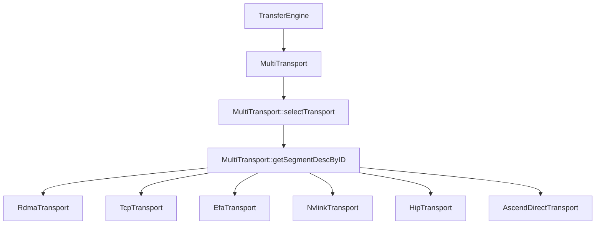
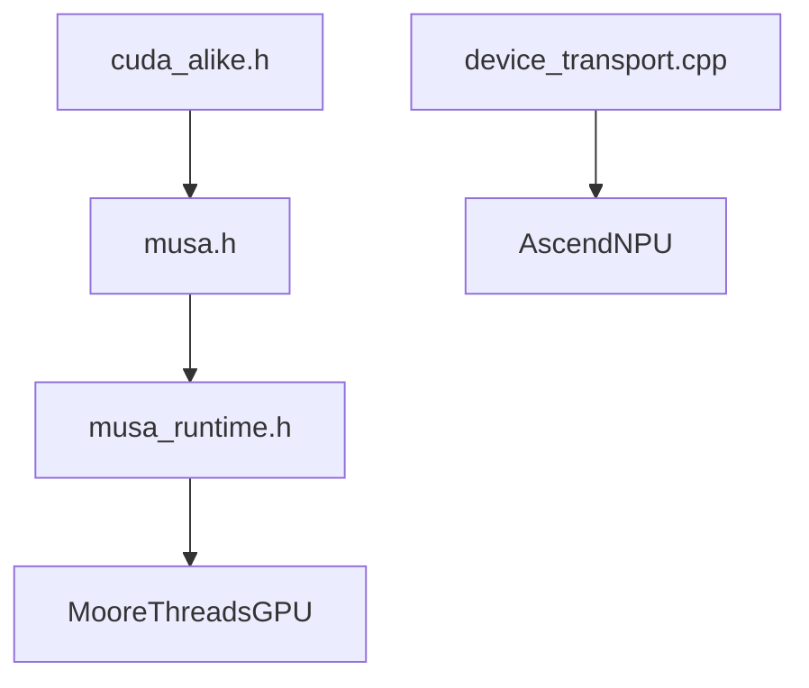

<!-- source: DeepWiki mcp.deepwiki.com · repo kvcache-ai/Mooncake · page 1.3 Supported Protocols and Hardware · fetched 2026-11-11 -->

# Supported Protocols and Hardware

Relevant source files

The following files were used as context for generating this wiki page:

- [.github/workflows/release-musa.yaml](.github/workflows/release-musa.yaml)
- [README.md](README.md)
- [docs/source/conf.py](docs/source/conf.py)
- [docs/source/design/transfer-engine/transport/ascend_direct_transport.md](docs/source/design/transfer-engine/transport/ascend_direct_transport.md)
- [docs/source/design/transfer-engine/transport/ascend_transport.md](docs/source/design/transfer-engine/transport/ascend_transport.md)
- [docs/source/design/transfer-engine/transport/efa_transport.md](docs/source/design/transfer-engine/transport/efa_transport.md)
- [docs/source/design/transfer-engine/transport/flagcx_transport.md](docs/source/design/transfer-engine/transport/flagcx_transport.md)
- [docs/source/design/transfer-engine/transport/heterogeneous_ascend.md](docs/source/design/transfer-engine/transport/heterogeneous_ascend.md)
- [docs/source/design/transfer-engine/transport/kunpeng_ub_transport.md](docs/source/design/transfer-engine/transport/kunpeng_ub_transport.md)
- [docs/source/design/transfer-engine/transport/mpcomm_transport.md](docs/source/design/transfer-engine/transport/mpcomm_transport.md)
- [docs/source/design/transfer-engine/transport/sunrise_link_transport.md](docs/source/design/transfer-engine/transport/sunrise_link_transport.md)
- [docs/source/getting_started/build.md](docs/source/getting_started/build.md)
- [docs/source/getting_started/quick-start.md](docs/source/getting_started/quick-start.md)
- [docs/source/getting_started/supported-protocols.md](docs/source/getting_started/supported-protocols.md)
- [docs/source/index.md](docs/source/index.md)
- [docs/source/zh_archive/build.md](docs/source/zh_archive/build.md)
- [docs/source/zh_archive/run-examples.md](docs/source/zh_archive/run-examples.md)
- [mooncake-common/common.cmake](mooncake-common/common.cmake)
- [mooncake-pg/torch/setup.py](mooncake-pg/torch/setup.py)
- [mooncake-store/CMakeLists.txt](mooncake-store/CMakeLists.txt)
- [mooncake-store/include/version.h.in](mooncake-store/include/version.h.in)
- [mooncake-transfer-engine/CMakeLists.txt](mooncake-transfer-engine/CMakeLists.txt)
- [mooncake-transfer-engine/include/cuda_alike.h](mooncake-transfer-engine/include/cuda_alike.h)
- [mooncake-transfer-engine/include/gpu_vendor/musa.h](mooncake-transfer-engine/include/gpu_vendor/musa.h)
- [mooncake-transfer-engine/include/transport/device/comm_device.cuh](mooncake-transfer-engine/include/transport/device/comm_device.cuh)
- [mooncake-transfer-engine/include/transport/device/cuda/cuda_ops.cuh](mooncake-transfer-engine/include/transport/device/cuda/cuda_ops.cuh)
- [mooncake-transfer-engine/include/transport/device/ibgda/mlx5gda.h](mooncake-transfer-engine/include/transport/device/ibgda/mlx5gda.h)
- [mooncake-transfer-engine/include/transport/device/ibgda/os.h](mooncake-transfer-engine/include/transport/device/ibgda/os.h)
- [mooncake-transfer-engine/include/transport/device/musa/musa_ops.cuh](mooncake-transfer-engine/include/transport/device/musa/musa_ops.cuh)
- [mooncake-transfer-engine/src/CMakeLists.txt](mooncake-transfer-engine/src/CMakeLists.txt)
- [mooncake-transfer-engine/src/transport/CMakeLists.txt](mooncake-transfer-engine/src/transport/CMakeLists.txt)
- [mooncake-transfer-engine/src/transport/device/CMakeLists.txt](mooncake-transfer-engine/src/transport/device/CMakeLists.txt)
- [mooncake-transfer-engine/src/transport/device/ibgda_device_transport.cpp](mooncake-transfer-engine/src/transport/device/ibgda_device_transport.cpp)
- [mooncake-transfer-engine/src/transport/device/mlx5gda.cpp](mooncake-transfer-engine/src/transport/device/mlx5gda.cpp)
- [mooncake-transfer-engine/src/transport/intranode_nvlink_transport/CMakeLists.txt](mooncake-transfer-engine/src/transport/intranode_nvlink_transport/CMakeLists.txt)
- [mooncake-transfer-engine/src/transport/nvmeof_transport/CMakeLists.txt](mooncake-transfer-engine/src/transport/nvmeof_transport/CMakeLists.txt)

## Purpose and Scope

The Transfer Engine subsystem requires diverse transport layers and hardware integration pathways to achieve ultra-low latency and high-throughput data movement for KVCache-centric LLM serving. This page establishes the full taxonomy of supported transport protocols (RDMA, NVLink, TCP, EFA, CXL, and others) and hardware accelerators (CUDA, HIP, Ascend, MUSA, MACA), defining valid operational combinations, compile-time flags, and target deployment use cases.

Sources: [docs/source/getting_started/supported-protocols.md:1-24](), [docs/source/getting_started/build.md:116-130]()

## Transport Architecture and Routing Logic

Mooncake’s Transfer Engine employs a pluggable transport architecture managed through the `MultiTransport` class, enabling seamless routing and protocol selection at runtime. The key function `MultiTransport::submitTransfer()` examines the metadata of source and destination segments, including device types, buffer locations, and available hardware, to dynamically select the optimal transport protocol via `MultiTransport::selectTransport()`.

Title: "Transport Routing and Dispatching Architecture"

Sources: [docs/source/getting_started/supported-protocols.md:1-24](), [mooncake-transfer-engine/src/transport/CMakeLists.txt:1-131]()

## Supported Transport Protocols

### Network Transport Protocols

- **TCP (`TcpTransport`)**:  
  A reliable, universal protocol over standard Ethernet networks. It serves as the default fallback transport, requiring no specialized hardware, ideal for testing, development, or environments lacking RDMA support. The Python API uses `"tcp"` as the protocol string without a device name.  
  Use case: general purpose, broad compatibility but higher latency and CPU use.  
  Supported via Python API as primary transport.  

- **RDMA (`RdmaTransport`)**:  
  Remote Direct Memory Access provides high throughput and low latency with minimal CPU involvement using InfiniBand or RoCE hardware. Supports accelerator-aware zero-copy transfers, including NVIDIA GPUDirect RDMA for CUDA memory and Cambricon MLU buffers when compiled with `-DUSE_MLU=ON`.  
  Use case: high-performance LLM KV cache transfer across nodes with RDMA-capable NICs.  
  The system auto-fallbacks to TCP if no RDMA device is found. Supports both classic and TENT RDMA backends.  
  Configuration includes specifying RDMA device (e.g., `"mlx5_0"`) or using `"auto-discovery"` for topology-aware device selection.

- **EFA (`EfaTransport`)**:  
  AWS Elastic Fabric Adapter uses libfabric’s SRD protocol to offer RDMA-like performance on AWS instances without native RDMA hardware. Supports GPU transfers with CUDA enabled.  
  Use case: AWS cloud deployments for high-throughput inference workloads.  

- **UB / Barex / CXL** (Advanced, specialized protocols):  
  Additional specialized protocols for NVMe-oF storage access, memory pooling across hosts (CXL), and bare-metal RDMA extensions. These have limited Python API support and usually require advanced cluster setups.

Sources: [docs/source/getting_started/supported-protocols.md:27-172](), [mooncake-transfer-engine/src/transport/CMakeLists.txt:14-17]()

### GPU Interconnect Protocols

- **NVLink (`NvlinkTransport`, `IntraNodeNvlinkTransport`)**:  
  Supports intra-node and multi-node GPU communication via NVIDIA’s NVLink and Mellanox MNNVL fabrics. Ideal for high-throughput tensor transfers between GPUs inside the same server or across connected nodes. Requires building with `-DUSE_INTRA_NVLINK=ON`.  
  Use case: fast GPU-to-GPU data transfers, crucial for large model parallelism and KVCache sharing.

- **HIP (`HipTransport`)**:  
  Enables AMD ROCm/HIP-based clusters to perform intra- and inter-node GPU transfers. HIP transport supports device-aware memory registration and communication. Requires compilation with `-DUSE_HIP=ON`.  
  Use case: AMD GPU clusters and machine learning workloads seeking HIP compatibility.

- **MUSA / MACA**:  
  - **MUSA (Moore Threads GPU)**: Supported via a translation layer that redefines CUDA APIs to the MUSA runtime. Requires building with `-DUSE_MUSA=ON`. Integrates with `mthreads-peermem` for GPUDirect RDMA on Moore Threads GPUs.  
  - **MACA (MetaX GPU)**: Similar abstraction for MetaX hardware, building with `-DUSE_MACA=ON`.  
  Both provide zero-copy accelerator-to-accelerator transfers within the Transfer Engine framework.  
  Use case: deployments on these emerging GPU hardware platforms for inference acceleration.

Sources: [docs/source/getting_started/build.md:116-130](), [mooncake-transfer-engine/include/gpu_vendor/musa.h:1-154](), [mooncake-transfer-engine/src/transport/CMakeLists.txt:59-87]()

### Processor and Memory Protocols

- **Ascend Direct (`AscendDirectTransport`)**:  
  For Huawei Ascend NPUs, Mooncake offers direct transport via ADXL engines and uses HCCS/HCCL libraries for efficient data movement, achieving asynchronous transfers with robust lifecycle management.  
  Requires `-DUSE_ASCEND_DIRECT=ON` and sourced Ascend environment.  
  Use case: LLM serving on Ascend accelerators, enabling prefill and decode separation with zero-copy buffers.

- **CPU and DRAM-based transports (`tcp`, `shm`)**:  
  For CPU and host DRAM transfers, TCP is default. Shared memory (`shm`) transport allows intra-host communication with minimal overhead.

- **CXL (`CxlTransport`)**:  
  Supports shared memory expansion and pooling using Compute Express Link protocol. Useful for memory disaggregation scenarios.

Sources: [docs/source/getting_started/build.md:116-130](), [docs/source/getting_started/supported-protocols.md:1-24]()

## Hardware Accelerators and Vendor Abstraction

Mooncake provides a unified hardware abstraction layer to support heterogeneous accelerator types through a common API. This enables seamless integration of vendor-specific SDKs using wrapper layers and shared header translation.

Title: "Hardware Accelerator Vendor Abstraction Space"

The `cuda_alike.h` file maps CUDA API calls to either the NVIDIA CUDA runtime or alternative runtimes such as MUSA and MACA, enabling reuse of GPU memory registration and data movement mechanisms across different vendors.

Sources: [mooncake-transfer-engine/include/gpu_vendor/musa.h:1-154](), [mooncake-transfer-engine/src/transport/device/CMakeLists.txt:1-15]()

### Accelerator Vendor Support

| Accelerator | Build Flag | Description | Use Case |
|-------------|------------|-------------|----------|
| NVIDIA CUDA | `-DUSE_CUDA=ON` | Supports NVIDIA GPUs with GPUDirect RDMA, DevX UMEM, IBGDA direct verbs for mlx5gda devices. Enables RDMA transfers with GPU buffers and intra-node NVLink. | Most common production target for distributed LLM serving and accelerator-aware transfers. |
| AMD HIP (ROCm) | `-DUSE_HIP=ON` | Enables ROCm/HIP runtime support for AMD GPUs. Supports device memory registration and HIP transport. | AMD GPU clusters and open-source LLM inference on AMD hardware. |
| Huawei Ascend | `-DUSE_ASCEND_DIRECT=ON` | Uses ADXL-based Ascend Direct transport with HCCS/HCCL support for intra- and inter-node data movement. | LLM inference on Ascend NPUs with efficient prefill/decode separation. |
| Moore Threads MUSA | `-DUSE_MUSA=ON` | Provides MUSA runtime compatible interface to support Moore Threads GPUs, including GPUDirect RDMA integration via mthreads-peermem. | Emerging Moore Threads GPU deployments needing seamless RDMA capabilities. |
| MetaX MACA | `-DUSE_MACA=ON` | Supports MetaX GPUs by mapping CUDA-like API calls to MACA SDK. Enables MACA runtime memory registration and transport. | MetaX GPU clusters requiring high-throughput KVCache transfer with GPU acceleration. |

Sources: [mooncake-transfer-engine/include/gpu_vendor/musa.h:1-154](), [docs/source/getting_started/build.md:116-130]()

## Supported Combinations and Use Cases

| Hardware Accelerator  | Recommended Transport(s)              | Deployment Scope     | Typical Use Case Description                                |
|----------------------|-------------------------------------|---------------------|-------------------------------------------------------------|
| NVIDIA CUDA          | `rdma`, `nvlink`, `tcp`             | Inter-node or intra-node | Disaggregated KVCache data movement and GPU intra-node tensor sharing in large GPU clusters. |
| AWS EFA Instances    | `efa`                              | Inter-node          | High-throughput, cloud-native LLM inference on AWS infrastructure, bypassing traditional RDMA hardware dependencies. |
| AMD ROCm             | `hip`, `rdma`, `tcp`                | Inter-node or intra-node | ROCm-based GPU clusters serving inference workloads with HIP and RDMA support. |
| Huawei Ascend NPU    | `ascend_direct`, `tcp`              | Inter-node or intra-node | NPU-accelerated LLM workflows requiring zero-copy and asynchronous transfers. |
| Moore Threads MUSA   | `rdma` (via MUSA runtime)           | Intra-node or inter-node | Emerging Moore Threads GPU deployments with RDMA support. |
| Generic CPU/DRAM     | `tcp`, `shm`, `cxl`                 | Broad               | Fallback or development environments without specialized hardware. Also serving as memory pooling protocols with CXL. |

These combinations are verified by conformance testing and integration into the Transfer Engine with supported Python API bindings and runtime initialization patterns.

Sources: [docs/source/getting_started/supported-protocols.md:1-24](), [docs/source/getting_started/build.md:116-130]()

---

