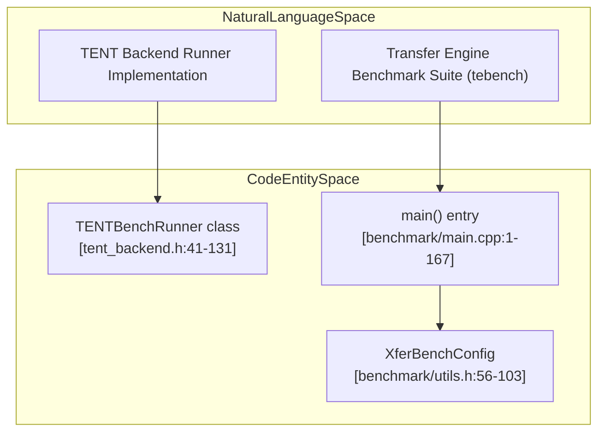
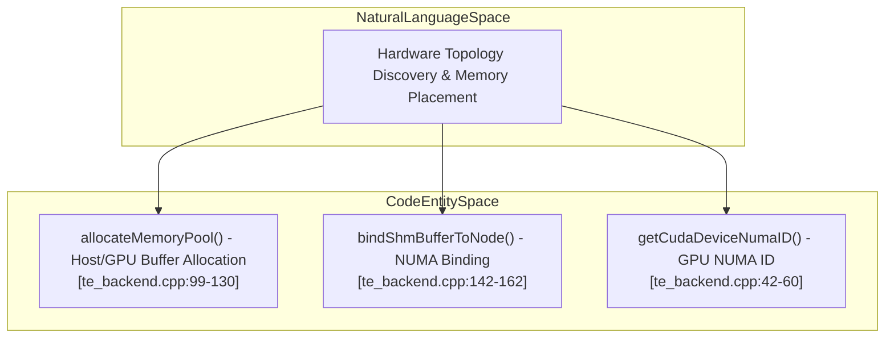
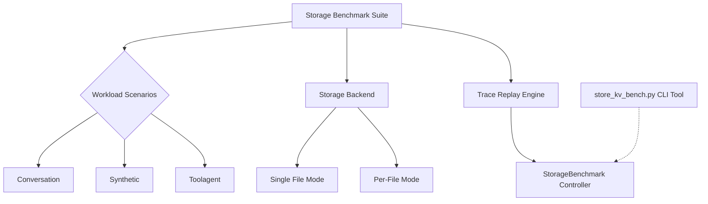
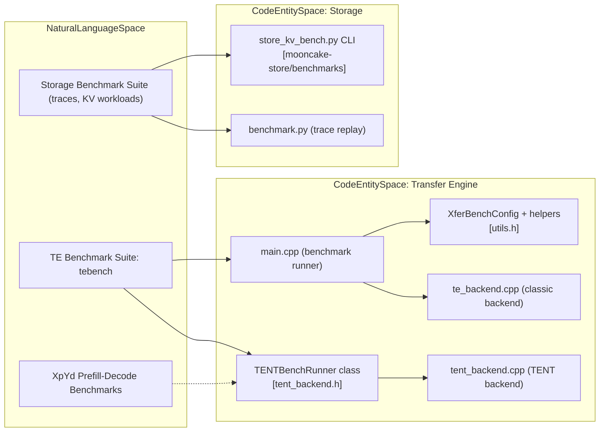

<!-- source: DeepWiki mcp.deepwiki.com · repo kvcache-ai/Mooncake · page 1.4 Performance Characteristics · fetched 2026-11-11 -->

# Performance Characteristics

Relevant source files

The following files were used as context for generating this wiki page:

- [benchmarks/storage_benchmark_v1/__init__.py](benchmarks/storage_benchmark_v1/__init__.py)
- [benchmarks/storage_benchmark_v1/__main__.py](benchmarks/storage_benchmark_v1/__main__.py)
- [benchmarks/storage_benchmark_v1/benchmark.py](benchmarks/storage_benchmark_v1/benchmark.py)
- [benchmarks/storage_benchmark_v1/doc/README.md](benchmarks/storage_benchmark_v1/doc/README.md)
- [benchmarks/storage_benchmark_v1/layout/__init__.py](benchmarks/storage_benchmark_v1/layout/__init__.py)
- [benchmarks/storage_benchmark_v1/layout/interface.py](benchmarks/storage_benchmark_v1/layout/interface.py)
- [benchmarks/storage_benchmark_v1/layout/mla.py](benchmarks/storage_benchmark_v1/layout/mla.py)
- [benchmarks/storage_benchmark_v1/storage/__init__.py](benchmarks/storage_benchmark_v1/storage/__init__.py)
- [benchmarks/storage_benchmark_v1/storage/disk.py](benchmarks/storage_benchmark_v1/storage/disk.py)
- [benchmarks/storage_benchmark_v1/storage/interface.py](benchmarks/storage_benchmark_v1/storage/interface.py)
- [docs/source/performance/mooncake/tebench.md](docs/source/performance/mooncake/tebench.md)
- [mooncake-store/benchmarks/store_kv_bench.md](mooncake-store/benchmarks/store_kv_bench.md)
- [mooncake-store/benchmarks/store_kv_bench.py](mooncake-store/benchmarks/store_kv_bench.py)
- [mooncake-store/benchmarks/test_store_kv_bench.py](mooncake-store/benchmarks/test_store_kv_bench.py)
- [mooncake-store/include/ssd_register_client.h](mooncake-store/include/ssd_register_client.h)
- [mooncake-transfer-engine/benchmark/CMakeLists.txt](mooncake-transfer-engine/benchmark/CMakeLists.txt)
- [mooncake-transfer-engine/benchmark/bench_runner.h](mooncake-transfer-engine/benchmark/bench_runner.h)
- [mooncake-transfer-engine/benchmark/main.cpp](mooncake-transfer-engine/benchmark/main.cpp)
- [mooncake-transfer-engine/benchmark/split_output.cpp](mooncake-transfer-engine/benchmark/split_output.cpp)
- [mooncake-transfer-engine/benchmark/split_output.h](mooncake-transfer-engine/benchmark/split_output.h)
- [mooncake-transfer-engine/benchmark/te_backend.cpp](mooncake-transfer-engine/benchmark/te_backend.cpp)
- [mooncake-transfer-engine/benchmark/te_backend.h](mooncake-transfer-engine/benchmark/te_backend.h)
- [mooncake-transfer-engine/benchmark/tent_backend.cpp](mooncake-transfer-engine/benchmark/tent_backend.cpp)
- [mooncake-transfer-engine/benchmark/tent_backend.h](mooncake-transfer-engine/benchmark/tent_backend.h)
- [mooncake-transfer-engine/benchmark/tests/split_output_test.cpp](mooncake-transfer-engine/benchmark/tests/split_output_test.cpp)
- [mooncake-transfer-engine/benchmark/utils.cpp](mooncake-transfer-engine/benchmark/utils.cpp)
- [mooncake-transfer-engine/benchmark/utils.h](mooncake-transfer-engine/benchmark/utils.h)

## Purpose and Scope

This document describes the performance metrics, benchmarks, and optimization strategies integral to the Mooncake platform, focusing on its KVCache-centric LLM serving capabilities. It details throughput and latency measurements, optimization strategies, and benchmarks validating real-world LLM workloads — including transfer engine profiling, storage subsystem evaluation, XpYd prefill-decode disaggregation benchmarks, and long-tail request patterns from the FAST25 research traces.

Mooncake attains high performance through topology-aware memory and transport management, multi-tiered caching, and flexible workload scheduling. It leverages high-bandwidth transport protocols such as RDMA and NVLink, supports heterogeneous hardware memory segments, and enables quality of service (QoS) differentiation for multi-tenant serving.

Sources: `[mooncake-transfer-engine/benchmark/utils.cpp:24-131]()`, `[mooncake-transfer-engine/benchmark/utils.h:56-103]()`

---

## Transfer Engine Benchmarking

Mooncake's Transfer Engine (TE) includes an extensible benchmarking suite tasked with quantifying bandwidth and latency across different hardware transports, memory segment types, concurrency configurations, and workload profiles.

### The `tebench` Tool

- **Implementation and Backends:**  
  The `tebench` benchmarking executable supports two primary backends:
  - **Classic TE backend:** implemented in `te_backend.cpp`.
  - **TENT (Transfer Engine Next) backend:** implemented in `tent_backend.cpp`, offering advanced scheduling and telemetry-driven dispatching.  
  Backend selection is determined by the `--backend` CLI option and enables precise measurement across both legacy and new TE architectures. These backends are integrated into the `tebench` build as per `CMakeLists.txt` configuration `[mooncake-transfer-engine/benchmark/CMakeLists.txt:28-38]()`.  

- **Multi-Segment and Multi-Transport Support:**  
  `tebench` supports mixed memory segment configurations via `--seg_type_mix` (e.g., `"dram,vram"`), allowing the same process to concurrently drive traffic over multiple memory types and associated transports such as SHM for DRAM and NVLink for VRAM. This tests multi-tier memory and transport concurrency and helps characterize aggregate pipeline throughput `[mooncake-transfer-engine/benchmark/utils.cpp:27-35]()`.  

- **QoS and Deadline-Aware Benchmarking:**  
  The tool accepts QoS class specifications (`--qos_classes`, `--qos_classes_json`) subdividing worker threads into named classes, each with thread counts, SLO latency targets, and weights for fair scheduling. The P99 and P999 latency distributions are tracked per QoS class to capture tail latency behavior (using the `XferMetricStats` class) `[mooncake-transfer-engine/benchmark/utils.h:106-155]()`.  

- **Workload Class Modeling:**  
  Complementing QoS threads, `tebench` allows JSON-defined workload classes that specify block sizes, batch sizes, intent types (e.g., `background_prefetch`, `weight_loading`), and deadlines, enabling mixed concurrent workloads to evaluate scheduling policies and bandwidth arbitration `[mooncake-transfer-engine/benchmark/utils.cpp:69-73]()`, `[mooncake-transfer-engine/benchmark/tent_backend.cpp:106-124]()`.

### Execution Flow and Configuration Management

The global benchmarking configuration is encapsulated by the `XferBenchConfig` structure, which processes extensive command-line parameters including:

- Buffer and batch sizing (`total_buffer_size`, `start_block_size`, `max_block_size`, `start_batch_size`, `max_batch_size`).
- Thread concurrency controls (`start_num_threads`, `max_num_threads`).
- Metadata service types and URLs (`--metadata_type`, `--metadata_url_list`).
- Transport selection (`--xport_type`), and backend preference (`--backend`).
- Deadline handling parameters (`deadline_us`, `deadline_tight_threads`, `deadline_bw_arbitration`).

These options govern the test topology, concurrency, network transport selection, scheduling mode, and consistency checks `[mooncake-transfer-engine/benchmark/utils.cpp:24-131]()`, `[mooncake-transfer-engine/benchmark/utils.h:56-103]()`.  

Upon running, `tebench` operates in either:

- **Target mode:** waits for connections and serves memory segments.
- **Initiator mode:** launches worker threads simulating transfer operations to target segments.

The initiator threads apply pacing delays (`request_interval_us`), determine local and remote buffer base addresses, and drive asynchronous batched transfers while collecting detailed latency and bandwidth statistics `[mooncake-transfer-engine/benchmark/main.cpp:44-167]()`.  

**Diagram: Transfer Engine Benchmark Code Entity Mapping**

Sources: `[mooncake-transfer-engine/benchmark/utils.cpp:24-131]()`, `[mooncake-transfer-engine/benchmark/utils.h:56-154]()`, `[mooncake-transfer-engine/benchmark/tent_backend.cpp:51-89]()`, `[mooncake-transfer-engine/benchmark/main.cpp:1-167]`, `[mooncake-transfer-engine/benchmark/tent_backend.h:41-131]()`

---

## RDMA and Topology Optimizations

### Topology Discovery and Memory Affinity

Mooncake dynamically discovers the hardware topology to map memory buffers close to the network interfaces used by RDMA or NVLink. This NUMA-aware allocation and binding significantly reduces memory access latency and maximizes throughput.

- The system infers NUMA node affinity via PCI bus IDs and sysfs queries to assign buffers optimally `[mooncake-transfer-engine/benchmark/te_backend.cpp:42-60]()`.
- For GPU VRAM, `cudaMalloc` allocates pinned device memory, and device-local pinned host memory can be allocated for zero-copy paths `[mooncake-transfer-engine/benchmark/te_backend.cpp:99-130]()`.
- Shared memory buffers are bound to NUMA nodes to ensure they are physically resident where expected (`bindShmBufferToNode` enforces page placement on host memory) `[mooncake-transfer-engine/benchmark/te_backend.cpp:142-162]()`.
- Hugepage support reduces TLB misses during large buffer registrations, governed by benchmarking flags like `use_hugepage` and `hugepage_size` `[mooncake-transfer-engine/benchmark/utils.cpp:113-121]()`.  

This topology-aware memory management is critical for performance, especially with heterogeneous segments combining DRAM and GPU VRAM buffers.

**Diagram: Topology and Memory Location Code Entities**

Sources: `[mooncake-transfer-engine/benchmark/te_backend.cpp:42-162]()`, `[mooncake-transfer-engine/benchmark/utils.cpp:113-121]()`  

---

## Storage and Allocator Benchmarks

Mooncake Store's internal components are benchmarked through specialized testing utilities designed to emulate realistic KVCache workloads and trace replay.

### KVCache Storage Benchmark v1 (Trace Replay)

This benchmark suite simulates real-world request sequences using the FAST25 research paper's trace datasets, driven by a Python benchmark script and auxiliary storage I/O backends. Key features include:

- **Multi-scenario support:** conversation, synthetic, toolagent, and all scenarios to represent different LLM workload characteristics `[benchmarks/storage_benchmark_v1/doc/README.md:1-101]()`.
- **Storage layout options:**
  - Single-file mode with a large preallocated binary blob (`data.bin`).
  - Per-file mode with individual files per page (`page_<id>.bin`), each replacing the full page on write for simplicity `[benchmarks/storage_benchmark_v1/doc/README.md:67-101]()`.
- **Durability modes:** configurable file synchronization (`fsync`) strategies including none, batch, always, and end `[benchmarks/storage_benchmark_v1/doc/README.md:30]()`.
- **Parallelism:** configurable number of client threads simulating concurrent accesses with per-thread isolated storage subdirectories `[benchmarks/storage_benchmark_v1/doc/README.md:33-66]()`.  

### Mooncake Store KV Benchmark (`store_kv_bench.py`)

The Mooncake Store KV benchmark evaluates end-to-end distributed KV operations in various realistic workload scenarios such as fill, verify write, mixed read/write, and metadata stress:

- Supports flexible workload definitions including random key distributions, batch sizes, request mixes (`put_pct`, `get_pct`, etc.) `[mooncake-store/benchmarks/store_kv_bench.py:31-65]()`.
- Permits operation via plain and zero-copy APIs to measure overhead from buffer copying.
- Incorporates latency sampling, error counter tracking, journaling and replay features for deterministic benchmark runs.
- Multi-replica and storage tier configuration options benchmark replication and offloading performance.

**Diagram: Storage Benchmark Architecture**

Sources: `[benchmarks/storage_benchmark_v1/doc/README.md:1-101]()`, `[mooncake-store/benchmarks/store_kv_bench.py:31-65]()`  

---

## XpYd (Prefill-Decode) Benchmarks and Tuning Parameters

XpYd benchmarks evaluate the performance of Mooncake in a real LLM serving deployment pattern termed **Prefill-Decode (PD) Disaggregation**:

- **Workflow:** prefilling nodes generate KVCache key-value tensor slices which they transfer en masse to decoding nodes performing the autoregressive computation.
- **Batching and Slicing:** TE batches multiple slice transfers to amortize overhead and maximize pipeline utilization.
- **Zero-Copy RDMA Transfers:** VRAM-registered buffers enable direct memory operations avoiding CPU copies.
- **Deadline-Aware Arbitration:** The TENT backend supports deadlines (`--deadline_us`) and per-thread scheduling groups (`deadline_tight_threads`) to prioritize latency-sensitive foreground traffic over background work. Bandwidth arbitration for RDMA further optimizes the delivery of urgent transfers `[mooncake-transfer-engine/benchmark/utils.cpp:89-98]()`.  

### Key Tuning Parameters

| Parameter               | Default      | Description |
|------------------------|--------------|-------------|
| `--total_buffer_size`   | 1GB          | Size of memory buffers used in benchmarking `[mooncake-transfer-engine/benchmark/utils.cpp:45]` |
| `--start_block_size`    | 4096 bytes   | Initial block size for transfer requests `[mooncake-transfer-engine/benchmark/utils.cpp:47]` |
| `--max_block_size`      | 64 MB        | Upper bound for block size sweep `[mooncake-transfer-engine/benchmark/utils.cpp:48]` |
| `--start_batch_size`    | 1            | Initial number of requests batched together `[mooncake-transfer-engine/benchmark/utils.cpp:49]` |
| `--max_batch_size`      | 1            | Maximum batch size `[mooncake-transfer-engine/benchmark/utils.cpp:50]` |
| `--xport_type`          | `""`         | Transport protocol selected: RDMA, TCP, SHM, NVLINK, etc. `[mooncake-transfer-engine/benchmark/utils.cpp:109-112]` |
| `--backend`             | `tent`       | Transport backend: classic or TENT `[mooncake-transfer-engine/benchmark/utils.cpp:113]` |
| `--deadline_us`         | 0 (disabled) | Per-transfer relative deadline in microseconds for worker threads `[mooncake-transfer-engine/benchmark/utils.cpp:89-93]` |

These parameters influence concurrency, transport path utilization, buffer placement, and deadline-driven scheduling, critical for optimizing end-to-end LLM serving latency and throughput.

Sources: `[mooncake-transfer-engine/benchmark/utils.cpp:44-136]()`, `[mooncake-transfer-engine/benchmark/tent_backend.cpp:51-89]()`  

---

# Summary

Mooncake's performance foundation centers on efficient memory and transport utilization enabled via extensive benchmarking and configuration tuning:

- The **Transfer Engine (TE) benchmark tool `tebench`** serves as an end-to-end microscopic profiler for bandwidth, latency, and QoS metrics across classic and TENT backends.
- **NUMA-aware topology and memory binding** ensure optimum network-device proximity and buffer locality, vital for RDMA and GPU VRAM transports.
- The **Mooncake Store storage benchmark** rigorously tests KV storage durability, latency, and throughput with realistic workloads and trace-driven request patterns.
- The **XpYd benchmark framework** evaluates PD disaggregation workflows simulating real multi-tenant LLM serving deployments, featuring deadline-aware scheduling, batching, and mixed priority traffic.
  
Together, these benchmarking and profiling components inform Mooncake’s architectural decisions, identify bottlenecks, and ensure the platform meets stringent LLM serving performance demands.

# Appendix: Key Code Entities Overview

Sources: `[mooncake-transfer-engine/benchmark/utils.cpp]()`, `[mooncake-transfer-engine/benchmark/utils.h]()`, `[mooncake-store/benchmarks/store_kv_bench.py]()`, `[benchmarks/storage_benchmark_v1/doc/README.md]()`

---

This page is a leaf in the documentation tree focusing on detailed performance characterization critical for Mooncake's LLM serving stack. For further architecture and API details, see sibling pages in the documentation hierarchy.

---

