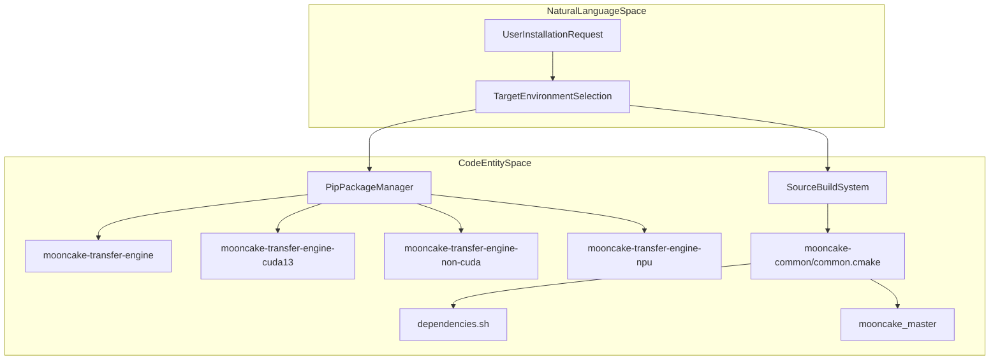
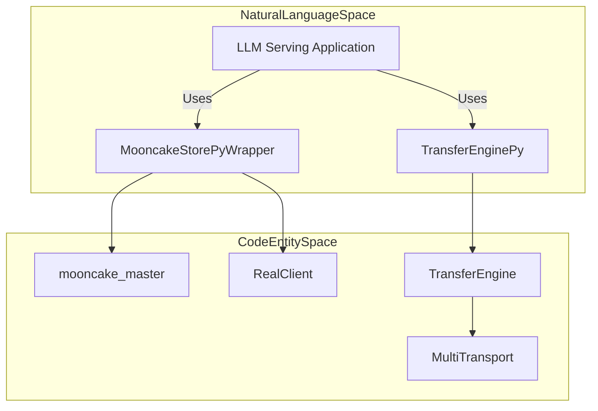

<!-- source: DeepWiki mcp.deepwiki.com · repo kvcache-ai/Mooncake · page 2 Getting Started · fetched 2026-11-11 -->

# Getting Started

Relevant source files

The following files were used as context for generating this wiki page:

- [README.md](README.md)
- [docs/source/getting_started/build.md](docs/source/getting_started/build.md)
- [docs/source/getting_started/quick-start.md](docs/source/getting_started/quick-start.md)
- [docs/source/getting_started/supported-protocols.md](docs/source/getting_started/supported-protocols.md)
- [docs/source/index.md](docs/source/index.md)
- [docs/source/zh_archive/build.md](docs/source/zh_archive/build.md)
- [docs/source/zh_archive/run-examples.md](docs/source/zh_archive/run-examples.md)
- [mooncake-common/common.cmake](mooncake-common/common.cmake)
- [mooncake-store/CMakeLists.txt](mooncake-store/CMakeLists.txt)
- [mooncake-store/include/version.h.in](mooncake-store/include/version.h.in)
- [mooncake-transfer-engine/CMakeLists.txt](mooncake-transfer-engine/CMakeLists.txt)
- [mooncake-transfer-engine/include/cuda_alike.h](mooncake-transfer-engine/include/cuda_alike.h)
- [mooncake-transfer-engine/src/CMakeLists.txt](mooncake-transfer-engine/src/CMakeLists.txt)
- [mooncake-transfer-engine/src/transport/CMakeLists.txt](mooncake-transfer-engine/src/transport/CMakeLists.txt)

This page guides users through installation, basic setup, and initial usage of Mooncake. It provides a high-level overview of system prerequisites, supported installation methods, core components, and verification steps. For comprehensive technical details, it links to child pages with focused topics on installation, usage examples, and configuration management.

- For detailed installation workflows including Python packages, source builds, and Docker usage, see [Installation](#2.1).  
- For minimal working examples showcasing tensor transfers, zero-copy operations, and LLM integrations, see [Quick Start Examples](#2.2).  
- For configuration of environment variables, config files, and command-line options, see [Configuration Overview](#2.3).

Sources: [docs/source/getting_started/quick-start.md:1-10](), [docs/source/getting_started/build.md:1-10]()

---

## Prerequisites and System Requirements

Before proceeding with installation, ensure your system satisfies the following prerequisites:

### Hardware Requirements

- **Network:** RDMA-capable NICs supporting InfiniBand or RoCE are preferred for low-latency, high-throughput data transfers. Alternatively, high-speed TCP/IP can be used [docs/source/getting_started/quick-start.md:15]() [docs/source/getting_started/supported-protocols.md:9-10]().
- **Accelerators:** Supported device types include NVIDIA GPUs (CUDA 12.1+), AMD GPUs (ROCm/HIP), Moore Threads MUSA GPUs, Huawei Ascend NPUs, MetaX MACA GPUs, and Cambricon MLUs [docs/source/getting_started/quick-start.md:16](), [docs/source/getting_started/build.md:116-131]().
- **Memory and Storage:** At least 16 GB of RAM is recommended to support buffer allocation for KVCache shards and metadata management. NVMe SSD or distributed filesystems are commonly employed for ephemeral eviction tiers [README.md:31-33](), [docs/source/getting_started/build.md:60-77]().

### Software Dependencies

- **Operating System:** Linux is the target OS, with Ubuntu 22.04 LTS or later recommended for compatibility with packaging and build tools [docs/source/getting_started/build.md:8]().
- **Python:** Version 3.10+ is required, ideally within a virtual environment [docs/source/getting_started/quick-start.md:14]().
- **System Libraries:** Essential native libraries include `libibverbs`, `rdma-core`, `libnuma`, `libcurl`, and `liburing` for network and async I/O support [docs/source/getting_started/quick-start.md:110-111]().

Sources: [docs/source/getting_started/quick-start.md:14-17](), [docs/source/getting_started/build.md:8-131]()

---

## Installation Methods Overview

Mooncake supports multiple installation modes tailored for various user needs and hardware configurations:

- **Prebuilt Python Wheels via PyPI:**  
  Multiple variant packages are provided to match hardware and software environments:
  - `mooncake-transfer-engine` for CUDA 12.1–12.9 [README.md:21]()  
  - `mooncake-transfer-engine-cuda13` for CUDA 13.0/13.1 [README.md:22]()  
  - `mooncake-transfer-engine-non-cuda` for CPU-only deployments [README.md:23]()  
  - `mooncake-transfer-engine-npu` for Ascend NPU platforms [README.md:24]()  
  - Variants exist for MUSA, EFA, and ROCm [README.md:25-27]().

- **Building from Source:**  
  Using CMake (configured via [mooncake-common/common.cmake:1]()) with flexible options for hardware backend support, such as CUDA, VRAM segments, and NVMe-oF storage [docs/source/getting_started/build.md:32-77](). Supporting scripts (`dependencies.sh`) automate system dependency installation.

- **Docker Containers:**  
  Official images are published on Docker Hub (`kvcacheai/mooncake`) for convenient environment encapsulation [docs/source/getting_started/quick-start.md:75-77]().

### Diagram: Installation Modes and Code Entities

Installation Modes to Code Entity Mapping

Sources: [README.md:21-28](), [docs/source/getting_started/build.md:14-59](), [mooncake-common/common.cmake:1-10]()

For comprehensive build instructions, hardware-specific flags, and Docker usage, see [Installation](#2.1).

---

## Core Components and Initial Usage

Mooncake comprises two key subsystems enabling efficient LLM KVCache disaggregation:

- **Transfer Engine:**  
  A high-performance data movement layer exposing the `TransferEnginePy` Python class. It manages connections, buffer registrations, and allows zero-copy transfers across NICs and GPU memory [README.md:4-10]().
- **Mooncake Store:**  
  A distributed object storage system with the `MooncakeStorePyWrapper` client interface, supporting scalable KVCache storage with lease management, replication, and multi-tier memory tiers [docs/source/index.md:30-38](), [docs/source/getting_started/quick-start.md:26-30]().

### Diagram: High-Level Architecture to Code Entities

Core Subsystems to Code Entities

Sources: [docs/source/getting_started/quick-start.md:26-31](), [README.md:4-10]()

### Verification Smoke Test

After installation, verify your setup by initializing a basic `TransferEngine` or a `MooncakeStore` client pointed at a metadata server (e.g., `P2PHANDSHAKE`). Running simple examples ensures the system is operational [docs/source/getting_started/quick-start.md:40-45]().

For working code snippets demonstrating basic file and tensor operations and framework integration, see [Quick Start Examples](#2.2).

Sources: [docs/source/getting_started/quick-start.md:40-46]()

---

## Configuration Overview

Mooncake supports flexible configuration through multiple layers:

- **Environment Variables:** Control transport protocol, device names, metadata servers, and debugging flags [docs/source/getting_started/quick-start.md:50-51]().
- **Configuration Files:** Includes `mooncake_config.py` for Python API clients, `default_config.h` for compiled defaults, and `environ.h` for environment variables semantics.
- **Command-line Flags:** Used by service binaries like `mooncake_master` and benchmark tools to override settings at runtime [docs/source/getting_started/quick-start.md:84]().

For detailed configuration options, tuning guides, and file formats, see [Configuration Overview](#2.3).

Sources: [docs/source/getting_started/quick-start.md:50-84](), [docs/source/getting_started/build.md:116-131]()

---

This concludes the high-level guidance to get started with Mooncake. Please explore the child pages for more granular instructions on installation, example usage, and configuration.

---

