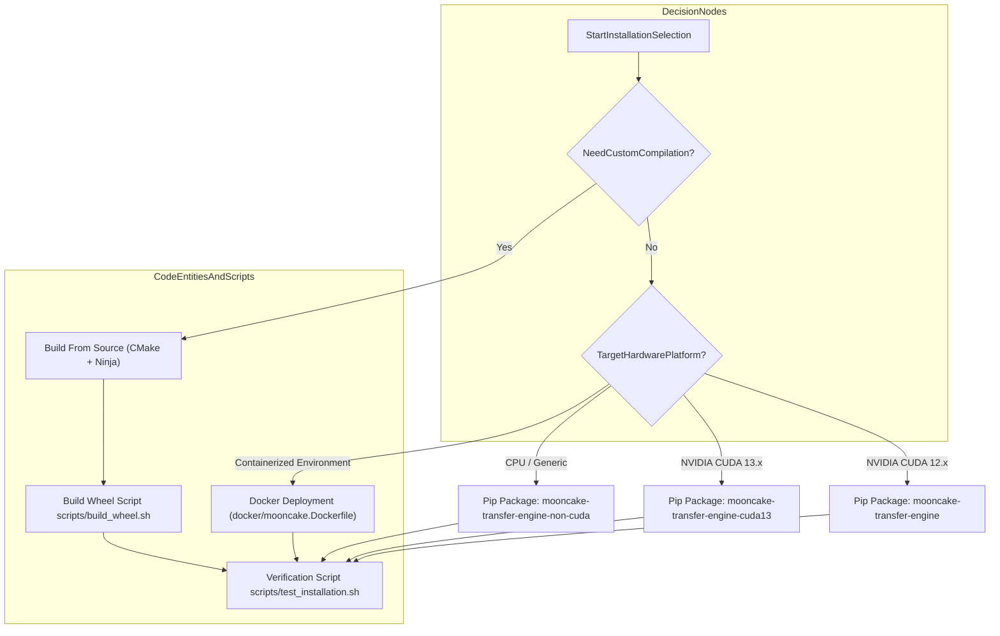
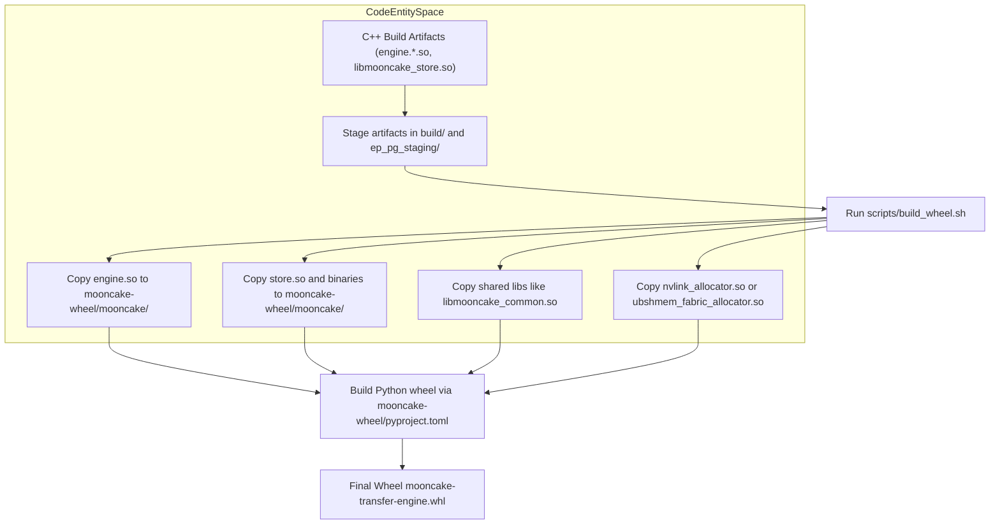
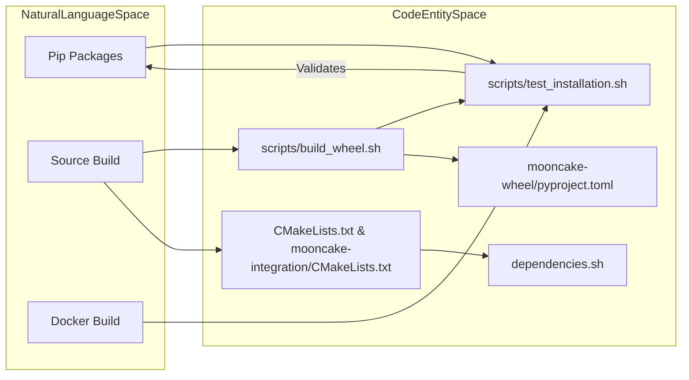

<!-- source: DeepWiki mcp.deepwiki.com · repo kvcache-ai/Mooncake · page 2.1 Installation · fetched 2026-11-11 -->

# Installation

<details>
<summary>Relevant source files</summary>

The following files were used as context for generating this wiki page:

- [.github/CODEOWNERS](.github/CODEOWNERS)
- [.github/labeler.yml](.github/labeler.yml)
- [.github/workflows/ci.yml](.github/workflows/ci.yml)
- [.github/workflows/pre-release.yaml](.github/workflows/pre-release.yaml)
- [.github/workflows/release-cuda13.yaml](.github/workflows/release-cuda13.yaml)
- [.github/workflows/release-non-cuda.yaml](.github/workflows/release-non-cuda.yaml)
- [.github/workflows/release-npu.yaml](.github/workflows/release-npu.yaml)
- [.github/workflows/release.yaml](.github/workflows/release.yaml)
- [.gitmodules](.gitmodules)
- [CMakeLists.txt](CMakeLists.txt)
- [dependencies.sh](dependencies.sh)
- [docker/mooncake.Dockerfile](docker/mooncake.Dockerfile)
- [docker/musa.Dockerfile](docker/musa.Dockerfile)
- [mooncake-integration/CMakeLists.txt](mooncake-integration/CMakeLists.txt)
- [mooncake-wheel/pyproject.toml](mooncake-wheel/pyproject.toml)
- [mooncake-wheel/setup.py](mooncake-wheel/setup.py)
- [mooncake-wheel/tests/test_distributed_object_store.py](mooncake-wheel/tests/test_distributed_object_store.py)
- [mooncake-wheel/tests/test_release_wheel_tags.py](mooncake-wheel/tests/test_release_wheel_tags.py)
- [python/tests/packaging/test_installed_wheel.py](python/tests/packaging/test_installed_wheel.py)
- [python/tests/packaging/test_project.py](python/tests/packaging/test_project.py)
- [scripts/build_wheel.sh](scripts/build_wheel.sh)
- [scripts/run_tests.sh](scripts/run_tests.sh)
- [scripts/test_installation.sh](scripts/test_installation.sh)

</details>


## Purpose and Scope

This page provides comprehensive technical documentation for installing Mooncake, the KVCache-centric LLM serving platform, across diverse operating environments. It details installation via prebuilt PyPI wheel packages (covering CUDA, CUDA 13, and non-CUDA/CPU variants), compiling and building from source using CMake and Ninja, and containerized deployments using Docker. Additionally, this page outlines system prerequisites, low-level dependency scripts, the Python wheel packaging pipeline, and post-installation verification routines.

Sources: `[scripts/build_wheel.sh:1-20]`, `[CMakeLists.txt:1-40]`, `[scripts/test_installation.sh:1-30]()`

---

## Installation Method Selection

Mooncake offers flexible deployment paths tailored to specific hardware backends and development workflows. Users can choose between prebuilt PyPI packages for rapid deployment, source compilation for customized tuning, or Docker containers for isolated runtime environments.

Title: "Installation Method Selection and Target Mapping"


This decision flow routes users to the appropriate installation mechanism depending on compilation requirements and hardware architecture.

Sources: `[scripts/build_wheel.sh:1-20]`, `[CMakeLists.txt:1-40]`, `[scripts/test_installation.sh:1-30]()`

---

## PyPI Packages and Variants

Mooncake publishes multiple wheel packages on PyPI to support diverse hardware platforms and CUDA versions. These packages bundle the core C++ `TransferEngine` and the distributed `MooncakeStore` Python bindings (`[mooncake-wheel/pyproject.toml:24-37]()`).

### Available Package Variants

| Package Name | Target Hardware | CUDA Version | Key Components | Reference Workflow |
| --- | --- | --- | --- | --- |
| `mooncake-transfer-engine` | NVIDIA GPU | CUDA 12.1 - 12.9 | `TransferEngine`, `MooncakeStore` | `[.github/workflows/release.yaml:1-25]()` |
| `mooncake-transfer-engine-cuda13` | NVIDIA GPU | CUDA 13.0 / 13.1 | `TransferEngine`, `MooncakeStore` | `[.github/workflows/release-cuda13.yaml:1-25]()` |
| `mooncake-transfer-engine-non-cuda` | CPU / Generic | None (CPU only) | `TransferEngine`, `MooncakeStore` | `[.github/workflows/ci.yml:31-42]()` |

All packages expose standard console entry points registered via `mooncake-wheel/pyproject.toml`:
- `mooncake_master` — Master metadata service CLI mapped to `mooncake.cli:main` `[mooncake-wheel/pyproject.toml:51]()`
- `mooncake_client` — Client CLI for object store operations mapped to `mooncake.cli_client:main` `[mooncake-wheel/pyproject.toml:52]()`
- `transfer_engine_bench` — Transfer engine benchmark tool mapped to `mooncake.cli_bench:main` `[mooncake-wheel/pyproject.toml:53]()`
- `mooncake_http_metadata_server` — HTTP metadata server mapped to `mooncake.http_metadata_server:main` `[mooncake-wheel/pyproject.toml:54]()`
- `transfer_engine_topology_dump` — Topology discovery utility mapped to `mooncake.transfer_engine_topology_dump:main` `[mooncake-wheel/pyproject.toml:56]()`

Sources: `[mooncake-wheel/pyproject.toml:24-57]`, `[.github/workflows/release.yaml:1-25]`, `[.github/workflows/release-cuda13.yaml:1-25]()`

---

## System Prerequisites and Dependency Installation

Target host environments must satisfy specific operating system and library dependencies prior to compilation or execution.

### Supported Operating Systems

- Ubuntu 22.04 LTS and newer `[dependencies.sh:148-149]()`
- Debian distributions `[dependencies.sh:148-149]()`
- Enterprise Linux distributions (CentOS, RHEL, Rocky Linux, AlmaLinux) `[dependencies.sh:151-152]()`
- EulerOS, openEuler, and Kylin `[dependencies.sh:151-152]()`

### Key System Dependencies

Mooncake requires foundational build utilities, networking stacks, and memory management libraries:
- Build Tools: `build-essential`, `cmake`, `ninja-build`, `git` `[dependencies.sh:166-169]()`
- Networking and Fabrics: `libibverbs-dev`, `libnuma-dev`, `libgoogle-glog-dev` `[dependencies.sh:172-176]()`
- RPC and Serialization: `libgrpc-dev`, `libgrpc++-dev`, `libprotobuf-dev`, `protobuf-compiler-grpc` `[dependencies.sh:180-184]()`
- Asynchronous I/O and Allocators: `liburing-dev`, `libjemalloc-dev`, `libmsgpack-dev`, `libzmq3-dev`, `libzstd-dev`, `libasio-dev` `[dependencies.sh:187-192]()`
- Python Development Headers: `libpython3-dev`, `pkg-config`, `patchelf` `[dependencies.sh:177-195]()`

### Automated Dependency Script

The repository provides `dependencies.sh` to install system packages and the Go runtime (`1.25.9`) required for metadata coordination `[dependencies.sh:26-127]()`:

```bash
sudo bash dependencies.sh -y
```

For advanced NVMe-oF transport support using SPDK, execute with the optional flag `[dependencies.sh:106-114]()`:

```bash
sudo bash dependencies.sh --with-spdk -y
```

Sources: `[dependencies.sh:1-207]()`

---

## Building from Source and CMake Configuration

Users requiring custom compilation flags or hardware-specific optimizations can build Mooncake directly from source.

### Top-Level CMake Options

| Option | Default | Description |
| --- | --- | --- |
| `WITH_TE` | ON | Enable building the Transfer Engine subsystem `[CMakeLists.txt:19]()` |
| `WITH_STORE` | ON | Enable building the Mooncake Store distributed storage `[CMakeLists.txt:20]()` |
| `USE_CUDA` | OFF | Enable NVIDIA CUDA GPU support and NVLink allocator |
| `USE_ETCD` | OFF | Enable ETCD metadata coordination support `[CMakeLists.txt:53]()` |
| `WITH_EP` | OFF | Enable Expert Parallelism (MoE) backend modules `[CMakeLists.txt:31]()` |

### Compilation Steps

```bash
# Initialize required submodules (pybind11)
git submodule update --init --recursive

# Configure build directory with CMake and Ninja
mkdir -p build && cd build
cmake .. -DUSE_CUDA=ON -DWITH_STORE=ON -DCMAKE_BUILD_TYPE=Release

# Compile and install
make -j$(nproc)
sudo make install
```

Sources: `[CMakeLists.txt:1-60]`, `[mooncake-integration/CMakeLists.txt:1-50]()`

---

## Python Wheel Packaging Pipeline

Python wheels are produced via a packaging pipeline orchestrated by `scripts/build_wheel.sh` and `mooncake-integration/CMakeLists.txt`.

Title: "Wheel Packaging Pipeline and Code Entity Mapping"


The script stages compiled native extensions, allocators, and shared object libraries into the `mooncake-wheel/mooncake/` package structure prior to invoking `setuptools` `[scripts/build_wheel.sh:20-137]()`.

Sources: `[scripts/build_wheel.sh:20-137]`, `[mooncake-integration/CMakeLists.txt:1-50]`, `[mooncake-wheel/pyproject.toml:1-67]()`

---

## Docker-based Deployment

For containerized clusters, Mooncake provides container definitions under `docker/`.

- The primary runtime container is defined in `docker/mooncake.Dockerfile`.
- Alternative accelerators (e.g., MUSA) provide dedicated Dockerfiles such as `docker/musa.Dockerfile`.

To build and run the container:

```bash
docker build -f docker/mooncake.Dockerfile -t mooncake:latest .
docker run --rm -it mooncake:latest bash
```

Sources: `[.github/workflows/ci.yml:1-100]`, `[docker/mooncake.Dockerfile]()`, `[docker/musa.Dockerfile]()`

---

## Verification and Testing of Installation

Post-installation verification ensures that all native modules, entry points, and Python bindings load correctly.

### Test Execution Script

The script `scripts/test_installation.sh` automates validation checks `[scripts/test_installation.sh:10-101]()`:
1. Establishes an isolated virtual environment `[scripts/test_installation.sh:11-12]()`.
2. Installs the generated wheel and verifies importability of `mooncake.engine` and `mooncake.reshard.weight` `[scripts/test_installation.sh:19-37]()`.
3. Validates executable console entry points (`mooncake_master`, `mooncake_client`, `transfer_engine_bench`, `mooncake_http_metadata_server`, `transfer_engine_topology_dump`) `[scripts/test_installation.sh:75-97]()`.

Execute the test suite using:

```bash
bash scripts/test_installation.sh
```

Sources: `[scripts/test_installation.sh:1-101]`, `[scripts/run_tests.sh:1-160]()`

---

## Summary Diagram: Installation Ecosystem Architecture

Title: "Installation Ecosystem Architecture"


Sources: `[scripts/test_installation.sh:1-101]`, `[scripts/build_wheel.sh:1-137]`, `[CMakeLists.txt:1-60]`, `[mooncake-integration/CMakeLists.txt:1-50]`, `[dependencies.sh:1-207]`, `[mooncake-wheel/pyproject.toml:1-67]()`

---

