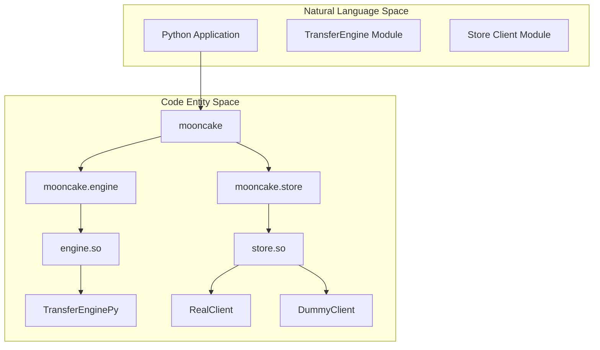
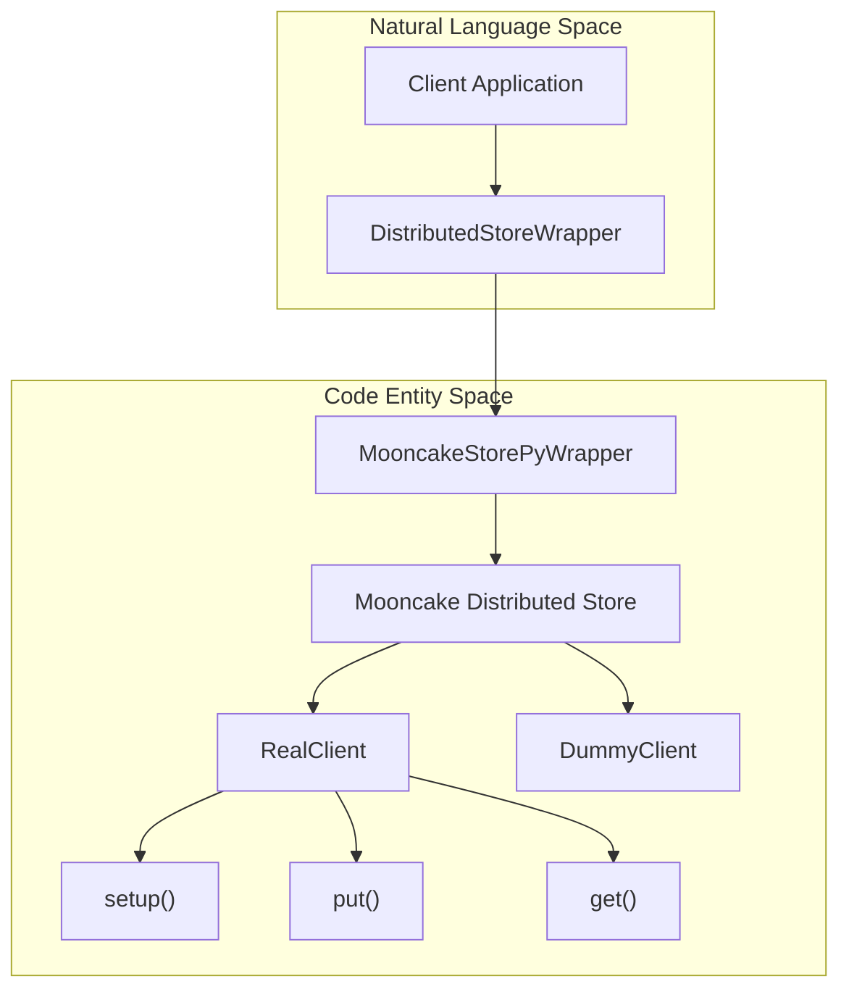

<!-- source: DeepWiki mcp.deepwiki.com · repo kvcache-ai/Mooncake · page 3 Python API Reference · fetched 2026-11-11 -->

# Python API Reference

Relevant source files

The following files were used as context for generating this wiki page:

- [docs/source/api-reference/cpp/transfer-engine.md](docs/source/api-reference/cpp/transfer-engine.md)
- [docs/source/api-reference/python/mooncake-store.md](docs/source/api-reference/python/mooncake-store.md)
- [mooncake-integration/store/store_py.cpp](mooncake-integration/store/store_py.cpp)
- [mooncake-integration/transfer_engine/transfer_engine_py.cpp](mooncake-integration/transfer_engine/transfer_engine_py.cpp)
- [mooncake-integration/transfer_engine/transfer_engine_py.h](mooncake-integration/transfer_engine/transfer_engine_py.h)
- [mooncake-store/include/client_service.h](mooncake-store/include/client_service.h)
- [mooncake-store/include/dummy_client.h](mooncake-store/include/dummy_client.h)
- [mooncake-store/include/pyclient.h](mooncake-store/include/pyclient.h)
- [mooncake-store/include/real_client.h](mooncake-store/include/real_client.h)
- [mooncake-store/src/client_service.cpp](mooncake-store/src/client_service.cpp)
- [mooncake-store/src/dummy_client.cpp](mooncake-store/src/dummy_client.cpp)
- [mooncake-store/src/real_client.cpp](mooncake-store/src/real_client.cpp)
- [mooncake-store/src/real_client_main.cpp](mooncake-store/src/real_client_main.cpp)
- [mooncake-store/tests/e2e/run_session_ranges_tcp_e2e.sh](mooncake-store/tests/e2e/run_session_ranges_tcp_e2e.sh)
- [mooncake-store/tests/e2e/session_ranges_tcp_e2e.py](mooncake-store/tests/e2e/session_ranges_tcp_e2e.py)
- [mooncake-store/tests/pybind_client_test.cpp](mooncake-store/tests/pybind_client_test.cpp)
- [mooncake-transfer-engine/include/multi_transport.h](mooncake-transfer-engine/include/multi_transport.h)
- [mooncake-transfer-engine/include/transfer_engine.h](mooncake-transfer-engine/include/transfer_engine.h)
- [mooncake-transfer-engine/include/transfer_engine_c.h](mooncake-transfer-engine/include/transfer_engine_c.h)
- [mooncake-transfer-engine/include/transfer_engine_impl.h](mooncake-transfer-engine/include/transfer_engine_impl.h)
- [mooncake-transfer-engine/include/transport/transport.h](mooncake-transfer-engine/include/transport/transport.h)
- [mooncake-transfer-engine/src/multi_transport.cpp](mooncake-transfer-engine/src/multi_transport.cpp)
- [mooncake-transfer-engine/src/transfer_engine.cpp](mooncake-transfer-engine/src/transfer_engine.cpp)
- [mooncake-transfer-engine/src/transfer_engine_c.cpp](mooncake-transfer-engine/src/transfer_engine_c.cpp)
- [mooncake-transfer-engine/src/transfer_engine_impl.cpp](mooncake-transfer-engine/src/transfer_engine_impl.cpp)
- [mooncake-transfer-engine/tests/shm_transport_test.cpp](mooncake-transfer-engine/tests/shm_transport_test.cpp)
- [mooncake-transfer-engine/tests/transport_uint_test.cpp](mooncake-transfer-engine/tests/transport_uint_test.cpp)

This page documents the complete Python API surface for Mooncake, covering both the low-level `TransferEnginePy` data movement engine and the `MooncakeStorePyWrapper` distributed object storage system. As a PARENT page, this section provides a high-level overview of the Python bindings architecture and key components. For detailed method signatures, parameter descriptions, and usage examples, consult the linked child pages.

Sources: [mooncake-integration/store/store_py.cpp:1-183](), [mooncake-store/src/real_client.cpp:1-201](), [mooncake-transfer-engine/src/transfer_engine.cpp:1-203](), [mooncake-integration/transfer_engine/transfer_engine_py.cpp:1-203]()

---

## Python Module Structure

Mooncake’s Python API is organized into multiple modules that provide clear separation between transfer operations and distributed object storage, while exposing native C++ classes using `pybind11` bindings [mooncake-integration/store/store_py.cpp:1-33](), [mooncake-integration/transfer_engine/transfer_engine_py.cpp:15-35](). The primary Python packages are:

- **`mooncake.engine`**: Contains `TransferEnginePy`, the Python interface for the Transfer Engine responsible for efficient cross-node data movement.
- **`mooncake.store`**: Provides `MooncakeStorePyWrapper` along with `RealClient` and `DummyClient` classes, implementing distributed KVCache storage and client logic [mooncake-store/include/real_client.h:80-109]().

The following diagram shows how common Python application layers map to underlying code entities:

This modular separation provides flexibility, allowing applications to independently use the transfer engine or storage client as needed.

Sources: [mooncake-integration/store/store_py.cpp:1-183](), [mooncake-transfer-engine/include/transfer_engine.h:1-200]()

---

## TransferEnginePy API

The `TransferEnginePy` Python class interfaces with the high-performance Transfer Engine for memory registration, segment management, single and batch transfers, and direct integration with CUDA streams when available [mooncake-integration/transfer_engine/transfer_engine_py.cpp:1-203]().

Key features include:
- Initialization via metadata connection strings, server identification, and transport protocol selection [mooncake-transfer-engine/src/transfer_engine.cpp:128-146]().
- Memory registration APIs to enable zero-copy transfers [mooncake-transfer-engine/include/transfer_engine.h:165-181]().
- Asynchronous batch transfer submission with fine-grained completion status via futures [mooncake-transfer-engine/src/transfer_engine.cpp:183-195]().
- Utilities for dumping transfer topology for diagnostics.

This API abstracts the underlying transport selection logic and TENT (Transfer Engine Next) functionality, providing a comprehensive Pythonic interface for high-throughput, low-latency data movement.

For full method details, parameters, and code examples, see [TransferEnginePy API](#3.1).

Sources: [mooncake-integration/transfer_engine/transfer_engine_py.cpp:1-203](), [mooncake-transfer-engine/src/transfer_engine.cpp:1-203]()

---

## MooncakeStorePyWrapper API

`MooncakeStorePyWrapper` serves as the Python entry point for interacting with the Mooncake distributed KVCache store [mooncake-integration/store/store_py.cpp:1-35](). It internally manages two client types:
- **`RealClient`**: The full-featured client that communicates with the distributed storage cluster, handling metadata lookups, lease management, and networked storage operations [mooncake-store/include/real_client.h:80-102]().
- **`DummyClient`**: A simplified local-only client used for testing or in-process scenarios [mooncake-store/include/real_client.h:103-109]().

The store API exposes setup methods, health check functions, basic object put/get operations with span-based buffer interfaces, and batch operation APIs [mooncake-store/include/real_client.h:110-185]().

The diagram below illustrates the client wrapper and its interactions:

For detailed lifecycle and API methods, see [MooncakeStorePyWrapper API](#3.2).

Sources: [mooncake-store/src/real_client.cpp:1-201](), [mooncake-store/include/real_client.h:80-185](), [mooncake-store/include/client_service.h:1-177]()

---

## Tensor Operations

Mooncake provides first-class support for tensor operations, tightly integrating with PyTorch tensors [mooncake-integration/store/store_py.cpp:40-84](). This includes:
- Serialization of tensor layout, dtype, and shape metadata into a consistent `TensorMetadata` header format [mooncake-integration/store/store_py.cpp:42-84]().
- Native `put_tensor` and `get_tensor` calls allowing tensors to be stored and retrieved as structured objects [mooncake-integration/store/store_py.cpp:100-149]().
- Support for tensor parallelism with explicit shard calculations and parallel topology awareness [mooncake-integration/store/store_py.cpp:150-160]().
- Integration with safetensor format for zero-copy loading and unloading.

For comprehensive tensor APIs, metadata formats, and examples, see [Tensor Operations](#3.3).

Sources: [mooncake-integration/store/store_py.cpp:42-183](), [mooncake-integration/store/store_py.cpp:1-35]()

---

## Zero-Copy Operations

To minimize CPU overhead and memory copying, Mooncake supports zero-copy buffer transfers via explicit memory registration [mooncake-store/include/real_client.h:118-121]():
- Buffers are registered with the Transfer Engine or Store via `register_buffer` [mooncake-store/include/real_client.h:118-121]().
- Zero-copy put and get operations (`put_from`, `get_into`) operate directly on registered buffers [mooncake-store/include/real_client.h:122-141]().
- The `BufferHandle` protocol defines memory registration state, enabling fast bulk transfers.

For memory registration procedures, buffer lifetime management, and integration details, see [Zero-Copy Operations](#3.4).

Sources: [mooncake-store/include/real_client.h:115-141](), [mooncake-store/src/real_client.cpp:1-50]()

---

## Batch Operations

Batch APIs concentrate multiple storage and transfer requests into a single submission to maximize throughput:
- The Store exposes `batch_get_into` variants allowing multiple keys and buffers to be processed in one batch [mooncake-store/include/real_client.h:170-185]().
- The Transfer Engine provides asynchronous batch submission (`submitTransfer`) to coordinate multiple data slices across segments [mooncake-transfer-engine/include/transfer_engine.h:183-184]().
- Batch processing reduces round-trip overhead, allowing network and DMA hardware to be saturated [mooncake-store/src/client_service.h:165-175]().

For detailed implementation notes, usage guidelines, and performance considerations, see [Batch Operations](#3.5).

Sources: [mooncake-store/include/client_service.h:1-177](), [mooncake-store/include/real_client.h:170-185](), [mooncake-transfer-engine/include/transfer_engine.h:183-184]()

---

## Configuration and CLI Tools

The Python API surface includes utilities for configuration, diagnostics, and cluster interaction:
- Python configuration interfaces and environment variables manage protocol selection, device filtering, and memory registration tuning [mooncake-store/tests/pybind_client_test.cpp:47-65]().
- CLI tools such as `mooncake_master` and `mooncake_client` provide command-line access to core store and transfer functionality.
- Helper utilities include an embedded HTTP metadata server and REST API server for cluster metadata, health checks, and metrics export [mooncake-store/src/real_client.cpp:76-81]().

For a complete list of commands, configuration parameters, and helpers, see [Configuration and CLI Tools](#3.6).

Sources: [mooncake-store/src/real_client.cpp:76-81](), [mooncake-store/tests/pybind_client_test.cpp:47-65]()

---

## Reshard and Weight Manifest API

The `mooncake-reshard` module defines a schema and API contracts for dynamic model weight sharding and runtime binding:
- `WeightPlacementManifest` and `WeightRuntimeBindingManifest` describe the planned shard distribution and runtime tensor layout.
- `ParallelTopology` and `TensorDescriptor` specifications define tensor slicing and parallelism dimensions.
- The module supports JSON serialization and deserialization for manifests to enable tooling interoperability.

For manifest schemas, planners, and examples of JSON API usage, see [Reshard and Weight Manifest API](#3.7).

Sources: [mooncake-integration/store/store_py.cpp:1-35]()

---

## Child Pages

- [TransferEnginePy API](#3.1) — Detailed documentation for the `TransferEnginePy` methods including initialization and transfers.
- [MooncakeStorePyWrapper API](#3.2) — Detailed documentation for the store wrapper and client internals.
- [Tensor Operations](#3.3) — Guide to tensor storage, metadata, and PyTorch integration.
- [Zero-Copy Operations](#3.4) — Protocol for buffer registration and direct memory transfer.
- [Batch Operations](#3.5) — High-throughput batch storage and transfer APIs.
- [Configuration and CLI Tools](#3.6) — Python configuration parameters and command-line interface utilities.
- [Reshard and Weight Manifest API](#3.7) — Framework-neutral manifests for model weight placement and resharding.

---

