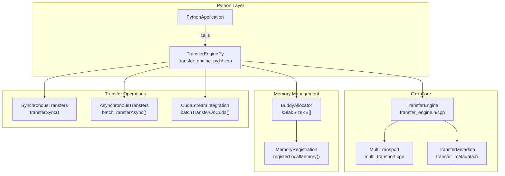
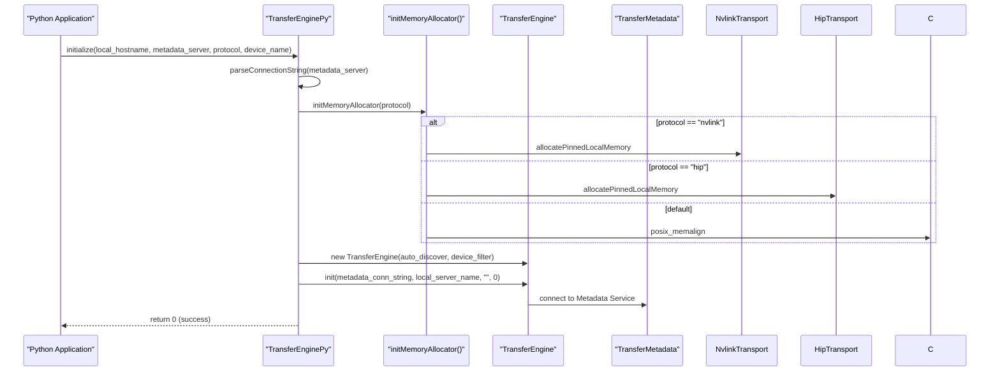
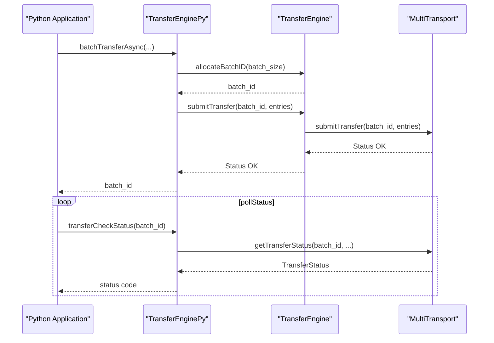

<!-- source: DeepWiki mcp.deepwiki.com · repo kvcache-ai/Mooncake · page 3.1 TransferEnginePy API · fetched 2026-11-11 -->

# TransferEnginePy API

<details>
<summary>Relevant source files</summary>

The following files were used as context for generating this wiki page:

- [docs/source/api-reference/cpp/transfer-engine.md](docs/source/api-reference/cpp/transfer-engine.md)
- [mooncake-integration/transfer_engine/transfer_engine_py.cpp](mooncake-integration/transfer_engine/transfer_engine_py.cpp)
- [mooncake-integration/transfer_engine/transfer_engine_py.h](mooncake-integration/transfer_engine/transfer_engine_py.h)
- [mooncake-transfer-engine/include/multi_transport.h](mooncake-transfer-engine/include/multi_transport.h)
- [mooncake-transfer-engine/include/transfer_engine.h](mooncake-transfer-engine/include/transfer_engine.h)
- [mooncake-transfer-engine/include/transfer_engine_c.h](mooncake-transfer-engine/include/transfer_engine_c.h)
- [mooncake-transfer-engine/include/transfer_engine_impl.h](mooncake-transfer-engine/include/transfer_engine_impl.h)
- [mooncake-transfer-engine/include/transport/transport.h](mooncake-transfer-engine/include/transport/transport.h)
- [mooncake-transfer-engine/src/multi_transport.cpp](mooncake-transfer-engine/src/multi_transport.cpp)
- [mooncake-transfer-engine/src/transfer_engine.cpp](mooncake-transfer-engine/src/transfer_engine.cpp)
- [mooncake-transfer-engine/src/transfer_engine_c.cpp](mooncake-transfer-engine/src/transfer_engine_c.cpp)
- [mooncake-transfer-engine/src/transfer_engine_impl.cpp](mooncake-transfer-engine/src/transfer_engine_impl.cpp)
- [mooncake-transfer-engine/tests/shm_transport_test.cpp](mooncake-transfer-engine/tests/shm_transport_test.cpp)
- [mooncake-transfer-engine/tests/transport_uint_test.cpp](mooncake-transfer-engine/tests/transport_uint_test.cpp)

</details>


The `TransferEnginePy` class provides a Python interface to Mooncake’s high-performance distributed memory transfer engine (`TransferEngine`). It enables users to perform direct memory transfers across nodes using a variety of hardware-accelerated transport protocols such as RDMA, NVLink, TCP, EFA, HIP, MUSA, and others. This API supports memory allocation, memory registration for zero-copy access, synchronous and asynchronous transfer operations, batch transfer APIs, CUDA stream integration, and topology inspection utilities.

This page documents the full technical details of the `TransferEnginePy` API as exposed via pybind11 bindings in `mooncake-integration/transfer_engine/transfer_engine_py.cpp` and `mooncake-integration/transfer_engine/transfer_engine_py.h`.

---

## Class Architecture & Core Components

The `TransferEnginePy` class acts as a Python-facing wrapper that delegates calls to Mooncake’s modern C++ Transfer Engine stack, notably the `TransferEngine` and `MultiTransport` classes. Memory management is facilitated by a slab-based buddy allocator with 16 predefined slab sizes ranging from 8 KB to 256 MB. Transfers are submitted as single or batch requests that are dispatched over the appropriate transport(s). Optional CUDA stream support enables integration with GPU workloads. Internal state and completion tracking are carefully managed to balance high throughput with asynchronous operation semantics.

### Component Overview Diagram



Sources:  
- `mooncake-integration/transfer_engine/transfer_engine_py.h:45-162`()  
- `mooncake-integration/transfer_engine/transfer_engine_py.cpp:1-230`()  
- `mooncake-transfer-engine/include/transfer_engine.h:80-160`()  
- `mooncake-transfer-engine/src/multi_transport.cpp:90-150`()  

---

## Initialization

### Methods: `initialize()` and `initializeExt()`

The engine is initialized with the local node’s hostname, metadata service connection string, target transport protocol, and device filter string. `initializeExt()` extends `initialize()` by allowing specification of the metadata backend type (e.g., `"etcd"`, `"p2p"`). Initialization involves parsing the connection metadata, establishing transport instances, setting up memory allocator function pointers, and binding RPC endpoints [mooncake-integration/transfer_engine/transfer_engine_py.cpp:61-197]().

```python
def initialize(
    local_hostname: str,
    metadata_server: str,
    protocol: str,
    device_name: str
) -> int

def initializeExt(
    local_hostname: str,
    metadata_server: str,
    protocol: str,
    device_name: str,
    metadata_type: str
) -> int
```

**Parameters**:
- `local_hostname`: Hostname and port of the local node (e.g., `"127.0.0.1:12345"`).
- `metadata_server`: Metadata service connection string (e.g., `"127.0.0.1:2379"`, `"etcd://..."`, or `"P2PHANDSHAKE"`).
- `protocol`: One of `"rdma"`, `"tcp"`, `"nvlink"`, `"efa"`, `"hip"`, `"musa"`, `"nvlink_intra"`.
- `device_name`: Comma-separated list of devices to filter or `""` for auto-discovery.
- `metadata_type` (only in `initializeExt`): Metadata backend type string like `"etcd"` or `"p2p"`.

**Returns**:  
- `0` on success, negative on failure.

---

### Initialization Data Flow



Sources:  
- `mooncake-integration/transfer_engine/transfer_engine_py.cpp:61-197`()  
- `mooncake-integration/transfer_engine/transfer_engine_py.cpp:204-235`()  

---

## Memory Management

### Buddy Allocator and Slab Sizes

The `TransferEnginePy` manages memory allocations using a slab-based buddy allocator:

- Supports 16 slab size classes defined by `kSlabSizeKB` [mooncake-integration/transfer_engine/transfer_engine_py.h:40-43]():  
  `[8KB, 16KB, 32KB, 64KB, 128KB, 256KB, 512KB, 1MB, 2MB, 4MB, 8MB, 16MB, 32MB, 64MB, 128MB, 256MB]`.
- Small allocations use these fixed-size slabs managed by free lists.
- Large allocations (above 256 MB) use protocol-specific allocator interfaces or `posix_memalign`.

| Slab Class ID | Slab Size | Typical Use                              |
|---------------|-----------|---------------------------------------|
| 0             | 8 KB      | Small metadata or control buffers      |
| 7             | 1 MB      | Medium KVCache blocks or moderate data |
| 15            | 256 MB    | Large activation memory or bulk data   |

---

### `allocateManagedBuffer(length: int) -> int` and `freeManagedBuffer`

Allocates a managed buffer of the requested size (in bytes) [mooncake-integration/transfer_engine/transfer_engine_py.cpp:265-290]():
- Uses the slab allocator to find a fitting slab.
- Returns the buffer pointer as an integer (`uintptr_t`) for Python usage.
- `freeManagedBuffer(user_tensor, length)` releases the buffer back to the slab allocator [mooncake-integration/transfer_engine/transfer_engine_py.cpp:292-307]().

### Memory Registration

`TransferEnginePy` exposes `register_memory()` and `unregister_memory()` to enable zero-copy memory registration for RDMA and other transports [mooncake-integration/transfer_engine/transfer_engine_py.cpp:760-768]():

```python
def register_memory(buffer_addr: int, capacity: int) -> int
def unregister_memory(buffer_addr: int) -> int
```

- Registration informs transport layers about memory regions that can be accessed remotely via `TransferEngine::registerLocalMemory` [mooncake-transfer-engine/include/transfer_engine.h:165-169]().

Sources:  
- `mooncake-integration/transfer_engine/transfer_engine_py.h:38-43`()  
- `mooncake-integration/transfer_engine/transfer_engine_py.cpp:265-307`()  
- `mooncake-integration/transfer_engine/transfer_engine_py.cpp:760-768`()  
- `mooncake-transfer-engine/include/transfer_engine.h:121-173`()  

---

## Transfer Operations

### Synchronous and Asynchronous Transfers

Provides blocking and non-blocking transfer APIs.

```python
def transferSyncWrite(target_hostname: str, buffer: int, peer_buffer_address: int,
                      length: int, transport_hint: str = "") -> int

def transferSubmitWrite(target_hostname: str, buffer: int, peer_buffer_address: int,
                        length: int, transport_hint: str = "") -> batch_id_t

def batchTransferAsync(target_hostname: str, buffers: List[int], peer_buffer_addresses: List[int],
                       lengths: List[int], opcode: TransferOpcode,
                       transport_hint: str = "") -> batch_id_t

def transferCheckStatus(batch_id: batch_id_t) -> int
```

- `transferSyncWrite` executes a blocking write transfer [mooncake-integration/transfer_engine/transfer_engine_py.cpp:70-84]().
- `batchTransferAsync` submits a batch of asynchronous transfers via `MultiTransport::submitTransfer` [mooncake-transfer-engine/include/multi_transport.h:62-63]().
- `transferCheckStatus` polls the status of a submitted batch ID.

### Scatter Transfer Operations with Tickets

```python
def scatterTransferSyncWriteWithTicket(
    endpoint: str,
    local_base_addresses: List[int],
    local_capacities: List[int],
    remote_base_addresses: List[int],
    remote_capacities: List[int],
    local_offsets: List[List[int]],
    remote_offsets: List[List[int]],
    lengths: List[List[int]]
) -> ScatterTransferTicket
```

- Enables range-based scatter/gather operations returning a `ScatterTransferTicket` object that can be drained using `.drain(timeout_ms)` [mooncake-integration/transfer_engine/transfer_engine_py.cpp:95-120]().

---

### Data Flow Diagram: Async Batch Transfer and Status Polling



Sources:  
- `mooncake-integration/transfer_engine/transfer_engine_py.cpp:121-154`()  
- `mooncake-integration/transfer_engine/transfer_engine_py.cpp:566-626`()  

---

## CUDA Stream Integration

When built with CUDA support (`USE_CUDA`), `TransferEnginePy` exposes methods to associate memory transfers with CUDA streams, enabling fine-grained GPU synchronization.

```python
def batchTransferOnCuda(target_hostname: str, buffers: List[int], peer_buffer_addresses: List[int],
                        lengths: List[int], opcode: TransferOpcode,
                        stream_ptr: int = 0, transport_hint: str = "") -> None
```

- `stream_ptr`: raw pointer (`uintptr_t`) to a `cudaStream_t`.
- Transfers become asynchronous with respect to CPU but ordered on the specified CUDA stream.

Sources:  
- `mooncake-integration/transfer_engine/transfer_engine_py.cpp:156-162`()  
- `mooncake-integration/transfer_engine/transfer_engine_py.cpp:772-910`()  

---

## Topology Dump Utility and Helper Methods

### Topology Dump & Helpers

- Exposed via internal topology discovery methods and utility scripts [mooncake-integration/transfer_engine/transfer_engine_py.cpp:1-1424]().
- `getRpcPort()`: Returns the RPC port number used by the local engine [mooncake-integration/transfer_engine/transfer_engine_py.cpp:68-69]().
- `writeBytesToBuffer()` and `readBytesFromBuffer()`: Facilitates raw byte payload read/write on buffer pointers [mooncake-integration/transfer_engine/transfer_engine_py.cpp:726-749]().

Sources:  
- `mooncake-integration/transfer_engine/transfer_engine_py.cpp:68-69`()  
- `mooncake-integration/transfer_engine/transfer_engine_py.cpp:726-749`()  

---

## Summary Table of Key Methods

| Method | Purpose | Notes |
|-------|---------|-------|
| `initialize()` | Initialize transfer engine with config | Parses protocol, device filter, metadata connection |
| `initializeExt()` | Extended init with metadata backend type | Supports etcd, p2p, etc. |
| `allocateManagedBuffer(length)` | Allocate memory buffer with slab allocator | Returns integer pointer |
| `freeManagedBuffer(user_tensor, length)` | Free previously allocated buffer | Slab or protocol-specific |
| `register_memory(buffer_addr, capacity)` | Register memory for zero-copy | Enables RDMA/transport access |
| `unregister_memory(buffer_addr)` | Unregister previously registered memory | |
| `transferSyncWrite(...)` | Synchronous WRITE transfer | Blocking call |
| `batchTransferAsync(...)` | Submit batch async transfers | Non-blocking |
| `transferCheckStatus(batch_id)` | Check batch completion status | Polling method |
| `scatterTransferSyncWriteWithTicket(...)` | Scatter-gather transfer with ticket | For complex sparse patterns |
| `batchTransferOnCuda(...)` | Async batch transfer on CUDA stream | Requires CUDA enabled |
| `getRpcPort()` | Retrieve RPC listening port | Useful for communication setup |

---

## References

- `mooncake-integration/transfer_engine/transfer_engine_py.cpp:1-235`()  
- `mooncake-integration/transfer_engine/transfer_engine_py.h:45-162`()  
- `mooncake-transfer-engine/include/transfer_engine.h:80-160`()  
- `mooncake-transfer-engine/src/multi_transport.cpp:90-150`()  
- `mooncake-transfer-engine/include/transfer_engine_impl.h:60-204`()

---

