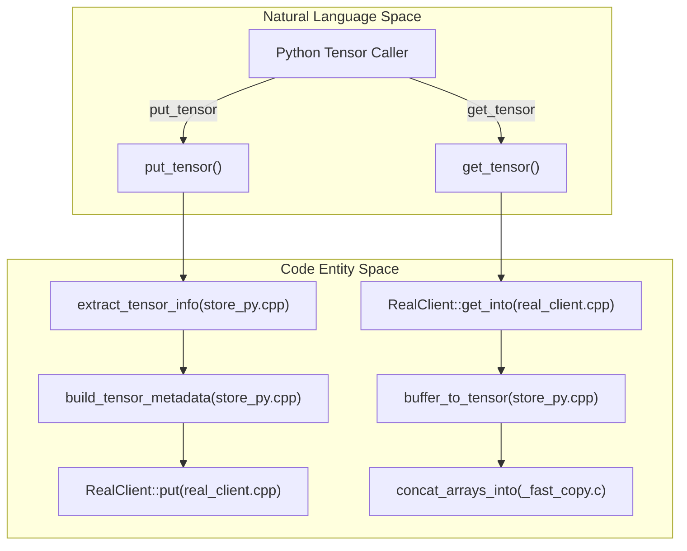
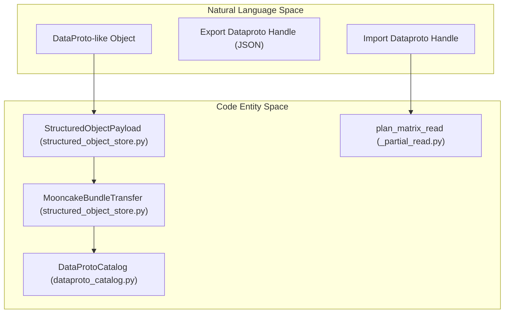
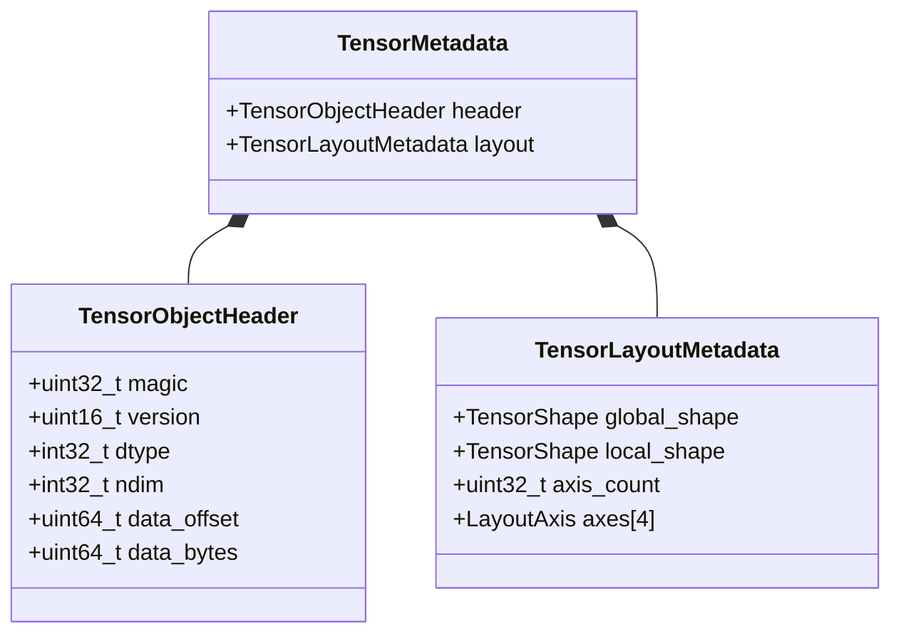

<!-- source: DeepWiki mcp.deepwiki.com · repo kvcache-ai/Mooncake · page 3.3 Tensor Operations · fetched 2026-11-11 -->

# Tensor Operations

<details>
<summary>Relevant source files</summary>

The following files were used as context for generating this wiki page:

- [docs/source/api-reference/python/dataproto-structured-object-transfer.md](docs/source/api-reference/python/dataproto-structured-object-transfer.md)
- [mooncake-wheel/mooncake/_fast_copy.c](mooncake-wheel/mooncake/_fast_copy.c)
- [mooncake-wheel/mooncake/_partial_read.py](mooncake-wheel/mooncake/_partial_read.py)
- [mooncake-wheel/mooncake/dataproto_catalog.py](mooncake-wheel/mooncake/dataproto_catalog.py)
- [mooncake-wheel/mooncake/structured_object_store.py](mooncake-wheel/mooncake/structured_object_store.py)
- [mooncake-wheel/tests/test_dataproto_catalog.py](mooncake-wheel/tests/test_dataproto_catalog.py)
- [mooncake-wheel/tests/test_fast_copy.py](mooncake-wheel/tests/test_fast_copy.py)
- [mooncake-wheel/tests/test_partial_read.py](mooncake-wheel/tests/test_partial_read.py)
- [mooncake-wheel/tests/test_put_get_tensor.py](mooncake-wheel/tests/test_put_get_tensor.py)
- [mooncake-wheel/tests/test_structured_object_store.py](mooncake-wheel/tests/test_structured_object_store.py)
- [scripts/ci/check_changed_python_format.py](scripts/ci/check_changed_python_format.py)

</details>


## Purpose and Scope
This page documents tensor-specific operations available in Mooncake. It covers the implementation details of the tensor put/get APIs, the support for tensor parallelism and parallel I/O layouts, safetensor integration, structured object store usage for DataProto-like objects, and the `TensorMetadata` serialization format utilized internally.

We include explanations of the data flow, key classes and functions, and integration diagrams bridging natural language concepts (like "put tensor") to code entities (`RealClient::put` etc.). This page targets advanced users and developers working with Mooncake's tensor handling and storage APIs, including both low-level C++ integration layers and the Python API surface.

Sources: [mooncake-wheel/mooncake/structured_object_store.py:1-237](), [mooncake-wheel/tests/test_put_get_tensor.py:81-135]()

---

## Wire Format for Tensor Storage

Tensors in Mooncake are stored as a contiguous byte sequence comprising:

- A fixed-size **TensorMetadata** header (around 304 bytes), which includes both `TensorObjectHeader` and `TensorLayoutMetadata`.
- Raw tensor data bytes directly following the header.

```
[ TensorMetadata header ] [ raw tensor bytes ]
```

### TensorMetadata Components

| Field / Component | Description | Location Reference |
|---|---|---|
| `magic` | Fixed magic number `0x4D4F4F4E` ("MOON") to identify tensor blobs | integration_utils.h:171-180 |
| `dtype` | Enumeration of tensor data type (`FLOAT32`, `INT64`, etc.) | integration_utils.h:25-43 |
| `ndim` | Number of active dimensions (up to 8) | integration_utils.h:204-222 |
| `data_offset` | Offset in bytes to raw tensor data after the header | integration_utils.h:219 |
| `global_shape` | Full tensor dimensions (for parallel tensors) | integration_utils.h:204 |
| `local_shape` | Local shard dimensions stored | integration_utils.h:205 |
| `axis_count`, `axes` | Layout axes used for parallelism (parallel axis info) | integration_utils.h:181-209 |

The complete `TensorMetadata` structure includes:
- `TensorObjectHeader` defining core tensor properties
- `TensorLayoutMetadata` describing parallel layout and sharding

This metadata enables Mooncake to reconstruct tensor shape, dtype, and distributed layout on get operations.

Sources: [mooncake-wheel/tests/test_put_get_tensor.py:81-135]()

---

## Supported Data Types

Mooncake supports an enumerated set of tensor data types aligned with PyTorch `torch.dtype`. This includes floating point, integer, boolean, and relatively new low-bit formats (such as FP8).

| `torch.dtype` | Mooncake `TensorDtype` Enum |
|---|---|
| `torch.float32` | `FLOAT32` |
| `torch.float64` | `FLOAT64` |
| `torch.float16` | `FLOAT16` |
| `torch.bfloat16` | `BFLOAT16` |
| `torch.float8_e4m3fn` | `FLOAT8_E4M3` |
| `torch.float8_e5m2` | `FLOAT8_E5M2` |
| `torch.int32` | `INT32` |
| `torch.int64` | `INT64` |
| `torch.bool` | `BOOL` |

The mapping from PyTorch dtypes to internal Mooncake enums is validated when calling tensor APIs.

Sources: [mooncake-wheel/tests/test_put_get_tensor.py:81-135]()

---

## Shape and Metadata Constraints

- Maximum supported number of dimensions (`ndim`) is 8.
- The `TensorMetadata` header occupies approximately 304 bytes.
- Contiguity checks verify that the tensor is contiguous (required for native operations) and that shape dimensions are non-negative.

These limits influence how tensors can be stored and retrieved efficiently.

Sources: [mooncake-wheel/tests/test_put_get_tensor.py:81-135]()

---

## Core Tensor API Methods and Data Flow

Mooncake exposes tensor put/get operations optimized for native (PyTorch) tensors and supports zero-copy where possible. These are primarily implemented in C++, with Python bindings via `MooncakeStorePyWrapper`.

### `put_tensor` Flow

- **Purpose**: Serialize a `torch.Tensor` object with a `TensorMetadata` prepended header and raw tensor bytes, then store via the backend.
- **Process**:
  - Extract tensor info, including contiguity check and buffer pointer.
  - Build full `TensorMetadata`, populate dtype, shape, layout.
  - Pass together with raw tensor bytes to `RealClient::put`.
- **Result**: stored tensor key in Mooncake store, ready for distributed access.

### `get_tensor` Flow

- **Purpose**: Retrieve stored tensor bytes, parse metadata, and reconstruct PyTorch tensor.
- **Process**:
  - Call `RealClient::get_into` to fetch raw bytes into a buffer.
  - Parse buffer for `TensorMetadata`.
  - Depending on `dtype`, create intermediate numpy array view, then cast to torch tensor.
  - Handle special dtype cases (e.g. BF16, FP8) with `.view()` hacks.
- **Result**: PyTorch-readable tensor matching stored value.

### Data Flow Diagram: Tensor Put/Get Integration



Sources: [mooncake-wheel/tests/test_put_get_tensor.py:81-135](), [mooncake-wheel/mooncake/_fast_copy.c:34-182]()

---

## Unified Parallel Tensor I/O and Tensor Parallelism Support

Mooncake supports complex tensor layouts for distributed training serving, including tensor parallelism (TP), data parallelism (DP), expert parallelism (EP), and pipeline parallelism (PP).

- **Tensor Parallelism Metadata**: The `TensorLayoutMetadata` embedded in the tensor header encodes axis partitioning and shard placement, enabling clients to reconstruct global and local tensor shapes.

- **Unified Write and Read APIs**:
  - `put_tensor_with_parallelism`: takes a `TensorParallelism` structure describing axes and shards, stores accordingly with metadata.
  - Reading modes via `ReadTarget` specify if the client desires raw shard (`shard`), full gather (`full`), or on-demand `as_stored`.

- **Legacy TP Support**: Some APIs use explicit sharding by chunking and suffixing keys with shard rank (e.g. `{key}_tp_{rank}`).

This layered model standardizes tensor access across different training parallelization schemas.

Sources: [mooncake-wheel/tests/test_put_get_tensor.py:81-135]()

---

## Safetensor Integration and Structured Object Store

Mooncake uses a structured object store abstraction for complex objects, including DataProto-like batched tensors:

- **StructuredObjectPayload**: A dataclass encapsulating dictionary metadata and named tensor buffers, enabling fine-grained field access without loading the full object [mooncake-wheel/mooncake/structured_object_store.py:93-107]().

- **MooncakeBundleTransfer**: Handles the storage and retrieval of batched structured objects, leveraging parallelism and zero-copy optimizations [docs/source/api-reference/python/dataproto-structured-object-transfer.md:15-48]().

- **Export/Import Handles**: `export_dataproto_ref` and `import_dataproto_ref` provide a JSON-safe handle for passing lightweight references between components without copying tensors [docs/source/api-reference/python/dataproto-structured-object-transfer.md:45-61]().

- **Fast Copy C Extension**: The `_fast_copy.c` module offers `concat_arrays_into`, a GIL-released scatter-gather copy of multiple numpy arrays into pre-allocated buffers, used to speed up typed-ragged ndarray writes to BufferPool memory [mooncake-wheel/mooncake/_fast_copy.c:34-182]().

- **Partial Read Planning**: `_partial_read.py` implements `plan_matrix_read`, which generates minimal ranged read requests to efficiently fetch slices of large 2D matrices (e.g. batched features) [mooncake-wheel/mooncake/_partial_read.py:15-90]().

### Structured and DataProto Tensor Flow Diagram



Sources: [mooncake-wheel/mooncake/structured_object_store.py:84-180](), [mooncake-wheel/mooncake/_fast_copy.c:34-182](), [mooncake-wheel/mooncake/_partial_read.py:15-90](), [docs/source/api-reference/python/dataproto-structured-object-transfer.md:1-48]()

---

## `TensorMetadata` Serialization Format

The internal `TensorMetadata` structure serializes tensor metadata in two parts:



- `TensorObjectHeader` contains the canonical header fields including magic, dtype, dimension count, and data byte offsets.
- `TensorLayoutMetadata` encodes sharding and axis partitioning information when parallel tensor layouts are in use.

This fixed-layout header precedes the tensor data in Mooncake's storage system.

Sources: [mooncake-wheel/tests/test_put_get_tensor.py:81-135]()

---

## Key Implementation Details

- `extract_tensor_info` validates the tensor object, checks contiguity, maps PyTorch dtype to Mooncake dtype, and constructs the metadata header.
- `buffer_to_tensor` translates raw byte buffers back into torch tensors, handling dtype-specific wrapping for special formats.
- `put_tensor` relies on metadata extraction and sends data via `RealClient::put`.
- `get_tensor` calls `RealClient::get_into` and converts data with `buffer_to_tensor`.

Zero-copy optimizations are used when possible, including direct device memory registrations and staged copies.

Sources: [mooncake-wheel/tests/test_put_get_tensor.py:81-135]()

---

## Constraints and Notes

- Tensors must be contiguous for zero-copy and native put operations.
- The `RealClient` backend supports tensor operations with optimized transfer.
- The IPC `DummyClient` backend falls back to helper IPC transfers for tensors.
- Each tensor storage includes a metadata header that adds overhead particularly noticeable for very small tensors.
- Parallel tensor layouts unify TP/DP/EP/PP semantics via `TensorLayoutMetadata`.

Sources: [mooncake-wheel/tests/test_put_get_tensor.py:81-135]()

---

# Summary

Mooncake's tensor operations are a foundational pillar enabling efficient KVCache and model weight storage for distributed LLM serving. Through a careful design of `TensorMetadata`, unified parallel I/O APIs, zero-copy optimizations, and structured DataProto object integration, Mooncake balances flexibility and performance for state-of-the-art tensor workloads.

This page covered the low-level format, core functions, tensor parallelism support, safetensor/structured object abstraction, and critical data flow integrations between Python APIs and native backends.

Sources: [mooncake-wheel/mooncake/structured_object_store.py:1-237](), [mooncake-wheel/tests/test_put_get_tensor.py:81-135]()

---

