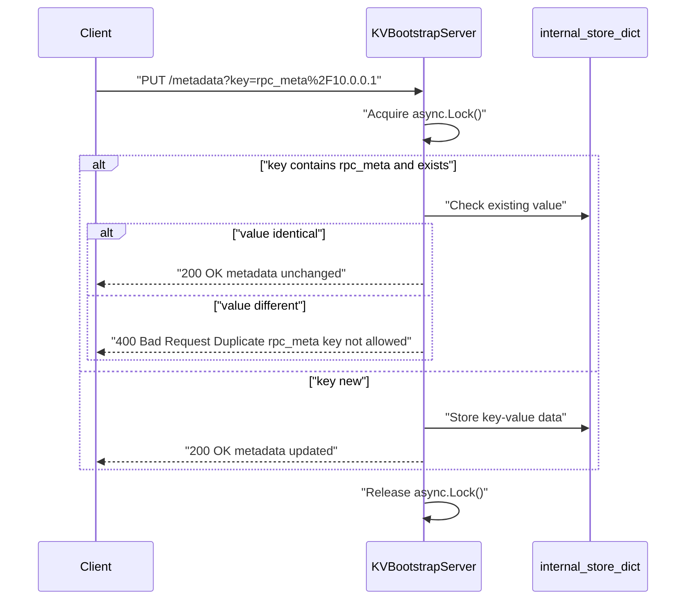
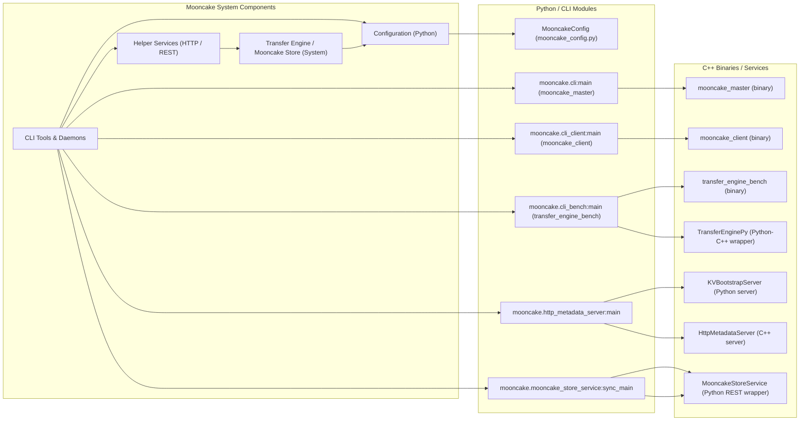

<!-- source: DeepWiki mcp.deepwiki.com · repo kvcache-ai/Mooncake · page 3.6 Configuration and CLI Tools · fetched 2026-11-11 -->

# Configuration and CLI Tools

Relevant source files

The following files were used as context for generating this wiki page:

- [mooncake-store/include/http_metadata_server.h](mooncake-store/include/http_metadata_server.h)
- [mooncake-store/src/http_metadata_server.cpp](mooncake-store/src/http_metadata_server.cpp)
- [mooncake-store/tests/http_metadata_server_test.cpp](mooncake-store/tests/http_metadata_server_test.cpp)
- [mooncake-transfer-engine/example/http-metadata-server-python/bootstrap_server.py](mooncake-transfer-engine/example/http-metadata-server-python/bootstrap_server.py)
- [mooncake-wheel/mooncake/mooncake_store_service.py](mooncake-wheel/mooncake/mooncake_store_service.py)
- [mooncake-wheel/tests/test_mooncake_store_service_api.py](mooncake-wheel/tests/test_mooncake_store_service_api.py)

Mooncake provides a comprehensive set of configuration interfaces and command-line utilities to manage the lifecycle of the KVCache-centric disaggregated architecture. These tools bridge the gap between high-level Python orchestration and low-level, performance-critical C++ engines.

## Overview

Mooncake's configuration architecture is layered across environment variables, Python dataclasses, and specialized CLI entry points to support diverse deployment needs. The system supports multiple hardware backends and protocols, dynamically controlled by runtime parameters and build flags. Central to configuration is the `MooncakeConfig` dataclass, which unifies parameters consumed by both the `MooncakeStore` (distributed storage backend) and the `TransferEngine` (high-performance data mover).

Sources: `[mooncake-wheel/mooncake/mooncake_config.py:1-62]()`, `[mooncake-wheel/mooncake/mooncake_store_service.py:1-14]()`

## Configuration Interfaces

### MooncakeConfig Class

The `MooncakeConfig` dataclass, defined in `mooncake-wheel/mooncake/mooncake_config.py`, encapsulates all core configuration parameters for Mooncake. It provides:

- **Robust size parsing** for memory-related parameters with human-friendly suffixes like "GB", "MB".
- **Strict boolean parsing** which accepts a controlled set of textual boolean forms, preventing misconfiguration.
- **Support for JSON config files** via the class method `from_file`.
- **Environment variable loading** via `load_from_env`, which reads `MOONCAKE_*` prefix environment variables.

| Feature | Implementation Detail | Source Location |
|---------|----------------------|-----------------|
| Size parsing | `_parse_segment_size` parses strings (e.g., "2GB") into integer bytes | `[mooncake-wheel/mooncake/mooncake_config.py:127-143]()` |
| Boolean parsing | `_parse_bool` accepts "on/off", "yes/no", "true/false", "1/0", "enable/disable" and throws on invalid input | `[mooncake-wheel/mooncake/mooncake_config.py:146-168]()` |
| JSON config loading | `from_file` reads JSON files into config fields | `[mooncake-wheel/mooncake/mooncake_config.py:10-62]()` |
| Environment variable loading | `load_from_env` reads environment variables and converts them to config fields | `[mooncake-wheel/mooncake/mooncake_config.py:10-62]()` |

**Important Configuration Parameters:**

- `local_hostname` (string): Hostname for the local service.
- `metadata_server` (string): The address of the metadata server.
- `master_server_address` (string): The address of the master server.
- `protocol` (string): Communication protocol (tcp or rdma).
- `global_segment_size` (int): Size of each global segment in bytes. 0 means do not set up store.
- `local_buffer_size` (int): Size of the local buffer in bytes.
- `tenant_id` (string): Identifier for multi-tenant isolation (default: "default").

Sources: `[mooncake-wheel/mooncake/mooncake_config.py:72-124]()`, `[mooncake-wheel/tests/test_mooncake_store_service_api.py:147]()`

### Protocol Normalization

Mooncake supports many hardware and transport protocols. Internally, protocols are normalized to lowercase strings since the backend C++ components perform case-sensitive comparisons.

The following protocol sets are supported:

- **Standard**: `tcp`, `rdma`
- **Accelerated/Hardware-Optimized**: `efa`, `nvmeof`, `nvlink`, `nvlink_intra`, `hip`, `barex`, `cxl`, `ascend`
- **Specialized**: `ub`, `ubshmem`, `maca`, `sunrise_link`
- **Store-Only Mode**: `rpc_only` disables the transfer engine for purely RPC-based operations.

Normalization occurs during config parsing to ensure consistency for downstream C++ calls.

Sources: `[mooncake-wheel/mooncake/mooncake_config.py:41-44]()`, `[mooncake-wheel/mooncake/mooncake_config.py:96-117]()`

## CLI Tools and Entry Points

Mooncake maps command-line utilities and service daemons through Python entry points declared in `pyproject.toml`. These entry points invoke Python modules that wrap or launch underlying C++ binaries and services.

### CLI Command to Code Entity Mapping

This diagram depicts the relationships from CLI commands to Python modules, and further to the corresponding C++ binaries or classes.

```mermaid
graph TD
    subgraph "CLI Entry Points (pyproject.toml)"
        mooncake_master_cli["mooncake_master"]
        mooncake_client_cli["mooncake_client"]
        transfer_engine_bench_cli["transfer_engine_bench"]
        mooncake_http_metadata_server_cli["mooncake_http_metadata_server"]
        mc_store_rest_server_cli["mc_store_rest_server"]
        transfer_engine_topology_dump_cli["transfer_engine_topology_dump"]
    end

    subgraph "Python Modules"
        cli_py["mooncake.cli:main"]
        cli_client_py["mooncake.cli_client:main"]
        cli_bench_py["mooncake.cli_bench:main"]
        http_metadata_server_py["mooncake.http_metadata_server:main"]
        mooncake_store_service_py["mooncake.mooncake_store_service:sync_main"]
        transfer_engine_topology_dump_py["mooncake.transfer_engine_topology_dump:main"]
    end

    subgraph "C++ Backends / Python Wrappers"
        mooncake_master_bin["mooncake_master (binary)"]
        mooncake_client_bin["mooncake_client (binary)"]
        transfer_engine_bench_bin["transfer_engine_bench (binary)"]
        kv_bootstrap_server_class["mooncake.http_metadata_server.KVBootstrapServer"]
        mooncake_store_service_class["mooncake.mooncake_store_service.MooncakeStoreService"]
        transfer_engine_py_wrapper["mooncake.engine.TransferEnginePy"]
    end

    mooncake_master_cli --> cli_py
    mooncake_client_cli --> cli_client_py
    transfer_engine_bench_cli --> cli_bench_py
    mooncake_http_metadata_server_cli --> http_metadata_server_py
    mc_store_rest_server_cli --> mooncake_store_service_py
    transfer_engine_topology_dump_cli --> transfer_engine_topology_dump_py

    cli_py --> mooncake_master_bin
    cli_client_py --> mooncake_client_bin
    cli_bench_py --> transfer_engine_bench_bin
    http_metadata_server_py --> kv_bootstrap_server_class
    mooncake_store_service_py --> mooncake_store_service_class
    transfer_engine_topology_dump_py --> transfer_engine_py_wrapper
```

Sources: `[mooncake-wheel/pyproject.toml:50-56]()`, `[scripts/build_wheel.sh:60-65]()`, `[scripts/build_wheel.sh:134-136]()`, `[python/tests/packaging/test_installed_wheel.py:90-103]()`

- The `mooncake_master` and `mooncake_client` binaries are wrapped by Python CLI interfaces for convenience.
- The `transfer_engine_bench` provides benchmarking tools for the transfer engine.
- The `mooncake_http_metadata_server` CLI launches a Python HTTP metadata service implementation.
- The `mc_store_rest_server` wraps a REST API for the store service.
- The `transfer_engine_topology_dump` dumps transfer engine topology information.

The `scripts/build_wheel.sh` script ensures these executables and shared libraries are packaged into the Python wheel during build, copying the binaries into the wheel folder `[scripts/build_wheel.sh:60-65]()`, `[scripts/build_wheel.sh:134-136]()`.

## HTTP Metadata Server

The metadata server serves as a lightweight alternative to ETCD for cluster bootstrapping and metadata propagation, using HTTP as the transport.

### C++ Implementation

- The server is implemented in `mooncake-store/src/http_metadata_server.cpp`.
- It uses `coro_http_server` for async HTTP handling `[mooncake-store/src/http_metadata_server.cpp:15]()`.
- Supports `/metadata` route with `GET`, `PUT` and `DELETE` methods, and a health check `/health` `[mooncake-store/src/http_metadata_server.cpp:26-107]()`.
- Enforces idempotency and consistency on special `rpc_meta` keys: rejects conflicting duplicate values `[mooncake-store/src/http_metadata_server.cpp:61-73]()`.
- Validates async server startup including port bind failure detection `[mooncake-store/src/http_metadata_server.cpp:119-124]()`.

Sources: `[mooncake-store/src/http_metadata_server.cpp:12-108]()`, `[mooncake-store/src/http_metadata_server.cpp:48-79]()`, `[mooncake-store/include/http_metadata_server.h:22-62]`, `[mooncake-store/tests/http_metadata_server_test.cpp:49-97]()`

### Python Implementation

- The `KVBootstrapServer` class in `mooncake-transfer-engine/example/http-metadata-server-python/bootstrap_server.py` provides a concurrent REST interface for metadata operations using `aiohttp` `[mooncake-transfer-engine/example/http-metadata-server-python/bootstrap_server.py:13-19]()`.
- Supports `GET`, `PUT`, `DELETE` on `/metadata` keys `[mooncake-transfer-engine/example/http-metadata-server-python/bootstrap_server.py:31-36]()`.
- Synchronizes access to an internal dict storing key-value metadata using `asyncio.Lock` `[mooncake-transfer-engine/example/http-metadata-server-python/bootstrap_server.py:18]()`, `[mooncake-transfer-engine/example/http-metadata-server-python/bootstrap_server.py:41]()`, `[mooncake-transfer-engine/example/http-metadata-server-python/bootstrap_server.py:51]()`, `[mooncake-transfer-engine/example/http-metadata-server-python/bootstrap_server.py:60]()`.
- Provides `/health` for readiness probes.
- Rejects changed `rpc_meta` republish attempts `[mooncake-transfer-engine/example/http-metadata-server-python/bootstrap_server.py:52-54]()`.

The Python server's `main` function serves as the entry point for the `mooncake_http_metadata_server` CLI.

#### Metadata Server Request Flow

Sources: `[mooncake-transfer-engine/example/http-metadata-server-python/bootstrap_server.py:30-66]()`

## Mooncake Store REST Server

The `MooncakeStoreService` class in `mooncake-wheel/mooncake/mooncake_store_service.py` serves as a high-level REST API wrapper on top of the `MooncakeDistributedStore` (the distributed object storage system).

### Key Features

- **Configuration**: Uses `MooncakeConfig` for initialization, supporting overrides from JSON file or CLI-provided dict `[mooncake-wheel/mooncake/mooncake_store_service.py:93-121]()`.
- **Service Lifecycle**: The `start_store_service()` method attempts to initiate the store with retries until a maximum wait time or a shutdown signal is received `[mooncake-wheel/mooncake/mooncake_store_service.py:129-185]()`.
- **Shared Memory Path Handling**: Validates and normalizes shared memory names for segment mounting under `/dev/shm` `[mooncake-wheel/mooncake/mooncake_store_service.py:33-40]()`.
- **Operational Modes**: Supports switching between `prefill` and `decode` modes via REST `/api/reconfigure`, maintaining state with an asyncio lock for safe concurrency `[mooncake-wheel/mooncake/mooncake_store_service.py:98-104]()`.
- **Graceful Shutdown**: Installs signal handlers for SIGINT and SIGTERM to enable asynchronous shutdown sequence `[mooncake-wheel/mooncake/mooncake_store_service.py:51-66]()`.

### Signal Handling

The `_install_shutdown_signal_handlers` function sets up signal listeners that integrate with the asyncio event loop to initiate a shutdown event safely.

| Function | Description | Source Lines |
|-|-|-|
| `_install_shutdown_signal_handlers` | Registers SIGINT and SIGTERM for async shutdown | `[mooncake-wheel/mooncake/mooncake_store_service.py:51-66]()` |
| `_shm_name_to_path` | Sanitizes shared memory names for `/dev/shm` use | `[mooncake-wheel/mooncake/mooncake_store_service.py:33-40]()` |

### CLI Entry Point

The `sync_main()` function exposed in `mooncake_store_service.py` is tied to the `mc_store_rest_server` CLI command, enabling deployment of the REST server.

Sources: `[mooncake-wheel/mooncake/mooncake_store_service.py:33-185]()`, `[mooncake-wheel/tests/test_mooncake_store_service_api.py:124-180]()`, `[mooncake-wheel/pyproject.toml:55]()`

---

# Summary Mermaid Diagram: Natural Language Space to Code Entity Mapping

Sources:
- Config: `[mooncake-wheel/mooncake/mooncake_config.py:1-62]()`, `[mooncake-wheel/tests/test_mooncake_store_service_api.py:147]()`
- CLI & Helper services: `[mooncake-wheel/pyproject.toml:50-56]()`, `[mooncake-wheel/mooncake/mooncake_store_service.py:1-185]()`, `[mooncake-store/src/http_metadata_server.cpp:12-108]()`, `[mooncake-transfer-engine/example/http-metadata-server-python/bootstrap_server.py:30-103]()`
- Binaries and wrappers: `[scripts/build_wheel.sh:60-65]()`, `[scripts/build_wheel.sh:134-136]()`

---

# Table: CLI Tools and Helper Utilities with Descriptions

| CLI Command | Python Entry Point | Backend Binary/Service | Description |
|---|---|---|---|
| `mooncake_master` | `mooncake.cli:main` | `mooncake_master` binary | Master daemon for Mooncake Store management. |
| `mooncake_client` | `mooncake.cli_client:main` | `mooncake_client` binary | Client utility to interact with Mooncake Store. |
| `transfer_engine_bench` | `mooncake.cli_bench:main` | `transfer_engine_bench` binary | Benchmark tool for Transfer Engine performance. |
| `mooncake_http_metadata_server` | `mooncake.http_metadata_server:main` | Python `KVBootstrapServer` or C++ `HttpMetadataServer` | Lightweight metadata service alternative to ETCD. |
| `mc_store_rest_server` | `mooncake.mooncake_store_service:sync_main` | Python `MooncakeStoreService` | REST API for Mooncake Store for management and monitoring. |
| `transfer_engine_topology_dump` | `mooncake.transfer_engine_topology_dump:main` | No dedicated binary (Python wrapper) | Dumps transfer engine hardware topology. |

Sources: `[mooncake-wheel/pyproject.toml:50-56]()`, `[scripts/build_wheel.sh:60-65]()`, `[mooncake-wheel/mooncake/mooncake_store_service.py:1-185]()`, `[mooncake-store/src/http_metadata_server.cpp:12-108]`, `[mooncake-transfer-engine/example/http-metadata-server-python/bootstrap_server.py:30-103]()`

---

# Summary

This page covers how Mooncake configures its core components using `MooncakeConfig`, exposes operations through CLI tools linked to Python wrappers and native C++ binaries, and integrates lightweight helper services like the HTTP metadata server, all tightly packed into a standard Python wheel package. These components form a flexible and pluggable platform for managing large-scale KVCache disaggregation infrastructure.

Sources:
- `[mooncake-wheel/mooncake/mooncake_config.py:1-168]()`
- `[mooncake-wheel/pyproject.toml:50-56]()`
- `[scripts/build_wheel.sh:60-65]()`
- `[scripts/build_wheel.sh:134-136]()`
- `[mooncake-wheel/mooncake/mooncake_store_service.py:1-185]()`
- `[mooncake-store/src/http_metadata_server.cpp:12-108]()`
- `[mooncake-transfer-engine/example/http-metadata-server-python/bootstrap_server.py:30-103]()`
- `[mooncake-wheel/tests/test_mooncake_store_service_api.py:124-180]()`
- `[python/tests/packaging/test_installed_wheel.py:90-103]()`

---

