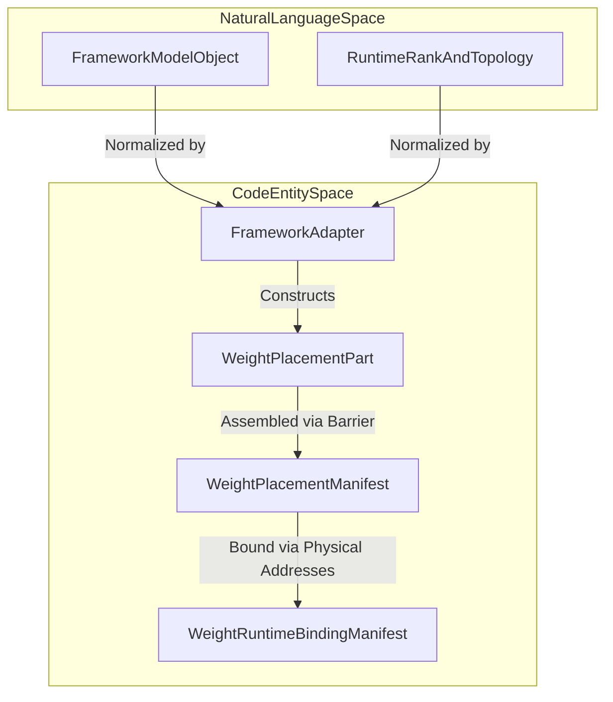
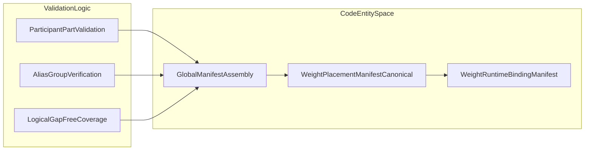
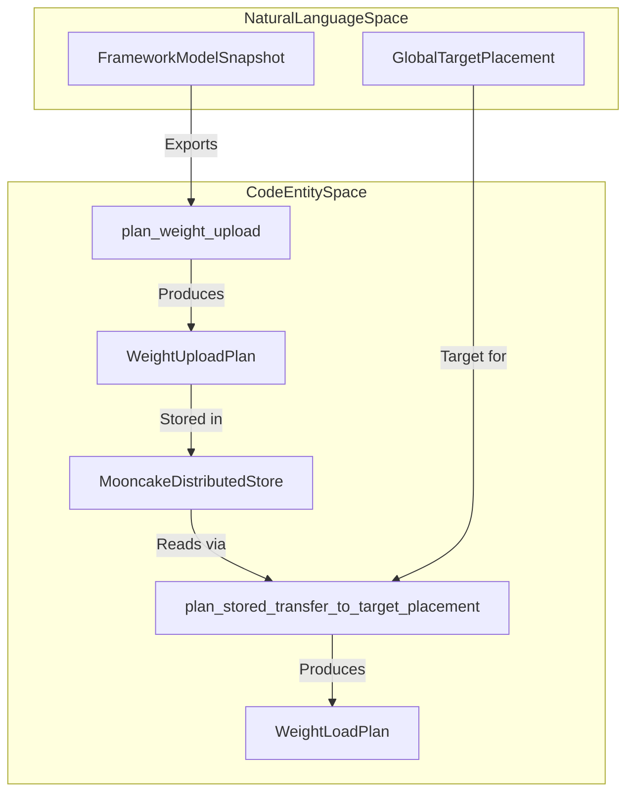

<!-- source: DeepWiki mcp.deepwiki.com · repo kvcache-ai/Mooncake · page 3.7 Reshard and Weight Manifest API · fetched 2026-11-11 -->

# Reshard and Weight Manifest API

Relevant source files

The following files were used as context for generating this wiki page:

- [docs/source/api-reference/python/dataproto-structured-object-transfer.md](docs/source/api-reference/python/dataproto-structured-object-transfer.md)
- [mooncake-wheel/mooncake/_fast_copy.c](mooncake-wheel/mooncake/_fast_copy.c)
- [mooncake-wheel/mooncake/_partial_read.py](mooncake-wheel/mooncake/_partial_read.py)
- [mooncake-wheel/mooncake/dataproto_catalog.py](mooncake-wheel/mooncake/dataproto_catalog.py)
- [mooncake-wheel/mooncake/structured_object_store.py](mooncake-wheel/mooncake/structured_object_store.py)
- [mooncake-wheel/tests/test_dataproto_catalog.py](mooncake-wheel/tests/test_dataproto_catalog.py)
- [mooncake-wheel/tests/test_fast_copy.py](mooncake-wheel/tests/test_fast_copy.py)
- [mooncake-wheel/tests/test_partial_read.py](mooncake-wheel/tests/test_partial_read.py)
- [mooncake-wheel/tests/test_put_get_tensor.py](mooncake-wheel/tests/test_put_get_tensor.py)
- [mooncake-wheel/tests/test_structured_object_store.py](mooncake-wheel/tests/test_structured_object_store.py)
- [scripts/ci/check_changed_python_format.py](scripts/ci/check_changed_python_format.py)

The `mooncake-reshard` module and its associated components in `mooncake.reshard.contracts` and `mooncake.reshard.weight` provide a framework-neutral resource contract for model weight placement, runtime binding, and store upload planning. This architecture cleanly separates complete logical placement from live physical addresses, enabling planning and resharding workflows to complete before runtime binding information is available or required [docs/source/design/mooncake-reshard/reshard-manifest.md:3-10](), [docs/source/design/mooncake-reshard/model-weight-store-upload-planning.md:1-7]().

---

## Contract Architecture and Lifetime Split

Mooncake defines structural `Protocol` types as manifest contracts used by the reshard subsystem. These protocol contracts act as serialization schemas and agreement boundaries, rather than relying on class inheritance or runtime polymorphism. Framework-owned adapters inspect framework runtime objects, normalize framework-specific parameters, and produce typed canonical manifests. Mooncake core accepts only these typed canonical values, explicitly excluding importing framework runtime structures or duck-typed records [docs/source/design/mooncake-reshard/reshard-manifest.md:12-16]().

| Contract | Contents | Lifetime |
| :--- | :--- | :--- |
| `ResourceManifest` | Structural protocol for resource identity and kind | Shared public contract [docs/source/design/mooncake-reshard/reshard-manifest.md:22]() |
| `PlacementManifest` | Structural protocol for address-free placement identity and digest | Serializable and reusable [docs/source/design/mooncake-reshard/reshard-manifest.md:23]() |
| `RuntimeBindingManifest` | Structural protocol for placement attestation, runtime instance, generation, and lease | One live runtime snapshot [docs/source/design/mooncake-reshard/reshard-manifest.md:24]() |

Weight revision, tensor geometry, model semantics, parallel ownership, and weight generation belong to the weight specialization layer. GPU addresses, network endpoints, owners, generations, and leases never appear inside `WeightPlacementManifest` [docs/source/design/mooncake-reshard/reshard-manifest.md:37-40]().

### Adapter to Canonical Manifest Data Flow

Sources: [docs/source/design/mooncake-reshard/reshard-manifest.md:12-31]()

---

## Parallel Topology and Axis Contracts

The `ParallelTopology` defines the runtime's parallelism axes and sizes for tensor parallelism (TP), pipeline parallelism (PP), expert parallelism (EP), and data parallelism (DP), along with an explicit participant-to-rank mapping. The `world_size` is the count of declared participants and may differ from the mathematical product `tp_size * pp_size * ep_size * dp_size` because frameworks may map multiple axes onto overlapping physical workers [docs/source/design/mooncake-reshard/reshard-manifest.md:25,48-52]().

### Supported Axis Types

- **`SplitAxis(kind, dim)`**: Shards exactly one logical dimension of a tensor along the given parallelism kind (e.g., sharding hidden dimensions in TP). This axis defines split partitions of the tensor shape [docs/source/design/mooncake-reshard/reshard-manifest.md:26]().

- **`ReplicatedAxis(kind)`**: Requires that each selected rank has a complete replica of the tensor (e.g., DP or replicated PP). Holds identical full tensor copies at each rank [docs/source/design/mooncake-reshard/reshard-manifest.md:27]().

- **`OwnershipAxis(kind)`**: Assigns tensor or object ownership explicitly without splitting any tensor dimension (common for PP and independent expert ownership). Ownership axes map ranks to ownership declarations rather than geometry [docs/source/design/mooncake-reshard/reshard-manifest.md:28]().

Sources: [docs/source/design/mooncake-reshard/reshard-manifest.md:25-28](), [docs/source/design/mooncake-reshard/reshard-manifest.md:48-52]()

---

## Weight Placement and Runtime Binding Manifests

### Weight Placement Parts and Full Placement Manifests

Framework adapters construct one `WeightPlacementPart` for each participant in the global deployment topology. Each part carries the resource ID, revision, weight generation, placement-set ID, topology ID, the participant ID, parallel rank, tensor descriptors, and logical fragments [docs/source/design/mooncake-reshard/reshard-manifest.md:53-57](). Importantly, `WeightPlacementPart` contains no physical memory addresses; it describes only the logical fragments and identities assigned to each participant.

A global assembly barrier collects these `WeightPlacementPart` objects and composes a complete `WeightPlacementManifest`. This manifest fully describes the logical coverage of model weight data across all parallel axes and participants. Assembly validation rejects missing participants, duplicates, or inconsistencies with the declared resource, generation, or topology [docs/source/design/mooncake-reshard/reshard-manifest.md:60-66]().

### Weight Runtime Binding Manifests

At runtime, each active participant owner produces a typed `WeightRuntimeBindingManifest` that references the global `placement_id`, attests to the participant's identity, and carries physical fragment locations, generation numbers, and lease attestations. Each participant owning fragments must produce exactly one binding manifest [docs/source/design/mooncake-reshard/reshard-manifest.md:67-74]().

Together, the placement manifest and binding manifests provide a complete logical and physical mapping for weight management, transfer, and runtime activation.

Sources: [docs/source/design/mooncake-reshard/reshard-manifest.md:53-74]()

---

## Global Placement Assembly and Logical Coverage

Each tensor in the manifest has a stable `tensor_id` and full metadata including `global_shape`, data type, item size, layout fingerprint, and optional layer or expert identities [docs/source/design/mooncake-reshard/reshard-manifest.md:75-77](). Logical fragments represent N-dimensional boxes within global tensor coordinates, defined by `global_offset` and `local_shape`.

### Validation Rules

- **Shard Dimension Match**: The declared `shard_dims` in `TensorDescriptor` must match exactly the dimensions assigned to split axes (`SplitAxis`) in the parallel topology [docs/source/design/mooncake-reshard/reshard-manifest.md:81-87]().

- **Coverage Verification**: Each selected data-parallel (DP) replica must provide a gap-free coverage of the tensor space. For split axes, fragments form a non-overlapping cover where every rank participates explicitly [docs/source/design/mooncake-reshard/reshard-manifest.md:89-95]().

- **Pipeline and Expert Handling**: Pipeline parallelism (PP) manages layer ownership requiring independent, complete covers on each PP owner. Grouped expert tensors use `SplitAxis` on their leading expert dimension, while independently allocated experts use `OwnershipAxis` and remain distinct [docs/source/design/mooncake-reshard/reshard-manifest.md:102-107]().

### Manifest Assembly and Verification Logic

Sources: [docs/source/design/mooncake-reshard/reshard-manifest.md:75-122]()

---

## Weight Load Planning, Upload Planning, and Execution

The `mooncake.reshard.weight` module provides the APIs to plan transfers and uploads of weights based on these manifests [docs/source/design/mooncake-reshard/model-weight-store-upload-planning.md:1-7]().

### Key Concepts

- **`StoredWeightManifest`**: Represents the manifest as stored in Mooncake Store, containing tensor descriptors and fragment-to-object byte ranges [mooncake-reshard/python/mooncake/reshard/weight/_store/load.py:18](), [docs/source/design/mooncake-reshard/weight-management.md:26-28]().

- **`WeightLoadPlan` and `WeightUploadPlan`**: These plans encapsulate the data and instructions for moving weights between the store and runtime placements, including transfer regions, tensor descriptors, manifest digests, and the set of logical fragments to move [mooncake-reshard/python/mooncake/reshard/weight/_store/contracts.py:10-11](), [docs/source/design/mooncake-reshard/model-weight-store-upload-planning.md:35-40]().

- **`plan_weight_upload`**: A planner function converting a complete runtime `WeightPlacementManifest` and its active `WeightRuntimeBindingManifest` into an immutable `WeightUploadPlan`. This plan contains the `StoredWeightManifest` and the operations required to upload payload to the store [docs/source/design/mooncake-reshard/model-weight-store-upload-planning.md:1-6]().

- **Store snapshot writer**: The `MooncakeDistributedStore.begin_weight_snapshot` API returns a `WeightStoreWriter`, which framework adapters use to export weight tensors once per placement, finally producing a committed `StoredWeightManifest` [docs/source/design/mooncake-reshard/model-weight-store-upload-planning.md:55-63]().

### Weight Upload and Load Planning Flow

Sources: [docs/source/design/mooncake-reshard/model-weight-store-upload-planning.md:1-68](), [mooncake-reshard/python/mooncake/reshard/weight/_store/contracts.py:10-11]()

---

## Mooncake Store Backend Integration and Weight Management

The `mooncake.reshard.weight._store.backend` module provides a fail-closed adapter over the native Mooncake Store API, normalizing core storage operations for weight manifests and fragments [mooncake-reshard/python/mooncake/reshard/weight/_store/backend.py:1](). Authority for weight metadata is cleanly divided:

- `WeightMetadataStore` manages exact revision discovery, availability status, revision leases, and immutable manifest references. It governs state machine transitions and import/commit lifecycle [docs/source/design/mooncake-reshard/weight-management.md:19-28](), [mooncake-store/include/weight_metadata_store.h:61-114]().

- `StoredWeightManifest` represents the immutable on-disk tensor placement, fragment mappings, and snapshot identity. It does not track runtime bindings or active allocations [docs/source/design/mooncake-reshard/weight-management.md:26-28]().

### StoreBackend Methods

- `get` / `put` / `remove`: Wrap native Store client operations for raw object retrieval and mutation [mooncake-reshard/python/mooncake/reshard/weight/_store/backend.py:64-79]().

- `get_into_ranges`: Supports ranged get operations into heterogeneous physical buffers, facilitating partial tensor fragment loading [mooncake-reshard/python/mooncake/reshard/weight/_store/backend.py:139-167]().

Sources: [docs/source/design/mooncake-reshard/weight-management.md:19-50](), [mooncake-store/include/weight_metadata_store.h:61-120](), [mooncake-reshard/python/mooncake/reshard/weight/_store/backend.py:61-167]()

---

## Serialization and JSON API

Manifests are serialized into JSON representations to support cross-process coordination, control plane workflows, and multi-language adapters. The JSON serializer explicitly embeds a `ResourceKind` discriminator (e.g., `"model_weight"`) inside typed manifests rather than inferring from parameter names [mooncake-wheel/mooncake/structured_object_store.py:84-91](), [docs/source/design/mooncake-reshard/reshard-manifest.md:42-45]().

This ensures manifest identity and correctness are preserved during storage, transfer, and remapping phases.

Sources: [docs/source/design/mooncake-reshard/reshard-manifest.md:42-45]()

---

## Key Classes and APIs in `mooncake-reshard`

The following core classes constitute the contracts and planners used in the `mooncake-reshard` module:

| Class/Component | Purpose | Location |
|---|---|---|
| `WeightPlacementManifest` | Describes global logical tensor placement parts and fragments independent of physical addresses | [mooncake-reshard/python/mooncake/reshard/weight/contracts.py]() |
| `WeightRuntimeBindingManifest` | Per participant physical fragment bindings, lease and generation metadata | [mooncake-reshard/python/mooncake/reshard/weight/contracts.py]() |
| `ParallelTopology` | Defines TP/PP/EP/DP sizes and explicit participant-to-rank mapping | [mooncake-reshard/python/mooncake/reshard/contracts.py]() |
| `TensorDescriptor` | Canonical tensor descriptors including shape, dtype, shard_dims, layout fingerprint, and ownership | [mooncake-reshard/python/mooncake/reshard/contracts.py]() |
| `plan_weight_upload` | Planner converts runtime placements to upload plans and stored manifests | [docs/source/design/mooncake-reshard/model-weight-store-upload-planning.md:1-6]() |

The planners use slice-overlap and logical-region computations to produce transfer and upload plans devoid of physical GPU runtime addresses, yet fully representing all tensor shards and parallel axes. The JSON serialization APIs render the manifests and plans for persistence and runtime sharing.

---

## Summary

The Reshard and Weight Manifest API in Mooncake enables robust, framework-neutral handling of large language model weights across distributed deployments. With typed manifests for global logical placement, runtime physical binding, and store snapshot uploads, it cleanly separates logical metadata management from runtime binding and transfer execution. The use of parallel topology abstractions and rigorous manifest validation enables consistent, scalable weight segmentation, transfer, and runtime loading for diverse parallelism strategies, including tensor, pipeline, data, and expert parallelism.

---

Sources:  
[docs/source/design/mooncake-reshard/reshard-manifest.md](),  
[docs/source/design/mooncake-reshard/model-weight-reshard-planner.md](),  
[docs/source/design/mooncake-reshard/model-weight-store-upload-planning.md](),  
[docs/source/design/mooncake-reshard/weight-management.md](),  
[mooncake-reshard/python/mooncake/reshard/weight/_store/backend.py](),  
[mooncake-reshard/python/mooncake/reshard/weight/_store/load.py](),  
[mooncake-wheel/mooncake/structured_object_store.py]()

---

