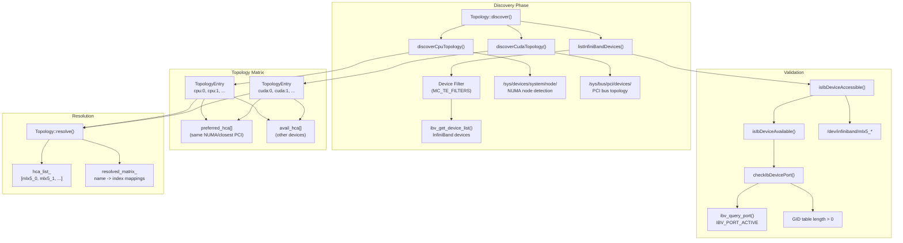
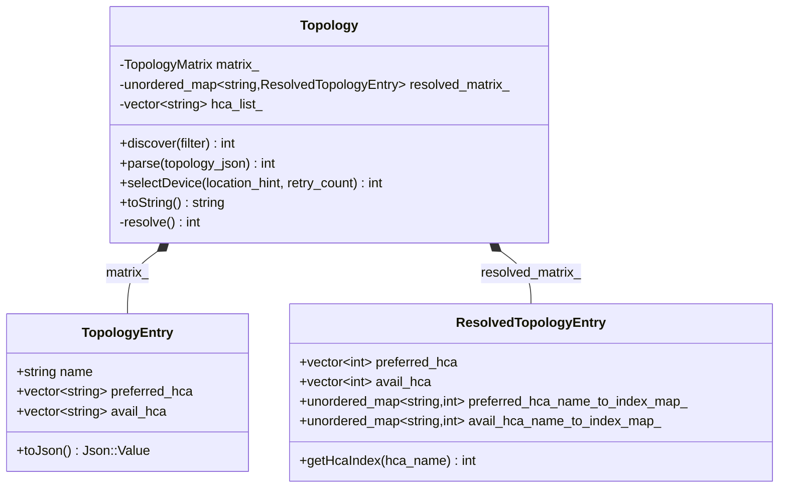
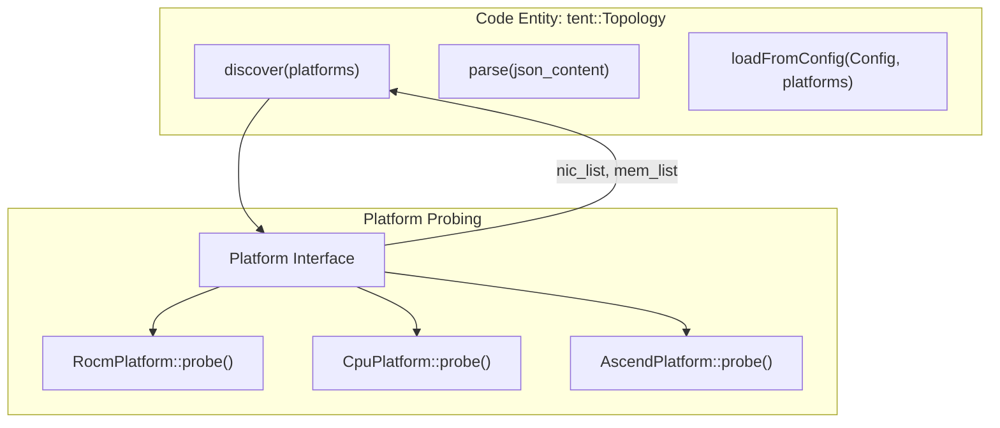

<!-- source: DeepWiki mcp.deepwiki.com · repo kvcache-ai/Mooncake · page 4.10 Topology Discovery and Device Selection · fetched 2026-11-11 -->

# Topology Discovery and Device Selection

<details>
<summary>Relevant source files</summary>

The following files were used as context for generating this wiki page:

- [docs/source/api-reference/python/transfer-engine.md](docs/source/api-reference/python/transfer-engine.md)
- [docs/source/design/tent/transport-selector.md](docs/source/design/tent/transport-selector.md)
- [mooncake-transfer-engine/example/transfer_engine_bench.cpp](mooncake-transfer-engine/example/transfer_engine_bench.cpp)
- [mooncake-transfer-engine/example/transfer_engine_bench_with_notify.cpp](mooncake-transfer-engine/example/transfer_engine_bench_with_notify.cpp)
- [mooncake-transfer-engine/example/transfer_engine_bench_with_retry.cpp](mooncake-transfer-engine/example/transfer_engine_bench_with_retry.cpp)
- [mooncake-transfer-engine/example/transfer_engine_validator.cpp](mooncake-transfer-engine/example/transfer_engine_validator.cpp)
- [mooncake-transfer-engine/include/topology.h](mooncake-transfer-engine/include/topology.h)
- [mooncake-transfer-engine/src/memory_location.cpp](mooncake-transfer-engine/src/memory_location.cpp)
- [mooncake-transfer-engine/src/topology.cpp](mooncake-transfer-engine/src/topology.cpp)
- [mooncake-transfer-engine/src/transport/rpc_communicator/CMakeLists.txt](mooncake-transfer-engine/src/transport/rpc_communicator/CMakeLists.txt)
- [mooncake-transfer-engine/tent/include/tent/common/types.h](mooncake-transfer-engine/tent/include/tent/common/types.h)
- [mooncake-transfer-engine/tent/include/tent/runtime/transport_selector.h](mooncake-transfer-engine/tent/include/tent/runtime/transport_selector.h)
- [mooncake-transfer-engine/tent/include/tent/transfer_engine.h](mooncake-transfer-engine/tent/include/tent/transfer_engine.h)
- [mooncake-transfer-engine/tent/src/CMakeLists.txt](mooncake-transfer-engine/tent/src/CMakeLists.txt)
- [mooncake-transfer-engine/tent/src/python/CMakeLists.txt](mooncake-transfer-engine/tent/src/python/CMakeLists.txt)
- [mooncake-transfer-engine/tent/src/python/pybind.cpp](mooncake-transfer-engine/tent/src/python/pybind.cpp)
- [mooncake-transfer-engine/tent/src/runtime/transport_loader.cpp](mooncake-transfer-engine/tent/src/runtime/transport_loader.cpp)
- [mooncake-transfer-engine/tent/src/runtime/transport_selector.cpp](mooncake-transfer-engine/tent/src/runtime/transport_selector.cpp)
- [mooncake-transfer-engine/tent/src/transfer_engine.cpp](mooncake-transfer-engine/tent/src/transfer_engine.cpp)
- [mooncake-transfer-engine/tent/src/transport/CMakeLists.txt](mooncake-transfer-engine/tent/src/transport/CMakeLists.txt)
- [mooncake-transfer-engine/tent/tests/test_python_guards.py](mooncake-transfer-engine/tent/tests/test_python_guards.py)
- [mooncake-transfer-engine/tent/tests/transport_selector_test.cpp](mooncake-transfer-engine/tent/tests/transport_selector_test.cpp)
- [mooncake-transfer-engine/tests/rdma_transport_submit_task_test.cpp](mooncake-transfer-engine/tests/rdma_transport_submit_task_test.cpp)
- [mooncake-transfer-engine/tests/rdma_transport_test.cpp](mooncake-transfer-engine/tests/rdma_transport_test.cpp)
- [mooncake-transfer-engine/tests/tcp_transport_test.cpp](mooncake-transfer-engine/tests/tcp_transport_test.cpp)
- [mooncake-transfer-engine/tests/topology_test.cpp](mooncake-transfer-engine/tests/topology_test.cpp)

</details>


## Purpose and Scope

This document details the implementation of Mooncake's topology discovery and device selection mechanisms within the Transfer Engine subsystem. These mechanisms identify hardware topology, including InfiniBand devices, CPU NUMA nodes, and accelerator devices (such as GPUs and NPUs). The system then strategically selects devices and routes transfers respecting NUMA and PCI locality to optimize bandwidth and latency across heterogeneous infrastructures.

Mooncake supports two key topology backends:

- **Classic Backend:** Embedded in the standard Transfer Engine (`Topology` class), relying on static topology detection and heuristic device selection.
- **TENT Backend:** Provided by the Transfer Engine Next (TENT) system, offering an advanced dynamic device selector (`tent::DeviceSelector`), enhanced platform probing, and runtime scheduling based on EWMA metrics.

Sources: [mooncake-transfer-engine/include/topology.h:1-135](), [mooncake-transfer-engine/src/topology.cpp:1-896](), [mooncake-transfer-engine/tent/include/tent/runtime/topology.h:1-133]()

---

## System Overview

The topology discovery workflow performs these major steps:

1. **Hardware Enumeration:** Lists all RDMA/InfiniBand devices, CPU NUMA nodes, and accelerator devices present in the system.
2. **Device Filtering and Validation:** Validates devices by checking kernel driver accessibility, port activity, and GID table presence.
3. **Proximity and Affinity Mapping:** Associates each device with preferred and available HCAs (Host Channel Adapters) optimized by NUMA and PCI bus proximity.
4. **Topology Resolution:** Converts string device identifiers into efficient runtime indices for device selection.

### Topology Discovery Pipeline Diagram



Sources: [mooncake-transfer-engine/src/topology.cpp:338-377](), [mooncake-transfer-engine/include/topology.h:62-131]()

---

## InfiniBand and UB Device Detection

Mooncake supports discovery and validation of:

- **InfiniBand devices** via `libibverbs`.
- **Ascend UB devices** via `liburma` (when available).

### InfiniBand Device Validation Steps

| Check                 | Function                 | Criteria                                                                                  |
|-----------------------|--------------------------|-------------------------------------------------------------------------------------------|
| File accessibility    | `isIbDeviceAccessible()`  | `/dev/infiniband/<device>` exists, is a char device, readable and writable               |
| Port status            | `checkIbDevicePort()`     | At least one port is `IBV_PORT_ACTIVE` and with a non-empty GID table                     |
| Device context         | `isIbDeviceAvailable()`   | Successfully opens device via `ibv_open_device()` and satisfies previous checks          |

Only devices fulfilling these checks are considered "available" and enriched with metadata (name, PCI bus ID, NUMA node) by parsing sysfs data.

For Ascend UB devices, a similar enumeration is done using `urma_get_device_list()`, yielding devices usable as RDMA transport NICs with specialized considerations.

Sources: [mooncake-transfer-engine/src/topology.cpp:46-140](), [mooncake-transfer-engine/src/topology.cpp:142-193](), [mooncake-transfer-engine/src/topology.cpp:206-218]()

---

## GPU Topology Discovery and PCI Proximity

When GPU support is enabled, Mooncake enumerates GPUs and assigns preferred HCAs to GPUs based on proximity on the PCI bus and NUMA affinity.

### PCI Distance Calculation Algorithm

The `getPciDistance()` function measures PCI proximity by:

1. Resolving both PCI bus IDs to canonical paths using `realpath()`.
2. Finding the longest common prefix between paths.
3. Counting the number of directory separators `/` in the diverging suffixes.
4. Summing these counts as a PCI distance metric.

### GPU to HCA Assignment Workflow

The `discoverCudaTopology()` method implements:

- Checks if any HCAs share NUMA node with the GPU; filters candidates accordingly.
- Computes PCI distance for each HCA candidate.
- Selects the HCAs with minimal PCI distance as `preferred_hca` for this GPU.
- The rest are classified in `avail_hca`.

This mapping helps prioritize data transfers over physically closer paths.

Sources: [mooncake-transfer-engine/src/topology.cpp:234-335]()

---

## Topology Data Structures and Resolution

### `Topology` Class Overview

The `Topology` class maintains hardware topology in these central mappings:

- **`matrix_`** (`TopologyMatrix`): Maps device name strings (e.g., `"cpu:0"`, `"cuda:1"`) to `TopologyEntry` objects, which contain arrays of preferred and available HCAs.
- **`resolved_matrix_`**: Integer-indexed version of the topology, used for fast runtime lookup by converting device names to numeric indices and storing numeric device arrays.

### Key Classes and Members



Sources: [mooncake-transfer-engine/include/topology.h:38-131](), [mooncake-transfer-engine/src/topology.cpp:486-523]()

---

## Device Selection Algorithms (Classic Backend)

The `Topology::selectDevice()` method selects an HCA index for data transfer. The logic follows:

| Condition           | Behavior                                                                                                  |
|---------------------|-----------------------------------------------------------------------------------------------------------|
| `hint` provided     | Return the HCA index matching the hint if it exists in the topology entry (`getHcaIndex()` lookup).         |
| `retry_count == 0`  | Choose either a random or round-robin device from `preferred_hca` if non-empty, else from `avail_hca`.       |
| `retry_count > 0`   | Round-robin over the union of all HCAs (both preferred and available).                                     |

Additionally, if peer affinity is enabled (`enable_hca_peer_affinity`), the method tries to select a local HCA whose affinity domain matches or is closest to the remote HCA. This is especially important for bindings with GPUs (`cuda:` or `hip:` prefixes).

Affinity logic respects GPU device prefixes configured by `GPU_PREFIX` macros to ensure dynamics work across CUDA and HIP backends.

Sources: [mooncake-transfer-engine/include/topology.h:92-131](), [mooncake-transfer-engine/src/topology.cpp:551-654](), [mooncake-transfer-engine/tests/topology_test.cpp:163-165]()

---

## NUMA-Aware Memory Location Detection and Routing

Mooncake implements memory topology awareness to route transfers efficiently by detecting where buffers reside:

- `getMemoryLocation()` probes a pointer's underlying memory:
  - For CPU buffers, Linux `numa_move_pages()` is called to detect NUMA node(s).
  - For GPU buffers, CUDA/HIP APIs are used to detect device ID.

- Large buffers spanning multiple NUMA nodes use segmented location strings in the format:

  ```
  "segments:<page_size>:<numa0>,<numa1>,..."
  ```

  This is encoded/decoded with `buildSegmentsLocation()` and `parseSegmentsLocation()` functions to map buffer offsets precisely to their NUMA node regions.

This fine-grained location detection enables the Transfer Engine to select the best possible NIC and route transfers close to the physical memory to optimize bandwidth and latency.

Sources: [mooncake-transfer-engine/include/memory_location.h:1-74](), [mooncake-transfer-engine/src/memory_location.cpp:1-180]()

---

## TENT Backend: Topology and DeviceSelector

The Transfer Engine Next (TENT) subsystem includes a more advanced topology discovery and device selection mechanism built to support dynamic and heterogeneous environments.

### Key Components

- `tent::Topology`: Contains NIC (`nic_list_`) and memory (`mem_list_`) device descriptions with detailed metadata such as NIC type, PCI bus, and NUMA node.

- **Platform Interface and Probing:** Supports multiple platform implementations:
  - `CpuPlatform`
  - `RocmPlatform`
  - `AscendPlatform`
  
  Each platform probes its devices and reports NIC/memory metadata.

### Platform Probing Diagram



Sources: [mooncake-transfer-engine/tent/include/tent/runtime/topology.h:38-133](), [mooncake-transfer-engine/tent/src/runtime/topology.cpp:110-187](), [mooncake-transfer-engine/tent/src/platform/ascend/ascend_probe.cpp]()

---

## Transport Selection Policies in TENT

The `tent::TransportSelector` class governs how TENT picks an appropriate transport protocol and device for individual transfer requests. It operates on a policy-based system configured via JSON.

### Transport Selection Process

```mermaid
graph TD
    A[Transfer Request] --> B{TransportSelector::selectTransport()}
    B --> C{Match Policy}
    C -- "No match" --> D[Use Default Policies]
    C -- "Match Policy" --> E[Apply Policy Rules]
    E --> F{Filter by Segment Type}
    F --> G{Filter by Machine Locality}
    G --> H{Filter by Memory Patterns}
    H --> I{Filter by Size}
    I --> J{Filter by Priority}
    J --> K{Filter by Devices}
    K --> L{Order Transports by Preference}
    L --> M[Selected Transport and Device]

    subgraph "Policy Configuration"
        N[Config::getArray(\"policy\")] --> C
        O[TransportSelector::getDefaultPolicies()] --> D
    end

    subgraph "Request Attributes"
        P[SegmentType] --> F
        Q[Same Machine?] --> G
        R[LocalMemoryPattern] --> H
        S[RemoteMemoryPattern] --> H
        T[Min/Max Size] --> I
        U[Priority] --> J
        V[Devices] --> K
        W[IntentType] --> J
    end
```

- Policies are loaded from the `"policy"` section of the config.
- If no user policies exist, defaults (e.g., `"file_storage"`, `"memory_default"`) are used.
- Policies specify criteria: segment type (File/Memory), locality, memory patterns (e.g., `"cpu:*"`), size constraints, priority, allowed devices, transport types, and intent types.
- The selector matches request attributes against policies and determines the most suitable transport and device.

Sources: [mooncake-transfer-engine/tent/src/runtime/transport_selector.cpp:122-133](), [mooncake-transfer-engine/tent/src/runtime/transport_selector.cpp:144-208](), [mooncake-transfer-engine/tent/src/runtime/transport_selector.cpp:55-81]()

---

## DeviceSelector Scheduling Modes in TENT

The TENT `DeviceSelector` supports:

- **Baseline Mode:** Basic round-robin device selection to maintain backward compatibility.
- **Smart (EWMA-based) Routing:** Tracks per-device in-flight bytes and predicts completion times using Exponentially Weighted Moving Average (EWMA). Selects devices to minimize latency and load balance dynamically.

For UB (Ascend) devices, TENT exposes NICs with global and native EID identifiers mapped in the topology for efficient routing.

Sources: [mooncake-transfer-engine/tent/include/tent/runtime/topology.h:38-133](), [mooncake-transfer-engine/tent/src/runtime/topology.cpp:110-187]()

---

## Topology Dump and Inspection Utility

Mooncake provides utilities and APIs exposing topology for diagnostic and configuration validation:

- `transfer_engine_bench` example and `topology_test` test utility can dump the discovered topology as JSON.
- `Topology::toString()` provides a JSON string representation of the entire hardware and HCA affinity matrix.
- Filtering devices via `MC_TE_FILTERS` environment variable or in `transfer-engine.json` (`rdma_whitelist` / `rdma_blacklist`) enables operator control over device enumerations.
- These tools help validate device bindings, NUMA groupings, and hardware configuration correctness before running actual data transfers.

Sources: [mooncake-transfer-engine/tests/topology_test.cpp:14-22](), [mooncake-transfer-engine/src/topology.cpp:1-886](), [mooncake-transfer-engine/tent/config/transfer-engine.json:8-9](), [mooncake-transfer-engine/src/topology.cpp:161-190]()

---

# Summary

This page detailed Mooncake's topology discovery and device selection mechanisms in the Transfer Engine subsystem, covering:

- Classic static topology discovery and heuristic device selection.
- InfiniBand and Ascend UB device validation.
- NUMA-aware memory location detection and PCI-proximate GPU-HCA linkage.
- Advanced TENT backend with dynamic platform probing and EWMA-based scheduling.
- Policy-driven transport and device selection for heterogeneous hardware.
- Tools for topology inspection and device filtering.

Together, these are key enablers for Mooncake's high-performance KVCache disaggregation and LLM serving, ensuring transfers are routed with awareness of physical topology, load, and hardware heterogeneity.

---

# References

| File Path                                      | Lines        | Contents Covered                                               |
|-----------------------------------------------|--------------|----------------------------------------------------------------|
| mooncake-transfer-engine/include/topology.h    | 1-135        | Topology class definitions and data structures                 |
| mooncake-transfer-engine/src/topology.cpp       | 1-897        | Topology discovery, device validation, GPU-HCA assignment      |
| mooncake-transfer-engine/include/memory_location.h | 1-74       | Memory location types and encoding                              |
| mooncake-transfer-engine/src/memory_location.cpp  | 1-180       | NUMA page detection, GPU memory detection, segment location    |
| mooncake-transfer-engine/tent/include/tent/runtime/topology.h | 1-133 | TENT backend topology and NIC/memory metadata                  |
| mooncake-transfer-engine/tent/src/runtime/topology.cpp | 110-187  | TENT topology discovery and UB device handling                 |
| mooncake-transfer-engine/tent/src/platform/ascend/ascend_probe.cpp | All | Ascend device discovery for TENT backend                       |
| mooncake-transfer-engine/tests/topology_test.cpp  | 14-22       | Topology dump test utilities                                   |
| mooncake-transfer-engine/tent/config/transfer-engine.json | 8-9         | RDMA whitelist/blacklist filtering in TENT config              |
| mooncake-transfer-engine/tent/src/runtime/transport_selector.cpp | 1-624 | TENT transport selection policy loading and matching           |
| mooncake-transfer-engine/example/transfer_engine_bench.cpp | 31-33      | Example usage of Transfer Engine and topology dumping           |

---

# End of Section 4.10 - Topology Discovery and Device Selection

---

