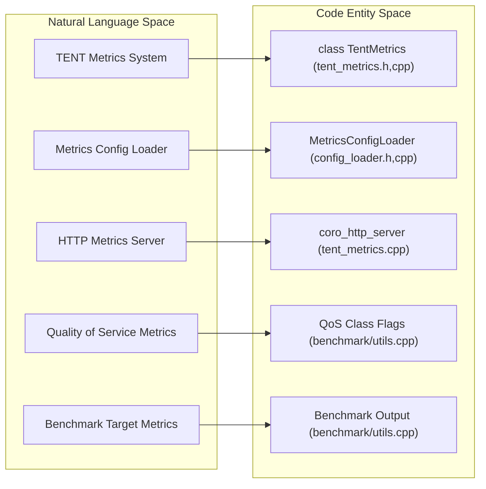
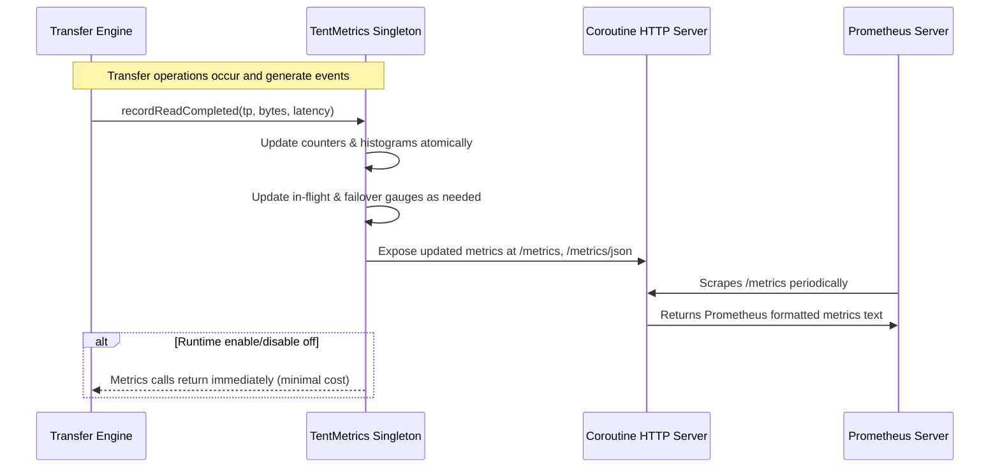

<!-- source: DeepWiki mcp.deepwiki.com · repo kvcache-ai/Mooncake · page 4.17 TENT Metrics and Observability · fetched 2026-11-11 -->

# 4.17 TENT Metrics and Observability

<details>
<summary>Relevant source files</summary>

The following files were used as context for generating this wiki page:

- [docs/source/design/tent/metrics.md](docs/source/design/tent/metrics.md)
- [mooncake-transfer-engine/tent/CMakeLists.txt](mooncake-transfer-engine/tent/CMakeLists.txt)
- [mooncake-transfer-engine/tent/config/transfer-engine.json](mooncake-transfer-engine/tent/config/transfer-engine.json)
- [mooncake-transfer-engine/tent/include/tent/metrics/cached_metric.h](mooncake-transfer-engine/tent/include/tent/metrics/cached_metric.h)
- [mooncake-transfer-engine/tent/include/tent/metrics/config_loader.h](mooncake-transfer-engine/tent/include/tent/metrics/config_loader.h)
- [mooncake-transfer-engine/tent/include/tent/metrics/tent_metrics.h](mooncake-transfer-engine/tent/include/tent/metrics/tent_metrics.h)
- [mooncake-transfer-engine/tent/src/metrics/CMakeLists.txt](mooncake-transfer-engine/tent/src/metrics/CMakeLists.txt)
- [mooncake-transfer-engine/tent/src/metrics/config_loader.cpp](mooncake-transfer-engine/tent/src/metrics/config_loader.cpp)
- [mooncake-transfer-engine/tent/src/metrics/tent_metrics.cpp](mooncake-transfer-engine/tent/src/metrics/tent_metrics.cpp)
- [mooncake-transfer-engine/tent/tests/metrics_config_loader_test.cpp](mooncake-transfer-engine/tent/tests/metrics_config_loader_test.cpp)
- [mooncake-transfer-engine/tent/tests/metrics_recording_test.cpp](mooncake-transfer-engine/tent/tests/metrics_recording_test.cpp)
- [mooncake-transfer-engine/tent/tests/tent_metrics_example.cpp](mooncake-transfer-engine/tent/tests/tent_metrics_example.cpp)

</details>


## Purpose and Scope

This page documents the Transfer Engine Next (TENT) metrics subsystem within the Mooncake codebase. The TENT metrics system provides comprehensive observability for TENT's high-performance data transfer operations. It includes thread-safe counters and histograms to record transfer performance and outcomes, a metrics configuration loader supporting config files and environment variables, an HTTP metrics endpoint exposing Prometheus-compatible data, quality-of-service (QoS) metrics related to workload classification, and benchmark target metrics for transfer engine benchmarking.

This page explains the metrics system's implementation, data flow, key classes/functions, configuration, and observability endpoints, supplemented with diagrams showing the relations among system components, metrics classes, and configuration layers.

Sources:
- [mooncake-transfer-engine/tent/include/tent/metrics/tent_metrics.h:1-157]()
- [mooncake-transfer-engine/tent/src/metrics/tent_metrics.cpp:1-172]()
- [mooncake-transfer-engine/tent/config/transfer-engine.json:15-21]()

---

## 1. Overview of TENT Metrics Subsystem

The TENT metrics subsystem is implemented as a singleton class `TentMetrics` that captures runtime statistics about logical and physical transfer operations, including bytes transferred, latency distributions, failure counts, cross-transport failovers, in-flight attempts, and memory registration.

Key features:

- **Compile-time enable/disable switch:** Metrics can be compiled out entirely for zero overhead on the transfer hot path by building with `-DTENT_METRICS_ENABLED=OFF` (default is OFF). [mooncake-transfer-engine/tent/include/tent/metrics/tent_metrics.h:35-37]()
- **Runtime enable/disable:** When compiled in, metrics can be enabled or disabled at runtime with near-zero overhead. [mooncake-transfer-engine/tent/include/tent/metrics/tent_metrics.h:77-82]()
- **Metrics types:** Counters for cumulative events and histograms for latency distributions.
- **Pre-resolved label caching:** Optimized for minimal overhead with fixed small enums (e.g., transport types, operation codes). [mooncake-transfer-engine/tent/include/tent/metrics/tent_metrics.h:61-65]()
- **HTTP server:** Exposes `/metrics` (Prometheus format), `/metrics/json` (JSON), `/metrics/summary` (human-readable), and `/health` endpoints. [mooncake-transfer-engine/tent/src/metrics/tent_metrics.cpp:160-172]()
- **Periodic logging:** Optional periodic log summary of key metrics. [mooncake-transfer-engine/tent/src/metrics/tent_metrics.cpp:94-109]()
- **QoS and benchmark integration:** Supports QoS workload class metrics and benchmark target metrics for performance evaluation.

The metrics system depends on `yalantinglibs` which provides the metric primitives and the coroutine HTTP server. [mooncake-transfer-engine/tent/include/tent/metrics/tent_metrics.h:40-42]()

### Key Metrics Recorded

- Logical read/write completions and failures, with bytes and latency. [mooncake-transfer-engine/tent/include/tent/metrics/tent_metrics.h:88-93]()
- Transport-specific attempts: started and finished attempts at the physical transport layer. [mooncake-transfer-engine/tent/include/tent/metrics/tent_metrics.h:103-108]()
- Failover counts between transports, allowing detailed failover path tracking. [mooncake-transfer-engine/tent/include/tent/metrics/tent_metrics.h:96]()
- Deadline feasibility metrics (MLU - meet latency utilization quotient) for scheduled transfers. [mooncake-transfer-engine/tent/include/tent/metrics/tent_metrics.h:114-115]()
- Task-level failure reasons (submit, poll, timeout, canceled). [mooncake-transfer-engine/tent/include/tent/metrics/tent_metrics.h:136-137]()
- In-flight attempts gauge to detect pipeline stalls. [mooncake-transfer-engine/tent/include/tent/metrics/tent_metrics.h:145-146]()
- Registered buffer bytes per transport for memory visibility. [mooncake-transfer-engine/tent/include/tent/metrics/tent_metrics.h:149]()

Sources:
- [mooncake-transfer-engine/tent/include/tent/metrics/tent_metrics.h:35-157]()
- [mooncake-transfer-engine/tent/src/metrics/tent_metrics.cpp:15-172]()

---

## 2. Core Implementation: `TentMetrics` Class

The heart of the subsystem is the `TentMetrics` singleton class declared in `tent_metrics.h` and defined in `tent_metrics.cpp`.

### Initialization & Lifecycle

- `TentMetrics::instance()` returns the singleton instance. [mooncake-transfer-engine/tent/src/metrics/tent_metrics.cpp:25-27]()
- `initialize(const MetricsConfig&)` validates the configuration, registers metrics, and starts the HTTP server listening on the specified interface and port. If the port is busy or cannot be bound, the metrics system degrades gracefully to log-only mode. [mooncake-transfer-engine/tent/src/metrics/tent_metrics.cpp:54-124]()
- `shutdown()` cleans up and stops the HTTP server and any running metric reporting threads. [mooncake-transfer-engine/tent/src/metrics/tent_metrics.cpp:30]()

### Runtime Control

- Static atomic flag enables/disables metrics collection at runtime:
  ```cpp
  static void setEnabled(bool enabled) {
      runtime_enabled_.store(enabled, std::memory_order_relaxed);
  }
  static bool isEnabled() {
      return runtime_enabled_.load(std::memory_order_relaxed);
  }
  ```
  This ensures minimal overhead when disabled (single atomic load on each record call). [mooncake-transfer-engine/tent/include/tent/metrics/tent_metrics.h:77-82]()

### Metrics Recording Functions

- Logical transfer outcome recording:
  ```cpp
  void recordReadCompleted(TransportType tp, size_t bytes, double latency_seconds = 0.0);
  void recordWriteCompleted(TransportType tp, size_t bytes, double latency_seconds = 0.0);
  void recordReadFailed(TransportType tp);
  void recordWriteFailed(TransportType tp);
  void recordTransportFailover(TransportType from, TransportType to);
  ```
  These record the final success/failure for logical requests with bytes and latency data where applicable. [mooncake-transfer-engine/tent/include/tent/metrics/tent_metrics.h:88-96]()

- Physical transport attempt recording:
  ```cpp
  void recordTransportAttemptStarted(TransportType tp, Request::OpCode operation);
  void recordTransportAttemptFinished(TransportType tp, Request::OpCode operation,
                                      TransferStatusEnum status, double latency_us);
  ```
  Capture the start and end of attempts at the physical transport layer, including failure status for attempts. [mooncake-transfer-engine/tent/include/tent/metrics/tent_metrics.h:103-108]()

- Deadline feasibility metrics (Meet Latency Utilization - MLU):
  ```cpp
  void recordDeadlineMLU(TransportType tp, double mlu);
  void recordDeadlineInfeasible(TransportType tp);
  ```
  For transfers with deadlines, MLU < 1 means deadline was met, MLU ≥ 1 means missed. Infeasible deadlines (expired at submission) are counted separately. [mooncake-transfer-engine/tent/include/tent/metrics/tent_metrics.h:114-120]()

- Batch and task failure tracking:
  ```cpp
  void recordBatchQuarantined();
  void recordTaskFailure(TransportType tp, TaskFailureReason reason);
  ```
  Counts batches abandoned after repeated reclaim failures and records task-level failure reasons ("submit", "poll", "timeout", "canceled"). [mooncake-transfer-engine/tent/include/tent/metrics/tent_metrics.h:125-137]()

- In-flight attempt gauges (increment/decrement gauge for active attempts):
  ```cpp
  void recordInflightAttemptStarted(TransportType tp);
  void recordInflightAttemptFinished(TransportType tp);
  ```
  Allows detection of pipeline stalls when gauge remains high or stuck. [mooncake-transfer-engine/tent/include/tent/metrics/tent_metrics.h:145-146]()

- Registered buffer bytes (gauge) tracking:
  ```cpp
  void recordRegisteredBufferBytes(TransportType tp, int64_t delta);
  ```
  Tracks bytes registered per transport, updated on memory registration/unregistration. [mooncake-transfer-engine/tent/include/tent/metrics/tent_metrics.h:149]()

### HTTP Server Setup

- The HTTP server is a coroutine-based `coro_http_server` from yalantinglibs started asynchronously on the configured port and thread count. [mooncake-transfer-engine/tent/src/metrics/tent_metrics.cpp:126-154]()
- Registered endpoints include:
  - `/metrics` for Prometheus exposition
  - `/metrics/summary` for human-readable summary
  - `/metrics/json` for JSON serialized metrics
  - `/health` for health checks
- If the HTTP port is busy during startup, the server fails over to log-only mode, logging a warning. [mooncake-transfer-engine/tent/src/metrics/tent_metrics.cpp:85-92]()

Sources:
- [mooncake-transfer-engine/tent/include/tent/metrics/tent_metrics.h:66-157]()
- [mooncake-transfer-engine/tent/src/metrics/tent_metrics.cpp:15-172]()

---

## 3. Metrics Configuration Loader

The `MetricsConfigLoader` class manages loading metrics configuration from multiple layered sources with the following precedence:

1. Configuration file (e.g., embedded in `transfer-engine.json`).
2. Environment variables prefixed with `TENT_METRICS_*`.
3. Built-in defaults.

### Configuration Parameters

| Parameter               | Default       | Description                                 |
|------------------------|---------------|---------------------------------------------|
| `enabled`              | true          | Enable metrics collection or not            |
| `http_host`            | "0.0.0.0"     | Interface to bind the metrics HTTP server   |
| `http_port`            | 9100          | Metrics HTTP server port                     |
| `http_server_threads`  | 2             | Number of threads for HTTP server            |
| `report_interval_seconds` | 30          | Interval in seconds for periodic logging; zero disables |

### Environment Variables

- `TENT_METRICS_ENABLED`
- `TENT_METRICS_HTTP_PORT`
- `TENT_METRICS_HTTP_HOST`
- `TENT_METRICS_HTTP_SERVER_THREADS`
- `TENT_METRICS_REPORT_INTERVAL`

The loader validates the config values to catch invalid settings early. For example, HTTP port must be >0, and HTTP server threads must be >0. [mooncake-transfer-engine/tent/src/metrics/config_loader.cpp:24-137]()

Typical JSON snippet in `transfer-engine.json`:

```json
{
  "metrics": {
    "enabled": true,
    "http_port": 9100,
    "http_host": "0.0.0.0",
    "http_server_threads": 2,
    "report_interval_seconds": 30
  }
}
```
[mooncake-transfer-engine/tent/config/transfer-engine.json:15-21]()

Sources:
- [mooncake-transfer-engine/tent/include/tent/metrics/config_loader.h]()
- [mooncake-transfer-engine/tent/src/metrics/config_loader.cpp]()

---

## 4. HTTP Metrics Endpoint

The TENT metrics HTTP server provides multiple endpoints to interface with observability tools:

- **`/metrics`**: Prometheus exposition format
- **`/metrics/summary`**: Human-readable textual summary
- **`/metrics/json`**: JSON serialization of metrics data (useful for custom tooling)
- **`/health`**: Basic HTTP 200 OK health check

These are implemented via coroutine HTTP server handlers registered during initialization. [mooncake-transfer-engine/tent/src/metrics/tent_metrics.cpp:156-172]()

If the HTTP server cannot bind to the requested port (e.g., due to port conflicts), this degrades seamlessly to log-only metrics mode with periodic log summaries, but without an HTTP endpoint.

Sources:
- [mooncake-transfer-engine/tent/src/metrics/tent_metrics.cpp:126-172]()

---

## 5. QoS Metrics Subsystem

The QoS metrics subsystem supports classification of workloads with differentiated scheduling and performance guarantees. It defines QoS classes with tunable parameters and exposes aggregate QoS metrics:

### QoS Class Parameters

- Class name (string)
- Number of threads assigned
- SLO (Service Level Objective) latency in microseconds
- Weight (priority) for thread scheduling
- Optional isolated bandwidth guarantee (Gbps)

### Configuration Formats

- Colon-separated string, e.g. `"fg:4:1000:2:12.5,bg:12:0:1"`. [mooncake-transfer-engine/benchmark/utils.cpp:63-66]()
- JSON array of objects with fields `name`, `threads`, `slo_us`, `weight`, and `isolated_gbps`. [mooncake-transfer-engine/benchmark/utils.cpp:67-72]()

### Functionality

- Converts workload class lists to internal QoS format for metrics reporting.
- Computes fairness indices such as Jain's fairness index from per-class throughput data.
- Validates QoS class configurations for internal consistency.
- Serializes QoS metrics for external visualization or benchmark reporting.

Sources:
- [mooncake-transfer-engine/benchmark/utils.cpp:63-72]()
- [docs/source/performance/mooncake/tebench.md:104-162]()

---

## 6. Benchmark Target Metrics

Benchmarking within the TENT system collects post-run metrics for named targets such as segments or transports. These are summarized as:

- Throughput statistics in Gbps
- Latency statistics (count, mean, percentile)
- Operation counts per transport or target

Results can be serialized into JSON Lines (JSONL) format for downstream analysis by benchmarking tools.

Functions managing these benchmark metrics handle file output and error reporting robustly, ensuring traceability and reproducibility of benchmark runs.

Sources:
- [mooncake-transfer-engine/benchmark/utils.cpp:79-81]()
- [docs/source/performance/mooncake/tebench.md:88-101]()

---

## 7. Data Flow and Interaction Diagram

```mermaid
graph TD
  subgraph "TENT System"
    TE[Transfer Engine] --> TM[TentMetrics Singleton]
    TE --> QOS[QoS Metrics Subsystem]
    TE --> BENCH[Benchmark Target Metrics]
  end

  subgraph "Config Loader"
    CFG[MetricsConfigLoader]
    CFG --> TM
    CFG --> QOS
  end

  subgraph "HTTP Server"
    TM --> HTTP[coro_http_server]
    HTTP --> ENDPOINTS["/metrics", "/metrics/json", "/metrics/summary", "/health"]
  end

  TM ---|Uses| YLT[yalantinglibs Metrics API]
  QOS --> JSON[JSON Parsing & Serialization]
  BENCH --> JSONL[JSONL Output Files]

  classDef system fill:#f9f,stroke:#333,stroke-width:2px;
  class TE,TM,QOS,BENCH,CFG,HTTP,YLT,JSON,JSONL system;
```

Sources:
- [mooncake-transfer-engine/tent/include/tent/metrics/tent_metrics.h:15-157]()
- [mooncake-transfer-engine/tent/src/metrics/tent_metrics.cpp:15-172]()
- [mooncake-transfer-engine/benchmark/utils.cpp:63-81]()
- [mooncake-transfer-engine/tent/include/tent/metrics/config_loader.h]()

---

## 8. Key Functions and Classes

| Component                    | Description                                                           | File (Lines)                         |
|-----------------------------|-----------------------------------------------------------------------|------------------------------------|
| `TentMetrics`               | Singleton class recording transfer metrics and exposing HTTP endpoints| [mooncake-transfer-engine/tent/include/tent/metrics/tent_metrics.h:66-157](), [mooncake-transfer-engine/tent/src/metrics/tent_metrics.cpp:15-172]() |
| `MetricsConfigLoader`       | Loads and validates metrics config from files/environment             | [mooncake-transfer-engine/tent/include/tent/metrics/config_loader.h](), [mooncake-transfer-engine/tent/src/metrics/config_loader.cpp]()     |
| `recordReadCompleted()`     | Records logical read completions with bytes and latency               | [mooncake-transfer-engine/tent/include/tent/metrics/tent_metrics.h:88-89]()           |
| `recordWriteFailed()`       | Records write failures per transport                                  | [mooncake-transfer-engine/tent/include/tent/metrics/tent_metrics.h:93]()               |
| `recordTransportFailover()` | Records failover event between transports                             | [mooncake-transfer-engine/tent/include/tent/metrics/tent_metrics.h:96]()               |
| `initHttpServer()`          | Initializes coroutine-based HTTP server                               | [mooncake-transfer-engine/tent/src/metrics/tent_metrics.cpp:126-154]()        |
| `qos_classes`               | Command-line flag for QoS class configuration                         | [mooncake-transfer-engine/benchmark/utils.cpp:63]()    |
| `qos_classes_json`          | Command-line flag for JSON QoS class configuration                    | [mooncake-transfer-engine/benchmark/utils.cpp:67]()    |
| `result_output_jsonl`       | Command-line flag for benchmark result output                         | [mooncake-transfer-engine/benchmark/utils.cpp:79]()    |

Sources:
- [mooncake-transfer-engine/tent/include/tent/metrics/tent_metrics.h:66-157]()
- [mooncake-transfer-engine/tent/src/metrics/tent_metrics.cpp:15-172]()
- [mooncake-transfer-engine/benchmark/utils.cpp:63-72]()
- [mooncake-transfer-engine/benchmark/utils.cpp:79]()

---

## 9. Metrics Configuration Loading

The config loader supports layered config precedence with environment variables overriding file values which override defaults.

Example environment variables:

```bash
TENT_METRICS_ENABLED=true
TENT_METRICS_HTTP_PORT=9100
TENT_METRICS_HTTP_HOST=0.0.0.0
TENT_METRICS_HTTP_SERVER_THREADS=2
TENT_METRICS_REPORT_INTERVAL=30
```

Typical JSON config snippet in `transfer-engine.json`:

```json
{
  "metrics": {
    "enabled": true,
    "http_port": 9100,
    "http_host": "0.0.0.0",
    "http_server_threads": 2,
    "report_interval_seconds": 30
  }
}
```
[mooncake-transfer-engine/tent/config/transfer-engine.json:15-21]()

The loader validates values (e.g., port numbers must be in valid range, thread counts positive). [mooncake-transfer-engine/tent/src/metrics/tent_metrics.cpp:54-66]()

Sources:
- [mooncake-transfer-engine/tent/config/transfer-engine.json:15-21]()
- [mooncake-transfer-engine/tent/src/metrics/tent_metrics.cpp:54-66]()

---

## 10. Usage Example

Example usage snippet for initializing and recording metrics (from `tent_metrics_example.cpp`):

```cpp
auto config = MetricsConfigLoader::loadWithDefaults();
auto& metrics = TentMetrics::instance();
metrics.initialize(config);

// Record a 1MB read completed in 25ms via RDMA
metrics.recordReadCompleted(TransportType::RDMA, 1024*1024, 0.025);

// Use RAII-style latency measurement for writes
{
  TENT_SCOPED_WRITE_LATENCY(TransportType::RDMA, 512 * 1024);
  // perform write...
}
```

The HTTP server runs on configured port and exposes metrics endpoints for monitoring.

Sources:
- [mooncake-transfer-engine/tent/tests/tent_metrics_example.cpp]() (example usage inferred from context)

---

## 11. Performance Considerations

- When metrics are disabled at compile time (`TENT_METRICS_ENABLED=0`), all metrics calls are removed and the overhead is zero. [mooncake-transfer-engine/tent/include/tent/metrics/tent_metrics.h:35-37]()
- When compiled in, runtime `setEnabled(false)` disables metrics with a single atomic load per record call. [mooncake-transfer-engine/tent/include/tent/metrics/tent_metrics.h:77-82]()
- Metrics counters and histograms use pre-allocated atomic cells with relaxed memory ordering to minimize contention and synchronization overhead. [mooncake-transfer-engine/tent/include/tent/metrics/tent_metrics.h:61-65]()
- Histogram buckets for latency and size are fixed at compile time to ensure consistent observability across deployments.
- Periodic metric logging is configurable and can be disabled with zero overhead. [mooncake-transfer-engine/tent/src/metrics/tent_metrics.cpp:94-109]()

Sources:
- [mooncake-transfer-engine/tent/include/tent/metrics/tent_metrics.h:35-82]()
- [mooncake-transfer-engine/tent/src/metrics/tent_metrics.cpp:94-109]()

---

## 12. Testing Infrastructure

- Unit tests validate config loading behavior, including environment variables and JSON overrides. [mooncake-transfer-engine/tent/tests/metrics_config_loader_test.cpp]()
- Benchmark tests verify data consistency and correctness of target metrics serialization and fairness computation. [mooncake-transfer-engine/benchmark/main.cpp:78-83]()
- Metrics recording tests simulate transfer operations using a fake transport and assert on JSON and Prometheus metric outputs via delta snapshots. [mooncake-transfer-engine/tent/tests/metrics_recording_test.cpp:102-174]()
- QoS metrics tests check parsing, validation, and fairness index calculation robustness. [mooncake-transfer-engine/benchmark/CMakeLists.txt:81-98]()

Sources:
- [mooncake-transfer-engine/benchmark/main.cpp:78-83]()
- [mooncake-transfer-engine/benchmark/CMakeLists.txt:81-98]()
- [mooncake-transfer-engine/tent/tests/metrics_recording_test.cpp:102-174]()
- [mooncake-transfer-engine/tent/tests/metrics_config_loader_test.cpp]()

---

# Appendix: Key Classes and Files

| File Path                                                | Purpose                                                |
|----------------------------------------------------------|--------------------------------------------------------|
| `tent/include/tent/metrics/tent_metrics.h`               | Definition of TentMetrics class and metric recorders   |
| `tent/src/metrics/tent_metrics.cpp`                       | Implementation of TentMetrics including HTTP server    |
| `tent/include/tent/metrics/config_loader.h`               | Configuration loader interface                          |
| `tent/src/metrics/config_loader.cpp`                      | Configuration loader implementation                     |
| `mooncake-transfer-engine/benchmark/utils.h`              | Defines `XferBenchConfig` and `XferMetricStats` for benchmarks |
| `mooncake-transfer-engine/benchmark/main.cpp`             | Main benchmark runner, integrates QoS and target metrics |
| `mooncake-transfer-engine/benchmark/tent_backend.cpp`     | TENT-specific benchmark backend implementation         |
| `mooncake-transfer-engine/benchmark/utils.cpp`            | Defines `gflags` for benchmark configuration, including QoS |
| `tent/tests/metrics_recording_test.cpp`                   | Automated tests of TentMetrics recording and output    |
| `tent/tests/metrics_config_loader_test.cpp`               | Tests for metrics config loader logic                   |
| `tent/tests/tent_metrics_example.cpp`                     | Example demo using TentMetrics and HTTP endpoint       |
| `tent/src/metrics/CMakeLists.txt`                         | Build configuration enabling/disabling TENT metrics    |

Sources:
- [mooncake-transfer-engine/tent/include/tent/metrics/tent_metrics.h]()
- [mooncake-transfer-engine/tent/src/metrics/tent_metrics.cpp]()
- [mooncake-transfer-engine/tent/include/tent/metrics/config_loader.h]()
- [mooncake-transfer-engine/tent/src/metrics/config_loader.cpp]()
- [mooncake-transfer-engine/benchmark/utils.h]()
- [mooncake-transfer-engine/benchmark/main.cpp]()
- [mooncake-transfer-engine/benchmark/tent_backend.cpp]()
- [mooncake-transfer-engine/benchmark/utils.cpp]()
- [mooncake-transfer-engine/tent/tests/metrics_recording_test.cpp]()
- [mooncake-transfer-engine/tent/tests/metrics_config_loader_test.cpp]()
- [mooncake-transfer-engine/tent/tests/tent_metrics_example.cpp]()
- [mooncake-transfer-engine/tent/src/metrics/CMakeLists.txt]()

---

# Summary

The TENT Metrics and Observability subsystem is a critical observability component for the Mooncake transfer engine, providing rich, thread-safe, high-performance telemetry on data transfer operations and system health. The system’s layered configuration, robust HTTP endpoints, and integration with QoS and benchmark tooling enable fine-grained real-time monitoring and retrospective analysis critical for performance tuning and fault diagnosis.

---

# License

All components documented here are licensed under Apache License v2.0 as per file headers.

---

# Mermaid Diagram: Mapping Natural Language Concepts to Code Entities



Sources:
- [mooncake-transfer-engine/tent/include/tent/metrics/tent_metrics.h]()
- [mooncake-transfer-engine/tent/src/metrics/tent_metrics.cpp]()
- [mooncake-transfer-engine/tent/include/tent/metrics/config_loader.h]()
- [mooncake-transfer-engine/tent/src/metrics/config_loader.cpp]()
- [mooncake-transfer-engine/benchmark/utils.cpp:63-81]()

---

# Mermaid Diagram: Metrics Recording Data Flow



Sources:
- [mooncake-transfer-engine/tent/include/tent/metrics/tent_metrics.h:88-149]()
- [mooncake-transfer-engine/tent/src/metrics/tent_metrics.cpp:160-165]()

---

---

