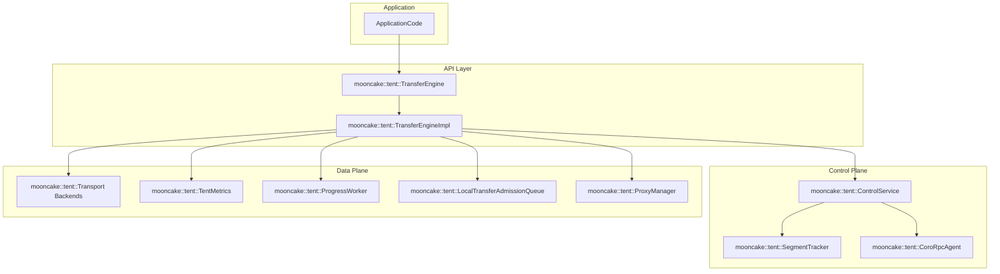
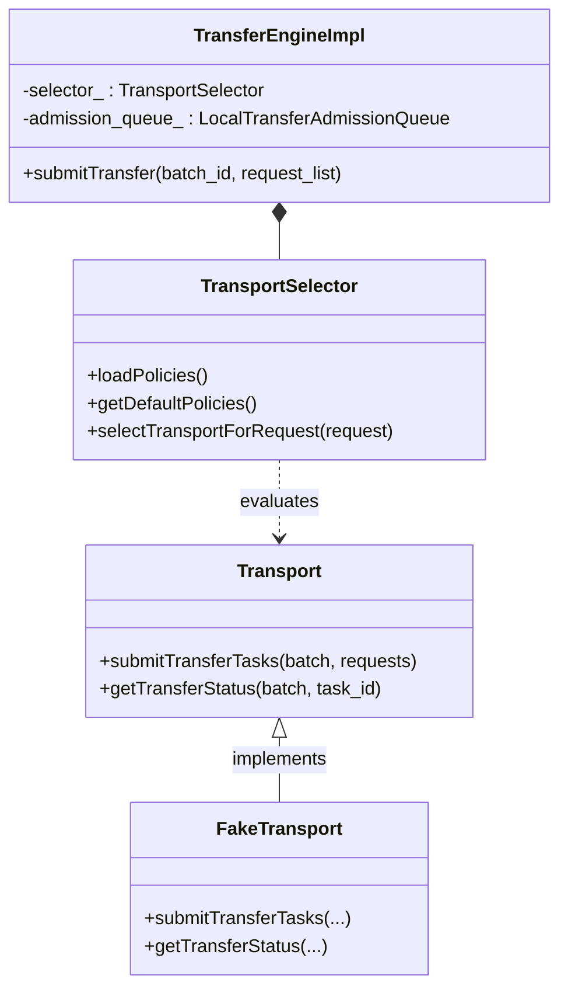
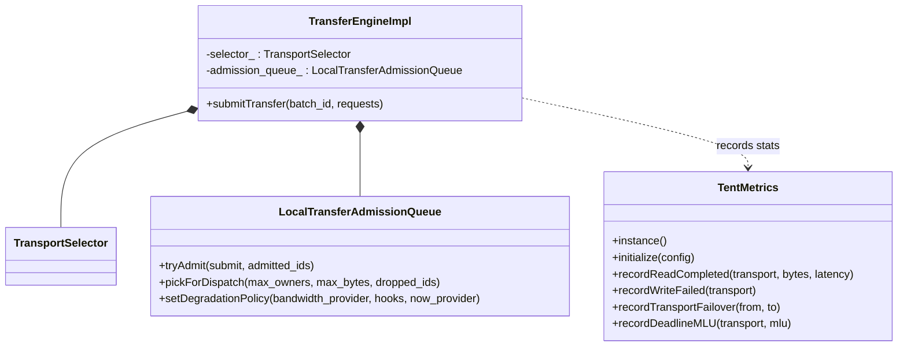
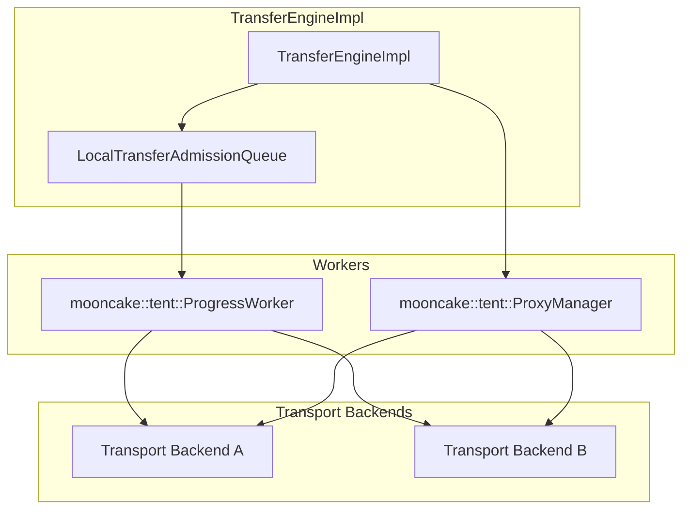

<!-- source: DeepWiki mcp.deepwiki.com · repo kvcache-ai/Mooncake · page 4.2 TENT (Transfer Engine Next) · fetched 2026-11-11 -->

# TENT (Transfer Engine Next)

Relevant source files

The following files were used as context for generating this wiki page:

- [mooncake-transfer-engine/tent/include/tent/platform/cuda.h](mooncake-transfer-engine/tent/include/tent/platform/cuda.h)
- [mooncake-transfer-engine/tent/include/tent/platform/cuda_utils.h](mooncake-transfer-engine/tent/include/tent/platform/cuda_utils.h)
- [mooncake-transfer-engine/tent/include/tent/platform/rocm.h](mooncake-transfer-engine/tent/include/tent/platform/rocm.h)
- [mooncake-transfer-engine/tent/include/tent/runtime/admission_queue.h](mooncake-transfer-engine/tent/include/tent/runtime/admission_queue.h)
- [mooncake-transfer-engine/tent/include/tent/runtime/amd_location.h](mooncake-transfer-engine/tent/include/tent/runtime/amd_location.h)
- [mooncake-transfer-engine/tent/include/tent/runtime/progress_worker.h](mooncake-transfer-engine/tent/include/tent/runtime/progress_worker.h)
- [mooncake-transfer-engine/tent/include/tent/runtime/proxy_manager.h](mooncake-transfer-engine/tent/include/tent/runtime/proxy_manager.h)
- [mooncake-transfer-engine/tent/include/tent/runtime/transfer_engine_impl.h](mooncake-transfer-engine/tent/include/tent/runtime/transfer_engine_impl.h)
- [mooncake-transfer-engine/tent/include/tent/runtime/transport.h](mooncake-transfer-engine/tent/include/tent/runtime/transport.h)
- [mooncake-transfer-engine/tent/include/tent/transport/shm/shm_transport.h](mooncake-transfer-engine/tent/include/tent/transport/shm/shm_transport.h)
- [mooncake-transfer-engine/tent/plugins/cuda/CMakeLists.txt](mooncake-transfer-engine/tent/plugins/cuda/CMakeLists.txt)
- [mooncake-transfer-engine/tent/plugins/cuda/cuda_plugin.cpp](mooncake-transfer-engine/tent/plugins/cuda/cuda_plugin.cpp)
- [mooncake-transfer-engine/tent/plugins/rocm/rocm_plugin.cpp](mooncake-transfer-engine/tent/plugins/rocm/rocm_plugin.cpp)
- [mooncake-transfer-engine/tent/src/platform/cpu_allocator.cpp](mooncake-transfer-engine/tent/src/platform/cpu_allocator.cpp)
- [mooncake-transfer-engine/tent/src/platform/cuda/cuda_allocator.cpp](mooncake-transfer-engine/tent/src/platform/cuda/cuda_allocator.cpp)
- [mooncake-transfer-engine/tent/src/platform/cuda/cuda_probe.cpp](mooncake-transfer-engine/tent/src/platform/cuda/cuda_probe.cpp)
- [mooncake-transfer-engine/tent/src/platform/rocm/rocm_allocator.cpp](mooncake-transfer-engine/tent/src/platform/rocm/rocm_allocator.cpp)
- [mooncake-transfer-engine/tent/src/platform/rocm/rocm_probe.cpp](mooncake-transfer-engine/tent/src/platform/rocm/rocm_probe.cpp)
- [mooncake-transfer-engine/tent/src/runtime/admission_queue.cpp](mooncake-transfer-engine/tent/src/runtime/admission_queue.cpp)
- [mooncake-transfer-engine/tent/src/runtime/memory_prober.cpp](mooncake-transfer-engine/tent/src/runtime/memory_prober.cpp)
- [mooncake-transfer-engine/tent/src/runtime/progress_worker.cpp](mooncake-transfer-engine/tent/src/runtime/progress_worker.cpp)
- [mooncake-transfer-engine/tent/src/runtime/proxy_manager.cpp](mooncake-transfer-engine/tent/src/runtime/proxy_manager.cpp)
- [mooncake-transfer-engine/tent/src/runtime/remote_stage_operation.cpp](mooncake-transfer-engine/tent/src/runtime/remote_stage_operation.cpp)
- [mooncake-transfer-engine/tent/src/runtime/remote_stage_operation.h](mooncake-transfer-engine/tent/src/runtime/remote_stage_operation.h)
- [mooncake-transfer-engine/tent/src/runtime/transfer_engine_impl.cpp](mooncake-transfer-engine/tent/src/runtime/transfer_engine_impl.cpp)
- [mooncake-transfer-engine/tent/src/transport/bufio/bufio_transport.cpp](mooncake-transfer-engine/tent/src/transport/bufio/bufio_transport.cpp)
- [mooncake-transfer-engine/tent/src/transport/io_uring/io_uring_transport.cpp](mooncake-transfer-engine/tent/src/transport/io_uring/io_uring_transport.cpp)
- [mooncake-transfer-engine/tent/src/transport/shm/shm_transport.cpp](mooncake-transfer-engine/tent/src/transport/shm/shm_transport.cpp)
- [mooncake-transfer-engine/tent/tests/CMakeLists.txt](mooncake-transfer-engine/tent/tests/CMakeLists.txt)
- [mooncake-transfer-engine/tent/tests/admission_queue_test.cpp](mooncake-transfer-engine/tent/tests/admission_queue_test.cpp)
- [mooncake-transfer-engine/tent/tests/engine_failover_e2e_test.cpp](mooncake-transfer-engine/tent/tests/engine_failover_e2e_test.cpp)
- [mooncake-transfer-engine/tent/tests/local_memory_lifecycle_test.cpp](mooncake-transfer-engine/tent/tests/local_memory_lifecycle_test.cpp)
- [mooncake-transfer-engine/tent/tests/progress_worker_test.cpp](mooncake-transfer-engine/tent/tests/progress_worker_test.cpp)
- [mooncake-transfer-engine/tent/tests/proxy_shutdown_timeout_test.cpp](mooncake-transfer-engine/tent/tests/proxy_shutdown_timeout_test.cpp)
- [mooncake-transfer-engine/tent/tests/rocm_platform_test.cpp](mooncake-transfer-engine/tent/tests/rocm_platform_test.cpp)
- [mooncake-transfer-engine/tent/tests/shm_transport_test.cpp](mooncake-transfer-engine/tent/tests/shm_transport_test.cpp)
- [mooncake-transfer-engine/tent/tests/stage_buffer_concurrency_test.cpp](mooncake-transfer-engine/tent/tests/stage_buffer_concurrency_test.cpp)

## Purpose and Scope
This document covers the technical design and internal implementation of **TENT (Transfer Engine Next)**, the high-performance runtime subsystem in Mooncake for heterogeneous, point-to-point data transfers. It focuses on TENT’s support for dynamic path selection across multiple transports, telemetry-driven admission scheduling, failure and failover handling, its declarative and extensible API, and key components such as admission queues, proxy and progress workers, and platform plugins.

---

## 1. Namespace Architecture & Declarative API

TENT organizes its core runtime logic within the `mooncake::tent` namespace. The primary application interface is the declarative `TransferEngine` API which internally delegates processing to its implementation class `TransferEngineImpl`. Control plane interactions (metadata, RPCs, handshakes) are handled by the `ControlService` and RPC agents, while data plane I/O is managed by dedicated transport backends, workers, admission queues, and proxy managers.

### Diagram: Architecture to Code Entity Mapping

- **`TransferEngine` / `TransferEngineImpl`**: The `TransferEngine` class provides the external declarative API for clients, handling transfer submissions and queries. Its concrete implementation `TransferEngineImpl` orchestrates internal state, admission control, transport dispatch, and failure recovery [mooncake-transfer-engine/tent/include/tent/runtime/transfer_engine_impl.h:37-51]().
- **Control Plane**: This includes RPC clients and services such as `ControlService` and `CoroRpcAgent`, responsible for segment metadata management, bootstrap handshakes, and remote control messages [mooncake-transfer-engine/tent/src/runtime/control_plane.cpp:54-149]().
- **Data Plane Components**: Transport backends handle actual data movement over various hardware protocols. The `ProgressWorker` polls and advances task completion state, while the `ProxyManager` deals with RPC-based peer coordination [mooncake-transfer-engine/tent/src/runtime/proxy_manager.cpp:25-36](). The `LocalTransferAdmissionQueue` regulates flow control and deadlines for incoming requests [mooncake-transfer-engine/tent/src/runtime/admission_queue.cpp:77-82]().
- **Telemetry and Metrics**: `TentMetrics` collects observability data for transfer status, failover events, bandwidth usage, and SLA compliance [mooncake-transfer-engine/tent/src/runtime/transfer_engine_impl.cpp:43-44]().

Sources:  
[mooncake-transfer-engine/tent/include/tent/runtime/transfer_engine_impl.h:37-51]()  
[mooncake-transfer-engine/tent/src/runtime/transfer_engine_impl.cpp:15-46]()  
[mooncake-transfer-engine/tent/src/runtime/control_plane.cpp:54-149]()

---

## 2. Dynamic Path Selection & Transport Routing

TENT supports a wide range of transport protocols encapsulated by the `TransportType` enum, including `RDMA`, `NVLINK`, `SHM`, `GDS`, `TCP`, `AscendDirect`, `HP_TCP`, and others. The `TransportSelector` class dynamically chooses the most suitable transport path for each transfer based on policy, segment attributes, priority, locality, and hardware capabilities.

### Diagram: Transport Selection & Routing Mapping

- The **`TransportSelector`** evaluates configured policies that match request attributes (e.g., segment types like memory or file, machine locality, size ranges, priority levels) to determine a preferred transport.  
- **Default policies** provide fallback transport chains when no explicit policy is set—e.g., preferring `GDS` and `IOURING` for file storage and `NVLINK` or `RDMA` for memory segments [mooncake-transfer-engine/tent/src/runtime/transport_selector.cpp:84-120]().  
- Transport backends implement the full lifecycle of task submission, polling, and completion reporting.

Sources:  
[mooncake-transfer-engine/tent/include/tent/runtime/transfer_engine_impl.h:64-90]()  
[mooncake-transfer-engine/tent/include/tent/runtime/transport_selector.h]()  
[mooncake-transfer-engine/tent/src/runtime/transport_selector.cpp:84-120]()

---

## 3. Telemetry-Driven Scheduling & Admission Control

TENT integrates a telemetry-driven admission control using the `LocalTransferAdmissionQueue` and the `TentMetrics` subsystem to prioritize, schedule, and monitor transfers according to QoS and deadline policies.

### Diagram: Admission Control and Telemetry Integration

- **`LocalTransferAdmissionQueue`** enforces queue limits on outstanding request owners and bytes, incorporating reserves for internal staging operations to prevent starvation [mooncake-transfer-engine/tent/include/tent/runtime/admission_queue.h:41-70]().  
- Transfers carry QoS priorities (`PRIO_HIGH`, `PRIO_MEDIUM`, `PRIO_LOW`) used for strict head-of-line scheduling [mooncake-transfer-engine/tent/include/tent/common/types.h:32-35]().  
- Requests may optionally include an absolute deadline timestamp (`deadline_ns`). The system calculates Macro-Level Utilization (MLU) of the deadline window as `actual_transfer_time / available_window` to observe SLA feasibility [mooncake-transfer-engine/tent/include/tent/common/types.h:170-180]().  
- The admission queue supports deadline-aware dispatch, promoting owners with imminent deadlines and optionally dropping infeasible transfers based on predicted MLU and bandwidth estimates, raising degradation hooks for local recompute or compression [mooncake-transfer-engine/tent/src/runtime/admission_queue.cpp:130-180]().  
- **`TentMetrics`** exposes a Prometheus-compatible HTTP endpoint for runtime monitoring, uses label cells and lock-free atomic counters for high-throughput update paths, and tracks detailed transfer statistics and failover counts [mooncake-transfer-engine/tent/include/tent/metrics/tent_metrics.h](), [mooncake-transfer-engine/tent/src/metrics/tent_metrics.cpp]().

Sources:  
[mooncake-transfer-engine/tent/include/tent/common/types.h:32-35, 170-180]()  
[mooncake-transfer-engine/tent/include/tent/runtime/admission_queue.h:41-70]()  
[mooncake-transfer-engine/tent/include/tent/metrics/tent_metrics.h:60-114]()  
[mooncake-transfer-engine/tent/src/metrics/tent_metrics.cpp:126-172]()  
[mooncake-transfer-engine/tent/src/runtime/admission_queue.cpp:60-180]()  
[mooncake-transfer-engine/tent/tests/CMakeLists.txt:56-61]()

---

## 4. Failure Handling, Failover, and Quarantine

TENT implements robust failure detection and failover to maintain transfer throughput and data correctness under adverse conditions.

- Each transfer attempt is tracked in the `TaskInfo` structure, which records its type, current status, failover count, and the stage of failure attribution (submission vs. polling) [mooncake-transfer-engine/tent/include/tent/runtime/transfer_engine_impl.h:64-109]().  
- Upon transport failure on a task, TENT initiates failover to an alternative transport path selected by the `TransportSelector`, incrementing failover counts and recording the event via `TentMetrics::recordTransportFailover()` [mooncake-transfer-engine/tent/include/tent/metrics/tent_metrics.h:95-96]().  
- A batch of transfers may be quarantined if it experiences repeated reclaim failures during resource cleanup. After `kMaxReclaimAttempts` (4096) consecutive errors, it is marked abandoned, the errors stop propagating warnings, and the batch is isolated until shutdown, preventing resource leaks or deadlocks in the engine [mooncake-transfer-engine/tent/src/runtime/transfer_engine_impl.cpp:53-78]().

Sources:  
[mooncake-transfer-engine/tent/include/tent/runtime/transfer_engine_impl.h:60-110]()  
[mooncake-transfer-engine/tent/include/tent/metrics/tent_metrics.h:95-125]()  
[mooncake-transfer-engine/tent/src/runtime/transfer_engine_impl.cpp:53-78]()

---

## 5. Configuration System

TENT uses a layered configuration system supporting JSON files, environment variable overrides, and programmatic APIs.

- The `Config` class parses JSON or string-based configurations, supports environment variable overrides (with `MC_` prefix), and offers typed accessor methods including boolean and array retrieval [mooncake-transfer-engine/tent/src/runtime/transfer_engine_impl.cpp:90-185](), [mooncake-transfer-engine/tent/src/common/config.cpp:40-163]().  
- Key configuration parameters include:
  - `metrics/enabled`: Enables or disables metric collection and HTTP endpoint [mooncake-transfer-engine/tent/include/tent/metrics/tent_metrics.h:76-83]().  
  - `rpc_server_port` and `rpc_server_threads`: Control the control plane RPC server endpoint and concurrency [mooncake-transfer-engine/tent/src/runtime/transfer_engine_impl.cpp:121-180]().  
  - `transports/force_tcp`: Forces the engine to use TCP only, disabling accelerated paths like RDMA and HP_TCP [mooncake-transfer-engine/tent/src/runtime/transfer_engine_impl.cpp:98]() (via `PreservedTentConfigOverrides::force_tcp`).

Sources:  
[mooncake-transfer-engine/tent/include/tent/metrics/tent_metrics.h:76-83]()  
[mooncake-transfer-engine/tent/src/runtime/transfer_engine_impl.cpp:90-185]()  
[mooncake-transfer-engine/tent/src/common/config.cpp:40-163]()

---

## 6. Proxy and Progress Workers

TENT employs dedicated worker threads for coordinated transfer management.

### Diagram: Proxy and Progress Workers Architecture

- **`ProgressWorker`** is responsible for polling transports’ completion queues, advancing task states, and triggering notifications. It implements throttled polling with exponential backoff to balance CPU utilization and latency [mooncake-transfer-engine/tent/include/tent/runtime/transfer_engine_impl.h:54-62](), [mooncake-transfer-engine/tent/src/runtime/progress_worker.cpp]()  
- **`ProxyManager`** manages control plane RPC operations that support transport establishment, address handshakes, and buffer pinning/unpinning. It runs multiple threads (shards) for concurrency and supports deferred cleanup of staging buffers [mooncake-transfer-engine/tent/src/runtime/proxy_manager.cpp:25-36]().

Sources:  
[mooncake-transfer-engine/tent/include/tent/runtime/transfer_engine_impl.h:54-62]()  
[mooncake-transfer-engine/tent/src/runtime/proxy_manager.cpp]()  
[mooncake-transfer-engine/tent/include/tent/runtime/proxy_manager.h]()  
[mooncake-transfer-engine/tent/src/runtime/progress_worker.cpp]()  
[mooncake-transfer-engine/tent/include/tent/runtime/progress_worker.h]()

---

## 7. Platform Plugins

TENT supports various hardware platforms via plugin abstractions implemented through the `Platform` interface. This modular design supports rapid extension and hardware heterogeneity.

- The **`Platform`** abstraction exposes APIs for device discovery, memory allocation, and buffer registration that differ per hardware type [mooncake-transfer-engine/tent/include/tent/runtime/platform.h]().  
- Supported platform plugins include:  
  - **CUDA** plugin implements NVIDIA GPU support with memory allocators and probes [mooncake-transfer-engine/tent/src/platform/cuda/cuda_allocator.cpp](), [mooncake-transfer-engine/tent/src/platform/cuda/cuda_probe.cpp]().  
  - **ROCm** plugin for AMD GPUs includes `RocmAllocator` and device probing code [mooncake-transfer-engine/tent/src/platform/rocm/rocm_allocator.cpp](), [mooncake-transfer-engine/tent/src/platform/rocm/rocm_probe.cpp]().  
  - **XPU** plugin supports Intel XPUs, leveraging SYCL backends [mooncake-transfer-engine/tent/src/platform/xpu/xpu_platform.cpp](), [mooncake-transfer-engine/tent/src/platform/xpu/xpu_sycl_backend.h]().  
  - **Ascend** plugin supports Ascend AI processors with direct transport integration [mooncake-transfer-engine/tent/src/runtime/transfer_engine_impl.cpp:101-103]() (via `PreservedTentConfigOverrides::ascend_agent_mode`, `ascend_store_te_init`, `ascend_fabric_mem`).

These platform plugins facilitate optimal performance by directly utilizing device-specific features and allocation strategies within the common TENT runtime.

Sources:  
[mooncake-transfer-engine/tent/include/tent/runtime/platform.h]()  
[mooncake-transfer-engine/tent/src/platform/cuda/cuda_allocator.cpp]()  
[mooncake-transfer-engine/tent/src/platform/cuda/cuda_probe.cpp]()  
[mooncake-transfer-engine/tent/src/platform/rocm/rocm_allocator.cpp]()  
[mooncake-transfer-engine/tent/src/platform/rocm/rocm_probe.cpp]()  
[mooncake-transfer-engine/tent/src/platform/xpu/xpu_platform.cpp]()  
[mooncake-transfer-engine/tent/src/platform/xpu/xpu_sycl_backend.h]()  
[mooncake-transfer-engine/tent/src/runtime/transfer_engine_impl.cpp:101-103]()

---

# Summary Table: Natural Language Concepts to Code Entities

| Concept                         | Key Code Entities / Files                                  |
|--------------------------------|------------------------------------------------------------|
| Declarative API                | `TransferEngine` ([mooncake-transfer-engine/tent/include/tent/transfer_engine.h]())        |
| Core Runtime Implementation   | `TransferEngineImpl` ([mooncake-transfer-engine/tent/src/runtime/transfer_engine_impl.cpp]()) |
| Dynamic Transport Selection   | `TransportSelector` ([mooncake-transfer-engine/tent/include/tent/runtime/transport_selector.h]())       |
| Transport Protocol Backends   | Implement `Transport` interface ([mooncake-transfer-engine/tent/include/tent/runtime/transport.h]())    |
| Admission Queue (Telemetry)   | `LocalTransferAdmissionQueue` ([mooncake-transfer-engine/tent/include/tent/runtime/admission_queue.h]())|
| Deadline & QoS Scheduling     | Request.deadline_ns field, MLU calculations ([mooncake-transfer-engine/tent/include/tent/common/types.h](), [mooncake-transfer-engine/tent/src/runtime/admission_queue.cpp]()) |
| Metrics & Observability       | `TentMetrics` ([mooncake-transfer-engine/tent/include/tent/metrics/tent_metrics.h](), [mooncake-transfer-engine/tent/src/metrics/tent_metrics.cpp]()) |
| Failure Handling & Failover   | `TaskInfo` tracking ([mooncake-transfer-engine/tent/include/tent/runtime/transfer_engine_impl.h]()), failover logic ([mooncake-transfer-engine/tent/src/runtime/transfer_engine_impl.cpp]()) |
| Batch Quarantine              | `Batch` reclaim logic ([mooncake-transfer-engine/tent/src/runtime/transfer_engine_impl.cpp]()) |
| Proxy and Progress Workers    | `ProxyManager` ([mooncake-transfer-engine/tent/src/runtime/proxy_manager.cpp]()), `ProgressWorker` ([mooncake-transfer-engine/tent/src/runtime/progress_worker.cpp]()) |
| Platform Plugin Architecture  | `Platform` interface and implementations ([mooncake-transfer-engine/tent/include/tent/runtime/platform.h](), [mooncake-transfer-engine/tent/src/platform/cuda/cuda_allocator.cpp]()) |

---

This page documents the implementation details of TENT’s core runtime and its integration components responsible for efficient, scalable, and fault-tolerant transfer operations in Mooncake.

Sources:  
[mooncake-transfer-engine/tent/include/tent/runtime/transfer_engine_impl.h]()  
[mooncake-transfer-engine/tent/src/runtime/transfer_engine_impl.cpp]()  
[mooncake-transfer-engine/tent/include/tent/runtime/control_plane.h]()  
[mooncake-transfer-engine/tent/src/runtime/control_plane.cpp]()  
[mooncake-transfer-engine/tent/include/tent/common/types.h]()  
[mooncake-transfer-engine/tent/include/tent/runtime/admission_queue.h]()  
[mooncake-transfer-engine/tent/src/runtime/admission_queue.cpp]()  
[mooncake-transfer-engine/tent/include/tent/metrics/tent_metrics.h]()  
[mooncake-transfer-engine/tent/src/metrics/tent_metrics.cpp]()  
[mooncake-transfer-engine/tent/src/runtime/proxy_manager.cpp]()  
[mooncake-transfer-engine/tent/include/tent/runtime/proxy_manager.h]()  
[mooncake-transfer-engine/tent/src/runtime/progress_worker.cpp]()  
[mooncake-transfer-engine/tent/include/tent/runtime/progress_worker.h]()  
[mooncake-transfer-engine/tent/src/runtime/transport_selector.cpp]()  
[mooncake-transfer-engine/tent/include/tent/runtime/transport_selector.h]()  
[mooncake-transfer-engine/tent/include/tent/runtime/transport.h]()  
[mooncake-transfer-engine/tent/src/platform/cuda/cuda_allocator.cpp]()  
[mooncake-transfer-engine/tent/src/platform/cuda/cuda_probe.cpp]()  
[mooncake-transfer-engine/tent/src/platform/rocm/rocm_allocator.cpp]()  
[mooncake-transfer-engine/tent/src/platform/rocm/rocm_probe.cpp]()  
[mooncake-transfer-engine/tent/src/platform/xpu/xpu_platform.cpp]()  
[mooncake-transfer-engine/tent/src/platform/xpu/xpu_sycl_backend.h]()

---

