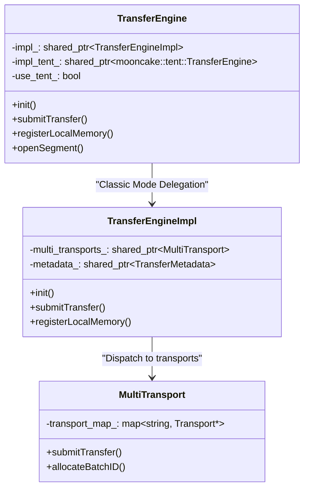

<!-- source: DeepWiki mcp.deepwiki.com · repo kvcache-ai/Mooncake · page 4.3 C++ API Reference · fetched 2026-11-11 -->

# C++ API Reference

<details>
<summary>Relevant source files</summary>

The following files were used as context for generating this wiki page:

- [docs/source/api-reference/cpp/transfer-engine.md](docs/source/api-reference/cpp/transfer-engine.md)
- [mooncake-integration/transfer_engine/transfer_engine_py.cpp](mooncake-integration/transfer_engine/transfer_engine_py.cpp)
- [mooncake-integration/transfer_engine/transfer_engine_py.h](mooncake-integration/transfer_engine/transfer_engine_py.h)
- [mooncake-transfer-engine/include/multi_transport.h](mooncake-transfer-engine/include/multi_transport.h)
- [mooncake-transfer-engine/include/transfer_engine.h](mooncake-transfer-engine/include/transfer_engine.h)
- [mooncake-transfer-engine/include/transfer_engine_c.h](mooncake-transfer-engine/include/transfer_engine_c.h)
- [mooncake-transfer-engine/include/transfer_engine_impl.h](mooncake-transfer-engine/include/transfer_engine_impl.h)
- [mooncake-transfer-engine/include/transport/transport.h](mooncake-transfer-engine/include/transport/transport.h)
- [mooncake-transfer-engine/src/multi_transport.cpp](mooncake-transfer-engine/src/multi_transport.cpp)
- [mooncake-transfer-engine/src/transfer_engine.cpp](mooncake-transfer-engine/src/transfer_engine.cpp)
- [mooncake-transfer-engine/src/transfer_engine_c.cpp](mooncake-transfer-engine/src/transfer_engine_c.cpp)
- [mooncake-transfer-engine/src/transfer_engine_impl.cpp](mooncake-transfer-engine/src/transfer_engine_impl.cpp)
- [mooncake-transfer-engine/tests/shm_transport_test.cpp](mooncake-transfer-engine/tests/shm_transport_test.cpp)
- [mooncake-transfer-engine/tests/transport_uint_test.cpp](mooncake-transfer-engine/tests/transport_uint_test.cpp)

</details>


## Purpose and Scope

This page documents the public C++ API of the `TransferEngine` class, declared in `[mooncake-transfer-engine/include/transfer_engine.h]()`. It details initialization, memory registration, segment operations, batch transfers, notification system, and status tracking essential for high-performance data movement across nodes or accelerators in Mooncake.

For the C language bindings, refer to [4.4](). For architecture and design insights on the Transfer Engine, see [4.1](). For deep dives into notification mechanisms, see [4.16]() and for batch and slice operations, see [4.13]().

---

## Type Aliases and Key Types

The `TransferEngine` class re-exports integral types from the transport layer to ensure a stable and consistent public interface. These types exist within the `mooncake` namespace.

| Alias               | Underlying Type             | Defined In                                                  |
|---------------------|-----------------------------|-------------------------------------------------------------|
| `TransferRequest`    | `Transport::TransferRequest`| `[mooncake-transfer-engine/include/transfer_engine.h:59]()`|
| `TransferStatus`     | `Transport::TransferStatus` | `[mooncake-transfer-engine/include/transfer_engine.h:60]()`|
| `TransferStatusEnum` | `Transport::TransferStatusEnum` | `[mooncake-transfer-engine/include/transfer_engine.h:61]()`|
| `SegmentHandle`      | `Transport::SegmentHandle`  | `[mooncake-transfer-engine/include/transfer_engine.h:62]()`|
| `SegmentID`          | `Transport::SegmentID` (`uint64_t`) | `[mooncake-transfer-engine/include/transfer_engine.h:63]()`|
| `BatchID`            | `Transport::BatchID` (`uint64_t`)   | `[mooncake-transfer-engine/include/transfer_engine.h:64]()`|
| `INVALID_BATCH_ID`   | `UINT64_MAX`                | `[mooncake-transfer-engine/include/transfer_engine.h:65]()`|
| `BufferEntry`        | `Transport::BufferEntry`    | `[mooncake-transfer-engine/include/transfer_engine.h:66]()`|
| `NicLoadStats`       | `Transport::NicLoadStats`   | `[mooncake-transfer-engine/include/transfer_engine.h:67]()`|

Sources: `[mooncake-transfer-engine/include/transfer_engine.h:59-67]()`

---

## TransferRequest Structure

`TransferRequest` encapsulates a unit of transfer work submitted to the engine. It is a struct nested inside the `Transport` class and aliased by `TransferEngine`.

| Field               | Description                                                                                                                |
|---------------------|----------------------------------------------------------------------------------------------------------------------------|
| `opcode`            | Operation code: `READ` (0) means remote to local; `WRITE` (1) means local to remote transfer.                               |
| `source`            | Local memory address (DRAM/VRAM) corresponding to the transfer buffer, must be registered for remote access.               |
| `target_id`         | Target segment ID obtained via `openSegment`, indicating which remote segment to access.                                   |
| `target_offset`     | Byte offset into the remote segment (or virtual segment address for RAM regions).                                          |
| `length`            | Number of bytes to transfer; internally, large transfers may be split into slices.                                         |
| `advise_retry_cnt`  | Hint to transports on the number of retries to attempt before failing.                                                     |
| `transport_hint`    | Transport pin for targeted scheduling (used by TENT).                                                                      |
| `task_group_id`     | Optional ID to group adjacent requests for coalesced scheduling.                                                           |
| `priority`          | Priority for transport scheduling in TENT mode; ignored otherwise.                                                        |
| `nic_hint`          | Optional local RNIC index for classic RDMA transport.                                                                      |

Sources: `[mooncake-transfer-engine/include/transport/transport.h:60-83]()`, `[mooncake-transfer-engine/include/transfer_engine.h:59]()`

---

## TransferStatus Enumeration and Structure

The transfer progress and outcome of each transfer task are represented via `TransferStatusEnum` and queried with a `TransferStatus` struct.

| Status Enum | Value | Description                                         |
|-------------|-------|-----------------------------------------------------|
| `WAITING`   | 0     | In the transfer phase.                              |
| `PENDING`   | 1     | Not supported.                                      |
| `INVALID`   | 2     | Invalid parameters.                                 |
| `CANCELED`  | 3     | Not supported.                                      |
| `COMPLETED` | 4     | Transfer completed.                                 |
| `TIMEOUT`   | 5     | Not supported.                                      |
| `FAILED`    | 6     | Transfer failed even after retries.                 |

Sources: `[mooncake-transfer-engine/include/transport/transport.h:86-94]()`, `[mooncake-transfer-engine/include/transfer_engine.h:60-61]()`

---

## API Overview Diagram

This diagram maps key components of the natural language "Transfer Engine" subsystem to code entities and APIs.

```mermaid
graph LR

subgraph TE["TransferEngine API Surface"]
    Init[/"init(metadata_conn_string, local_server_name,...)/"]
    Free[/"freeEngine()"/]
    RegMem["registerLocalMemory(void*, size_t, ...)"]
    UnregMem["unregisterLocalMemory(void*, ...)"]
    OpenSeg["openSegment(segment_name)"]
    CloseSeg["closeSegment(handle)"]
    RemoveSeg["removeLocalSegment(segment_name)"]
    AllocBatch["allocateBatchID(batch_size)"]
    SubmitTx["submitTransfer(batch_id, entries)"]
    SubmitScatter["submitScatter(ranges)"]
    SubmitWithNotify["submitTransferWithNotify(batch_id, entries, notify_msg)"]
    GetStatus["getTransferStatus(batch_id, task_id, status)"]
    GetBatchStatus["getBatchTransferStatus(batch_id, statuses)"]
    FreeBatch["freeBatchID(batch_id)"]
    InstallTr["installTransport(proto, args)"]
    UninstallTr["uninstallTransport(proto)"]
    GetTransport["getTransport(proto)"]
    NotifyByID["sendNotifyByID(target_id, notify_msg)"]
    NotifyByName["sendNotifyByName(target_name, notify_msg)"]
    GetNotifies["getNotifies(notifies)"]
end

subgraph Impl["Internal Layers"]
    TEImpl["TransferEngineImpl"]
    MT["MultiTransport"]
    Transports["Transport Backends"]
end

TE --> Init --> TEImpl
TE --> Free --> TEImpl
TE --> RegMem --> TEImpl
TE --> UnregMem --> TEImpl
TE --> OpenSeg --> TEImpl
TE --> CloseSeg --> TEImpl
TE --> RemoveSeg --> TEImpl
TE --> AllocBatch --> TEImpl
TE --> SubmitTx --> TEImpl
TE --> SubmitScatter --> TEImpl
TE --> SubmitWithNotify --> TEImpl
TE --> GetStatus --> TEImpl
TE --> GetBatchStatus --> TEImpl
TE --> FreeBatch --> TEImpl
TE --> InstallTr --> TEImpl
TE --> UninstallTr --> TEImpl
TE --> GetTransport --> TEImpl
TE --> NotifyByID --> TEImpl
TE --> NotifyByName --> TEImpl
TE --> GetNotifies --> TEImpl

TEImpl --> MT
MT --> Transports
```

Sources: `[mooncake-transfer-engine/include/transfer_engine.h:106-265]()`, `[mooncake-transfer-engine/src/transfer_engine.cpp:89-182]()`, `[mooncake-transfer-engine/include/multi_transport.h:30-140]()`

---

## Constructors and Initialization

### Constructors

```cpp
TransferEngine(bool auto_discover = false);
TransferEngine(bool auto_discover, const std::vector<std::string>& filter);
```

- `auto_discover`: Indicates whether the engine should automatically discover device topology and available transports during initialization.
- `filter`: Optional whitelist of device names to restrict topology discovery.

Internally, these create and hold a `TransferEngineImpl` instance which manages the actual functionality `[mooncake-transfer-engine/src/transfer_engine.cpp:89-94]()`.

---

### Initialization (`init`)

```cpp
int init(const std::string& metadata_conn_string,
         const std::string& local_server_name,
         const std::string& ip_or_host_name = "",
         uint64_t rpc_port = 12345);
```

Initializes the transfer engine by connecting to the metadata service and preparing local transport instances.

| Parameter                | Description                                                                        |
|--------------------------|------------------------------------------------------------------------------------|
| `metadata_conn_string`    | Metadata service connection info (e.g., `etcd://127.0.0.1:2379`, or `P2PHANDSHAKE`).|
| `local_server_name`       | Unique local server name for this instance.                                       |
| `ip_or_host_name`         | Optional IP address or hostname for RPC binding. Defaults to empty.                |
| `rpc_port`                | Optional RPC port for metadata communication. Defaults to `12345`.                |

Returns 0 on success, or a non-zero error code otherwise `[mooncake-transfer-engine/src/transfer_engine.cpp:128-135]()`.

---

### Cleanup (`freeEngine`)

```cpp
int freeEngine();
```

Releases all resources held by the engine, including transports, segments, registered memory, and metadata connections. Invoked automatically by the destructor.

Also detaches shutdown tokens used for graceful termination `[mooncake-transfer-engine/src/transfer_engine.cpp:147-153]()`.

---

## Memory Registration

Buffers must be registered with the engine to pin memory and prepare remote access keys before any transfer.

### `registerLocalMemory`

```cpp
int registerLocalMemory(void* addr, size_t length,
                        const std::string& location = kWildcardLocation,
                        bool remote_accessible = true,
                        bool update_metadata = true);
```

Registers a local buffer for remote accessibility.

| Parameter          | Description                                             |
|--------------------|---------------------------------------------------------|
| `addr`             | Pointer to the starting address of the buffer.          |
| `length`           | Size of the buffer in bytes.                             |
| `location`         | Logical location identifier (e.g., `"cpu:0"`, `"cuda:0"`). Defaults to wildcard to auto-detect. |
| `remote_accessible` | If true, buffer access keys are published to remote peers.|
| `update_metadata`   | If true, immediately updates segment metadata remotely.|

Returns 0 on success or a negative error code otherwise `[mooncake-transfer-engine/src/transfer_engine.cpp:188-193]()`.

---

### `unregisterLocalMemory`

```cpp
int unregisterLocalMemory(void* addr, bool update_metadata = true);
```

Unregisters a previously registered buffer and optionally updates metadata to inform peers.

Sources: `[mooncake-transfer-engine/src/transfer_engine.cpp:196-198]()`.

---

### Batch Memory Registration APIs

These APIs efficiently batch register or unregister multiple buffers:

```cpp
int registerLocalMemoryBatch(const std::vector<BufferEntry>& buffer_list,
                             const std::string& location);

int unregisterLocalMemoryBatch(const std::vector<void*>& addr_list);
```

Sources: `[mooncake-transfer-engine/include/transfer_engine.h:206-211]()`.

---

### Multi-Protocol Memory APIs

When `ENABLE_MULTI_PROTOCOL` is enabled, the engine supports protocol-specific memory registration/unregistration:

```cpp
int mp_registerLocalMemory(
    std::unordered_map<std::string, std::vector<RegisteredBuffer>>& buffer_map);

int mp_unregisterLocalMemory(
    std::unordered_map<std::string, std::vector<RegisteredBuffer>>& buffer_map);
```

`RegisteredBuffer` wraps buffer details including memory location, remote accessibility, and a flag to trigger metadata update.

Sources: `[mooncake-transfer-engine/include/transfer_engine.h:88-105]()` and `[mooncake-transfer-engine/include/transfer_engine_impl.h:193-202]()`.

---

## Segment Management

### Opening a Segment

```cpp
SegmentHandle openSegment(const std::string& segment_name);
```

Queries the metadata server to resolve a segment's ID and prepare for transfer operations. Returns the segment handle or error codes on failure `[mooncake-transfer-engine/src/transfer_engine.cpp:172-174]()`.

---

### Checking Segment Status

```cpp
Status CheckSegmentStatus(SegmentID sid);
```

Verifies segment reachability and liveness `[mooncake-transfer-engine/src/transfer_engine.cpp:176-178]()`.

---

### Closing and Removing Segments

```cpp
int closeSegment(SegmentHandle handle);
int removeLocalSegment(const std::string& segment_name);
```

Closes handles and removes local segment registrations, releasing any associated register resources `[mooncake-transfer-engine/src/transfer_engine.cpp:180-186]()`.

---

## Batch Transfer Operations

### Allocating a Batch

```cpp
BatchID allocateBatchID(size_t batch_size);
```

Prepares a batch descriptor for grouping multiple transfer requests. Returned `BatchID` acts as an opaque handle for submitting and tracking these requests `[mooncake-transfer-engine/include/multi_transport.h:56]()`.

---

### Submitting Transfers

```cpp
Status submitTransfer(BatchID batch_id,
                      const std::vector<TransferRequest>& entries);
```

Dispatches the batch of transfers asynchronously. `MultiTransport` inside the `TransferEngineImpl` selects the suitable transport backend and sends the slices.

Sources: `[mooncake-transfer-engine/src/transfer_engine_impl.cpp:128-143]()`.

---

### Freeing a Batch

```cpp
Status freeBatchID(BatchID batch_id);
```

Must be called after all batch transfers complete. This method frees internal metadata and transport resources associated with the batch. It may defer cleanup if tasks remain in-flight, spawning a cleanup thread `[mooncake-transfer-engine/src/multi_transport.cpp:120-152]()`.

---

### Multi-Protocol Submit

```cpp
Status mp_submitTransfer(BatchID batch_id,
                         const std::vector<TransferRequest>& entries,
                         std::string& proto);
```

Allows specifying a preferred transport protocol for the batch submission `[mooncake-transfer-engine/include/transfer_engine_impl.h:203-204]()`.

---

## Scatter Transfer Operations

Enable efficient partial scatter/gather transfers between a remote segment and multiple local buffers.

### ScatterTransferRange Struct

Defines a scatter transfer operation range with multiple sub-slices:

```cpp
struct ScatterTransferRange {
    TransferRequest::OpCode opcode;
    std::string remote_segment;
    uint64_t remote_base_offset;
    size_t remote_size;
    void* local_buffer;
    size_t local_capacity;
    std::span<const size_t> local_offsets;
    std::span<const size_t> remote_offsets;
    std::span<const size_t> lengths;
    std::function<void(size_t, const Status&)> on_fragment_complete;
    int intent_type;
};
```

Sources: `[mooncake-transfer-engine/include/transfer_engine.h:186-198]()`.

---

### ScatterTransferOperation Class

An opaque, move-only handle representing an active scatter transfer batch.

- `wait()`: Blocks until the entire scatter operation completes.
- `waitFor(std::chrono::nanoseconds timeout)`: Blocks until completion or timeout.

Internally, it wraps a `shared_ptr` to a `ScatterTransferOperation` object that manages transfer submission and waits for completion `[mooncake-integration/transfer_engine/transfer_engine_py.cpp:63-127]()`.

---

### Submitting Scatter Operations

```cpp
ScatterTransferOperation submitScatter(
    const std::vector<ScatterTransferRange>& ranges);
```

Submits scatter transfers asynchronously and returns a handle for completion tracking `[mooncake-transfer-engine/include/transfer_engine.h:200-201]()`.

```cpp
Status transferScatter(const std::vector<ScatterTransferRange>& ranges);
```

Submits and blocks until completion `[mooncake-transfer-engine/include/transfer_engine.h:202-203]()`.

---

## Notification System

The Transfer Engine supports out-of-band notifications that can be triggered during or after transfer completion.

---

### NotifyDesc Structure

```cpp
struct NotifyDesc {
    std::string name;
    std::string notify_msg;
};
```

Used to carry notification messages alongside transfer batches `[mooncake-transfer-engine/include/transport/transport.h:59]()`.

---

### Submission API With Notification

```cpp
Status submitTransferWithNotify(BatchID batch_id,
                                const std::vector<TransferRequest>& entries,
                                TransferMetadata::NotifyDesc notify_msg);
```

Submits a batch and links the notification to the batch completion `[mooncake-transfer-engine/src/transfer_engine_impl.cpp:162-190]()`.

When `ENABLE_MULTI_PROTOCOL` is defined, a variant supporting protocol specification is available `[mooncake-transfer-engine/include/transfer_engine.h:201-204]()`.

---

### Notification Queries and Send APIs

- `int getNotifies(std::vector<NotifyDesc>& notifies);`  
  Retrieves pending received notifications.

- `int sendNotifyByID(SegmentID target_id, NotifyDesc notify_msg);`  
  Sends notification by target segment ID.

- `int sendNotifyByName(const std::string& target_name, NotifyDesc notify_msg);`  
  Sends notification by target segment name.

Sources: `[mooncake-transfer-engine/include/transfer_engine.h:216-224]()`.

---

## Status Tracking APIs

- **Task Status Query:**

```cpp
Status getTransferStatus(BatchID batch_id, size_t task_id, TransferStatus& status);
```

- **Batch Status Query:**

```cpp
Status getBatchTransferStatus(BatchID batch_id, std::vector<TransferStatus>& status_list);
```

Both queries allow monitoring progress or errors of individual transfers or entire batch submissions `[mooncake-transfer-engine/include/transfer_engine.h:226-231]()`.

---

## Transport Management

### Installing and Uninstalling Transports

```cpp
Transport* installTransport(const std::string& proto, void** args);
int uninstallTransport(const std::string& proto);
```

Install or uninstall named transport backends such as `"rdma"`, `"tcp"`, `"nvlink"`, etc.

### Accessing Installed Transports

```cpp
Transport* getTransport(const std::string& proto);
```

Retrieve a pointer to an installed transport instance.

Sources: `[mooncake-transfer-engine/src/transfer_engine.cpp:157-164]()` and `[mooncake-transfer-engine/include/transfer_engine.h:129-131]()`.

---

## Introspection and Utilities

- `std::string getLocalIpAndPort();`  
  Returns local IP address and RPC port for this engine instance.

- `int getRpcPort();`  
  Returns the RPC port number.

- `bool isUsingTent() const;`  
  Indicates if the TENT backend is active.

- `std::shared_ptr<mooncake::tent::TransferEngine> getTentEngine() const;`  
  Exposes the internal TENT engine for direct API calls when in TENT mode.

- `const std::string& getMetadataConnectionString() const;`  
  Returns the metadata connection string used during initialization.

- `int getNicLoadStats(std::vector<NicLoadStats>& stats);`  
  Queries NIC load statistics for all installed transports.

Sources: `[mooncake-transfer-engine/src/transfer_engine.cpp:166-170]()` and `[mooncake-transfer-engine/include/transfer_engine.h:133-150]()`, `[mooncake-transfer-engine/include/transfer_engine.h:257-262]()`.

---

## Internal Structure: Dual-Backend Design Diagram

Mooncake’s `TransferEngine` is implemented as a front-end interface delegating to two possible backends:

- `TransferEngineImpl` for the classic engine.
- `tent::TransferEngine` for the next-generation TENT implementation.

This design enables backward compatibility and experimentation with new transfer scheduling paradigms.



Sources: `[mooncake-transfer-engine/include/transfer_engine.h:106-145]()`, `[mooncake-transfer-engine/src/transfer_engine.cpp:89-122]()`.

---

## Complete Method Reference Table

| Method                                  | Return Type             | Description                                                                                   |
|---------------------------------------|------------------------|-----------------------------------------------------------------------------------------------|
| `TransferEngine(bool auto_discover)`  | —                      | Constructor enabling optional auto-discovery.                                                |
| `TransferEngine(bool auto_discover, const std::vector<std::string>& filter)` | — | Constructor with device filtering.                                                         |
| `TransferEngine(TransferEngine&& other)` | —                    | Move constructor.                                                                             |
| `operator=(TransferEngine&& other)`   | `TransferEngine&`       | Move assignment operator.                                                                     |
| `~TransferEngine()`                    | —                      | Destructor, frees engine resources.                                                          |
| `int init(...)`                       | `int`                  | Initializes engine with metadata connection and server info.                                 |
| `int freeEngine()`                    | `int`                  | Releases all engine resources explicitly.                                                    |
| `Transport* installTransport(const std::string& proto, void** args)` | `Transport*`            | Installs a transport protocol backend.                                                      |
| `int uninstallTransport(const std::string& proto)` | `int`                  | Uninstalls a transport backend.                                                             |
| `std::string getLocalIpAndPort()`    | `std::string`           | Gets local IP and bound port (RPC).                                                          |
| `int getRpcPort()`                   | `int`                   | Gets RPC port number.                                                                         |
| `bool isUsingTent() const`           | `bool`                  | Returns `true` if TENT backend is active.                                                    |
| `std::shared_ptr<mooncake::tent::TransferEngine> getTentEngine() const` | `shared_ptr` | Exposes the internal TENT engine.                                                            |
| `const std::string& getMetadataConnectionString() const` | `const std::string&` | Returns the metadata connection string.                                                      |
| `SegmentHandle openSegment(const std::string& segment_name)` | `SegmentHandle`          | Opens a remote segment by name.                                                              |
| `int getSegmentBuffers(SegmentHandle handle, std::vector<SegmentBufferInfo>& buffers)` | `int` | Replaces buffers with a snapshot of the segment's memory buffers.                            |
| `Status CheckSegmentStatus(SegmentID sid)` | `Status`                  | Checks reachability and liveness of a segment.                                              |
| `int closeSegment(SegmentHandle handle)` | `int`                   | Closes the segment handle.                                                                   |
| `int removeLocalSegment(const std::string& segment_name)` | `int`                   | Removes a local segment.                                                                     |
| `int registerLocalMemory(void* addr, size_t length, ...)` | `int`                   | Register a local memory buffer for transfer.                                                |
| `void* allocateSharedMemory(size_t length)` | `void*` | Allocates shared memory for `ShmTransport`.                                                  |
| `void* allocateSharedMemory(size_t length, const SharedMemoryOptions& opt)` | `void*` | Allocates shared memory with options.                                                        |
| `int freeSharedMemory(void* addr)`   | `int`                   | Frees shared memory.                                                                         |
| `int unregisterLocalMemory(void* addr, bool update_metadata)` | `int`                   | Unregister a local memory buffer.                                                           |
| `int registerLocalMemoryBatch(const std::vector<BufferEntry>& buffers, const std::string& location)` | `int` | Batch register multiple buffers.                                                          |
| `int unregisterLocalMemoryBatch(const std::vector<void*>& addr_list)` | `int`                   | Batch unregister multiple buffers.                                                         |
| `int mp_registerLocalMemory(std::unordered_map<std::string, std::vector<RegisteredBuffer>>&)` | `int` | Multi-protocol memory registration.                                                        |
| `int mp_unregisterLocalMemory(std::unordered_map<std::string, std::vector<RegisteredBuffer>>&)` | `int` | Multi-protocol memory unregistration.                                                      |
| `BatchID allocateBatchID(size_t batch_size)` | `BatchID` | Allocates a `BatchID` for grouping transfers.                                                |
| `Status submitTransfer(BatchID batch_id, const std::vector<TransferRequest>& entries)` | `Status`                 | Submit a batch of transfers asynchronously.                                                |
| `ScatterTransferOperation submitScatter(const std::vector<ScatterTransferRange>& ranges)` | `ScatterTransferOperation` | Submit scatter transfer operations asynchronously.                                    |
| `Status transferScatter(const std::vector<ScatterTransferRange>& ranges)` | `Status`                 | Submit scatter transfers synchronously.                                                   |
| `Status submitTransferWithNotify(BatchID batch_id, const std::vector<TransferRequest>& entries, NotifyDesc notify_msg)` | `Status` | Submit transfers with notification support.                                            |
| `Status mp_submitTransfer(BatchID batch_id, const std::vector<TransferRequest>& entries, std::string& proto)` | `Status` | Submit transfers specifying a protocol.                                               |
| `Status mp_submitTransferWithNotify(BatchID batch_id, const std::vector<TransferRequest>& entries, NotifyDesc notify_msg, std::string& proto)` | `Status` | Multi-protocol transfer with Notification.                                         |
| `int getNotifies(std::vector<NotifyDesc>& notifies)` | `int`                   | Retrieves pending notifications received.                                                 |
| `int sendNotifyByID(SegmentID target_id, NotifyDesc notify_msg)` | `int`                   | Sends notification by target ID.                                                         |
| `int sendNotifyByName(const std::string& target_name, NotifyDesc notify_msg)` | `int`                   | Sends notification by target segment name.                                              |
| `Status getTransferStatus(BatchID batch_id, size_t task_id, TransferStatus& status)` | `Status`                 | Query status of a single task in batch.                                                |
| `Status getBatchTransferStatus(BatchID batch_id, std::vector<TransferStatus>& status_list)` | `Status`                 | Query overall status of entire batch.                                                 |
| `Status freeBatchID(BatchID batch_id)` | `Status`                 | Frees batch resources after tasks completion.                                         |
| `Transport* getTransport(const std::string& proto)` | `Transport*`             | Gets installed transport by protocol name.                                            |
| `bool isTcpOnly()`                   | `bool`                  | Returns true if only TCP transport installed.                                          |
| `int getNicLoadStats(std::vector<NicLoadStats>& stats)` | `int`                   | Retrieves NIC load statistics for all installed transports.                           |

Sources: `[mooncake-transfer-engine/include/transfer_engine.h:106-265]()`

---

# Summary

The `TransferEngine` C++ API is the cornerstone for Mooncake's high-performance KVCache data transfer framework enabling:

- Initialization/configuration of transport backends and metadata connection.
- Memory registration to pin local buffers for remote access.
- Segment lookup and management to represent remote memory or file regions.
- Batch-oriented asynchronous transfer submission and status tracking.
- Scatter-gather operations for fine-grained data slices.
- Integrated notification system for out-of-band messaging between transfer clients.
- Fine control of transport installation and introspection.

This API is designed to shield callers from transport-specific complexity while providing flexible, performant transfer semantics needed in high-scale disaggregated LLM serving deployments.

Sources summary:  
- `[mooncake-transfer-engine/include/transfer_engine.h:15-265]()`  
- `[mooncake-transfer-engine/src/transfer_engine.cpp:1-203]()`  
- `[mooncake-transfer-engine/src/transfer_engine_impl.cpp:1-192]()`  
- `[mooncake-integration/transfer_engine/transfer_engine_py.cpp:1-203]()`  
- `[mooncake-transfer-engine/include/transport/transport.h:59]()`  
- `[mooncake-transfer-engine/include/multi_transport.h:20-140]()`

---

