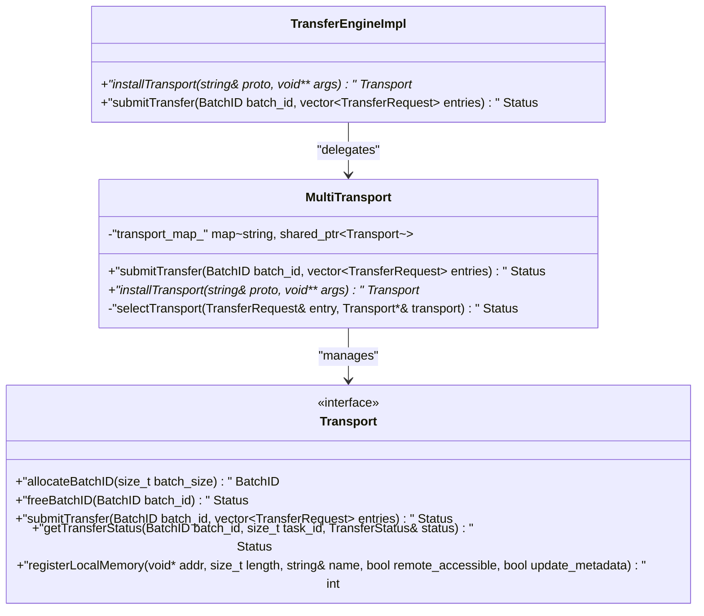
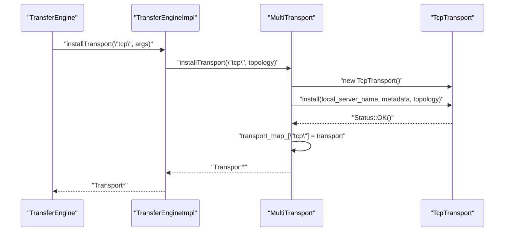
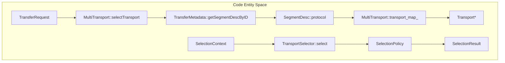
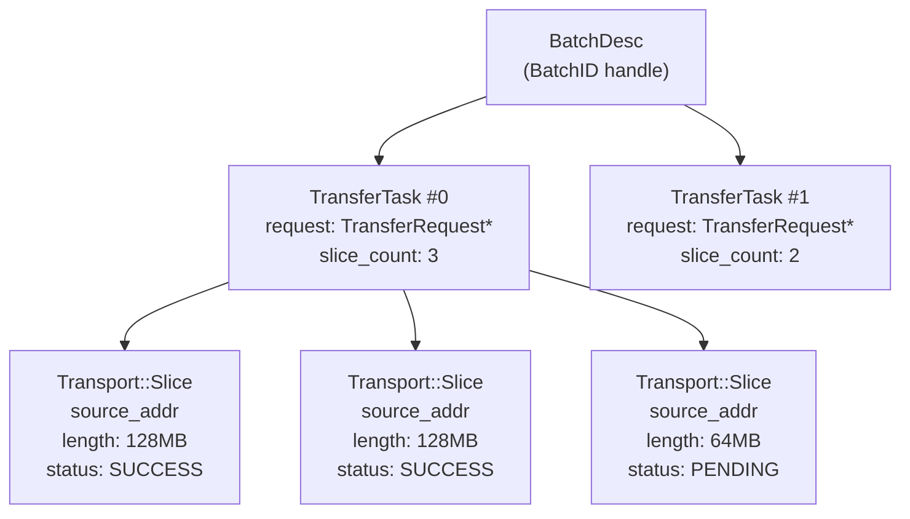

<!-- source: DeepWiki mcp.deepwiki.com · repo kvcache-ai/Mooncake · page 4.5 Transport Layer Architecture · fetched 2026-11-11 -->

# Transport Layer Architecture

Relevant source files

The following files were used as context for generating this wiki page:

- [docs/source/api-reference/cpp/transfer-engine.md](docs/source/api-reference/cpp/transfer-engine.md)
- [docs/source/design/tent/transport-selector.md](docs/source/design/tent/transport-selector.md)
- [mooncake-integration/transfer_engine/transfer_engine_py.cpp](mooncake-integration/transfer_engine/transfer_engine_py.cpp)
- [mooncake-integration/transfer_engine/transfer_engine_py.h](mooncake-integration/transfer_engine/transfer_engine_py.h)
- [mooncake-transfer-engine/include/multi_transport.h](mooncake-transfer-engine/include/multi_transport.h)
- [mooncake-transfer-engine/include/transfer_engine.h](mooncake-transfer-engine/include/transfer_engine.h)
- [mooncake-transfer-engine/include/transfer_engine_c.h](mooncake-transfer-engine/include/transfer_engine_c.h)
- [mooncake-transfer-engine/include/transfer_engine_impl.h](mooncake-transfer-engine/include/transfer_engine_impl.h)
- [mooncake-transfer-engine/include/transport/transport.h](mooncake-transfer-engine/include/transport/transport.h)
- [mooncake-transfer-engine/src/multi_transport.cpp](mooncake-transfer-engine/src/multi_transport.cpp)
- [mooncake-transfer-engine/src/transfer_engine.cpp](mooncake-transfer-engine/src/transfer_engine.cpp)
- [mooncake-transfer-engine/src/transfer_engine_c.cpp](mooncake-transfer-engine/src/transfer_engine_c.cpp)
- [mooncake-transfer-engine/src/transfer_engine_impl.cpp](mooncake-transfer-engine/src/transfer_engine_impl.cpp)
- [mooncake-transfer-engine/src/transport/rpc_communicator/CMakeLists.txt](mooncake-transfer-engine/src/transport/rpc_communicator/CMakeLists.txt)
- [mooncake-transfer-engine/tent/include/tent/common/types.h](mooncake-transfer-engine/tent/include/tent/common/types.h)
- [mooncake-transfer-engine/tent/include/tent/runtime/transport_selector.h](mooncake-transfer-engine/tent/include/tent/runtime/transport_selector.h)
- [mooncake-transfer-engine/tent/include/tent/transfer_engine.h](mooncake-transfer-engine/tent/include/tent/transfer_engine.h)
- [mooncake-transfer-engine/tent/src/CMakeLists.txt](mooncake-transfer-engine/tent/src/CMakeLists.txt)
- [mooncake-transfer-engine/tent/src/python/CMakeLists.txt](mooncake-transfer-engine/tent/src/python/CMakeLists.txt)
- [mooncake-transfer-engine/tent/src/python/pybind.cpp](mooncake-transfer-engine/tent/src/python/pybind.cpp)
- [mooncake-transfer-engine/tent/src/runtime/transport_loader.cpp](mooncake-transfer-engine/tent/src/runtime/transport_loader.cpp)
- [mooncake-transfer-engine/tent/src/runtime/transport_selector.cpp](mooncake-transfer-engine/tent/src/runtime/transport_selector.cpp)
- [mooncake-transfer-engine/tent/src/transfer_engine.cpp](mooncake-transfer-engine/tent/src/transfer_engine.cpp)
- [mooncake-transfer-engine/tent/src/transport/CMakeLists.txt](mooncake-transfer-engine/tent/src/transport/CMakeLists.txt)
- [mooncake-transfer-engine/tent/tests/test_python_guards.py](mooncake-transfer-engine/tent/tests/test_python_guards.py)
- [mooncake-transfer-engine/tent/tests/transport_selector_test.cpp](mooncake-transfer-engine/tent/tests/transport_selector_test.cpp)
- [mooncake-transfer-engine/tests/shm_transport_test.cpp](mooncake-transfer-engine/tests/shm_transport_test.cpp)
- [mooncake-transfer-engine/tests/transport_uint_test.cpp](mooncake-transfer-engine/tests/transport_uint_test.cpp)

This page documents the transport layer architecture in the Mooncake Transfer Engine. It covers the pluggable transport abstraction, transport installation via `installTransport`, protocol selection logic in `MultiTransport` and `TransportSelector`, and the `Transport` base class interface.

---

## Transport Base Class Interface

The `Transport` class serves as the foundational interface for all data movement backends in Mooncake. It abstracts memory registration, transfer submission, and status tracking, enabling the Transfer Engine to operate independently of specific hardware or network protocols [mooncake-transfer-engine/include/transport/transport.h:44-210]().

### Core Interface Overview

- **`TransferRequest`**: Describes a data movement operation, defining opcode (`READ` or `WRITE`), source buffer, target segment ID, target offset, length, and scheduling hints [mooncake-transfer-engine/include/transport/transport.h:60-84]().
- **`BatchID`**: An opaque identifier representing a batch of transfer requests, internally carrying a pointer to a `BatchDesc` structure [mooncake-transfer-engine/include/transport/transport.h:107-123]().
- **`submitTransfer`**: Submits a batch of transfer requests to hardware queues for asynchronous execution.
- **`getTransferStatus`**: Queries the progress or completion status of a transfer request [mooncake-transfer-engine/include/transport/transport.h:136-140]().
- **Memory Registration**: Registers memory buffers with the transport for remote or local access, respecting location and accessibility constraints.

### Interfaces and Code Entity Mapping

Title: "Transport and MultiTransport Class Hierarchy"

**Key Types Defined in `Transport`:**

| Type Name          | Underlying Type                | Description                                          |
|--------------------|-------------------------------|------------------------------------------------------|
| `SegmentID`        | `uint64_t`                    | Identifier for remote memory segments                |
| `BatchID`          | `uint64_t`                    | Opaque handle containing a pointer to `BatchDesc`    |
| `BufferDesc`       | `TransferMetadata::BufferDesc`| Metadata describing registered memory buffers        |
| `TransferRequest`  | struct                        | User request specifying operation details            |
| `TransferStatus`   | struct                        | Transfer progress and completion status              |

Sources: [mooncake-transfer-engine/include/transport/transport.h:44-210](), [mooncake-transfer-engine/src/multi_transport.cpp:88-107]()

---

## Pluggable Transport Architecture and Installation

Mooncake features a pluggable transport architecture that allows dynamic runtime loading and management of hardware and protocol backends such as RDMA, TCP, NVLink, and others.

### Transport Installation via `installTransport`

The `TransferEngine::installTransport` method calls into `TransferEngineImpl::installTransport`, which delegates to `MultiTransport::installTransport` to instantiate and register a transport backend by protocol name [mooncake-transfer-engine/include/transfer_engine.h:129](), [mooncake-transfer-engine/src/transfer_engine.cpp:157-160](), [mooncake-transfer-engine/include/transfer_engine_impl.h:105]().

**Installation flow:**
- `TransferEngineImpl` receives a protocol string and optional arguments.
- Delegates to `MultiTransport::installTransport` [mooncake-transfer-engine/src/transfer_engine_impl.cpp:105]().
- `MultiTransport` instantiates the appropriate transport subclass (e.g., `TcpTransport`) [mooncake-transfer-engine/src/multi_transport.cpp:838-840]().
- Registers the transport instance in `transport_map_` keyed by protocol [mooncake-transfer-engine/include/multi_transport.h:134]().

### Installation Sequence Diagram

Title: "Transport Installation Sequence"

Sources: [mooncake-transfer-engine/src/multi_transport.cpp:77-91](), [mooncake-transfer-engine/src/transfer_engine.cpp:130-160](), [mooncake-transfer-engine/include/transfer_engine.h:129](), [mooncake-transfer-engine/src/transfer_engine_impl.cpp:105](), [mooncake-transfer-engine/include/multi_transport.h:134]()

---

## Protocol Selection Logic in MultiTransport and TransportSelector

Mooncake uses a two-level approach for selecting transport backends:

1. **`MultiTransport` Selector:** Runtime dispatcher selecting transports based on the `TransferRequest` protocol and transport registry.
2. **`TransportSelector` in TENT:** Configuration-driven rule engine choosing transports based on criteria such as memory type, segment metadata, transfer size, and locality.

### MultiTransport Protocol Selection

- `MultiTransport::submitTransfer` iterates all transfer requests in a batch [mooncake-transfer-engine/src/multi_transport.cpp:300]().
- For each request, it invokes `selectTransport` [mooncake-transfer-engine/src/multi_transport.cpp:304]().
- `selectTransport` queries segment metadata via `TransferMetadata` [mooncake-transfer-engine/src/multi_transport.cpp:700]() and looks up the transport in `transport_map_` [mooncake-transfer-engine/src/multi_transport.cpp:710-712]().

### Protocol Selection Code Mapping

Title: "Protocol Selection Code Mapping"

Sources: [mooncake-transfer-engine/src/multi_transport.cpp:103-190](), [mooncake-transfer-engine/tent/include/tent/runtime/transport_selector.h:74-190]()

---

## Transfer Task Hierarchy and Data Flow

Transfers are organized hierarchically to facilitate efficient scheduling and batching:

- **`BatchDesc`**: Represents a batch of transfer requests grouped by the caller, identified by `BatchID` [mooncake-transfer-engine/include/transport/transport.h:107-123]().
- **`TransferTask`**: Represents each individual transfer request inside a batch [mooncake-transfer-engine/include/transport/transport.h:400-408]().
- **`Slice`**: The minimal dispatch unit representing a contiguous data range to be transferred [mooncake-transfer-engine/include/transport/transport.h:127-198]().

### Transfer Task Hierarchy Diagram

Title: "Transfer Task Hierarchy"

Sources: [mooncake-transfer-engine/include/transport/transport.h:101-210](), [mooncake-transfer-engine/src/multi_transport.cpp:94-107]()

---

## Protocol Summary

| Protocol String / Enum | Implementation Header                         | Key Feature                              |
|-----------------------|----------------------------------------------|------------------------------------------|
| `rdma`                | `rdma_transport/rdma_transport.h`            | High-bandwidth zero-copy RDMA transfers  |
| `tcp`                 | `tcp_transport/tcp_transport.h`              | Universal fallback network transport     |
| `nvlink` / `mnnvl`    | `nvlink_transport/nvlink_transport.h`        | Multi-node and intra-node NVLink peer transfers |
| `hip`                 | `hip_transport/hip_transport.h`               | AMD GPU-specific transport                |
| `musa`                | `musa_transport/musa_transport.h`             | MUSA GPU-specific transport               |
| `intranode_nvlink`    | `intranode_nvlink_transport/intranode_nvlink_transport.h` | Intra-node NVLink transport               |
| `efa`                 | `efa_transport/efa_transport.h`               | Amazon Elastic Fabric Adapter transport  |
| `cxl`                 | `cxl_transport/cxl_transport.h`               | Compute Express Link transport            |
| `shm`                 | `shm_transport/shm_transport.h`               | Shared memory intra-node communication    |
| `ubshmem`             | `ubshmem_transport/ubshmem_transport.h`      | Ascend UBShmem transport                  |
| `flagcx`              | `flagcx_transport/flagcx_transport.h`        | FlagCX transport                          |
| `ascend_direct`       | `ascend_transport/ascend_direct_transport/ascend_direct_transport.h` | Optimized transport for Huawei Ascend NPUs |
| `hccl`                | `ascend_transport/hccl_transport/hccl_transport.h` | Huawei Collective Communication Library transport |
| `heterogeneous_rdma`  | `ascend_transport/heterogeneous_rdma_transport.h` | Ascend heterogeneous RDMA transport       |
| `barex`               | `barex_transport/barex_transport.h`           | Barex transport                           |
| `nvmeof`              | `nvmeof_transport/nvmeof_transport.h`         | NVMe-oF transport                        |
| `nccl`                | `nccl_transport/nccl_transport.h`             | NVIDIA Collective Communications Library transport |
| `cxi`                 | `cxi_transport/cxi_transport.h`               | Cray Slingshot CXI transport              |
| `sunrise`             | `sunrise_link_transport/sunrise_link_transport.h` | Sunrise Link transport                    |
| `ub`                  | `kunpeng_transport/ub_transport.h`             | Kunpeng UB transport                      |

Sources:  
- Protocol headers and declarations in [mooncake-transfer-engine/src/multi_transport.cpp:23-87]()  
- Installation and mapping in [mooncake-transfer-engine/src/multi_transport.cpp:838-841]()  
- Memory allocator selection examples in [mooncake-integration/transfer_engine/transfer_engine_py.cpp:140-188]()

---

