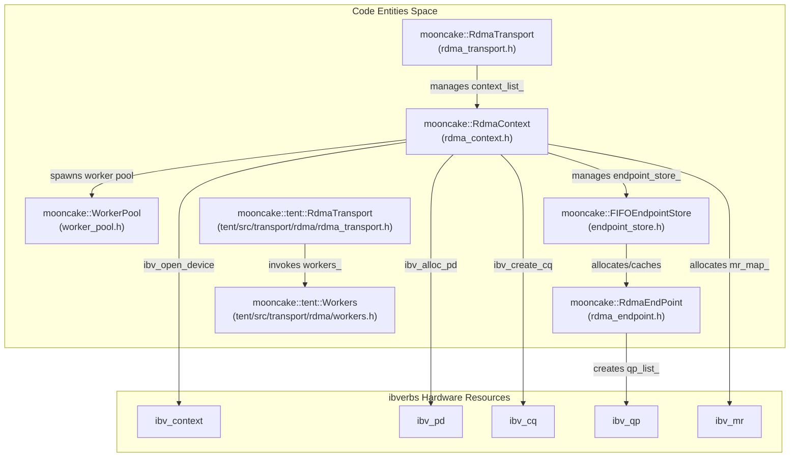
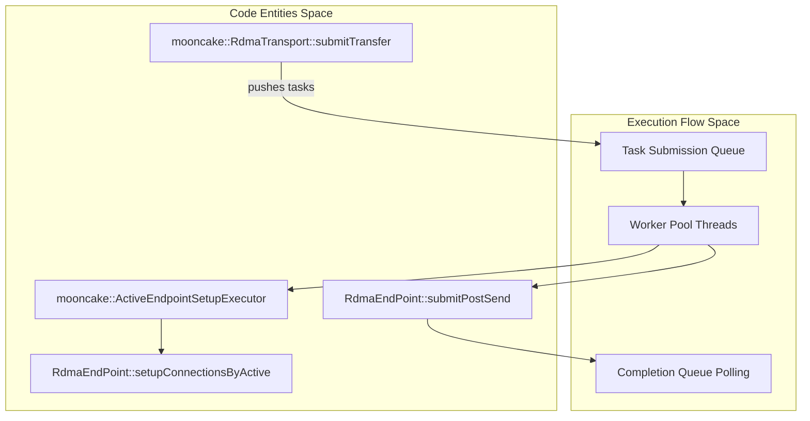
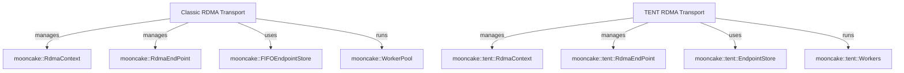

<!-- source: DeepWiki mcp.deepwiki.com · repo kvcache-ai/Mooncake · page 4.6 RDMA Transport · fetched 2026-11-11 -->

# RDMA Transport

Relevant source files

The following files were used as context for generating this wiki page:

- [docs/source/api-reference/cpp/index.md](docs/source/api-reference/cpp/index.md)
- [docs/source/api-reference/http/index.md](docs/source/api-reference/http/index.md)
- [docs/source/api-reference/python/index.md](docs/source/api-reference/python/index.md)
- [docs/source/design/tent/deadline-scheduling.md](docs/source/design/tent/deadline-scheduling.md)
- [docs/source/design/tent/failover.md](docs/source/design/tent/failover.md)
- [docs/source/design/tent/overview.md](docs/source/design/tent/overview.md)
- [docs/source/design/tent/slice-spraying.md](docs/source/design/tent/slice-spraying.md)
- [docs/source/design/tent/testing.md](docs/source/design/tent/testing.md)
- [docs/source/design/transfer-engine/index.md](docs/source/design/transfer-engine/index.md)
- [docs/source/zh_archive/transfer-engine.md](docs/source/zh_archive/transfer-engine.md)
- [mooncake-transfer-engine/include/CMakeLists.txt](mooncake-transfer-engine/include/CMakeLists.txt)
- [mooncake-transfer-engine/include/buffer_range_index.h](mooncake-transfer-engine/include/buffer_range_index.h)
- [mooncake-transfer-engine/include/config.h](mooncake-transfer-engine/include/config.h)
- [mooncake-transfer-engine/include/transport/rdma_transport/endpoint_store.h](mooncake-transfer-engine/include/transport/rdma_transport/endpoint_store.h)
- [mooncake-transfer-engine/include/transport/rdma_transport/rdma_context.h](mooncake-transfer-engine/include/transport/rdma_transport/rdma_context.h)
- [mooncake-transfer-engine/include/transport/rdma_transport/rdma_endpoint.h](mooncake-transfer-engine/include/transport/rdma_transport/rdma_endpoint.h)
- [mooncake-transfer-engine/include/transport/rdma_transport/rdma_transport.h](mooncake-transfer-engine/include/transport/rdma_transport/rdma_transport.h)
- [mooncake-transfer-engine/include/transport/rdma_transport/worker_pool.h](mooncake-transfer-engine/include/transport/rdma_transport/worker_pool.h)
- [mooncake-transfer-engine/src/config.cpp](mooncake-transfer-engine/src/config.cpp)
- [mooncake-transfer-engine/src/transport/rdma_transport/endpoint_store.cpp](mooncake-transfer-engine/src/transport/rdma_transport/endpoint_store.cpp)
- [mooncake-transfer-engine/src/transport/rdma_transport/rdma_context.cpp](mooncake-transfer-engine/src/transport/rdma_transport/rdma_context.cpp)
- [mooncake-transfer-engine/src/transport/rdma_transport/rdma_endpoint.cpp](mooncake-transfer-engine/src/transport/rdma_transport/rdma_endpoint.cpp)
- [mooncake-transfer-engine/src/transport/rdma_transport/rdma_transport.cpp](mooncake-transfer-engine/src/transport/rdma_transport/rdma_transport.cpp)
- [mooncake-transfer-engine/src/transport/rdma_transport/worker_pool.cpp](mooncake-transfer-engine/src/transport/rdma_transport/worker_pool.cpp)
- [mooncake-transfer-engine/tent/benchmark/hip_bandwidth_bench.cpp](mooncake-transfer-engine/tent/benchmark/hip_bandwidth_bench.cpp)
- [mooncake-transfer-engine/tent/include/tent/transport/rdma/context.h](mooncake-transfer-engine/tent/include/tent/transport/rdma/context.h)
- [mooncake-transfer-engine/tent/include/tent/transport/rdma/endpoint.h](mooncake-transfer-engine/tent/include/tent/transport/rdma/endpoint.h)
- [mooncake-transfer-engine/tent/include/tent/transport/rdma/endpoint_store.h](mooncake-transfer-engine/tent/include/tent/transport/rdma/endpoint_store.h)
- [mooncake-transfer-engine/tent/include/tent/transport/rdma/params.h](mooncake-transfer-engine/tent/include/tent/transport/rdma/params.h)
- [mooncake-transfer-engine/tent/include/tent/transport/rdma/promotion_policy.h](mooncake-transfer-engine/tent/include/tent/transport/rdma/promotion_policy.h)
- [mooncake-transfer-engine/tent/include/tent/transport/rdma/quota.h](mooncake-transfer-engine/tent/include/tent/transport/rdma/quota.h)
- [mooncake-transfer-engine/tent/include/tent/transport/rdma/rail_monitor.h](mooncake-transfer-engine/tent/include/tent/transport/rdma/rail_monitor.h)
- [mooncake-transfer-engine/tent/include/tent/transport/rdma/rdma_transport.h](mooncake-transfer-engine/tent/include/tent/transport/rdma/rdma_transport.h)
- [mooncake-transfer-engine/tent/include/tent/transport/rdma/slice.h](mooncake-transfer-engine/tent/include/tent/transport/rdma/slice.h)
- [mooncake-transfer-engine/tent/include/tent/transport/rdma/workers.h](mooncake-transfer-engine/tent/include/tent/transport/rdma/workers.h)
- [mooncake-transfer-engine/tent/src/transport/rdma/buffers.cpp](mooncake-transfer-engine/tent/src/transport/rdma/buffers.cpp)
- [mooncake-transfer-engine/tent/src/transport/rdma/context.cpp](mooncake-transfer-engine/tent/src/transport/rdma/context.cpp)
- [mooncake-transfer-engine/tent/src/transport/rdma/endpoint.cpp](mooncake-transfer-engine/tent/src/transport/rdma/endpoint.cpp)
- [mooncake-transfer-engine/tent/src/transport/rdma/endpoint_store.cpp](mooncake-transfer-engine/tent/src/transport/rdma/endpoint_store.cpp)
- [mooncake-transfer-engine/tent/src/transport/rdma/quota.cpp](mooncake-transfer-engine/tent/src/transport/rdma/quota.cpp)
- [mooncake-transfer-engine/tent/src/transport/rdma/rail_monitor.cpp](mooncake-transfer-engine/tent/src/transport/rdma/rail_monitor.cpp)
- [mooncake-transfer-engine/tent/src/transport/rdma/rdma_transport.cpp](mooncake-transfer-engine/tent/src/transport/rdma/rdma_transport.cpp)
- [mooncake-transfer-engine/tent/src/transport/rdma/workers.cpp](mooncake-transfer-engine/tent/src/transport/rdma/workers.cpp)
- [mooncake-transfer-engine/tent/tests/endpoint_lifecycle_test.cpp](mooncake-transfer-engine/tent/tests/endpoint_lifecycle_test.cpp)
- [mooncake-transfer-engine/tent/tests/promotion_policy_test.cpp](mooncake-transfer-engine/tent/tests/promotion_policy_test.cpp)
- [mooncake-transfer-engine/tent/tests/quota_accounting_test.cpp](mooncake-transfer-engine/tent/tests/quota_accounting_test.cpp)
- [mooncake-transfer-engine/tent/tests/rail_monitor_test.cpp](mooncake-transfer-engine/tent/tests/rail_monitor_test.cpp)
- [mooncake-transfer-engine/tent/tests/rdma_transport_test.cpp](mooncake-transfer-engine/tent/tests/rdma_transport_test.cpp)
- [mooncake-transfer-engine/tests/CMakeLists.txt](mooncake-transfer-engine/tests/CMakeLists.txt)
- [mooncake-transfer-engine/tests/config_test.cpp](mooncake-transfer-engine/tests/config_test.cpp)
- [mooncake-transfer-engine/tests/endpoint_store_test.cpp](mooncake-transfer-engine/tests/endpoint_store_test.cpp)
- [mooncake-transfer-engine/tests/rdma_buffer_range_index_test.cpp](mooncake-transfer-engine/tests/rdma_buffer_range_index_test.cpp)
- [mooncake-transfer-engine/tests/rdma_endpoint_reestablish_test.cpp](mooncake-transfer-engine/tests/rdma_endpoint_reestablish_test.cpp)
- [mooncake-transfer-engine/tests/rdma_endpoint_state_test.cpp](mooncake-transfer-engine/tests/rdma_endpoint_state_test.cpp)
- [mooncake-transfer-engine/tests/worker_pool_rail_state_test.cpp](mooncake-transfer-engine/tests/worker_pool_rail_state_test.cpp)

## Purpose and Scope

`RdmaTransport` implements the `Transport` interface for RDMA-capable networks, including InfiniBand and RoCE. It is instantiated by `MultiTransport` when RDMA is selected as the transport protocol. The Mooncake codebase contains two RDMA implementations:

- **Classic RDMA Transport:** Located in `mooncake-transfer-engine/src/transport/rdma_transport/`. This version provides foundational support with classes like `RdmaContext` and `RdmaEndPoint`.

- **TENT RDMA Transport:** Located in `mooncake-transfer-engine/tent/src/transport/rdma/`. This modern implementation adds dynamic path selection, telemetry-based scheduling, and advanced device selection features.

Key capabilities of the RDMA Transport include:

- Memory registration and management optimized for local and remote access.
- Connection management via endpoint abstractions `RdmaContext` and `RdmaEndPoint`.
- Worker pool-based concurrency to process transfers and manage completions efficiently.
- Rail monitoring and telemetry to track link health and adapt scheduling.
- NUMA-aware buffer allocation and device selection for optimized PCIe path usage.
- Support for both classic RDMA and the advanced TENT RDMA implementation featuring pluggable transports and richer telemetry.

Sources: [mooncake-transfer-engine/src/transport/rdma_transport/rdma_transport.cpp:15-182](), [mooncake-transfer-engine/include/transport/rdma_transport/rdma_context.h:121-190](), [mooncake-transfer-engine/tent/src/transport/rdma/rdma_transport.cpp:1-183]()

---

## Architecture Overview

The RDMA Transport subsystem consists of multiple core components managing hardware resources, software endpoints, worker threads, and connection lifecycles. These interact with the ibverbs hardware resources to provide high throughput data transfer.

- `RdmaTransport` manages multiple RDMA contexts (`RdmaContext`), each corresponding to a local RDMA device (HCA).
- `RdmaContext` encapsulates device resources — protection domains, completion queues, and manages `RdmaEndPoint`s via an `EndpointStore` (`FIFOEndpointStore`).
- `RdmaEndPoint` represents connections to remote NICs through multiple Queue Pairs (QPs).
- Worker pools execute transfer tasks and handle completion queue (CQ) events.
- The TENT implementation extends this design with telemetry-driven workers and dynamic scheduling.

Sources: [mooncake-transfer-engine/include/transport/rdma_transport/rdma_transport.h:150-180](), [mooncake-transfer-engine/src/transport/rdma_transport/endpoint_store.cpp:30-80](), [mooncake-transfer-engine/src/transport/rdma_transport/rdma_endpoint.cpp:90-170](), [mooncake-transfer-engine/src/transport/rdma_transport/worker_pool.cpp:40-120](), [mooncake-transfer-engine/tent/src/transport/rdma/rdma_transport.h:15-60]()

---

## Memory Registration

### Relaxed Ordering Support for Memory Regions

To optimize RDMA write/read throughput, the RDMA transport supports PCIe relaxed ordering semantics, reducing ordering constraints on PCIe transactions.

- At runtime, the presence of the `ibv_reg_mr_iova2` symbol (available in IBVERBS 1.8+) is checked to confirm driver/hardware support [mooncake-transfer-engine/src/transport/rdma_transport/rdma_transport.cpp:165-168]().
- The relaxed ordering mode is configurable via an environment variable or config parameter `MC_IB_PCI_RELAXED_ORDERING`, defaulting to enabled if supported [mooncake-transfer-engine/src/transport/rdma_transport/rdma_transport.cpp:154-161]().
- When enabled, memory registration flags include `IBV_ACCESS_RELAXED_ORDERING`, enabling hardware to reorder RDMA operations for improved performance [mooncake-transfer-engine/src/transport/rdma_transport/rdma_transport.cpp:170-182]().

### Large Buffer Auto-Chunking

RDMA devices impose maximum sizes for Memory Regions (MRs). To prevent silent failures due to buffer size exceeding maximum MR size:

- Large buffers are split ("chunked") into multiple MRs.
- `bytesUntilBufferEnd()` calculates the remaining bytes in the current MR for a given address to prevent crossing MR boundaries in a single work request.
- `SliceLengthCalculator` computes maximum slice lengths bounded by MR boundaries to ensure transfer write requests never cross MRs, enabling safe scatter-gather writes [mooncake-transfer-engine/src/transport/rdma_transport/rdma_transport.cpp:77-149]().

### Parallel Registration and Pre-Touch

- Memory regions are registered in parallel across devices to optimize setup latency [mooncake-transfer-engine/include/transport/rdma_transport/rdma_context.h:140-141]().
- A pre-touch mechanism accesses registered pages in a NUMA-aware fashion to enforce physical page commitment and locality before transfers begin [mooncake-transfer-engine/include/transport/rdma_transport/rdma_context.h:169](), [mooncake-transfer-engine/src/transport/rdma_transport/rdma_context.cpp:446-465]().

### DMABUF Registration for GPU (HIP/AMD)

- GPU memory registration on AMD platforms uses `dma_buf` file descriptors to reduce kernel resource usage.
- A single exported `dma_buf` fd is shared for registration across multiple NICs, collapsing kernel dma_buf objects into one to save BAR1 address space [mooncake-transfer-engine/include/transport/rdma_transport/rdma_context.h:112-117]().
- Kernel support for required PCIe and dma_buf features is verified via config and symbol checks [mooncake-transfer-engine/src/transport/rdma_transport/rdma_context.cpp:108-188]().

Sources: [mooncake-transfer-engine/src/transport/rdma_transport/rdma_transport.cpp:50-182](), [mooncake-transfer-engine/include/transport/rdma_transport/rdma_context.h:110-170](), [mooncake-transfer-engine/src/transport/rdma_transport/rdma_context.cpp:108-188]()

---

## Connection Management via RdmaContext and RdmaEndPoint

### Endpoint Abstraction

- `RdmaEndPoint` manages the Queue Pairs (QPs) connecting a local `RdmaContext` to a remote peer NIC.
- Each `RdmaEndPoint` holds multiple QPs to leverage parallelism (QP multiplicity).
- The endpoint maintains connection state, transmit buffers, and handles for direct RDMA operations [mooncake-transfer-engine/src/transport/rdma_transport/rdma_endpoint.cpp:99-130]().
  
### Handshake and Setup

- Endpoints perform handshake protocols exchanging parameters such as LID (Local ID), GID (Global ID), QP numbers, and flags for readiness acknowledgment.
- The handshake is described in `HandShakeDesc` structures and involves local and remote NIC path resolution [mooncake-transfer-engine/src/transport/rdma_transport/rdma_endpoint.cpp:44-60]().

- Active connection setup is performed asynchronously using an `ActiveEndpointSetupExecutor` thread pool that submits tasks invoking `RdmaEndPoint::setupConnectionsByActive()`. This avoids blocking key transfer worker threads [mooncake-transfer-engine/src/transport/rdma_transport/worker_pool.cpp:63-97]().

- Passive setup occurs upon receiving incoming handshake data from peers completing the connection lifecycle.

### Endpoint Teardown Lifecycle

Two-phase teardown is implemented to safely destroy endpoints:

1. **`beginDestroy()`**: Marks the endpoint as destroying, disables new requests, sets QPs to error (`IBV_QPS_ERR`) to flush in-flight requests to completion queues (CQs) without use-after-free issues [mooncake-transfer-engine/src/transport/rdma_transport/endpoint_store.cpp:82-98]().

2. **`finishDestroy()`**: Waits for outstanding work requests (tracked via WR depth counters) to drain completely, then safely destroys QPs and releases resources [mooncake-transfer-engine/src/transport/rdma_transport/endpoint_store.cpp:138-147]().

This is coordinated via an `EndpointStore` managing active and waiting endpoint sets keyed by peer NIC.

Sources: [mooncake-transfer-engine/src/transport/rdma_transport/rdma_endpoint.cpp:90-130](), [mooncake-transfer-engine/src/transport/rdma_transport/worker_pool.cpp:63-97](), [mooncake-transfer-engine/src/transport/rdma_transport/endpoint_store.cpp:80-147]().

---

## Worker Pools and Concurrency

The RDMA Transport leverages worker pools for concurrency in submitting transfers, polling for completions, and managing endpoint connection lifecycle events:

- Worker threads run event loops polling Completion Queues (CQ), processing completed Work Queue elements (WQEs), and dispatching transfer completions.

- An `ActiveEndpointSetupExecutor` manages a fixed number of threads dedicated to asynchronous active connection handshakes, preventing blocking in submission workers [mooncake-transfer-engine/src/transport/rdma_transport/worker_pool.cpp:65-126]().

- The concurrency architecture balances submission throughput with timely progress of handshaking and cleanup operations.

Sources: [mooncake-transfer-engine/src/transport/rdma_transport/worker_pool.cpp:40-120]()

---

## Rail Monitoring and Telemetry (TENT Implementation)

The TENT RDMA Transport features sophisticated rail monitoring and telemetry:

- The `RailMonitor` class tracks the health and bandwidth of multi-rail paths to remote peers for traffic routing and failover [mooncake-transfer-engine/tent/src/transport/rdma/workers.cpp:44-55]().

- RDMA transport workers maintain per-peer rail state, updating completion rates, error counts, and link utilization metrics.

- Rail topology and priorities are configured via JSON files loaded at startup, enabling hardware topology-aware scheduling [mooncake-transfer-engine/tent/src/transport/rdma/workers.cpp:70-87]().

- EWMA estimators are used to meter bandwidth for adaptive path scoring in device selection [mooncake-transfer-engine/tent/src/transport/rdma/workers.cpp:117-143]().

Sources: [mooncake-transfer-engine/tent/src/transport/rdma/workers.cpp:44-143]()

---

## NUMA-Aware Allocation and Device Selection

The RDMA Transport supports NUMA-aware device selection for optimal PCIe utilization and reduced latency:

- The `DeviceSelector` component scores RDMA devices based on NUMA locality penalties configured through `numa_penalties` parameters [mooncake-transfer-engine/tent/src/transport/rdma/workers.cpp:63-65]().

- An optional strict NUMA locality mode (`strict_local_numa`) disables selection of remote NUMA devices to further reduce cross-node traffic [mooncake-transfer-engine/tent/src/transport/rdma/workers.cpp:113-115]().

- The transport dynamically selects local NICs and devices to exploit topology, optimizing buffer allocations and transfer routes to maximize bandwidth and minimize latency [mooncake-transfer-engine/tent/src/transport/rdma/workers.cpp:103-116]().

Sources: [mooncake-transfer-engine/tent/src/transport/rdma/workers.cpp:63-116]()

---

## Classic vs. TENT RDMA Implementations

| Aspect                     | Classic RDMA Transport                             | TENT RDMA Transport                                   |
|----------------------------|---------------------------------------------------|------------------------------------------------------|
| Location                   | `src/transport/rdma_transport/`                   | `tent/src/transport/rdma/`                           |
| Threading Model            | Fixed thread pools, straightforward FIFO queues   | Dynamic telemetry-driven worker pools and schedulers |
| Endpoint Store             | `FIFOEndpointStore`                                | `tent::EndpointStore`                                |
| Device Selection           | Basic or static heuristics                          | Advanced scoring, EWMA, rail monitoring               |
| Telemetry and Metrics      | Minimal                                            | Detailed bandwidth and health tracking                |
| Memory Registration        | Parallel registration, MR chunking                 | Configurable RdmaParams, JSON config support          |
| Key Classes                | `RdmaContext`, `RdmaEndPoint`, `WorkerPool`       | `tent::RdmaContext`, `tent::RdmaEndPoint`, `tent::Workers` |

This coexistence allows iterative enhancements while maintaining a stable, mature codebase.

Sources: [mooncake-transfer-engine/include/transport/rdma_transport/rdma_context.h](), [mooncake-transfer-engine/src/transport/rdma_transport/endpoint_store.cpp](), [mooncake-transfer-engine/tent/src/transport/rdma/rdma_transport.cpp:1-183](), [mooncake-transfer-engine/tent/src/transport/rdma/workers.cpp:44-143]().

---

# Summary

The RDMA Transport in Mooncake is a critical component enabling efficient zero-copy data transfers over RDMA networks. It integrates detailed memory registration handling with relaxed ordering support, connection lifecycle management through endpoints and contexts, high concurrency worker pools for transfers and handshakes, rail-level health tracking for adaptive scheduling, and NUMA-aware device selection. Maintaining both a classic implementation for stability and a modern TENT implementation for advanced features, the system is designed for high throughput KVCache data movement in heterogeneous hardware environments.

# References

- `mooncake-transfer-engine/src/transport/rdma_transport/rdma_transport.cpp`
- `mooncake-transfer-engine/src/transport/rdma_transport/rdma_context.cpp`
- `mooncake-transfer-engine/src/transport/rdma_transport/rdma_endpoint.cpp`
- `mooncake-transfer-engine/src/transport/rdma_transport/worker_pool.cpp`
- `mooncake-transfer-engine/src/transport/rdma_transport/endpoint_store.cpp`
- `mooncake-transfer-engine/include/transport/rdma_transport/rdma_transport.h`
- `mooncake-transfer-engine/include/transport/rdma_transport/rdma_context.h`
- `mooncake-transfer-engine/tent/src/transport/rdma/rdma_transport.cpp`
- `mooncake-transfer-engine/tent/src/transport/rdma/workers.cpp`
- `mooncake-transfer-engine/tent/src/transport/rdma/endpoint.cpp`

---

