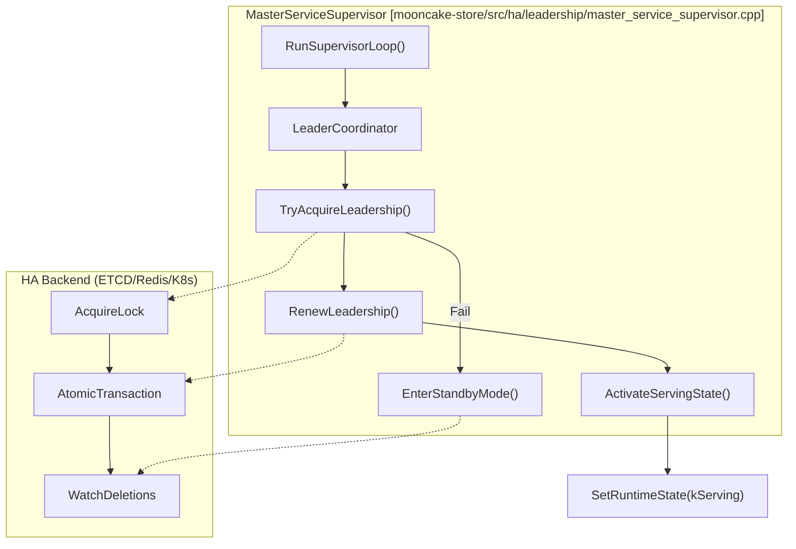
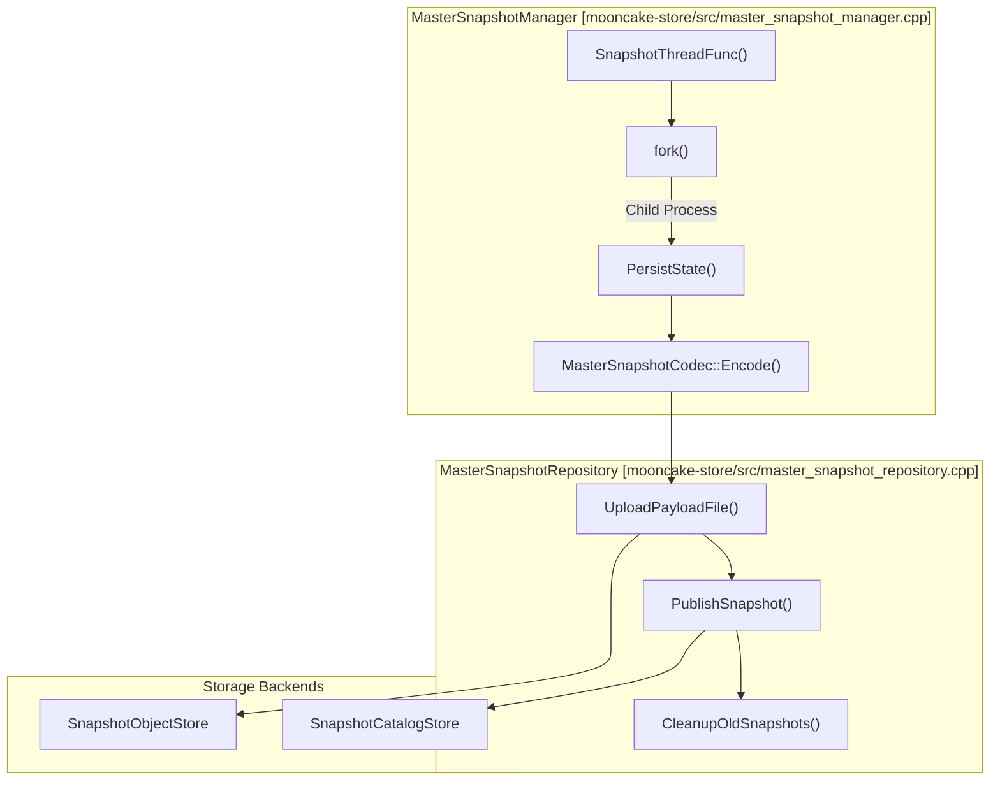
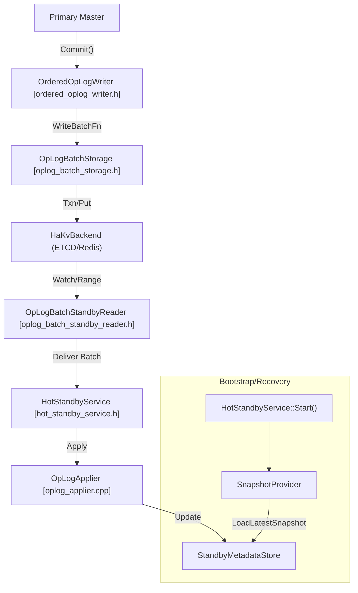

<!-- source: DeepWiki mcp.deepwiki.com · repo kvcache-ai/Mooncake · page 5.11 High Availability · fetched 2026-11-11 -->

# High Availability

Relevant source files

The following files were used as context for generating this wiki page:

- [mooncake-common/FindYLT.cmake](mooncake-common/FindYLT.cmake)
- [mooncake-common/etcd/etcd_wrapper_test.go](mooncake-common/etcd/etcd_wrapper_test.go)
- [mooncake-store/benchmarks/oplog_batch_bench.cpp](mooncake-store/benchmarks/oplog_batch_bench.cpp)
- [mooncake-store/include/cachelib_memory_allocator/include/fmt/format-inl.h](mooncake-store/include/cachelib_memory_allocator/include/fmt/format-inl.h)
- [mooncake-store/include/common/network.h](mooncake-store/include/common/network.h)
- [mooncake-store/include/ha/ha_types.h](mooncake-store/include/ha/ha_types.h)
- [mooncake-store/include/ha/kv/etcd_ha_kv_backend.h](mooncake-store/include/ha/kv/etcd_ha_kv_backend.h)
- [mooncake-store/include/ha/kv/ha_kv_backend.h](mooncake-store/include/ha/kv/ha_kv_backend.h)
- [mooncake-store/include/ha/kv/ha_kv_backend_factory.h](mooncake-store/include/ha/kv/ha_kv_backend_factory.h)
- [mooncake-store/include/ha/kv/redis_ha_kv_backend.h](mooncake-store/include/ha/kv/redis_ha_kv_backend.h)
- [mooncake-store/include/ha/oplog/oplog_batch_standby_reader.h](mooncake-store/include/ha/oplog/oplog_batch_standby_reader.h)
- [mooncake-store/include/ha/oplog/oplog_batch_storage.h](mooncake-store/include/ha/oplog/oplog_batch_storage.h)
- [mooncake-store/include/ha/oplog/oplog_batch_types.h](mooncake-store/include/ha/oplog/oplog_batch_types.h)
- [mooncake-store/include/ha/oplog/ordered_oplog_writer.h](mooncake-store/include/ha/oplog/ordered_oplog_writer.h)
- [mooncake-store/include/ha/snapshot/batch_oplog/batch_oplog_pruning_coordinator.h](mooncake-store/include/ha/snapshot/batch_oplog/batch_oplog_pruning_coordinator.h)
- [mooncake-store/include/ha/snapshot/batch_oplog/batch_oplog_snapshot_gc.h](mooncake-store/include/ha/snapshot/batch_oplog/batch_oplog_snapshot_gc.h)
- [mooncake-store/include/ha/snapshot/batch_oplog/batch_oplog_snapshot_provider.h](mooncake-store/include/ha/snapshot/batch_oplog/batch_oplog_snapshot_provider.h)
- [mooncake-store/include/ha/snapshot/batch_oplog/batch_oplog_snapshot_publisher.h](mooncake-store/include/ha/snapshot/batch_oplog/batch_oplog_snapshot_publisher.h)
- [mooncake-store/include/ha/snapshot/batch_oplog/capture.h](mooncake-store/include/ha/snapshot/batch_oplog/capture.h)
- [mooncake-store/include/ha/snapshot/batch_oplog_snapshot_publisher.h](mooncake-store/include/ha/snapshot/batch_oplog_snapshot_publisher.h)
- [mooncake-store/include/ha/snapshot/catalog/backends/embedded/embedded_snapshot_catalog_store.h](mooncake-store/include/ha/snapshot/catalog/backends/embedded/embedded_snapshot_catalog_store.h)
- [mooncake-store/include/ha/snapshot/catalog/backends/redis/redis_snapshot_catalog_store.h](mooncake-store/include/ha/snapshot/catalog/backends/redis/redis_snapshot_catalog_store.h)
- [mooncake-store/include/ha/snapshot/catalog/snapshot_catalog_store.h](mooncake-store/include/ha/snapshot/catalog/snapshot_catalog_store.h)
- [mooncake-store/include/ha/snapshot/master_snapshot_codec.h](mooncake-store/include/ha/snapshot/master_snapshot_codec.h)
- [mooncake-store/include/ha/snapshot/snapshot_constants.h](mooncake-store/include/ha/snapshot/snapshot_constants.h)
- [mooncake-store/include/ha/snapshot/snapshot_maintenance_lease.h](mooncake-store/include/ha/snapshot/snapshot_maintenance_lease.h)
- [mooncake-store/include/lease.h](mooncake-store/include/lease.h)
- [mooncake-store/include/master_snapshot_manager.h](mooncake-store/include/master_snapshot_manager.h)
- [mooncake-store/include/master_snapshot_repository.h](mooncake-store/include/master_snapshot_repository.h)
- [mooncake-store/include/metadata_store.h](mooncake-store/include/metadata_store.h)
- [mooncake-store/src/common/network.cpp](mooncake-store/src/common/network.cpp)
- [mooncake-store/src/config/ha_cluster_namespace_config.cpp](mooncake-store/src/config/ha_cluster_namespace_config.cpp)
- [mooncake-store/src/config/ha_cluster_namespace_config.h](mooncake-store/src/config/ha_cluster_namespace_config.h)
- [mooncake-store/src/ha/kv/etcd_ha_kv_backend.cpp](mooncake-store/src/ha/kv/etcd_ha_kv_backend.cpp)
- [mooncake-store/src/ha/kv/ha_kv_backend_factory.cpp](mooncake-store/src/ha/kv/ha_kv_backend_factory.cpp)
- [mooncake-store/src/ha/kv/redis_ha_kv_backend.cpp](mooncake-store/src/ha/kv/redis_ha_kv_backend.cpp)
- [mooncake-store/src/ha/leadership/backends/redis/redis_leader_coordinator.cpp](mooncake-store/src/ha/leadership/backends/redis/redis_leader_coordinator.cpp)
- [mooncake-store/src/ha/oplog/oplog_applier.cpp](mooncake-store/src/ha/oplog/oplog_applier.cpp)
- [mooncake-store/src/ha/oplog/oplog_batch_codec.cpp](mooncake-store/src/ha/oplog/oplog_batch_codec.cpp)
- [mooncake-store/src/ha/oplog/oplog_batch_standby_reader.cpp](mooncake-store/src/ha/oplog/oplog_batch_standby_reader.cpp)
- [mooncake-store/src/ha/oplog/oplog_batch_storage.cpp](mooncake-store/src/ha/oplog/oplog_batch_storage.cpp)
- [mooncake-store/src/ha/oplog/oplog_batch_types.cpp](mooncake-store/src/ha/oplog/oplog_batch_types.cpp)
- [mooncake-store/src/ha/oplog/ordered_oplog_writer.cpp](mooncake-store/src/ha/oplog/ordered_oplog_writer.cpp)
- [mooncake-store/src/ha/snapshot/batch_oplog/batch_oplog_pruning_coordinator.cpp](mooncake-store/src/ha/snapshot/batch_oplog/batch_oplog_pruning_coordinator.cpp)
- [mooncake-store/src/ha/snapshot/batch_oplog/batch_oplog_snapshot_coordinator.cpp](mooncake-store/src/ha/snapshot/batch_oplog/batch_oplog_snapshot_coordinator.cpp)
- [mooncake-store/src/ha/snapshot/batch_oplog/batch_oplog_snapshot_gc.cpp](mooncake-store/src/ha/snapshot/batch_oplog/batch_oplog_snapshot_gc.cpp)
- [mooncake-store/src/ha/snapshot/batch_oplog/batch_oplog_snapshot_provider.cpp](mooncake-store/src/ha/snapshot/batch_oplog/batch_oplog_snapshot_provider.cpp)
- [mooncake-store/src/ha/snapshot/batch_oplog/batch_oplog_snapshot_publisher.cpp](mooncake-store/src/ha/snapshot/batch_oplog/batch_oplog_snapshot_publisher.cpp)
- [mooncake-store/src/ha/snapshot/catalog/backends/embedded/embedded_snapshot_catalog_store.cpp](mooncake-store/src/ha/snapshot/catalog/backends/embedded/embedded_snapshot_catalog_store.cpp)
- [mooncake-store/src/ha/snapshot/catalog/backends/redis/redis_snapshot_catalog_store.cpp](mooncake-store/src/ha/snapshot/catalog/backends/redis/redis_snapshot_catalog_store.cpp)
- [mooncake-store/src/ha/snapshot/catalog_backed_snapshot_provider.cpp](mooncake-store/src/ha/snapshot/catalog_backed_snapshot_provider.cpp)
- [mooncake-store/src/ha/snapshot/master_snapshot_codec.cpp](mooncake-store/src/ha/snapshot/master_snapshot_codec.cpp)
- [mooncake-store/src/local_ssd/CMakeLists.txt](mooncake-store/src/local_ssd/CMakeLists.txt)
- [mooncake-store/src/master_snapshot_manager.cpp](mooncake-store/src/master_snapshot_manager.cpp)
- [mooncake-store/src/master_snapshot_repository.cpp](mooncake-store/src/master_snapshot_repository.cpp)
- [mooncake-store/tests/e2e/run_oplog_snapshot_smoke.sh](mooncake-store/tests/e2e/run_oplog_snapshot_smoke.sh)
- [mooncake-store/tests/ha/oplog/oplog_batch_auditor_test.cpp](mooncake-store/tests/ha/oplog/oplog_batch_auditor_test.cpp)
- [mooncake-store/tests/ha/oplog/oplog_batch_codec_test.cpp](mooncake-store/tests/ha/oplog/oplog_batch_codec_test.cpp)
- [mooncake-store/tests/ha/oplog/oplog_batch_standby_reader_test.cpp](mooncake-store/tests/ha/oplog/oplog_batch_standby_reader_test.cpp)
- [mooncake-store/tests/ha/oplog/oplog_batch_storage_test.cpp](mooncake-store/tests/ha/oplog/oplog_batch_storage_test.cpp)
- [mooncake-store/tests/ha/oplog/ordered_oplog_writer_test.cpp](mooncake-store/tests/ha/oplog/ordered_oplog_writer_test.cpp)
- [mooncake-store/tests/ha/snapshot/batch_oplog/coordinator_test.cpp](mooncake-store/tests/ha/snapshot/batch_oplog/coordinator_test.cpp)
- [mooncake-store/tests/ha/snapshot/batch_oplog/gc_test.cpp](mooncake-store/tests/ha/snapshot/batch_oplog/gc_test.cpp)
- [mooncake-store/tests/ha/snapshot/batch_oplog/promotion_test.cpp](mooncake-store/tests/ha/snapshot/batch_oplog/promotion_test.cpp)
- [mooncake-store/tests/ha/snapshot/batch_oplog/provider_test.cpp](mooncake-store/tests/ha/snapshot/batch_oplog/provider_test.cpp)
- [mooncake-store/tests/ha/snapshot/batch_oplog/pruning_coordinator_test.cpp](mooncake-store/tests/ha/snapshot/batch_oplog/pruning_coordinator_test.cpp)
- [mooncake-store/tests/ha/snapshot/batch_oplog/publisher_test.cpp](mooncake-store/tests/ha/snapshot/batch_oplog/publisher_test.cpp)
- [mooncake-store/tests/ha/snapshot/batch_oplog/rebootstrap_test.cpp](mooncake-store/tests/ha/snapshot/batch_oplog/rebootstrap_test.cpp)
- [mooncake-store/tests/ha/snapshot/batch_oplog/writer_test.cpp](mooncake-store/tests/ha/snapshot/batch_oplog/writer_test.cpp)
- [mooncake-store/tests/ha/snapshot/catalog/backends/embedded/embedded_snapshot_catalog_store_test.cpp](mooncake-store/tests/ha/snapshot/catalog/backends/embedded/embedded_snapshot_catalog_store_test.cpp)
- [mooncake-store/tests/ha/snapshot/catalog/backends/redis/redis_snapshot_catalog_store_test.cpp](mooncake-store/tests/ha/snapshot/catalog/backends/redis/redis_snapshot_catalog_store_test.cpp)
- [mooncake-store/tests/ha/snapshot/catalog_backed_snapshot_provider_test.cpp](mooncake-store/tests/ha/snapshot/catalog_backed_snapshot_provider_test.cpp)
- [mooncake-store/tests/ha/snapshot/master_service_ssd_test_for_snapshot.cpp](mooncake-store/tests/ha/snapshot/master_service_ssd_test_for_snapshot.cpp)
- [mooncake-store/tests/ha/snapshot/master_service_test_for_snapshot_base.h](mooncake-store/tests/ha/snapshot/master_service_test_for_snapshot_base.h)
- [mooncake-store/tests/ha/snapshot/master_snapshot_codec_test.cpp](mooncake-store/tests/ha/snapshot/master_snapshot_codec_test.cpp)
- [mooncake-store/tests/ha/snapshot/snapshot_child_process_test.cpp](mooncake-store/tests/ha/snapshot/snapshot_child_process_test.cpp)
- [mooncake-store/tests/ha/snapshot/snapshot_test_utils.h](mooncake-store/tests/ha/snapshot/snapshot_test_utils.h)
- [mooncake-store/tests/ha_cluster_namespace_config_test.cpp](mooncake-store/tests/ha_cluster_namespace_config_test.cpp)
- [mooncake-store/tools/oplog_batch_auditor.cpp](mooncake-store/tools/oplog_batch_auditor.cpp)
- [mooncake-store/tools/oplog_batch_inspector.cpp](mooncake-store/tools/oplog_batch_inspector.cpp)

## Purpose and Scope

This document details the high availability (HA) features of Mooncake Store, the distributed KV cache system at the heart of Mooncake. It covers the system's master failover mechanism via ETCD-based leader election, client reconnection strategies for resiliency, state persistence with metadata snapshots, and hot-standby replication implemented through an oplog mechanism. Various leader coordinator backends and metadata key-value storage are also described.

---

## Master Service High Availability

### Leader Election and Supervision

Mooncake employs a `MasterServiceSupervisor` that manages the lifecycle and HA state of the `MasterService`. The supervisor continuously attempts to acquire leadership through a `LeaderCoordinator`, which abstracts the HA backend (e.g., ETCD, Redis, Kubernetes leases). Once leadership is acquired, the supervisor transitions the master into the active `kServing` state; otherwise, it remains in standby mode.

Key transitions include:  
- `TryAcquireLeadership()` requests the leader lock atomically.  
- On success, lease renewal occurs regularly with `RenewLeadership()`.  
- If leadership is lost or not acquired, the supervisor keeps the service in standby to prevent split-brain scenarios.

The leader coordinator also maintains and publishes a `MasterView` containing the current leader's address and a monotonically increasing view version. This protects against stale leaders performing operations after losing leadership.

Sources:  
[mooncake-store/tests/ha/leadership/high_availability_test.cpp:52-110](),  
[mooncake-store/src/ha/leadership/master_service_supervisor.cpp:121-210]()

### HA Backend Support and LeaderCoordinator Abstraction

Mooncake supports multiple HA backends through the `LeaderCoordinator` interface and uses a factory pattern to create instances:

- **ETCD Backend:**  
  The primary HA backend uses ETCD leases and transactions to implement leader election, lease renewal, and watch mechanisms. ETCD client setup is via `EtcdHelper` which wraps a Go ETCD client. ETCD's atomic transactions and prefix watches provide strong consistency for master leadership and metadata persistence.

- **Redis Backend:**  
  Leader election through Redis uses Lua scripting with atomicity guarantees to acquire and renew locks.

- **Kubernetes Lease Backend:**  
  The Kubernetes Lease API (coordination.k8s.io) manages leader presence and lease TTLs. Additional pod role labeling support is provided for cluster orchestration.

Leader coordinator implementations, such as `EtcdLeaderCoordinator`, encapsulate connection handling, lease management, and current master view reading/watching.

Sources:  
[mooncake-store/include/ha/leadership/leader_coordinator.h](),  
[mooncake-store/src/ha/leadership/leader_coordinator_factory.cpp](),  
[mooncake-store/src/ha/leadership/backends/etcd/etcd_leader_coordinator.cpp:140-190](),  
[mooncake-common/etcd/etcd_wrapper.go:166-226](),  
[mooncake-store/src/ha/leadership/master_service_supervisor.cpp:30-50]()

---

## State Persistence and Recovery

### Metadata Snapshots

Mooncake ensures durable metadata persistence using snapshots managed by `MasterSnapshotManager`. Periodically or on-demand, this manager triggers snapshot creation in a separate child process to avoid blocking the active master runtime.

Snapshot creation involves:  
- Forking a child process via `SnapshotThreadFunc()` which calls `PersistState()` to serialize metadata.  
- Using `MasterSnapshotCodec` to encode a consistent point-in-time `MasterSnapshotStateView`, which includes metadata shards, segments, and task states.  
- Delivering serialized payloads to a `MasterSnapshotRepository` for storage and catalog publishing. Supported storage backends include local disk, S3, and Redis-based catalogs.

Snapshots enable fast recovery on restart and bootstrap of standby nodes. The `MasterServiceConfig` allows configuring snapshot behavior, including enabling/disabling snapshots and restore, backup directory, interval, child process timeout, and retention count [mooncake-store/include/master_config.h:164-170]().

Sources:  
[mooncake-store/src/master_snapshot_manager.cpp:100-203](),  
[mooncake-store/src/ha/snapshot/master_snapshot_codec.cpp:14-48](),  
[mooncake-store/src/master_snapshot_repository.cpp:26-75](),  
[mooncake-store/include/master_snapshot_manager.h:41-62](),  
[mooncake-store/tests/ha/snapshot/master_service_test_for_snapshot_base.h:160-180](),  
[mooncake-store/include/master_config.h:164-170]()

### Oplog-Based Hot Standby Replication

Mooncake uses a continuous oplog (`OpLog`) to replicate state changes from the primary master to standby nodes (hot standby). This enables minimal downtime failover and data consistency.

- The primary master writes operations to an `OrderedOpLogWriter` which guarantees ordered commit semantics, assigning incremental sequence IDs. The writer batches entries and retries on transient errors, publishing durability through callbacks and futures. The internal `Impl` manages entry batching, sealing, and durable prefix advances. This batch persistence is critical for maintaining consistency and fencing old leaders [mooncake-store/src/ha/oplog/ordered_oplog_writer.cpp:21-108]().

- Committed oplog batches are stored durably by `OpLogBatchStorage` via an abstract `HaKvBackend` like ETCD or Redis, maintaining a `DurablePrefix` that tracks persistence progress and implements fencing by validating prefixes before batch writes [mooncake-store/src/ha/oplog/oplog_batch_storage.cpp:70-135](). Ambiguous transaction errors and legacy layout are guarded against during initialization.

- Standby nodes use `HotStandbyService` for replication. It bootstraps metadata from the latest consistent snapshot then follows the oplog using `OpLogBatchStandbyReader`. The reader streams batches from kv backend watch/range queries, applies batches incrementally using `OpLogApplier`, and watches for compaction floor updates and consistency gaps. This service transitions through states managing connection, recovery, and replication loops for continuous hot standby [mooncake-store/src/hot_standby_service.cpp:20-179](), [mooncake-store/src/ha/oplog/oplog_batch_standby_reader.cpp:10-40]().

Sources:  
[mooncake-store/src/ha/oplog/ordered_oplog_writer.cpp:20-90](),  
[mooncake-store/src/ha/oplog/ordered_oplog_writer.cpp:29-120](),  
[mooncake-store/src/ha/oplog/oplog_batch_storage.cpp:70-135](),  
[mooncake-store/src/hot_standby_service.cpp:20-179](),  
[mooncake-store/src/ha/oplog/oplog_batch_standby_reader.cpp:10-40]()

---

## Client Resilience and Reconnection

Clients do not maintain persistent direct connections to the master node but instead observe master leadership changes through the `MasterView` metadata published via HA backends.

- The `MasterAdminServer` exposes RPC to fetch the current leader view. Clients update their RPC targets upon view changes to avoid stale connections.

- Masters deactivate serving state on losing leadership, triggering client reconnection and failover to the new leader. This ensures clients never communicate with a stale or not currently active master [mooncake-store/src/ha/leadership/master_service_supervisor.cpp:160-180]().

- This design decouples clients from direct coordination with individual master server processes, enabling resiliency across network partitions, failover, and master re-election scenarios.

Sources:  
[mooncake-store/src/ha/leadership/master_service_supervisor.cpp:160-180]()

---

## HA Integration Details and Key Components

| Component                   | Path / File                                         | Role and Details                                                                                                                           |
|----------------------------|----------------------------------------------------|--------------------------------------------------------------------------------------------------------------------------------------------|
| `MasterServiceSupervisor`  | `mooncake-store/src/ha/leadership/master_service_supervisor.cpp` | Manages leader election loops and state transitions for master node HA [mooncake-store/src/ha/leadership/master_service_supervisor.cpp:100-210]()                                                  |
| `LeaderCoordinator`         | `mooncake-store/include/ha/leadership/leader_coordinator.h`       | Interface for pluggable leader election backends: ETCD, Redis, Kubernetes leases                                                          |
| `EtcdLeaderCoordinator`     | `mooncake-store/src/ha/leadership/backends/etcd/etcd_leader_coordinator.cpp` | ETCD-specific leader coordinator implementation managing etcd leases and views                                                              |
| `OrderedOpLogWriter`        | `mooncake-store/src/ha/oplog/ordered_oplog_writer.cpp`            | Ensures ordered and batch-persisted metadata changes via durable oplog entries [mooncake-store/src/ha/oplog/ordered_oplog_writer.cpp:20-90]()                                                             |
| `OpLogBatchStorage`         | `mooncake-store/src/ha/oplog/oplog_batch_storage.cpp`             | Persistent storage abstraction for oplog batches and durable prefixes [mooncake-store/src/ha/oplog/oplog_batch_storage.cpp:70-135]()                                                                       |
| `HotStandbyService`         | `mooncake-store/src/hot_standby_service.cpp`                      | Standby master replication service applying oplog batches and snapshot bootstrap [mooncake-store/src/hot_standby_service.cpp:20-179]()                                                            |
| `OpLogApplier`              | `mooncake-store/src/ha/oplog/oplog_applier.cpp`                   | Applies decoded oplog entries to local metadata store                                                                                       |
| `MasterSnapshotManager`     | `mooncake-store/src/master_snapshot_manager.cpp`                  | Orchestrates metadata snapshots lifecycle including forking child processes [mooncake-store/src/master_snapshot_manager.cpp:100-203]()                                                                |
| `HaKvBackend`               | `mooncake-store/tests/ha/master_service_ha_test.cpp`             | Abstract key-value backend interface used in HA components; mock implementations for testing available [mooncake-store/tests/ha/master_service_ha_test.cpp:39-93]()                                      |

---

## Summary

Mooncake Store implements a robust and multi-faceted HA architecture through:  
- ETCD-backed leader election with lease and view/version management.  
- Metadata durability via point-in-time snapshots managed asynchronously in child processes.  
- Hot-standby replication using ordered oplog writing and batch storage to maintain consistent secondary nodes.  
- Client failover and reconnection based on leader views to preserve application availability.  
- Pluggable leader coordinator backends enable deployment flexibility across cloud-native and on-premise environments.

This HA design allows Mooncake to achieve strong consistency, high availability, and resilience in demanding distributed KVCache scenarios.

---

**Overall System Components to Code Entity Bridging (Diagram)**

```mermaid
graph TD
    subgraph "HA Leader Election"
        coord["LeaderCoordinator (interface)"]
        etcd_coord["EtcdLeaderCoordinator (etcd_leader_coordinator.cpp)"]
        redis_coord["RedisLeaderCoordinator (redis_ha_kv_backend.cpp)"]
        k8s_coord["K8sLeaderCoordinator (k8s_lease_helper.h)"]
        coord --> etcd_coord
        coord --> redis_coord
        coord --> k8s_coord
        supervisor["MasterServiceSupervisor (master_service_supervisor.cpp)"]
        supervisor --> coord
    end

    subgraph "Metadata Persistence"
        snapshot_mgr["MasterSnapshotManager (master_snapshot_manager.cpp)"]
        snapshot_codec["MasterSnapshotCodec (master_snapshot_codec.cpp)"]
        snapshot_repo["MasterSnapshotRepository (master_snapshot_repository.cpp)"]
        snapshot_mgr --> snapshot_codec
        snapshot_codec --> snapshot_repo
    end

    subgraph "Hot Standby Replication"
        primary_master["Primary Master"]
        oplog_writer["OrderedOpLogWriter (ordered_oplog_writer.h)"]
        oplog_storage["OpLogBatchStorage (oplog_batch_storage.h)"]
        backend_kv["HaKvBackend (ETCD/Redis)"]
        standby_reader["OpLogBatchStandbyReader (oplog_batch_standby_reader.h)"]
        hot_standby["HotStandbyService (hot_standby_service.h)"]
        oplog_applier["OpLogApplier (oplog_applier.cpp)"]
        primary_master --> oplog_writer --> oplog_storage --> backend_kv
        backend_kv --> standby_reader --> hot_standby --> oplog_applier
    end

    subgraph "Client Reconnection"
        client["Mooncake Client"]
        master_view["MasterView metadata"]
        ha_backend["HA Backend (etcd/redis/k8s)"]
        client --> master_view --> ha_backend
    end
```

Sources:  
All above-cited files and lines aggregated.

---

# End of High Availability Documentation

---

