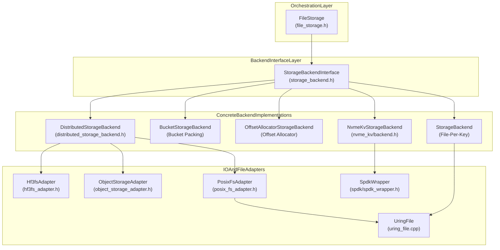
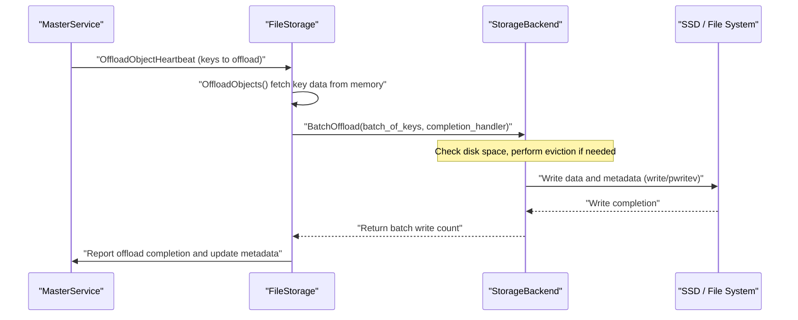

<!-- source: DeepWiki mcp.deepwiki.com · repo kvcache-ai/Mooncake · page 5.14 Storage Backend and Disk Offloading · fetched 2026-11-11 -->

# Storage Backend and Disk Offloading

Relevant source files

The following files were used as context for generating this wiki page:

- [docs/source/deployment/oss-offload.md](docs/source/deployment/oss-offload.md)
- [docs/source/deployment/ssd/ssd-offload.md](docs/source/deployment/ssd/ssd-offload.md)
- [docs/source/design/store/oss-backend.md](docs/source/design/store/oss-backend.md)
- [docs/source/design/store/ssd-offload.md](docs/source/design/store/ssd-offload.md)
- [mooncake-store/benchmarks/uring_batch_read_bench.cpp](mooncake-store/benchmarks/uring_batch_read_bench.cpp)
- [mooncake-store/include/file_interface.h](mooncake-store/include/file_interface.h)
- [mooncake-store/include/file_storage.h](mooncake-store/include/file_storage.h)
- [mooncake-store/include/segment/usage.h](mooncake-store/include/segment/usage.h)
- [mooncake-store/include/storage/distributed/dfs_allocator_interface.h](mooncake-store/include/storage/distributed/dfs_allocator_interface.h)
- [mooncake-store/include/storage/distributed/distributed_storage_backend.h](mooncake-store/include/storage/distributed/distributed_storage_backend.h)
- [mooncake-store/include/storage/distributed/fs_adapter.h](mooncake-store/include/storage/distributed/fs_adapter.h)
- [mooncake-store/include/storage/distributed/hf3fs_adapter.h](mooncake-store/include/storage/distributed/hf3fs_adapter.h)
- [mooncake-store/include/storage/distributed/immutable_bucket_allocator.h](mooncake-store/include/storage/distributed/immutable_bucket_allocator.h)
- [mooncake-store/include/storage/distributed/object_storage_adapter.h](mooncake-store/include/storage/distributed/object_storage_adapter.h)
- [mooncake-store/include/storage/distributed/oss_adapter.h](mooncake-store/include/storage/distributed/oss_adapter.h)
- [mooncake-store/include/storage/distributed/shard_allocator.h](mooncake-store/include/storage/distributed/shard_allocator.h)
- [mooncake-store/include/storage_backend.h](mooncake-store/include/storage_backend.h)
- [mooncake-store/src/config/oss_adapter_config.cpp](mooncake-store/src/config/oss_adapter_config.cpp)
- [mooncake-store/src/config/oss_adapter_config.h](mooncake-store/src/config/oss_adapter_config.h)
- [mooncake-store/src/file_storage.cpp](mooncake-store/src/file_storage.cpp)
- [mooncake-store/src/posix_file.cpp](mooncake-store/src/posix_file.cpp)
- [mooncake-store/src/storage/distributed/distributed_storage_backend.cpp](mooncake-store/src/storage/distributed/distributed_storage_backend.cpp)
- [mooncake-store/src/storage/distributed/hf3fs_adapter.cpp](mooncake-store/src/storage/distributed/hf3fs_adapter.cpp)
- [mooncake-store/src/storage/distributed/immutable_bucket_allocator.cpp](mooncake-store/src/storage/distributed/immutable_bucket_allocator.cpp)
- [mooncake-store/src/storage/distributed/oss_adapter.cpp](mooncake-store/src/storage/distributed/oss_adapter.cpp)
- [mooncake-store/src/storage/distributed/shard_allocator.cpp](mooncake-store/src/storage/distributed/shard_allocator.cpp)
- [mooncake-store/src/storage_backend.cpp](mooncake-store/src/storage_backend.cpp)
- [mooncake-store/src/uring_file.cpp](mooncake-store/src/uring_file.cpp)
- [mooncake-store/src/uring_submit.h](mooncake-store/src/uring_submit.h)
- [mooncake-store/tests/dfs_hf3fs_test.cpp](mooncake-store/tests/dfs_hf3fs_test.cpp)
- [mooncake-store/tests/dfs_immutable_bucket_allocator_test.cpp](mooncake-store/tests/dfs_immutable_bucket_allocator_test.cpp)
- [mooncake-store/tests/dfs_immutable_bucket_backend_test.cpp](mooncake-store/tests/dfs_immutable_bucket_backend_test.cpp)
- [mooncake-store/tests/dfs_posix_test.cpp](mooncake-store/tests/dfs_posix_test.cpp)
- [mooncake-store/tests/dfs_sync_client_test.cpp](mooncake-store/tests/dfs_sync_client_test.cpp)
- [mooncake-store/tests/dummy_client_get_buffer_test.cpp](mooncake-store/tests/dummy_client_get_buffer_test.cpp)
- [mooncake-store/tests/file_storage_test.cpp](mooncake-store/tests/file_storage_test.cpp)
- [mooncake-store/tests/object_storage_adapter_test.cpp](mooncake-store/tests/object_storage_adapter_test.cpp)
- [mooncake-store/tests/oss_adapter_config_test.cpp](mooncake-store/tests/oss_adapter_config_test.cpp)
- [mooncake-store/tests/oss_adapter_test.cpp](mooncake-store/tests/oss_adapter_test.cpp)
- [mooncake-store/tests/posix_file_test.cpp](mooncake-store/tests/posix_file_test.cpp)
- [mooncake-store/tests/storage_backend_test.cpp](mooncake-store/tests/storage_backend_test.cpp)

This page documents the storage backend subsystem of Mooncake Store, providing detailed technical explanations of file-based storage, cloud adapters, eviction-to-disk workflows, asynchronous I/O, distributed storage integration, and advanced NVMe/KV device support. It covers the main classes, data flow, and key functions critical for disk offloading and persistent storage support.

---

## 1. Architecture Overview and Code Entity Mapping

Mooncake's disk offloading subsystem enables eviction of KVCache objects from memory tiers (DRAM, GPU) to persistent storage such as SSDs or distributed storage backends. `FileStorage` orchestrates this, relying on pluggable storage backend implementations conforming to `StorageBackendInterface`.

The following diagram maps high-level system components to code entities within the codebase:

This hierarchy illustrates that the `FileStorage` class manages an abstract `StorageBackendInterface` pointer which can point to several backend implementations, including local file-per-key, batch bucket files, offset allocators, distributed filesystem or S3 adapters, and NVMe-KV backends.

#### Data Flow for Disk Offloading
- The Real Client or FileStorage receives offload tasks (keys to persist) from the master.
- Data for these keys is staged in client buffers managed by `ClientBufferAllocator`.
- `FileStorage` submits batches for offload to the configured backend via the `BatchOffload()` API.
- The backend writes data to underlying persistent storage, such as files on local SSD, distributed storage shards, or cloud object storage.
- Asynchronous I/O is leveraged via `UringFile` using Linux io_uring (where enabled), increasing throughput and reducing latency.
- Distributed storage backends use shard files and bucket allocators to manage large-scale capacity.
- NVMe-KV backends enable direct access to NVMe devices via SPDK for low-latency key-value storage.

Sources:  
[mooncake-store/include/file_storage.h:12-185](),  
[mooncake-store/include/storage_backend.h:165-171](),  
[mooncake-store/include/storage/distributed/distributed_storage_backend.h:43-107](),  
[mooncake-store/src/storage_backend.cpp:53-61]()

---

## 2. Configuration Subsystem

### `FileStorageConfig`

`FileStorageConfig` controls runtime parameters for file-based storage. It includes:

- **`storage_backend_type`**: Enum specifying the backend implementation, e.g., `kBucket`, `kFilePerKey`, `kOffsetAllocator`, `kDistributed`, or `kNvmeKv`. This is controlled by environment variable `MOONCAKE_OFFLOAD_STORAGE_BACKEND_DESCRIPTOR`.  
- **`storage_filepath`**: Path on local disk root to store offloaded objects (files or buckets). Controlled by `MOONCAKE_OFFLOAD_FILE_STORAGE_PATH`.  
- **`local_buffer_size`**: Size in bytes of the staging buffer used client-side for disk I/O. Typical sizes are hundreds of MBs.  
- **`use_uring`**: Enables asynchronous I/O with Linux io_uring if supported, controlled by `MOONCAKE_OFFLOAD_USE_URING` or `MOONCAKE_USE_URING`.

The config supports detailed tuning for eviction, buffer pinning, and SSD offload parameters.

### Bucket and Offset Allocator Configurations

- `BucketBackendConfig` controls bucket backend parameters such as bucket size limits, key limits, and eviction policies.  
- `FilePerKeyConfig` sets parameters for file-per-key storage including filesystem directory and eviction enablement.  
- `OffsetAllocatorBackendConfig` tunes watermark levels and eviction thresholds for the offset allocator backend, which manages large contiguous offset ranges in preallocated files.

Sources:  
[mooncake-store/src/storage_backend.cpp:60-126](),  
[mooncake-store/include/storage_backend.h:174-263]()

---

## 3. Storage Backend Implementations

### 3.1 `StorageBackend` - File-Per-Key Backend

The `StorageBackend` class implements a local filesystem backend where each key is stored as an individual file. It manages:

- **Initialization and State Reconstruction:** On startup (`Init()`), it scans the local filesystem directory recursively, listing all files, and reconstructs the storage state. It orders files by file birth time using `statx()` with `STATX_BTIME` to approximate LRU eviction.  
- **Eviction and Space Management:** It maintains metadata on used, total, and available space. If the quota is exceeded, eviction is triggered by deleting oldest files in the FIFO queue.  
- **File Path Mutexes:** To avoid concurrency issues with file access, it uses a fixed array of mutexes hashed by file path.  
- **Pending Evictions:** Tracks file paths marked as pending eviction to avoid concurrent operations.

This backend directly writes and reads files with POSIX I/O calls and utilizes asynchronous I/O when possible.

Key methods:  
- `Init()`: initialize backend, scan disk, reconstruct eviction state.  
- `RecalculateAvailableSpace()`: update available space after usage updates.  
- `IsEvictionEnabled()`: returns if eviction is configured and enabled.  
- `GetFilePathMutex(const std::string& path)`: returns mutex for concurrency control to a file path.

Sources:  
[mooncake-store/src/storage_backend.cpp:60-194](),  
[mooncake-store/include/storage_backend.h:26-90]()

### 3.2 `BucketStorageBackend` - Bucketed Key Packing

The `BucketStorageBackend` stores multiple keys packed inside a single bucket file to improve I/O efficiency:

- Uses `BucketMetadata` to track key offsets, sizes, and metadata inside each bucket file.  
- Manages inflight read counts with `BucketReadGuard` to ensure safety: a bucket is not deleted until all concurrent readers finish; the guard increments `inflight_reads_` on creation and decrements on destruction.  
- Eviction removes whole buckets atomically once safe.  
- Supports batch offload for multiple keys with atomic durability per bucket.

This design balances many small writes into fewer large files, reducing filesystem overhead and improving performance.

Sources:  
[mooncake-store/include/storage_backend.h:33-154](),  
[mooncake-store/src/storage_backend.cpp:35-310]()

---

## 4. Distributed Storage & Cloud Storage Adapters

Mooncake Store supports advanced distributed storage backends suitable for cloud or distributed filesystem environments.

### 4.1 `DistributedStorageBackend`

The `DistributedStorageBackend` encapsulates two storage access modes:

- **FileSystem mode**  
  Uses a `FileSystemAdapter` such as `PosixFsAdapter` (standard POSIX calls) or `Hf3fsAdapter` (integrates with 3FS USRBIO distributed filesystem). It manages shard files and aligned I/O operations over these shards and buckets.  
- **ObjectStorage mode**  
  Uses an `ObjectStorageAdapter` like `OssAdapter` to interact with S3/OSS compatible object storage backends, supporting cloud-based storage persistency with semantic Put/Get/Delete support.

The backend disables local eviction management because DFS or cloud storage manages capacity externally.

Backend internally keeps a cache of open shard files for efficient I/O and supports batch reads/writes with aligned offsets.

Key operations:  
- `BatchOffload()` for batch writes.  
- `BatchRead()` and `BatchWrite()` support descriptor-based DFS operations.  
- `Init()` initializes the backend and opens shard files or verifies object storage connectivity.

Sources:  
[mooncake-store/include/storage/distributed/distributed_storage_backend.h:44-146](),  
[mooncake-store/src/storage/distributed/distributed_storage_backend.cpp:13-179](),  
[mooncake-store/src/storage_backend.cpp:53-61]()

### 4.2 `Hf3fsAdapter` (3FS Integration)

- Available when compiled with `USE_3FS`, the `hf3fs_adapter` hooks into the 3FS distributed filesystem's user-space BIO interface.  
- Offers accelerated I/O bypassing kernel overheads and supports concurrent, aligned positional I/O operations on distributed shards.

### 4.3 `OssAdapter` (S3/OSS Adapter)

- Implements an S3-compatible object storage client adapter for cloud object backends.  
- Supports batch put/get operations with configurable endpoints and bucket naming.  
- Provides health check integration and error retry for robustness.

Sources:  
[mooncake-store/src/storage_backend.cpp:55-60](),  
[mooncake-store/include/storage/distributed/oss_adapter.h]()

---

## 5. `FileStorage` Orchestrator and Eviction-to-Disk Workflow

The `FileStorage` class is the front-facing interface managing SSD offload operations on disk:

- Maintains a pinned memory staging buffer pool and client buffer allocator for efficient disk I/O staging.  
- Controls asynchronous offloading from memory to disk via calls to `StorageBackendInterface`.  
- Flushes batched keys via `BatchOffload()` calls.  
- Manages heartbeat threads to report offload progress and drive eviction if needed.  
- Supports eviction-to-disk as part of memory pressure handling, coordinating with the master service.

During initialization, `FileStorage` registers its client buffer allocator memory with `UringFile` to allow io_uring accelerated I/O paths. The offload setup includes mounting disk segments and enabling offload flags.

#### Eviction-to-Disk Workflow Diagram

This sequence shows the interaction from the master’s offload commands, through `FileStorage` orchestration and backend storage, down to filesystem persistence with eviction handling.

Sources:  
[mooncake-store/src/file_storage.cpp:41-114](),  
[mooncake-store/include/file_storage.h:12-169](),  
[mooncake-store/src/storage_backend.cpp:730-810]()

---

## 6. Asynchronous I/O via `UringFile` and `SharedUringRing`

Mooncake Store uses Linux's `io_uring` interface for asynchronous file I/O to achieve high throughput and low latency:

- `UringFile` wraps I/O operations with support for asynchronous read, write, batch read, and vector I/O calls.  
- `SharedUringRing` provides a thread-local io_uring ring instance encouraging one ring per thread to eliminate mutex contention and allow fully concurrent I/O submission.  
- Buffer registration of the client allocator’s memory is done one time globally, and each thread lazily registers the buffer with its io_uring ring before the first I/O operation with the fixed buffer mechanism.  
- Batch submission of up to 32 concurrent reads boosts NVMe device queue depth within a single thread.  
- If buffer registration fails, the system falls back to regular (non-fixed-buffer) io_uring I/O preserving correctness.

Key aspects:  
- Lazy buffer registration with `register_global_buffer()`.  
- Efficient batch vectorized read/write primitives with retry mechanisms for short transfers.  
- Per-thread io_uring rings reduce locking overhead and enable batching for SSD devices.

Sources:  
[mooncake-store/src/uring_file.cpp:1-170](),  
[mooncake-store/src/file_storage.cpp:98-114]()

---

## 7. SPDK/NVMe-KV Integration

For specialized ultra-low latency persistence, Mooncake supports NVMe-KV backends using SPDK:

- `SpdkWrapper` manages SPDK environment initialization, registration of DMA-capable buffers, provides direct NVMe device access bypassing the Linux kernel.  
- Supports environment variable tuning for queue depths, CPU affinities, and queue counts.  
- Uses hugepage-backed memory allocations for SPDK compatibility, managed by a helper class.  
- The `NvmeKvStorageBackend` utilizes SPDK calls to present a key-value storage interface directly on NVMe devices.  
- Enables faster persistence than traditional filesystem methods with lower API overhead.

Sources:  
[mooncake-store/include/storage_backend.h:28-171](),  
[mooncake-store/src/spdk/spdk_wrapper.cpp:20-205](),  
[mooncake-store/src/shm_helper.cpp:88-100]()

---

## 8. File Error Handling and Partial Success

The backend supports robust error handling and partial batch success semantics:

- The `BatchOffload` API returns the count of successfully offloaded keys, allowing partial successes within a batch while continuing overall operation.  
- Test predicates can inject deterministic failure for unit testing partial success behavior.  
- Typical soft errors like `OBJECT_ALREADY_EXISTS` are treated specially by the per-bucket offload to avoid aborting the whole offload cycle.  
- `PosixFile` and other POSIX-related classes unlink incomplete or partially written files detected upon failure during write completion.

These features ensure resilience and consistency across disk offloading operations under error conditions.

Sources:  
[mooncake-store/tests/storage_backend_test.cpp:58-130](),  
[mooncake-store/include/file_storage.h:146-167](),  
[mooncake-store/src/posix_file.cpp:25-42]()

---

# Summary

Mooncake's storage backend and disk offloading architecture enables scalable, adaptable persistence of KVCache data across multiple storage tiers:

- The unified `StorageBackendInterface` allows transparent substitution among local files, bucket-packed files, offset allocators, distributed filesystem or cloud object stores, and direct NVMe-KV devices.  
- Asynchronous disk I/O via Linux io_uring minimizes blocking and maximizes SSD throughput.  
- Eviction, space accounting, and concurrency control mechanisms provide robust storage management under heavy memory pressure.  
- Distributed storage adapters and object storage integrations allow cloud-native and highly available deployments.  
- SPDK integration delivers ultra-low latency, high throughput NVMe key-value storage for advanced workloads.

This subsystem is critical for supporting Mooncake Store's large KVCache LLM serving workloads that exceed local memory capacities, providing fast, reliable SSD or distributed storage offload with integration into the overall KVCache disaggregation stack.

---

# References

- [FileStorage class declaration and implementation](mooncake-store/include/file_storage.h:12-185)()  
- [StorageBackend base class and key data structures](mooncake-store/include/storage_backend.h:27-171)()  
- [DistributedStorageBackend and adapters](mooncake-store/include/storage/distributed/distributed_storage_backend.h:43-107)()  
- [FileStorage orchestration and initialization](mooncake-store/src/file_storage.cpp:41-114)()  
- [StorageBackend core file-based implementation](mooncake-store/src/storage_backend.cpp:35-194)()  
- [DistributedStorageBackend implementation](mooncake-store/src/storage/distributed/distributed_storage_backend.cpp:13-179)()  
- [UringFile async I/O implementation](mooncake-store/src/uring_file.cpp:1-170)()  
- [SPDK wrapper and NVMe-KV integration](mooncake-store/src/spdk/spdk_wrapper.cpp:20-205)()  
- [Error handling and partial success unit tests](mooncake-store/tests/storage_backend_test.cpp:58-130)()

---

