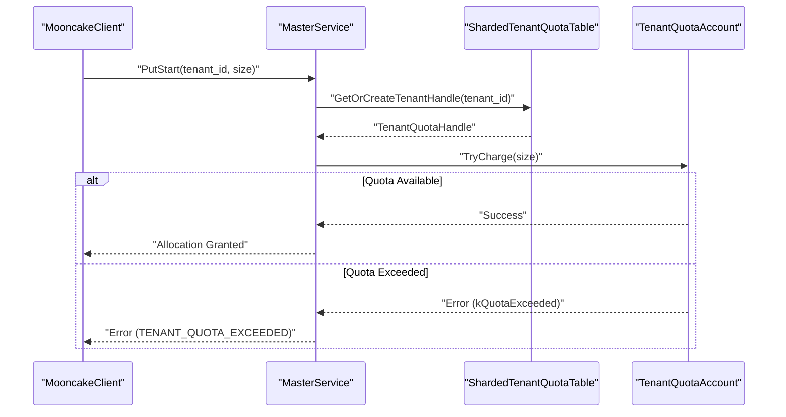
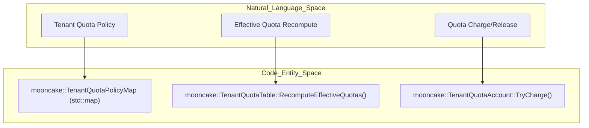
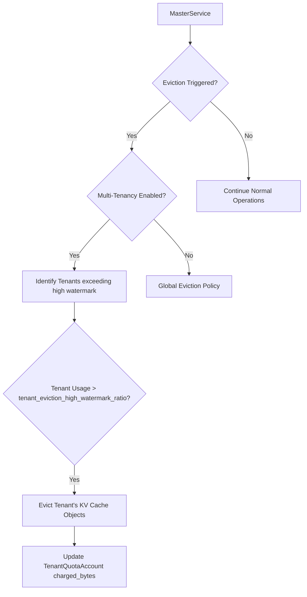
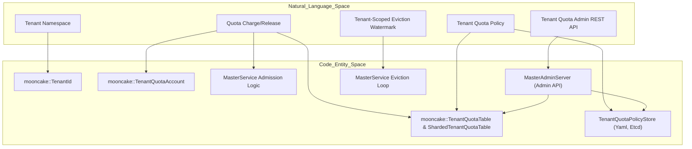

<!-- source: DeepWiki mcp.deepwiki.com · repo kvcache-ai/Mooncake · page 5.17 Multi-Tenancy and KV Cache Isolation · fetched 2026-11-11 -->

# Multi-Tenancy and KV Cache Isolation

<details>
<summary>Relevant source files</summary>

The following files were used as context for generating this wiki page:

- [mooncake-store/include/master_client.h](mooncake-store/include/master_client.h)
- [mooncake-store/include/master_metric_manager.h](mooncake-store/include/master_metric_manager.h)
- [mooncake-store/include/master_service.h](mooncake-store/include/master_service.h)
- [mooncake-store/include/rpc_service.h](mooncake-store/include/rpc_service.h)
- [mooncake-store/src/master_client.cpp](mooncake-store/src/master_client.cpp)
- [mooncake-store/src/master_metric_manager.cpp](mooncake-store/src/master_metric_manager.cpp)
- [mooncake-store/src/master_service.cpp](mooncake-store/src/master_service.cpp)
- [mooncake-store/src/rpc_service.cpp](mooncake-store/src/rpc_service.cpp)
- [mooncake-store/tests/master_metrics_test.cpp](mooncake-store/tests/master_metrics_test.cpp)
- [mooncake-store/tests/master_service/dsl/scenario.cpp](mooncake-store/tests/master_service/dsl/scenario.cpp)
- [mooncake-store/tests/master_service/dsl/scenario.h](mooncake-store/tests/master_service/dsl/scenario.h)
- [mooncake-store/tests/master_service/dsl/scenario_contract_test.cpp](mooncake-store/tests/master_service/dsl/scenario_contract_test.cpp)
- [mooncake-store/tests/master_service_concurrent_scenario_test.cpp](mooncake-store/tests/master_service_concurrent_scenario_test.cpp)
- [mooncake-store/tests/master_service_evict_scenario_test.cpp](mooncake-store/tests/master_service_evict_scenario_test.cpp)
- [mooncake-store/tests/master_service_offload_scenario_test.cpp](mooncake-store/tests/master_service_offload_scenario_test.cpp)
- [mooncake-store/tests/master_service_ssd_scenario_test.cpp](mooncake-store/tests/master_service_ssd_scenario_test.cpp)
- [mooncake-store/tests/master_service_ssd_test.cpp](mooncake-store/tests/master_service_ssd_test.cpp)
- [mooncake-store/tests/master_service_tenant_quota_test.cpp](mooncake-store/tests/master_service_tenant_quota_test.cpp)
- [mooncake-store/tests/master_service_test.cpp](mooncake-store/tests/master_service_test.cpp)
- [mooncake-store/tests/offload_on_evict_test.cpp](mooncake-store/tests/offload_on_evict_test.cpp)

</details>


Multi-tenancy in Mooncake provides logical isolation and resource governance for distributed KV cache storage. It enables multiple model families, deployment releases, or application groups to share a single Mooncake Store cluster while enforcing strict memory allocation limits through a robust quota system.

---

## Multi-Tenancy Overview

Mooncake implements multi-tenancy through two primary mechanisms:

1.  **Namespace Isolation**: Using unique identifiers such as `TenantId`, stable model names, release tags, and request-level salts to ensure KV cache keys are isolated between incompatible inference instances. This prevents unintended key collisions and enables controlled KV cache sharing [docs/source/deployment/kv-cache-sharing-and-isolation.md:5-25]().

2.  **Resource Governance (Quota System)**: Each tenant is assigned a memory quota that governs how much KV cache memory it can allocate and charge. The system enforces these limits strictly, rejecting new allocations when a tenant exceeds its quota [mooncake-store/include/tenant_quota.h:19-40]().

### Isolation Boundaries Summary

| Boundary               | Scope                                                 | Code Entity / Configuration                               |
|-----------------------|-------------------------------------------------------|------------------------------------------------------------|
| Model                 | Different model families or incompatible variants     | SGLang `--served-model-name` / vLLM Model Path             |
| Deployment / Release   | Rolling upgrades, canaries, environments              | SGLang `extra_backend_tag` / vLLM `cache_prefix`           |
| Request Group         | Application/user group reuse isolation                 | vLLM `cache_salt`                                          |
| Mooncake Tenant       | Logical namespace isolation and quota enforcement      | `TenantId` passed to Mooncake Store Client                  |

The logical tenant namespace identified by `TenantId` is independent and orthogonal to framework-level isolation such as model or request group namespaces. All these namespace labels together determine the final KV cache key space.

Sources: [docs/source/deployment/kv-cache-sharing-and-isolation.md:1-25]()

---

## Tenant Quota Architecture

The tenant quota system enforces per-tenant memory allocation limits within the Mooncake Store cluster. It integrates deeply into the `MasterService` admission logic, particularly affecting memory allocation operations such as `PutStart`.

### Core Components

- **TenantQuotaAccount**

  Represents a tenant's quota state. Tracks current charged bytes, effective quota limits, and admission state (open/closed) using atomic variables for thread-safe concurrent operations.

  Key functions include:

  - `TryCharge(bytes)`: Attempts to charge quota bytes atomically; rejects if quota exceeded.
  
  - `Release(bytes)`: Releases charged quota bytes atomically on eviction or cancellation.

  These methods use a 64-bit atomic integer `charged_state_` encoding both admission and bytes charged (bit 63 indicates admission closed, bits 0-62 store charged bytes) [mooncake-store/include/tenant_quota.h:50-82](), [mooncake-store/src/tenant_quota.cpp:89-179]().

- **TenantQuotaTable**

  Maintains the authoritative registry of tenant policies and accounts. Supports policy updates, effective quota recomputation based on cluster capacity, and tenant lifecycle management.

  It calculates effective quotas with fair-share proportional allocation if aggregate requests exceed allocatable capacity [mooncake-store/include/tenant_quota.h:92-129](), [mooncake-store/src/tenant_quota.cpp:28-85]().

- **ShardedTenantQuotaTable**

  Wraps `TenantQuotaTable` in shards for thread safety and low-latency runtime handle access. Per-tenant queries acquire only one shard's mutex, while policy updates synchronize globally [mooncake-store/include/tenant_quota_sharded.h:11-55]().

- **TenantQuotaPolicyStore**

  Abstract persistent storage for tenant quota policies, with implementations like YAML files or etcd connectors providing distributed management [mooncake-store/include/tenant_quota_policy_store.h]().

### Quota Admission Flow

A write request attempts allocation charged to a tenant via:



If the tenant quota is exceeded, the request is rejected early. Once the object inserts complete or are revoked, the quota is released accordingly.

Sources: [mooncake-store/include/tenant_quota.h:50-129](), [mooncake-store/src/tenant_quota.cpp:89-157]()

---

## Implementation Details

### Quota Accounting in TenantQuotaAccount

`TenantQuotaAccount` maintains a 64-bit atomic variable `charged_state_` where:

- Bit 63 (`kAdmissionClosed`) marks if the tenant's admission is closed (denying new allocations).
- Bits 0-62 track the number of bytes charged to this tenant.

The atomic CAS loop in `TryCharge` tries to increment the charged bytes if the new value doesn't exceed the effective quota and admission is not closed. If concurrency causes a conflict or if the policy sequence changed, this loop retries, rolling back on failure.

Example pseudocode behavior:

```cpp
bool TenantQuotaAccount::TryCharge(uint64_t bytes) {
    do {
        old_state = charged_state_.load();
        admission_closed = ExtractBit63(old_state);
        charged_bytes = ExtractBits0to62(old_state);
        if (admission_closed || charged_bytes + bytes > effective_quota) {
            return false;
        }
        new_state = ComposeState(admission_closed, charged_bytes + bytes);
    } while (!charged_state_.compare_exchange_weak(old_state, new_state));
    return true;
}
```

Releasing bytes atomically decreases the charged count with error checking to prevent underflows.

Additional state `policy_sequence_` synchronizes policy changes with admission control [mooncake-store/include/tenant_quota.h:50-82](), [mooncake-store/src/tenant_quota.cpp:89-179]().

### Effective Quota Calculation

The method `BuildEffectiveQuotaAssignmentsImpl` calculates per-tenant effective quotas given total allocatable capacity and requested quotas.

- If total requested quotas ≤ capacity, assigns each tenant their requested quota (no scaling).
- Otherwise, performs fair-share proportional allocation using 128-bit arithmetic to preserve high precision.
- Remainders from division are sorted and distributed to ensure fairness in leftover bytes.

Pseudocode outline:

```cpp
if (sum_requested_quota <= capacity) {
    effective_quotas = requested_quotas;
} else {
    // Proportional allocation:
    // effective_quota = floor((requested_quota * capacity) / sum_requested_quota)
    // Then distribute leftover bytes by largest remainder
}
```

This ensures tenants collectively do not exceed allocatable memory [mooncake-store/src/tenant_quota.cpp:28-85]().

### Code Entity Mapping: Quota System



Sources: [mooncake-store/src/tenant_quota.cpp:28-157](), [mooncake-store/include/tenant_quota.h:50-129]()

---

## KV Cache Sharing and Isolation Policies

Mooncake Store uses opaque byte strings as object keys, constructed by the inference framework, to define cache sharing scopes. This design enables precise control over which inference contexts share or isolate their KV cache entries.

### Isolation Boundaries

1. **Model Namespace**

   Different model families or algorithmic variants use stable model names (e.g., SGLang's `--served-model-name`) to isolate cache keys [docs/source/deployment/kv-cache-sharing-and-isolation.md:21]().

2. **Deployment / Release Namespace**

   Rolling upgrades, canary releases, or fine-tuned models use deployment tags like `extra_backend_tag` (SGLang) or `cache_prefix` (vLLM) to prevent cross-release data sharing [docs/source/deployment/kv-cache-sharing-and-isolation.md:22]().

3. **Request Group Namespace**

   Application-specific or user-level reuse isolation is done via a per-request `cache_salt` parameter, e.g., in vLLM [docs/source/deployment/kv-cache-sharing-and-isolation.md:23]().

4. **Mooncake Tenant Namespace**

   Logical isolation used by the Mooncake Store cluster for quota and eviction management, identified with the `tenant_id` embedded in client requests [docs/source/deployment/kv-cache-sharing-and-isolation.md:24]().

### Operational Guidelines

- Instances must share identical namespace labels to share KV cache entries.
- Rolling upgrades should assign different deployment tags to avoid cache pollution.
- Stable and deterministic key components are essential for correctness and privacy.
- Tenant IDs scope cache usage and quota accounting per logical application group.

### Example: SGLang Usage

```bash
python -m sglang.launch_server \
  --model-path Qwen/Qwen3-8B \
  --served-model-name qwen3-8b \
  --enable-hierarchical-cache \
  --hicache-storage-backend mooncake
```

Add deployment tag for release isolation:

```bash
--hicache-storage-backend-extra-config \
  '{"extra_backend_tag":"production-2026-07"}'
```

### Example: vLLM Usage

```json
{
  "cache_prefix": "production-2026-07"
}
```

Include tenant_id in Mooncake client config:

```json
{
  "tenant_id": "tenant-a"
}
```

Requests may include a `cache_salt` field for request-group isolation.

Sources: [docs/source/deployment/kv-cache-sharing-and-isolation.md:1-134](), [docs/source/deployment/multi-tenancy.md:1-130]()

---

## Tenant-Scoped Eviction Watermark

Mooncake Store supports tenant-level eviction watermarks that trigger eviction when tenants exceed their configured high usage ratio independently from the global eviction watermark.

- This prevents tenants from monopolizing the shared cache memory unevenly [mooncake-store/tests/master_service_tenant_quota_test.cpp:139-168]().
- When multi-tenancy is enabled and eviction is triggered, the system identifies over-limit tenants and selectively evicts their keys.
- The tenant's `TenantQuotaAccount` charged bytes are updated accordingly after eviction.

Diagram: Tenant-Scoped Eviction Flow



Sources: [mooncake-store/tests/master_service_tenant_quota_test.cpp:139-168]()

---

## Admin API and Configuration

Mooncake exposes a RESTful admin API via `MasterAdminServer` for tenant quota policy management at runtime. This allows operators to dynamically add, update, or remove tenant quotas without restarting the cluster.

### HTTP API Endpoints

| Method | Endpoint                       | Description                                      |
|--------|-------------------------------|------------------------------------------------|
| GET    | `/api/v1/tenant_quotas`       | List all tenant quota snapshots                 |
| GET    | `/api/v1/tenant_quotas?tenant_id=X` | Get snapshot for tenant X                  |
| PUT    | `/api/v1/tenant_quotas?tenant_id=X` | Set/update quota policy for tenant X      |
| DELETE | `/api/v1/tenant_quotas?tenant_id=X` | Remove tenant quota policy (tenant must be empty) |

JSON snapshot fields:

- `tenant_id`: Tenant identifier string
- `requested_quota_bytes`: User-requested quota bytes
- `effective_quota_bytes`: Quota after cluster-wide scaling
- `charged_bytes`: Currently allocated bytes charged
- `admission_closed`: New allocations rejected flag
- `over_quota`: Tenant currently exceeding quota
- `has_explicit_policy`: Whether tenant has explicit quota policy

### Enabling Multi-Tenancy in MasterService

Multi-tenancy and quota enforcement are disabled by default. Enable with:

- `--enable_multi_tenants=true`
- `--tenant_quota_connector_type=file` (or `etcd`)
- `--tenant_quota_connector_uri=/path/to/policy.yaml`

Example `policy.yaml`:

```yaml
version: 1

tenants:
  - name: tenant-a
    quota: 200GB
  - name: tenant-b
    quota: 500GB
```

The master loads and enforces these policies cluster-wide.

### Tenant Policy Lifecycle

- Upsert quotas via the PUT API.
- Delete only when no allocated objects remain.
- Effective quotas recomputed to fit cluster capacity.
- Capacity accounting tracks live allocations.
- Admission closed to tenants without explicit registered quotas.

Sources: [docs/source/deployment/multi-tenancy.md:3-44]()

---

## Integration Examples

### SGLang

Pass tenant_id in backend config:

```bash
--hicache-storage-backend mooncake \
--hicache-storage-backend-extra-config '{"master_server_address":"127.0.0.1:50051","tenant_id":"tenant-a"}'
```

Ensure all prefill, decode, and replica instances for one tenant specify the same `tenant_id`.

### vLLM

Client config example:

```json
{
  "tenant_id": "tenant-a"
}
```

Set environment variable `MOONCAKE_CONFIG_PATH` to point to this JSON.

Ensure all vLLM instances share consistent tenant_id and compatible cache namespaces.

Sources: [docs/source/deployment/multi-tenancy.md:89-130]()

---

## Summary Diagram: Natural Language to Code Entity Mapping in Mooncake Multi-Tenancy



---

This page covers the full technical details of Mooncake's multi-tenancy feature, including tenant quota enforcement architecture, namespace isolation in KV cache sharing, tenant-scoped eviction watermark policy, and the administrative API for runtime quota management.

Sources:

- [mooncake-store/include/tenant_quota.h:19-129]()
- [mooncake-store/src/tenant_quota.cpp:1-189]()
- [mooncake-store/include/tenant_quota_sharded.h:1-55]()
- [docs/source/deployment/kv-cache-sharing-and-isolation.md:1-134]()
- [docs/source/deployment/multi-tenancy.md:1-130]()
- [mooncake-store/tests/master_service_tenant_quota_test.cpp:139-168]()

---

