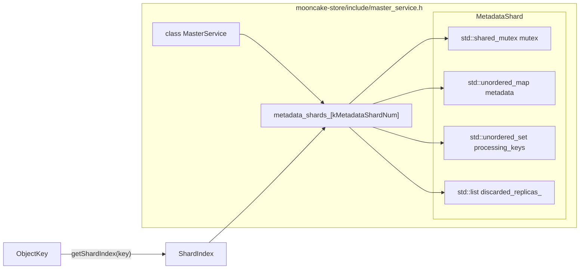
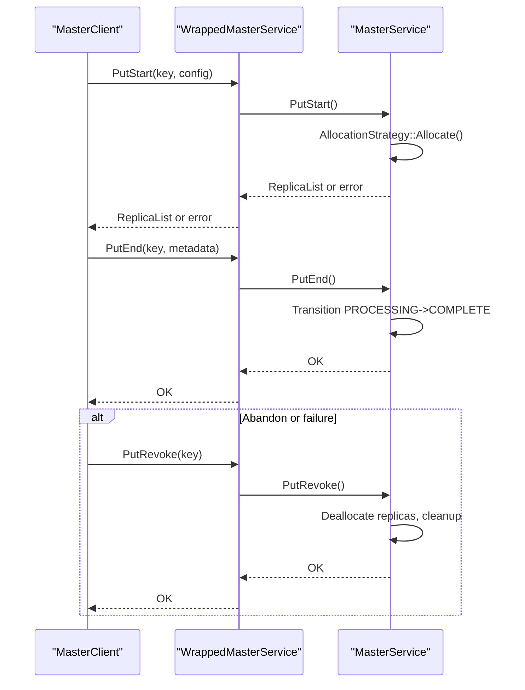
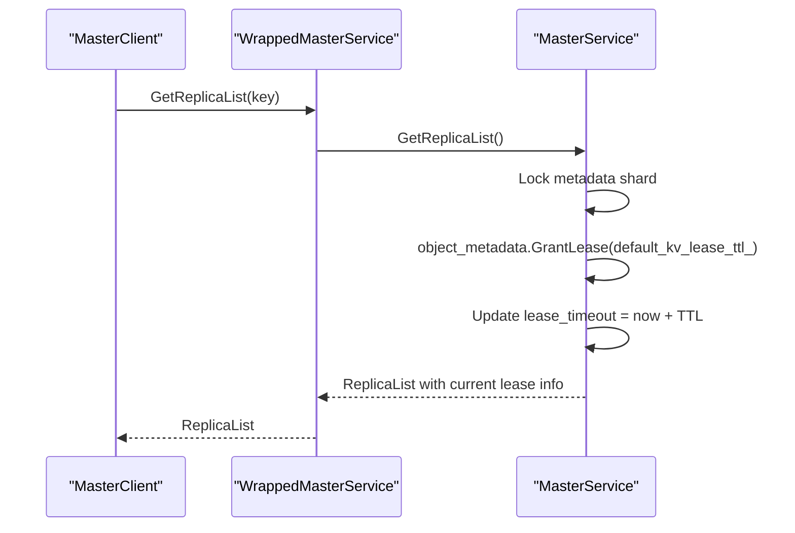
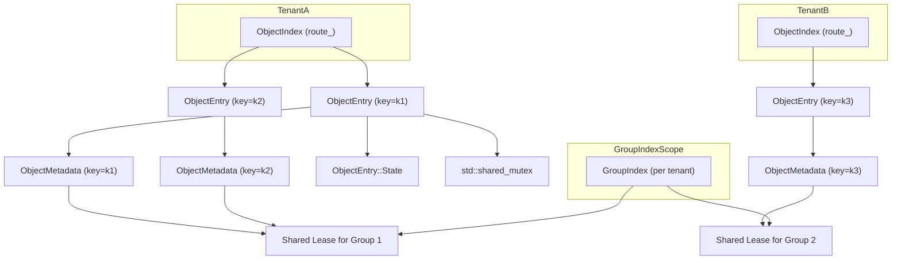

<!-- source: DeepWiki mcp.deepwiki.com · repo kvcache-ai/Mooncake · page 5.4 Object Lifecycle and State Management · fetched 2026-11-11 -->

# Object Lifecycle and State Management

<details>
<summary>Relevant source files</summary>

The following files were used as context for generating this wiki page:

- [mooncake-store/benchmarks/CMakeLists.txt](mooncake-store/benchmarks/CMakeLists.txt)
- [mooncake-store/benchmarks/group_index_contention_bench.cpp](mooncake-store/benchmarks/group_index_contention_bench.cpp)
- [mooncake-store/include/dynamic_replication_lease_table.h](mooncake-store/include/dynamic_replication_lease_table.h)
- [mooncake-store/include/group_index.h](mooncake-store/include/group_index.h)
- [mooncake-store/include/master_client.h](mooncake-store/include/master_client.h)
- [mooncake-store/include/master_metric_manager.h](mooncake-store/include/master_metric_manager.h)
- [mooncake-store/include/master_service.h](mooncake-store/include/master_service.h)
- [mooncake-store/include/metadata/tenant.h](mooncake-store/include/metadata/tenant.h)
- [mooncake-store/include/metadata/tenant_registry.h](mooncake-store/include/metadata/tenant_registry.h)
- [mooncake-store/include/object_entry.h](mooncake-store/include/object_entry.h)
- [mooncake-store/include/object_index.h](mooncake-store/include/object_index.h)
- [mooncake-store/include/rpc_service.h](mooncake-store/include/rpc_service.h)
- [mooncake-store/src/master_client.cpp](mooncake-store/src/master_client.cpp)
- [mooncake-store/src/master_metric_manager.cpp](mooncake-store/src/master_metric_manager.cpp)
- [mooncake-store/src/master_service.cpp](mooncake-store/src/master_service.cpp)
- [mooncake-store/src/rpc_service.cpp](mooncake-store/src/rpc_service.cpp)
- [mooncake-store/tests/dynamic_replication_lease_table_test.cpp](mooncake-store/tests/dynamic_replication_lease_table_test.cpp)
- [mooncake-store/tests/group_index_test.cpp](mooncake-store/tests/group_index_test.cpp)
- [mooncake-store/tests/master_metrics_test.cpp](mooncake-store/tests/master_metrics_test.cpp)
- [mooncake-store/tests/master_service_test.cpp](mooncake-store/tests/master_service_test.cpp)
- [mooncake-store/tests/object_entry_test.cpp](mooncake-store/tests/object_entry_test.cpp)
- [mooncake-store/tests/object_index_test.cpp](mooncake-store/tests/object_index_test.cpp)

</details>


## Purpose and Scope

This page explains the detailed object lifecycle and state management implemented in the Mooncake Store, focusing on the object state machine, lease and soft pin handling, core data structures (`ObjectMetadata`, `ObjectEntry`, `ObjectIndex`), and the lifecycle operations (`PutStart`, `PutEnd`, `PutRevoke`). It also covers metadata sharding, background cleanup of stale objects, and concurrency control via locking strategies.

The content serves engineers working on the Mooncake storage master service and those requiring deep understanding of how Mooncake ensures consistent, scalable, and fault tolerant KVCache object management.

For broader context including architecture, client APIs, and eviction mechanisms, see pages 5.2, 5.3, and 5.5.

Sources: [mooncake-store/include/master_service.h](), [mooncake-store/src/master_service.cpp]().

---

## Object Lifecycle Overview

Mooncake Store manages cached objects through a defined state machine ensuring consistency and memory resource controls.

### Object State Machine and Code Entity Correspondence

```mermaid
stateDiagram-v2
    [*] --> ALLOCATING: "PutStart() (MasterClient / WrappedMasterService)"
    ALLOCATING --> PROCESSING: "AllocationStrategy::Allocate()"
    PROCESSING --> COMPLETE: "PutEnd() (MasterService::PutEnd())"
    PROCESSING --> FAILED: "PutRevoke() OR timeout"
    COMPLETE --> SoftPinned: "Soft pin active (via ReplicateConfig soft_pin, TTL active)"
    SoftPinned --> COMPLETE: "Soft pin expired"
    COMPLETE --> EVICTED: "Lease expired + Eviction triggered"
    SoftPinned --> EVICTED: "Timeout expired OR allow_evict_soft_pinned=true"
    FAILED --> [*]: "Replicas deallocated"
    EVICTED --> [*]: "BufferAllocator reclaims memory"

    note right of PROCESSING
        Replicas: INITIALIZED / PROCESSING status
        (from replica.h:57-64)
    end note

    note right of COMPLETE
        Replica status COMPLETE; readable via GetReplicaList
        (from replica.h:61)
    end note
```

This lifecycle is driven by RPC calls and background sweeps that manage leases and reclaim resources, maintaining consistent object metadata and runtime state.

Sources: [mooncake-store/include/replica.h:57-64](), [mooncake-store/include/master_service.h:420-650](), [mooncake-store/src/master_service.cpp:685-780](), [mooncake-store/include/rpc_service.h:78-91]().

---

## ObjectMetadata and Metadata Sharding

The authoritative canonical object state is held in `ObjectMetadata` structs distributed over multiple shards within the `MasterService` for concurrency scalability.

### Metadata Sharding and Shard Composition



Objects are assigned to shards via a hashing function to distribute load and reduce lock contention.

### Key `ObjectMetadata` Fields

| Field | Type | Purpose |
|-------|-------|---------|
| `client_id` | `const UUID` | Identifier of client owning/allocating the object |
| `put_start_time` | `std::chrono::steady_clock::time_point` | Time when object allocation started or processing began; for stall detection |
| `size` | `size_t` | Object's byte size |
| `lease_timeout` | `std::chrono::steady_clock::time_point` | Lease expiration time indicating eviction eligibility |
| `soft_pin_timeout` | `std::optional<std::chrono::steady_clock::time_point>` | Optional expiry for soft pin protection |
| `replicas_` | `std::vector<Replica>` | List of physical storage replica descriptors (memory, NoF, SSD) |
| `lock` | `SpinLock` | Protects concurrent updates of lease, pin, and related metadata |

Other internal fields exist but above are essential for lifecycle and access management.

Sources: [mooncake-store/include/master_service.h:660-708](), [mooncake-store/src/master_service.cpp:199-215]().

---

## Put / End / Revoke Lifecycle Operations

### 1. PutStart(): Beginning Object Allocation

- **Entry point:**
  - Client calls `MasterClient::PutStart()`
  - Delegates to `WrappedMasterService::PutStart()`
  - Further delegates to `MasterService::PutStart()` handler

- **Allocation:**
  - Calls under shard lock within `MasterService`
  - Checks for existing keys to avoid duplicates
  - Cleans stale "processing" keys to avoid head-of-line blocking
  - Invokes `AllocationStrategy::Allocate()` to reserve replicas for storage

- **Replica Count Validation:**
  - Uses `HasExpectedReplicaAllocation()` to validate allocations against `ReplicateConfig`
  - Policies vary for memory-only, FLEXIBLE_DUAL_REPLICA, or strict replica counts

- **Metrics:**
  - PutStart request stats incremented in `MasterMetricManager`
  - Object size distribution recorded for monitoring

- **Outcome:**
  - On success, transitions object state to ALLOCATING
  - On failure, returns detailed error codes (e.g., `OBJECT_ALREADY_EXISTS`, `NO_AVAILABLE_HANDLE`)

### 2. PutEnd(): Completing Object Storage

- Transitions replicas from PROCESSING to COMPLETE state
- Sets lease expiry with default TTL (`default_kv_lease_ttl_`)
- Updates metadata to reflect successful object registration
- Supports batch variants via `WrappedMasterService::BatchPutEnd()` for performance

### 3. PutRevoke(): Cancelling Object Allocation

- Handles client aborts or timeouts during allocation or processing
- Frees allocated replicas, removes keys from "processing" sets
- Cleans up metadata to prevent resource leakage and dangling state

### Put Lifecycle Sequence



Sources: [mooncake-store/include/rpc_service.h:92-107](), [mooncake-store/src/master_service.cpp:591-788](), [mooncake-store/src/master_client.cpp:66-93]().

---

## Lease and Soft Pin Management

### Lease Types and Purpose

| Lease Type | Description | Configuration Constants & Notes |
|------------|-------------|--------------------------------|
| **Hard Lease** | Ensures hot data protection by extending lease on each access (e.g., GetReplicaList, ExistKey) | Default TTL from `DEFAULT_DEFAULT_KV_LEASE_TTL` (~100s) in `types.h` |
| **Soft Pin** | Provides brief eviction resistance beyond hard lease, used for newly written or pinned objects | Enabled via `ReplicateConfig.soft_pin` with a TTL capped by `DEFAULT_MAX_KV_SOFT_PIN_TTL_MS` |

The soft pin mechanism protects objects short-term even when lease TTL expires, configurable to allow eviction if needed.

### Lease Extension on Access



### Dynamic Replication Lease Table

Handles coordination of leases for replica proposals and replicas in-flight:

- `Put(proposal_id, lease)` - Adds or refreshes lease for a pending replica proposal
- `Remove(proposal_id)` - Removes lease once replica is no longer active
- `EraseForObject(user_key)` - Cleans all leases related to a given object key (used during revoke or cleanup)
- `EraseExpired(now)` - Periodic pruning of expired leases

This leasing system helps manage memory lifetime and eviction of replicas in a distributed, asynchronous environment.

Sources: [mooncake-store/include/master_service.h](), [mooncake-store/src/master_service.cpp]().

---

## Object Index and Entry Structures

### ObjectIndex

- Constructed as an in-memory routing table:
  - Maps user keys (strings) to `std::shared_ptr<ObjectEntry>`
- Thread-safe through a `std::shared_mutex`
- Supports:
  - `Insert(entry)` — Inserts new `ObjectEntry` if key absent, marking it published (atomic flag)
  - `EraseIf(key, expected_entry)` — Removes entry only if it matches expected, avoiding stale deletions
  - `Get(key)` — Retrieves current live entry
  - `SnapshotObjects()` — Enumerates all published entries (for background processing or stats)

This guarantees consistent publication and access to object states during concurrent operations.

Sources: [mooncake-store/include/object_index.h](), [mooncake-store/tests/object_index_test.cpp]().

### ObjectEntry

- Wraps:
  - `ObjectMetadata` holding the persistent identity and attributes
  - A `State` struct with runtime flags such as `is_processing`, `is_torn_down` and optional background tasks (replication, offloading, promotion)
  - A `std::shared_mutex` enabling safe exclusive or shared access to metadata and state

- Publishing:
  - One-time published flag (atomic) asserts uniqueness of the publication for the live route

- Access Control:
  - Uses template methods `WithExclusiveAccess` and `WithSharedAccess` to provide callback-based locked access ensuring consistency across metadata and state during operations

This design tightly couples persistent metadata with live runtime flags needed for replica task coordination.

Sources: [mooncake-store/include/object_entry.h:25-95](), [mooncake-store/tests/object_entry_test.cpp]().

### GroupIndex

- Manages groups of keys that share lease semantics for efficient eviction coordination
- Uses striping locks to reduce contention during concurrent metadata operations on grouped objects

Sources: [mooncake-store/include/group_index.h](), [mooncake-store/tests/group_index_test.cpp](), [mooncake-store/benchmarks/group_index_contention_bench.cpp]().

### Object Index, Entry, and Lease Sharing Relationships



This architecture allows isolated tenant metadata and runtime state management, while enabling group-based lease sharing to coordinate eviction efficiently.

Sources: [mooncake-store/include/master_service.h](), [mooncake-store/src/master_service.cpp](), [mooncake-store/tests/object_index_test.cpp]().

---

## Background Cleanup and Eviction

### Stale Put Handling (Discard & Release)

- **Phase 1: Discard**
  - Objects stuck in PROCESSING beyond discard timeout (default 30 seconds) are marked discarded.
  - Prevents stalled allocations from blocking progress.

- **Phase 2: Release**
  - Discarded objects held for more than release timeout (default 10 minutes) have replicas freed and metadata cleaned.
  - Prevents resource leakage from crashed or slow clients.

### Eviction Background Thread

- Monitors memory usage against configured high watermarks
- Scans across shards for objects whose leases have expired
- Evicts such objects to reclaim buffer resources
- Updates metrics accordingly

This mechanism enforces resource pressure handling and cache state freshness continuously.

Sources: [mooncake-store/src/master_service.cpp:159-198](), [mooncake-store/include/master_service.h:597-619](), [mooncake-store/include/types.h:84-94]().

---

## Concurrency and Locking Strategy

To avoid deadlocks, `MasterService` maintains a strict lock ordering discipline:

1. `client_mutex_` — Protects client state and registration
2. `tenant_quota_policy_mutex_` — Guards quota policy data
3. `snapshot_mutex_` — Serializes snapshot (metadata persistence) operations
4. `metadata_shards_[shard_index].mutex` — Controls per-shard metadata including object states
5. `tenant_quota_recompute_mutex_` — Serializes quota recomputations across tenants
6. `segment_mutex_` — Guards segment-related shared state
7. `soft_pin_deadline_index_ mutex` — To protect soft pin expiration indices

Adhering to this order ensures safe concurrency in RPC handling and background maintenance.

Sources: [mooncake-store/include/master_service.h:110-149]().

---

# Summary

Mooncake Store implements a robust object lifecycle system governed by a state machine transitioning objects from allocation initiation (`PutStart`), through processing to completion (`PutEnd`), or revocation (`PutRevoke`). Strong lease and soft pin management ensure active objects are protected from eviction, while stale allocations are detected and cleaned up.

Metadata is sharded and encapsulated in `ObjectMetadata` for concurrency, while runtime states live in `ObjectEntry` structures wrapped within a thread-safe `ObjectIndex`. A dynamic replication lease table further manages ephemeral replica lifetimes.

Concurrency is carefully controlled with a well-defined lock order to prevent deadlocks across the distributed metadata and background cleanup components.

Together, these mechanisms provide a consistent, scalable, and performant KVCache object state management system essential for Mooncake's LLM-serving cache infrastructure.

---

# References

- `mooncake-store/include/master_service.h`
- `mooncake-store/src/master_service.cpp`
- `mooncake-store/include/replica.h`
- `mooncake-store/include/rpc_service.h`
- `mooncake-store/src/master_client.cpp`
- `mooncake-store/include/object_entry.h`
- `mooncake-store/include/object_index.h`
- `mooncake-store/src/master_metric_manager.cpp`

---

