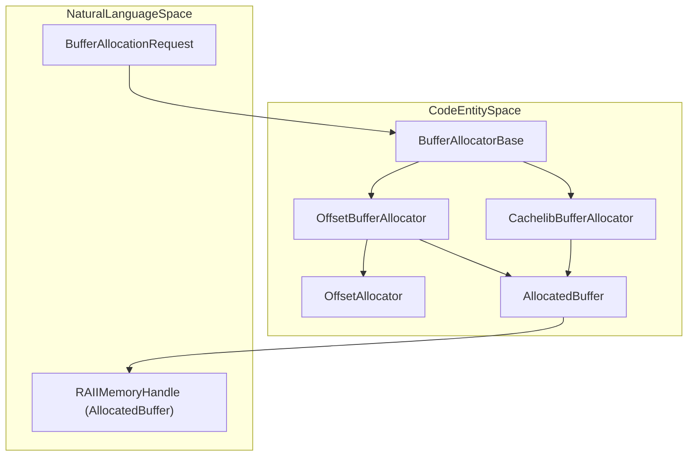
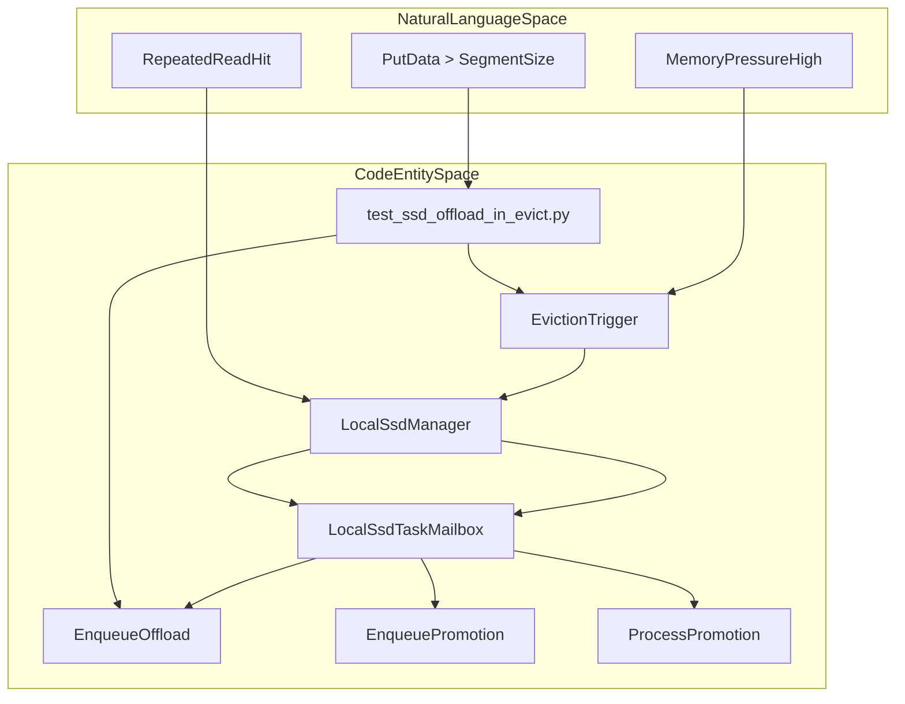

<!-- source: DeepWiki mcp.deepwiki.com · repo kvcache-ai/Mooncake · page 5.5 Memory Management and Eviction · fetched 2026-11-11 -->

# Memory Management and Eviction

<details>
<summary>Relevant source files</summary>

The following files were used as context for generating this wiki page:

- [docs/source/design/architecture.md](docs/source/design/architecture.md)
- [mooncake-store/benchmarks/offset_allocator_concurrency_bench.cpp](mooncake-store/benchmarks/offset_allocator_concurrency_bench.cpp)
- [mooncake-store/include/common/client_buffer_allocation.h](mooncake-store/include/common/client_buffer_allocation.h)
- [mooncake-store/include/crc32c.h](mooncake-store/include/crc32c.h)
- [mooncake-store/include/offset_allocator/offset_allocator.h](mooncake-store/include/offset_allocator/offset_allocator.h)
- [mooncake-store/src/common/client_buffer_allocation.cpp](mooncake-store/src/common/client_buffer_allocation.cpp)
- [mooncake-store/src/common/mmap_buffer.cpp](mooncake-store/src/common/mmap_buffer.cpp)
- [mooncake-store/src/config/hugepage_config.cpp](mooncake-store/src/config/hugepage_config.cpp)
- [mooncake-store/src/config/hugepage_config.h](mooncake-store/src/config/hugepage_config.h)
- [mooncake-store/src/config/mmap_arena_config.cpp](mooncake-store/src/config/mmap_arena_config.cpp)
- [mooncake-store/src/offset_allocator.cpp](mooncake-store/src/offset_allocator.cpp)
- [mooncake-store/tests/hugepage_size_env_test.cpp](mooncake-store/tests/hugepage_size_env_test.cpp)
- [mooncake-store/tests/mmap_arena_fallback_test.cpp](mooncake-store/tests/mmap_arena_fallback_test.cpp)
- [mooncake-store/tests/offset_allocator_test.cpp](mooncake-store/tests/offset_allocator_test.cpp)
- [mooncake-store/tests/promotion_on_hit_test.cpp](mooncake-store/tests/promotion_on_hit_test.cpp)
- [mooncake-store/tests/stress_cluster_benchmark.py](mooncake-store/tests/stress_cluster_benchmark.py)
- [mooncake-wheel/tests/test_ssd_offload_in_evict.py](mooncake-wheel/tests/test_ssd_offload_in_evict.py)

</details>


This page presents a detailed technical overview of the memory management and eviction subsystems of Mooncake Store. It covers the design and implementation of buffer allocators, allocation strategies, eviction policies, watermarks, and SSD offloading along with the eviction thread's coordination role. Key data flows and code module interactions are illustrated with diagrams for clarity.

---

## 1. Buffer Allocators

Mooncake abstracts memory allocation and management behind a polymorphic interface `BufferAllocatorBase` to accommodate different storage tiers and allocator implementations [mooncake-store/include/allocator.h:179-203](). This interface enables uniform handling of memory regardless of the underlying segment type (DRAM, SSD, CXL, VRAM).

### Key Classes and Architecture

- **`BufferAllocatorBase`**: Abstract base class defining allocator operations:
  - `allocate(size)`: Allocate a contiguous memory buffer of at least `size`.
  - `deallocate(handle)`: Release a previously allocated buffer.
  - `capacity()`, `size()`: Report total and used capacity.
  - `base()`: Base memory address.
  - `getLargestFreeRegion()`: Hint for largest allocatable contiguous free region.

- **`AllocatedBuffer`**: RAII wrapper representing an allocated buffer, holding a reference to the allocator and the memory region. Automatically frees on destruction. Also supports serialization of metadata via `get_descriptor()` for transfer or storage [mooncake-store/include/allocator.h:70-173]().

- **`CachelibBufferAllocator`**: An allocator implementation using Facebook's CacheLib slab allocator. Provides high performance by allocating fixed-size slabs and minimizing fragmentation, ideal for DRAM segment management [mooncake-store/src/allocator.cpp:138-152]().

- **`OffsetBufferAllocator`**: Uses the `OffsetAllocator` algorithm for precise offset-based allocations, efficiently managing heterogeneous sizes and enabling dynamic capacity adjustments [mooncake-store/src/allocator.cpp:169-175]().

- **`OffsetAllocator`**: Implements a sophisticated allocator with 240 bins, indexed by a custom floating point rounding scheme (`SmallFloat`). It separates free memory into bins by size class and uses a freelist of nodes to manage allocations and deallocations dynamically [mooncake-store/include/offset_allocator/offset_allocator.h:17-62](), [mooncake-store/src/offset_allocator.cpp:56-121]().


**Diagram: Buffer Allocator Hierarchy and Handle Generation**

Sources:
- [mooncake-store/include/allocator.h:70-203]()
- [mooncake-store/src/allocator.cpp:138-175]()
- [mooncake-store/include/offset_allocator/offset_allocator.h:17-62]()
- [mooncake-store/src/offset_allocator.cpp:56-121]()
- [mooncake-store/src/offset_allocator.cpp:178-184]()
- [mooncake-store/include/offset_allocator/offset_allocator.h:131-139]()

---

### Client Buffer Memory Allocation

The function `allocate_buffer_allocator_memory` centrally manages memory allocation for client buffers. It dispatches allocation requests based on the specified protocol and hardware environment [mooncake-store/src/common/client_buffer_allocation.cpp:95-137]().

Key dispatch logic:

- **Ascend / UBSHMEM**: Calls `ascend_allocate_memory` for Ascend-specific memory regions.
- **Sunrise Link**: `sunrise_allocate_memory` invoked for Sunrise transport.
- **UB**: Calls `ub_allocate_memory` allocator.
- **SPDK DMA**: Uses `SpdkWrapper::GetInstance().Alloc` for DMA memory backed by SPDK.
- **VRAM Segment**: Allocates GPU VRAM memory, either via `cudaMalloc` or intra-NVLink mechanisms `allocateFabricMemory_intra`.
- **Fallback**: Uses standard aligned allocation (`aligned_alloc`) for general purposes.

The complementary `free_memory` function guarantees symmetrical deallocation corresponding to the allocation type [mooncake-store/src/common/client_buffer_allocation.cpp:139-173]().

```mermaid
graph TD
    A[allocate_buffer_allocator_memory] --> B{Protocol/DMA Type?};
    B -- "ascend" / "ubshmem" --> C[ascend_allocate_memory];
    B -- "sunrise_link" --> D[sunrise_allocate_memory];
    B -- "ub" --> E[ub_allocate_memory];
    B -- "use_spdk_dma" --> F[SpdkWrapper::GetInstance().Alloc];
    B -- "vram_segment" --> G[allocate_vram_memory];
    B -- "Default" --> H[aligned_alloc];
```
**Diagram: `allocate_buffer_allocator_memory` Dispatch Logic**

Sources:
- [mooncake-store/src/common/client_buffer_allocation.cpp:29-55]()
- [mooncake-store/src/common/client_buffer_allocation.cpp:95-137]()
- [mooncake-store/src/common/client_buffer_allocation.cpp:139-173]()

---

### Hugepage and MMAP Arena Allocations

To optimize memory management performance and reduce page faults, Mooncake supports hugepage allocation and a lock-free arena allocator for mmap buffers.

- **HugepageConfig** parses environment variables `MC_STORE_USE_HUGEPAGE` and `MC_STORE_HUGEPAGE_SIZE` to determine the hugepage usage and page size (2MB, 512MB, or 1GB) [mooncake-store/src/common/client_buffer_allocation.cpp:61-92]().

- **`MmapArena`**: A lock-free mmap arena allocator that pools and manages large memory chunks efficiently. Initialization occurs once per process, controlled by flags like `MC_DISABLE_MMAP_ARENA` and `MC_MMAP_ARENA_POOL_SIZE` [mooncake-store/src/common/mmap_buffer.cpp:30-67](), [mooncake-store/src/config/mmap_arena_config.cpp:20-28]().

- **Fallback Behavior**: If hugepages are explicitly requested but unavailable, allocation fails rather than silently falling back, ensuring predictable memory behavior. Otherwise, fallback to traditional mmap occurs [mooncake-store/src/common/mmap_buffer.cpp:56-66](), tested comprehensively in mmap arena fallback unit tests [mooncake-store/tests/mmap_arena_fallback_test.cpp:128-178]().

- **NUMA Support**: The allocator supports NUMA-aware hugepage allocation, distributing memory initialization across NUMA nodes to improve locality [mooncake-store/src/common/mmap_buffer.cpp:128-173](), validated in fallback tests [mooncake-store/tests/mmap_arena_fallback_test.cpp:92-126]().

Sources:
- [mooncake-store/src/config/hugepage_config.h]()
- [mooncake-store/src/common/client_buffer_allocation.cpp:61-92]()
- [mooncake-store/tests/hugepage_size_env_test.cpp:56-65]()
- [mooncake-store/src/common/mmap_buffer.cpp:30-67]()
- [mooncake-store/src/config/mmap_arena_config.cpp:20-28]()
- [mooncake-store/src/common/mmap_buffer.cpp:56-66]()
- [mooncake-store/tests/mmap_arena_fallback_test.cpp:128-144]()
- [mooncake-store/tests/mmap_arena_fallback_test.cpp:160-178]()
- [mooncake-store/src/common/mmap_buffer.cpp:128-173]()
- [mooncake-store/tests/mmap_arena_fallback_test.cpp:92-126]()

---

## 2. Allocation Strategies and Allocator Manager

Mooncake employs allocation strategies to decide how memory slices for KVCache objects are distributed across segments and their attached allocators.

### Main Components

- **`AllocatorManager`**: Manages multiple allocators associated with each segment name, supporting addition, replacement, and removal of allocator instances in a thread-safe manner. Provides facilities to query suitable allocators by segment hints [mooncake-store/include/allocation_strategy.h:33-132]().

- **`AllocationStrategy`**: Encapsulates policies that govern allocator selection and replica allocation. Strategies operate with hints like `preferred_segments` and `excluded_segments`, attempting to fulfill replica counts best-effort across suitable allocators [mooncake-store/include/allocation_strategy.h:33-143]().

- **Replica Allocation**: The strategies try to satisfy the requested replica count but fall back gracefully when memory is constrained, promising partial allocations and spreading replicas opportunistically.

- **Fragmentation Measurement**: Fragmentation is calculated as `1 - (largest_free_region / total_free_space)`, providing an insight into allocator efficiency and memory utilization quality under mixed-size workloads.

Sources:
- [mooncake-store/include/allocation_strategy.h:33-132]()
- [mooncake-store/include/allocation_strategy.h:33-143]()
- [mooncake-store/tests/allocation_strategy_test.cpp:115-124]()

---

## 3. Eviction Policies, Watermarks, and SSD Offload

Mooncake handles memory pressure using eviction mechanisms that trigger based on configurable watermarks, integrating with local SSD tiers for offloading evicted data and promoting frequently accessed objects.

### Eviction Workflow

- Eviction is triggered when allocator usage exceeds the configured *high watermark ratio*.
- Objects may be protected temporarily by *soft pins* during active PUT/GET operations; such protection expires after TTL.
- The system marks eviction candidates, frees buffer space, and offloads data to local SSD for eviction-to-disk scenarios.

### SSD Offload and Promotion

- **`LocalSsdManager`**: Manages local SSD offload storage, monitoring capacity and managing offload/promote queues asynchronously [mooncake-store/include/local_ssd/manager.h:20-58]().
- **`LocalSsdTaskMailbox`**: Implements per-client task queues facilitating asynchronous eviction offload and promotion back to memory upon repeat read hits [mooncake-store/src/local_ssd/manager.cpp:13-88]().

### Test Case Validation

- The Python test `test_ssd_offload_in_evict.py` sets up scenarios where the PUT data volume exceeds segment size, triggering eviction to local SSD. The test verifies that objects can still be retrieved after eviction by promoting from SSD back to memory, demonstrating the end-to-end offload/promotion functionality [mooncake-wheel/tests/test_ssd_offload_in_evict.py:24-44]().


**Diagram: Memory Pressure and SSD Offload/Promotion Workflow**

Sources:
- [mooncake-store/include/local_ssd/manager.h:20-58]()
- [mooncake-store/src/local_ssd/manager.cpp:13-88]()
- [mooncake-wheel/tests/test_ssd_offload_in_evict.py:24-44]()

---

## 4. Segment Management and Lifecycle

Segments represent logical allocated memory regions or backing stores that host KVCache slices. They are central points for allocator binding and memory lifecycle.

### Segment Manager

- **`SegmentManager`**: Coordinates mounting, unmounting, and global metadata about memory segments. Keeps mappings from segment IDs/names to their allocators, tracks usage, and offers interfaces to query and update segment states [mooncake-store/include/segment.h:28-197](), [mooncake-store/src/segment.cpp:125-140]().

### Scoped Access to Protect State

- **`ScopedSegmentAccess`**: Provides RAII-safe scoped read or write access to segment data and their allocator pointers. It prevents races with concurrent mount/unmount or eviction operations ensuring safe allocator updates.

### Usage Tracking

- Segment memory usage snapshots aggregate capacity and allocated size from all active allocators on that segment.
- Functions like `AttachMountedUsageTrackers` hook global usage tracking metrics with all mounted segment allocators for continuous observability.

Sources:
- [mooncake-store/include/segment.h:28-197]()
- [mooncake-store/src/segment.cpp:125-140]()

---

## 5. Eviction Thread Function

Mooncake runs a dedicated eviction thread that monitors overall memory usage, initiates eviction according to policy and watermarks, and schedules asynchronous offload or reclamation.

### Eviction Thread Responsibilities

- Periodically checks memory usage and compares against configurable watermarks.
- Scans allocators within segments for eviction candidates, respecting soft pins and liveness.
- Triggers eviction actions:
  - Reclaim memory by freeing unused or safely evictable buffers.
  - Offload evicted data asynchronously to SSD tiers through `LocalSsdManager`.
- Coordinates with allocation strategies to balance allocations and reclamations for smooth memory pressure handling.

The eviction thread runs in the Mooncake Store master service context and is critical for maintaining memory pressure without impacting ongoing client requests.

---

## 6. Metrics and Monitoring

Memory allocation and eviction metrics are gathered and exposed via the `MasterMetricManager` and usage tracking APIs. These provide dashboards and alerts for cluster-wide memory usage and eviction status.

---

# Summary Table of Key Components

| Component                      | Description                                        | Primary Files / Lines                        |
|-------------------------------|--------------------------------------------------|---------------------------------------------|
| `BufferAllocatorBase`          | Abstract buffer allocator interface               | `allocator.h:179-203`                        |
| `CachelibBufferAllocator`      | CacheLib slab allocator wrapper                   | `allocator.cpp:138-152`                      |
| `OffsetBufferAllocator`        | Offset-based custom allocator                      | `allocator.cpp:169-175`                      |
| `OffsetAllocator`              | Floating-point bin allocator with dynamic capacity| `offset_allocator.h:17-62`, `offset_allocator.cpp:56-121` |
| `AllocatedBuffer`              | RAII buffer handle                                | `allocator.h:70-173`                         |
| `AllocatorManager`             | Manages allocator registrations per segment       | `allocation_strategy.h:33-132`               |
| `AllocationStrategy`           | Allocation policy encapsulation                    | `allocation_strategy.h`                      |
| `SegmentManager`               | Segment lifecycle and usage management             | `segment.h:28-197`, `segment.cpp:125-140`   |
| `LocalSsdManager`              | SSD offload and promotion task management          | `local_ssd/manager.h:20-58`, `manager.cpp` (partial) |
| Eviction Thread                | Background eviction orchestrator                    | Mooncake Store master service (internal)    |
| `allocate_buffer_allocator_memory` | Memory allocation dispatcher                     | `client_buffer_allocation.cpp:95-137`       |
| `MmapArena`                    | Lock-free mmap arena allocator                     | `mmap_buffer.cpp:30-67`                      |
| `HugepageConfig`               | Hugepage enabled and page size environment config  | `hugepage_config.h`                          |

---

## References

- Buffer Allocator abstractions and implementations:  
  [mooncake-store/include/allocator.h:70-203](),  
  [mooncake-store/src/allocator.cpp:138-179](),  
  [mooncake-store/include/offset_allocator/offset_allocator.h:17-62](),  
  [mooncake-store/src/offset_allocator.cpp:56-121]()  
- Allocation Strategy and Manager:  
  [mooncake-store/include/allocation_strategy.h:33-143](),  
  [mooncake-store/tests/allocation_strategy_test.cpp:115-124]()  
- Segment Management and Usage:  
  [mooncake-store/include/segment.h:28-197](),  
  [mooncake-store/src/segment.cpp:125-140]()  
- Local SSD offload and promotion:  
  [mooncake-store/include/local_ssd/manager.h:20-58](),  
  [mooncake-store/src/local_ssd/manager.cpp:13-88]()  
- Client Buffer Allocation:  
  [mooncake-store/src/common/client_buffer_allocation.cpp:95-137]()  
- MMAP Arena and Hugepage Configuration:  
  [mooncake-store/src/common/mmap_buffer.cpp:30-67](),  
  [mooncake-store/src/config/hugepage_config.h]()  
- SSD Offload Functional Test:  
  [mooncake-wheel/tests/test_ssd_offload_in_evict.py:24-44]()  

This completes the in-depth technical documentation of Mooncake Store's memory management and eviction subsystem.

---

